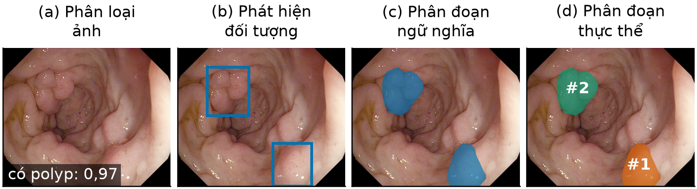

# CHƯƠNG 2. CƠ SỞ LÝ THUYẾT

> **Ghi chú soạn thảo (xóa khi nộp):**
> - Số tài liệu tham khảo đã đánh lại theo thứ tự trích dẫn lần đầu (IEEE) ngày 28/10/2026; danh mục ở `08_TAI_LIEU_THAM_KHAO.md`, bảng số cũ → mới ở `_KIEM_TRA/F_bang_doi_so_tai_lieu.csv`.
> - Mọi ví dụ số trong chương là **ví dụ minh họa tự đặt**, không phải số liệu thực nghiệm. Các ví dụ đã được tính lại bằng Python.

Chương này trình bày các kiến thức nền mà Chương 3 (mô hình đề xuất) và Chương 6 (đánh giá) sử dụng. Nội dung đi theo thứ tự:
1. các bài toán thị giác máy tính: phân loại, phát hiện, phân đoạn;
2. mạng nơ-ron tích chập;
3. họ mô hình YOLO và cách YOLO tạo mặt nạ;
4. YOLO26-seg: kiến trúc, các bước của thuật toán, ưu và nhược điểm;
5. cơ chế chú ý và chi phí của nó;
6. mô hình không gian trạng thái, Mamba và VMamba: nguyên lý, các bước, ưu và nhược điểm;
7. các độ đo đánh giá;
8. phương pháp so sánh hai mô hình qua nhiều lần huấn luyện.

## 2.1. Các bài toán thị giác máy tính

Ba bài toán cơ bản khác nhau ở **mức chi tiết của đầu ra**:

*Bảng 2.1. So sánh ba bài toán thị giác cơ bản*

| Bài toán | Câu hỏi trả lời | Đầu ra | Ví dụ với ảnh nội soi |
|---|---|---|---|
| Phân loại ảnh | Ảnh có gì? | Một nhãn (hoặc xác suất) cho cả ảnh | "Ảnh có polyp" với xác suất 0,97 |
| Phát hiện đối tượng | Đối tượng ở đâu? | Danh sách hộp bao, mỗi hộp có lớp và độ tin cậy | Hộp (x₁, y₁, x₂, y₂) quanh polyp, độ tin cậy 0,91 |
| Phân đoạn ảnh | Điểm ảnh nào thuộc đối tượng? | Mặt nạ cùng kích thước ảnh | Các điểm ảnh thuộc polyp mang giá trị 1 |

Phân đoạn ảnh lại chia thành hai dạng:
- **Phân đoạn ngữ nghĩa** gán mỗi điểm ảnh vào một lớp, không phân biệt các đối tượng cùng lớp. Nếu ảnh có hai polyp, đầu ra chỉ là một mặt nạ chung. U-Net [10] và PraNet [9] thuộc dạng này.
- **Phân đoạn thực thể** tách riêng từng đối tượng: mỗi polyp có hộp bao, độ tin cậy và mặt nạ riêng. YOLO26-seg thuộc dạng này.

**Ví dụ minh họa.** Hình 2.1 đặt bốn kiểu đầu ra cạnh nhau cho cùng một ảnh Kvasir-SEG.

*Hình 2.1. Bốn kiểu đầu ra trên cùng một ảnh tập kiểm định có hai polyp: (a) phân loại ảnh, (b) phát hiện đối tượng bằng hộp bao, (c) phân đoạn ngữ nghĩa (hai polyp chung một mặt nạ), (d) phân đoạn thực thể (mỗi polyp một mặt nạ riêng). Hộp bao và mặt nạ vẽ từ nhãn đa giác của ảnh; xác suất ở ô (a) là số minh họa, không phải đầu ra mô hình.*

*Nguồn: ảnh từ Kvasir-SEG [5]; hình do nhóm vẽ.*

Ba bài toán xếp theo độ chi tiết tăng dần, đồng thời chi phí gán nhãn cũng tăng dần: nhãn phân loại chỉ cần một từ, nhãn hộp cần bốn tọa độ, còn nhãn mặt nạ cần vẽ đường biên từng điểm. Đề tài chọn phân đoạn thực thể vì đầu ra vừa có mặt nạ để quan sát đường biên, vừa có hộp bao và độ tin cậy để hiển thị trong ứng dụng.

## 2.2. Mạng nơ-ron tích chập

### 2.2.1. Phép tích chập

Mạng nơ-ron tích chập (CNN) là nền của hầu hết mô hình thị giác. Phép tích chập trượt một bộ lọc nhỏ trên ảnh. Tại mỗi vị trí, giá trị đầu ra là tổng các tích giữa bộ lọc và vùng ảnh bên dưới:

$$ y(i,j) = \sum_{u}\sum_{v} w(u,v)\, x(i+u,\ j+v) + b \tag{2.1} $$

**Ví dụ.** Vùng ảnh 3×3 và bộ lọc phát hiện biên dọc:

$$ x = \begin{bmatrix} 10 & 10 & 80 \\ 10 & 10 & 80 \\ 10 & 10 & 80 \end{bmatrix}, \qquad w = \begin{bmatrix} -1 & 0 & 1 \\ -1 & 0 & 1 \\ -1 & 0 & 1 \end{bmatrix} $$

Đầu ra tại tâm là $3\times(-10 + 80) = 210$. (Nói chặt chẽ, công thức (2.1) là phép tương quan chéo; các thư viện học sâu vẫn gọi là tích chập.) Giá trị lớn này báo hiệu có biên dọc, chỗ độ sáng đổi đột ngột từ 10 sang 80. Ở vùng đồng nhất, đầu ra bằng 0. Trong CNN, các bộ lọc không được thiết kế bằng tay như ví dụ mà được học từ dữ liệu.

Ba tính chất làm tích chập phù hợp với ảnh:
- **Kết nối cục bộ:** mỗi đầu ra chỉ phụ thuộc một vùng nhỏ.
- **Chia sẻ trọng số:** cùng một bộ lọc dùng cho mọi vị trí, nên số tham số ít. Một lớp tích chập $k\times k$ từ $C_\text{in}$ sang $C_\text{out}$ kênh có $k^2 C_\text{in} C_\text{out}$ trọng số, không phụ thuộc kích thước ảnh.
- **Đồng biến tịnh tiến:** đối tượng dịch chuyển trong ảnh thì đáp ứng của bộ lọc dịch chuyển theo, nên đối tượng ở đâu cũng được nhận ra bằng cùng bộ lọc.

Hai biến thể được dùng nhiều trong đề tài:
- **Tích chập 1×1** chỉ trộn các kênh tại cùng một vị trí, dùng để đổi số kênh.
- **Tích chập theo chiều sâu (depthwise)** dùng một bộ lọc riêng cho từng kênh, không trộn kênh, nên rất ít tham số. Các bộ lọc 1×5 và 5×1 trong nhánh hình dạng của khối đề xuất (Chương 3) là tích chập theo chiều sâu.

### 2.2.2. Các thành phần khác

- **Chuẩn hóa theo lô (Batch Normalization, BN)** đưa đầu ra mỗi kênh về trung bình 0, phương sai 1 trên một lô, rồi co giãn bằng hai tham số học được. BN giúp huấn luyện ổn định hơn.
- **Hàm kích hoạt SiLU**, $\mathrm{SiLU}(x) = x\cdot\sigma(x)$, tạo tính phi tuyến. Trong YOLO, khối cơ bản `Conv` gồm tích chập, BN và SiLU.
- **Kết nối tắt dạng cộng (residual)** cộng đầu vào vào đầu ra của một khối: $y = x + F(x)$. Nhờ đó gradient đi qua mạng sâu dễ hơn. Khối đề xuất dùng biến thể $y = x + \gamma F(x)$ với $\gamma$ nhỏ (Chương 3).
- **Trường tiếp nhận (receptive field)** là vùng ảnh đầu vào ảnh hưởng tới một điểm đầu ra. Xếp chồng tích chập 3×3 chỉ mở rộng vùng này dần dần. Đây là lý do CNN thuần khó nắm ngữ cảnh toàn ảnh, và là động cơ để thêm attention hoặc SSM vào mạng.

## 2.3. Họ mô hình YOLO

### 2.3.1. Ý tưởng phát hiện một giai đoạn

Các mô hình hai giai đoạn như Mask R-CNN [34] trước hết đề xuất các vùng có thể chứa đối tượng, sau đó phân loại và tinh chỉnh từng vùng. YOLO [18] gộp hai bước thành một: ảnh đi qua mạng một lần, và mỗi ô trên bản đồ đặc trưng dự đoán trực tiếp hộp bao, lớp và độ tin cậy. Nhờ vậy YOLO nhanh, phù hợp xử lý thời gian thực.

Một mô hình YOLO hiện đại gồm ba phần:
- **Backbone:** trích đặc trưng, giảm dần kích thước qua các mức P1 đến P5. Mức P$k$ có kích thước bằng $1/2^k$ ảnh vào; với ảnh 640×640, P5 có kích thước 20×20.
- **Neck:** trộn đặc trưng giữa các mức. FPN [35] truyền thông tin ngữ nghĩa từ mức sâu xuống mức nông; PAN [36] truyền chi tiết vị trí từ mức nông lên mức sâu.
- **Head:** dự đoán đầu ra tại ba mức P3, P4, P5, tương ứng với đối tượng nhỏ, vừa và lớn.

### 2.3.2. Gán nhãn và hàm mất mát

Khi huấn luyện, mô hình phải biết điểm dự đoán nào chịu trách nhiệm cho đối tượng thật nào. YOLO26 dùng bộ gán nhãn căn chỉnh nhiệm vụ của TOOD [37]: một điểm được chọn khi vừa có điểm lớp cao, vừa có hộp dự đoán trùng tốt với hộp thật.

Hộp bao được học bằng mất mát CIoU [38]. CIoU mở rộng IoU (mục 2.7) bằng hai hạng tử phạt: khoảng cách giữa hai tâm hộp và độ lệch tỉ lệ khung. Nhờ vậy, ngay cả khi hai hộp chưa chồng nhau, mô hình vẫn có tín hiệu để kéo hộp dự đoán về đúng chỗ.

### 2.3.3. Bỏ bước lọc trùng NMS

Các YOLO trước đây dự đoán nhiều hộp cho cùng một đối tượng, rồi dùng thuật toán loại bỏ không cực đại (NMS) để giữ hộp tốt nhất. NMS chạy sau mạng, có ngưỡng phải chỉnh tay và làm thời gian suy luận khó dự đoán. YOLOv10 [20] đề xuất huấn luyện hai đầu song song:
- **đầu một-nhiều** gán mỗi đối tượng cho nhiều điểm dự đoán, cho nhiều tín hiệu học;
- **đầu một-một** gán mỗi đối tượng cho đúng một điểm dự đoán, nên đầu ra không bị trùng và không cần NMS.

Khi suy luận chỉ dùng đầu một-một. YOLO26 kế thừa cơ chế này.

### 2.3.4. Phân đoạn thực thể bằng mặt nạ mẫu

YOLACT [19] đề xuất cách tạo mặt nạ nhanh, được YOLO-seg dùng lại:
1. Một nhánh riêng (Proto) sinh $K$ **mặt nạ mẫu** $P_1, \dots, P_K$ dùng chung cho cả ảnh.
2. Với mỗi đối tượng, đầu dự đoán sinh thêm $K$ **hệ số** $c_1, \dots, c_K$.
3. Mặt nạ của đối tượng là tổ hợp tuyến tính, đưa qua hàm sigmoid rồi cắt theo hộp bao:

$$ \hat M = \sigma\Big(\sum_{k=1}^{K} c_k P_k\Big) \tag{2.2} $$

**Ví dụ với $K = 2$ trên lưới 2×2.** Giả sử:

$$ P_1 = \begin{bmatrix} 4 & 4 \\ -4 & -4 \end{bmatrix} \ (\text{nửa trên}), \qquad P_2 = \begin{bmatrix} 4 & -4 \\ 4 & -4 \end{bmatrix} \ (\text{nửa trái}) $$

- Đối tượng A có hệ số $(1,\ 1)$: tổng là $\begin{bmatrix} 8 & 0 \\ 0 & -8 \end{bmatrix}$. Qua sigmoid và quy tắc "thuộc đối tượng khi giá trị lớn hơn 0,5", chỉ ô trên–trái thuộc A (hai ô giá trị 0 cho sigmoid đúng bằng 0,5 nên không được tính).
- Đối tượng B có hệ số $(-1,\ 0)$: tổng là $\begin{bmatrix} -4 & -4 \\ 4 & 4 \end{bmatrix}$, tức nửa dưới thuộc B.

Như vậy, chỉ với vài hệ số, mỗi đối tượng có mặt nạ riêng mà không cần chạy một mạng phân đoạn cho từng đối tượng. YOLO26-seg dùng $K = 32$ mặt nạ mẫu kích thước 160×160 (bằng 1/4 ảnh vào 640×640).

## 2.4. Mô hình YOLO26-seg

### 2.4.1. Kiến trúc

YOLO26 [6] là phiên bản YOLO được Ultralytics công bố năm 2026 (bản tiền ấn phẩm). Đề tài dùng cỡ *small* (YOLO26s-seg) với hệ số độ sâu 0,5 và độ rộng 0,5. Bảng 2.2 liệt kê các khối chính; sơ đồ đầy đủ ở Hình 3.1 (Chương 3) **[CÓ THỂ ĐƯA BẢNG 24 TẦNG VÀO PHỤ LỤC]**.

*Bảng 2.2. Các khối chính của YOLO26s-seg (ảnh vào 640×640)*

| Phần | Tầng | Khối | Vai trò | Đầu ra |
|---|---|---|---|---|
| Backbone | 0–1 | Conv 3×3, bước 2 | Giảm kích thước nhanh | 64×160×160 |
| | 2–8 | C3k2 xen kẽ Conv bước 2 | Trích đặc trưng ở P3, P4, P5 | 512×20×20 |
| | 9 | SPPF | Gộp đặc trưng nhiều tỉ lệ bằng max-pooling lặp | 512×20×20 |
| | **10** | **C2PSA** | **Chú ý toàn cục trên P5. Đây là tầng mà đề tài thay thế** | 512×20×20 |
| Neck | 11–22 | Upsample, Concat, C3k2 | FPN đi xuống rồi PAN đi lên; riêng C3k2 ở tầng 22 có thêm khối PSA | P3 128×80×80, P4 256×40×40, P5 512×20×20 |
| Head | 23 | Segment26 | Hộp, lớp, 32 hệ số mặt nạ, Proto 32×160×160 | Tối đa 300 đối tượng |

Một số khối cần giải thích thêm:
- **C3k2** là khối tích chập có kết nối tắt kiểu CSP: chia kênh làm hai phần, chỉ một phần đi qua các khối nút cổ chai, rồi ghép lại. Cách làm này giảm tính toán mà vẫn giữ luồng gradient.
- **SPPF** áp dụng max-pooling 5×5 ba lần nối tiếp và ghép các kết quả, tương đương nhìn đặc trưng ở ba kích thước vùng khác nhau.
- **C2PSA** cũng có khuôn tách–xử lý–ghép. Phần xử lý là khối PSA (partial self-attention) [20] gồm attention đa đầu và mạng truyền thẳng. Ở cỡ *s*, C2PSA có 990.976 tham số. Mục 2.5 giải thích attention.

### 2.4.2. Các bước của thuật toán YOLO26-seg

**Suy luận** trên một ảnh gồm các bước sau:
1. **Tiền xử lý.** Co ảnh sao cho cạnh dài bằng 640 và giữ tỉ lệ, thêm viền tối thiểu để mỗi cạnh là bội số của bước 32 (letterbox), chia giá trị điểm ảnh cho 255.
2. **Backbone.** Trích đặc trưng qua các tầng 0–10, tạo ba mức P3, P4, P5.
3. **Neck.** Trộn đặc trưng giữa ba mức theo FPN rồi PAN.
4. **Head.** Tại mỗi điểm của ba mức, đầu một-một dự đoán bốn khoảng cách tới các cạnh hộp, điểm lớp và 32 hệ số mặt nạ. Nhánh Proto26 gộp đặc trưng của cả P3, P4, P5 để sinh 32 mặt nạ mẫu. (Proto26 còn có một nhánh phân đoạn ngữ nghĩa phụ, chỉ chạy khi huấn luyện.)
5. **Chọn đối tượng.** Lấy tối đa 300 dự đoán có điểm cao nhất, bỏ những dự đoán dưới ngưỡng tin cậy. Không có bước NMS.
6. **Tạo mặt nạ.** Với mỗi dự đoán còn lại, tính mặt nạ theo (2.2), phóng song tuyến về kích thước ảnh vào mạng, nhị phân hóa (sigmoid lớn hơn 0,5), cắt theo hộp, rồi đưa về kích thước ảnh gốc.
7. **Trả kết quả.** Danh sách gồm hộp bao, độ tin cậy và mặt nạ của từng đối tượng.

**Huấn luyện** mỗi lô ảnh gồm các bước:
1. **Tăng cường dữ liệu**, gồm ghép bốn ảnh (Mosaic) [39], lật, co giãn và đổi màu. Mosaic được tắt ở 10 epoch cuối.
2. **Lan truyền xuôi** qua cả hai đầu một-nhiều và một-một. Đặc trưng đi vào đầu một-một được tách khỏi đồ thị gradient (detach), nên đầu này không cập nhật ngược vào backbone.
3. **Gán nhãn** cho từng đầu bằng bộ gán nhãn căn chỉnh nhiệm vụ: đầu một-nhiều lấy 10 điểm tốt nhất cho mỗi đối tượng, đầu một-một giữ 1 điểm. YOLO26 thêm quy tắc STAL nới kích thước vật rất nhỏ khi chọn ứng viên [6].
4. **Tính mất mát** của từng đầu, gồm mất mát hộp (CIoU và L1), mất mát lớp, mất mát mặt nạ và mất mát ngữ nghĩa phụ. Tổng mất mát là tổ hợp có trọng số của hai đầu; trọng số của đầu một-nhiều giảm tuyến tính từ 0,8 xuống 0,1 trong quá trình huấn luyện. Chi tiết hệ số ở Bảng 3.6 và công thức (3.16).
5. **Lan truyền ngược và cập nhật trọng số** bằng bộ tối ưu. Đề tài dùng AdamW [40], là biến thể của Adam tách phần suy giảm trọng số khỏi bước cập nhật theo gradient.
6. **Cập nhật bản trung bình động (EMA)** của trọng số sau mỗi bước. Cuối mỗi epoch, đánh giá trên tập kiểm định bằng trọng số EMA và lưu trọng số tốt nhất.

YOLO26 bỏ thành phần DFL vốn dùng ở các phiên bản trước để biểu diễn tọa độ hộp dưới dạng phân phối [6]. Thay vào đó, mô hình hồi quy trực tiếp bốn khoảng cách, kèm mất mát L1.

**Ví dụ giải mã hộp bao.** Xét một điểm dự đoán ở ô (cột 10, hàng 12) của mức P3. Mức P3 có bước (stride) 8 pixel, nên tâm ô trên ảnh vào là $\big((10 + 0{,}5)\times 8,\ (12 + 0{,}5)\times 8\big) = (84,\ 100)$. Giả sử đầu dự đoán trả về bốn khoảng cách tới cạnh trái, trên, phải, dưới là $(2,\ 1,\ 3,\ 4)$ đơn vị ô. Nhân với bước 8 được $(16,\ 8,\ 24,\ 32)$ pixel. Hộp bao là:

$$ (x_1, y_1, x_2, y_2) = (84 - 16,\ 100 - 8,\ 84 + 24,\ 100 + 32) = (68,\ 92,\ 108,\ 132) $$

Hộp này rộng 40 và cao 40 pixel. Nếu điểm lớp sau sigmoid là 0,91 và vượt ngưỡng tin cậy, hộp được giữ lại; mặt nạ của nó tính theo (2.2) từ 32 hệ số đi kèm.

### 2.4.3. Ưu và nhược điểm

*Bảng 2.3. Ưu và nhược điểm của YOLO26-seg với bài toán phân đoạn polyp*

| Ưu điểm | Nhược điểm |
|---|---|
| Một lần suy luận cho cả hộp bao, độ tin cậy và mặt nạ | Mặt nạ mẫu chỉ có độ phân giải 160×160, có thể làm mất chi tiết biên của polyp nhỏ |
| Không cần NMS nên thời gian suy luận ổn định, dễ triển khai | Thiết kế cho dữ liệu tổng quát (COCO), chưa có thành phần riêng cho biên mờ |
| Có trọng số tiền huấn luyện trên COCO [41], giúp học nhanh với dữ liệu nhỏ | Attention chỉ có ở mức P5 (C2PSA ở tầng 10 và khối PSA trong tầng 22); các mức P3, P4 chỉ có tích chập |
| Thư viện Ultralytics [42] hoàn chỉnh: huấn luyện, đánh giá, xuất mô hình | Bài báo YOLO26 là bản tiền ấn phẩm, một số chi tiết chỉ có trong mã nguồn |
| Có nhiều cỡ mô hình (n, s, m, l, x) để cân đối tốc độ và độ chính xác | Mặt nạ bị cắt theo hộp, nên hộp sai thì mặt nạ cũng sai |

## 2.5. Cơ chế chú ý và chi phí tính toán

### 2.5.1. Tự chú ý

Cơ chế tự chú ý (self-attention) của Transformer [43] cho mỗi vị trí "hỏi" mọi vị trí khác. Với chuỗi đầu vào $X$ gồm $N$ vị trí, mô hình tính ba ma trận truy vấn $Q$, khóa $K$ và giá trị $V$ bằng các phép chiếu tuyến tính, rồi:

$$ \mathrm{Attention}(Q, K, V) = \mathrm{softmax}\Big(\frac{QK^\top}{\sqrt{d}}\Big) V \tag{2.3} $$

Ma trận $QK^\top$ có kích thước $N \times N$: phần tử $(i, j)$ cho biết vị trí $i$ chú ý đến vị trí $j$ bao nhiêu. Đầu ra của mỗi vị trí là trung bình có trọng số của mọi giá trị.

### 2.5.2. Chi phí bậc hai

Vì phải tính $N^2$ cặp, chi phí tính toán và bộ nhớ của attention tăng theo bình phương số vị trí:
- ở mức P5 (20×20, $N = 400$): $N^2 = 160.000$ cặp, vẫn chấp nhận được;
- ở mức P3 (80×80, $N = 6.400$): $N^2 \approx 41$ triệu cặp, gấp 256 lần.

Đây là lý do YOLO chỉ đặt attention ở mức P5. Mô hình không gian trạng thái là một hướng giảm chi phí: giữ tính toàn cục nhưng chi phí tăng chậm hơn.

## 2.6. Mô hình không gian trạng thái, Mamba và VMamba

### 2.6.1. Mô hình không gian trạng thái liên tục

Mô hình không gian trạng thái (SSM) mô tả một hệ có trạng thái ẩn $h(t)$, nhận tín hiệu vào $x(t)$ và cho tín hiệu ra $y(t)$:

$$ h'(t) = A\,h(t) + B\,x(t), \qquad y(t) = C\,h(t) \tag{2.4} $$

Trong đó $A$ quyết định trạng thái "nhớ" và "quên" thế nào, $B$ quyết định đầu vào ghi vào trạng thái ra sao, $C$ quyết định đọc đầu ra từ trạng thái thế nào. S4 [22] dùng ma trận $A$ dạng chéo cộng hạng thấp; biến thể S4D [44] đơn giản hóa thành ma trận chéo với các phần tử âm. Khi đó trạng thái tự suy giảm theo thời gian nếu không có đầu vào mới. Mamba và VMamba dùng dạng chéo này.

### 2.6.2. Rời rạc hóa

Dữ liệu thực là chuỗi rời rạc $x_1, x_2, \dots, x_L$. Với bước thời gian $\Delta$, phép rời rạc hóa giữ nguyên trong mỗi bước (zero-order hold) cho:

$$ \bar A = \exp(\Delta A), \qquad \bar B = (\Delta A)^{-1}\big(\exp(\Delta A) - I\big)\,\Delta B \approx \Delta B \tag{2.5} $$

$$ h_t = \bar A\, h_{t-1} + \bar B\, x_t, \qquad y_t = C\, h_t \tag{2.6} $$

Xấp xỉ $\bar B \approx \Delta B$ (phương pháp Euler) chỉ chính xác khi $|\Delta A|$ nhỏ; Mamba [23] và bản cài đặt trong đề tài (Chương 3) đều dùng xấp xỉ này. Công thức (2.6) là một phép truy hồi: trạng thái mới bằng trạng thái cũ nhân hệ số suy giảm $\bar A$ cộng phần đầu vào mới. Vì $A$ âm nên $0 < \bar A < 1$. $\Delta$ lớn thì $\bar A$ nhỏ, nghĩa là quên nhanh quá khứ và chú ý nhiều hơn đến đầu vào hiện tại.

**Ví dụ (một chiều).** Lấy $A = -1$, $B = C = 1$, $\Delta = 0{,}5$, chuỗi vào $x = (1,\ 0,\ 2)$, $h_0 = 0$. Khi đó $\bar A = e^{-0{,}5} \approx 0{,}607$ và, theo xấp xỉ Euler như trong mã, $\bar B \approx \Delta B = 0{,}5$. (Nếu dùng công thức ZOH đầy đủ, $\bar B = 1 - e^{-0{,}5} \approx 0{,}393$; các con số dưới đây đổi theo nhưng xu hướng giữ nguyên.)

| Bước | $x_t$ | $h_t = 0{,}607\,h_{t-1} + 0{,}5\,x_t$ | $y_t$ |
|---|---|---|---|
| 1 | 1 | $0 + 0{,}5 = 0{,}500$ | 0,500 |
| 2 | 0 | $0{,}607 \times 0{,}500 = 0{,}303$ | 0,303 |
| 3 | 2 | $0{,}607 \times 0{,}303 + 1{,}0 = 1{,}184$ | 1,184 |

Ở bước 2, không có đầu vào mới nên trạng thái giảm dần: mô hình "nhớ" giá trị cũ nhưng mờ đi. Ở bước 3, đầu ra là tổng của thông tin cũ đã suy giảm và đầu vào mới.

### 2.6.3. Mamba: SSM có chọn lọc

Ở S4, $\Delta$, $B$, $C$ cố định cho mọi vị trí. Mamba [23] cho ba đại lượng này **phụ thuộc vào đầu vào**: chúng được tính từ $x_t$ qua các phép chiếu tuyến tính, với $\Delta_t = \mathrm{softplus}(\cdot) > 0$. Nhờ vậy mô hình tự quyết định ở từng vị trí nên giữ hay bỏ thông tin.

Tiếp ví dụ trên: nếu ở bước 3 mô hình chọn $\Delta_3 = 2$, thì $\bar A_3 = e^{-2} \approx 0{,}135$ và $\bar B_3 \approx 2$. Khi đó $h_3 = 0{,}135 \times 0{,}303 + 2 \times 2 \approx 4{,}04$. Phần thông tin cũ gần như bị xóa, còn đầu vào mới được ghi mạnh hơn. Với $\Delta = 2$, xấp xỉ Euler đã khá thô: công thức ZOH cho $\bar B_3 = 1 - e^{-2} \approx 0{,}865$ và $h_3 \approx 1{,}76$, nhưng kết luận không đổi: trọng số của đầu vào mới (0,865) lớn hơn hẳn trường hợp $\Delta = 0{,}5$ (0,393), còn phần quá khứ bị giảm mạnh. Mô hình đã "chọn" tập trung vào đầu vào hiện tại.

Sau khi $\Delta, B, C$ phụ thuộc đầu vào, không thể tính SSM bằng một phép tích chập cố định như S4 nữa. Phép truy hồi (2.6) phải tính tuần tự hoặc bằng **thuật toán quét song song** [45], [46]. Ý tưởng là mỗi bước có dạng $h_t = a_t h_{t-1} + b_t$, và hai bước liên tiếp có thể gộp thành một bước cùng dạng:

$$ (a_2, b_2) \circ (a_1, b_1) = (a_2 a_1,\ a_2 b_1 + b_2) \tag{2.7} $$

Phép gộp (2.7) có tính kết hợp, nên có thể gộp từng cặp song song theo cây, cần khoảng $\log_2 L$ vòng thay vì $L$ bước. Bản Mamba gốc có kernel CUDA tối ưu, chi phí tăng tuyến tính theo độ dài chuỗi. Bản cài đặt trong đề tài dùng biến thể Hillis–Steele [46] viết bằng PyTorch thuần, tổng công việc là $O(L \log L)$ (Chương 3).

### 2.6.4. Đưa Mamba vào ảnh: VMamba và SS2D

Ảnh hai chiều không có thứ tự tự nhiên. Nếu trải ảnh thành chuỗi theo một hướng, mỗi vị trí chỉ "thấy" được các vị trí đứng trước nó. VMamba [7] đề xuất mô-đun **SS2D** quét theo bốn hướng.

Bốn thứ tự quét này được minh họa ở Hình 3.3 (Chương 3), trên lưới 4×4.

**Các bước của SS2D** (thuật toán VMamba) trên bản đồ đặc trưng $C \times H \times W$:
1. **Chiếu vào.** Phép chiếu tuyến tính (tích chập 1×1) đưa $C$ kênh lên $2EC$ kênh rồi tách thành nhánh chính $U$ và nhánh cổng $Z$, mỗi nhánh $EC$ kênh; $E$ là hệ số mở rộng (VMamba thường dùng $E = 2$).
2. **Trộn cục bộ.** Cho $U$ qua tích chập theo chiều sâu 3×3 và SiLU.
3. **Trải thành bốn chuỗi.** Trải $U$ thành chuỗi dài $L = H \times W$ theo bốn thứ tự: theo hàng từ đầu đến cuối; theo hàng từ cuối về đầu (đảo ngược chuỗi thứ nhất); theo cột từ đầu đến cuối; theo cột từ cuối về đầu.
4. **Quét chọn lọc.** Với mỗi chuỗi, tính $\Delta_t, B_t, C_t$ từ đầu vào, rời rạc hóa theo (2.5), chạy phép truy hồi (2.6), rồi cộng thêm hạng tử nhảy $D \cdot u_t$ (đưa thẳng đầu vào ra đầu ra).
5. **Gộp.** Đưa bốn chuỗi đầu ra về lưới $H \times W$, cộng lại và chuẩn hóa bằng LayerNorm.
6. **Cổng và chiếu ra.** Nhân với $\mathrm{SiLU}(Z)$ rồi chiếu 1×1 về $C$ kênh.

Bản SS2D cài đặt trong đề tài là bản rút gọn: $E = 1$, không có hạng tử $D$ và không có LayerNorm ở đầu ra. Chương 3 (mục 3.3.2) trình bày các điểm khác này.

**Ví dụ thứ tự quét trên lưới 2×2.** Đặt tên bốn ô là $\begin{bmatrix} a & b \\ c & d \end{bmatrix}$. Bốn chuỗi là:
- theo hàng: $a, b, c, d$;
- theo hàng, đảo ngược: $d, c, b, a$;
- theo cột: $a, c, b, d$;
- theo cột, đảo ngược: $d, b, c, a$.

Xét ô $b$. Ở chuỗi thứ nhất, $b$ chỉ nhận thông tin từ $a$; ở chuỗi thứ hai, từ $d$ và $c$; ở chuỗi thứ ba, từ $a$ và $c$; ở chuỗi thứ tư, từ $d$. Sau khi cộng bốn chuỗi, $b$ đã nhận thông tin từ cả ba ô còn lại. Với một lần quét duy nhất, điều này không xảy ra.

Sau bước 5, mỗi vị trí đã nhận thông tin từ cả bốn phía, tức là từ toàn bộ ảnh.

### 2.6.5. Ưu và nhược điểm của VMamba

*Bảng 2.4. Ưu và nhược điểm của VMamba*

| Ưu điểm | Nhược điểm |
|---|---|
| Mỗi vị trí nhận thông tin toàn ảnh sau một khối | Thứ tự quét cố định, không tự nhiên với ảnh; hai điểm gần nhau theo chiều dọc có thể cách xa nhau trong chuỗi quét hàng |
| Chi phí tăng gần tuyến tính theo số vị trí (với kernel tối ưu), rẻ hơn attention khi ảnh lớn | Ở bản đồ nhỏ như P5 ($L = 400$), lợi thế chi phí so với attention chưa rõ |
| Cơ chế chọn lọc cho phép giữ hay quên thông tin theo nội dung | Kernel tối ưu cần CUDA; bản PyTorch thuần chậm hơn nhiều |
| Có nhiều kết quả tốt trên ảnh y tế [24]–[26] | Huấn luyện từ đầu khó hơn; trọng số tiền huấn luyện ảnh hưởng lớn [25] |
| Không có ma trận $N \times N$ nên tiết kiệm bộ nhớ | Một số chi tiết (khởi tạo $\Delta$, chuẩn hóa đầu ra) nhạy với độ ổn định số |

## 2.7. Các độ đo đánh giá

### 2.7.1. Các đại lượng cơ bản

So sánh dự đoán với nhãn thật cho bốn loại kết quả:
- **TP (dương tính đúng):** dự đoán là polyp và đúng là polyp.
- **FP (dương tính giả):** dự đoán là polyp nhưng thực tế không phải.
- **FN (âm tính giả):** thực tế là polyp nhưng không được dự đoán.
- **TN (âm tính đúng):** dự đoán là nền và đúng là nền.

Từ đó:

$$ \text{Precision} = \frac{TP}{TP + FP}, \qquad \text{Recall} = \frac{TP}{TP + FN}, \qquad F_1 = \frac{2\cdot\text{Precision}\cdot\text{Recall}}{\text{Precision} + \text{Recall}} \tag{2.8} $$

Precision cho biết trong những gì mô hình báo là polyp, bao nhiêu phần đúng. Recall cho biết trong các polyp thật, mô hình tìm được bao nhiêu. Trong nội soi, Recall thấp nghĩa là bỏ sót polyp, nên thường được coi trọng hơn.

Các đại lượng này tính được ở hai mức:
- **Mức điểm ảnh:** mỗi điểm ảnh là một mẫu. Dùng khi so sánh mặt nạ.
- **Mức đối tượng:** mỗi polyp là một mẫu. Một dự đoán được tính là TP khi trùng với một polyp thật đủ nhiều (IoU vượt ngưỡng). Ở mức này, TN không xác định được, vì không thể đếm "số đối tượng không phải polyp" trong ảnh.

### 2.7.2. IoU và Dice

Với $G$ là tập điểm ảnh của nhãn thật và $P$ là tập điểm ảnh dự đoán:

$$ \text{IoU} = \frac{|P \cap G|}{|P \cup G|} = \frac{TP}{TP + FP + FN}, \qquad \text{Dice} = \frac{2|P \cap G|}{|P| + |G|} = \frac{2\,TP}{2\,TP + FP + FN} \tag{2.9} $$

IoU còn gọi là chỉ số Jaccard; Dice còn gọi là hệ số Sørensen–Dice. Hai chỉ số liên hệ với nhau qua $\text{Dice} = 2\,\text{IoU}/(1 + \text{IoU})$, nên Dice luôn lớn hơn hoặc bằng IoU. Ở mức điểm ảnh, Dice trùng với F1.

**Ví dụ trên lưới 4×4** (1 là polyp):

$$ G = \begin{bmatrix} 0&1&1&0\\ 1&1&1&0\\ 1&1&1&0\\ 0&1&0&0 \end{bmatrix}, \qquad P = \begin{bmatrix} 0&1&1&1\\ 0&1&1&0\\ 1&1&1&0\\ 0&0&0&0 \end{bmatrix} $$

- Nhãn thật có 9 điểm ảnh polyp, dự đoán có 8.
- Phần trùng: $TP = 7$. Dự đoán thừa: $FP = 1$ (ô hàng 1, cột 4). Bỏ sót: $FN = 2$ (ô hàng 2, cột 1 và ô hàng 4, cột 2). Còn lại $TN = 6$.

| Độ đo | Cách tính | Giá trị |
|---|---|---|
| Precision | 7 / (7 + 1) | 0,875 |
| Recall | 7 / (7 + 2) | 0,778 |
| IoU | 7 / (7 + 1 + 2) | 0,700 |
| Dice = F1 | 2·7 / (2·7 + 1 + 2) | 0,824 |

Kiểm tra lại: $2 \times 0{,}7 / (1 + 0{,}7) = 0{,}824$, khớp với Dice.

Khi đánh giá cả tập, có hai cách lấy trung bình:
- **trung bình theo ảnh:** tính Dice cho từng ảnh rồi lấy trung bình;
- **gộp toàn tập:** cộng TP, FP, FN của mọi ảnh rồi mới tính.

Hai cách cho kết quả khác nhau khi kích thước polyp chênh lệch lớn. Chương 6 ghi rõ cách nào được dùng.

### 2.7.3. AP, mAP50 và mAP50–95

Ở mức đối tượng, mỗi dự đoán có một độ tin cậy. Sắp xếp các dự đoán theo độ tin cậy giảm dần, rồi tính Precision và Recall tích lũy sau mỗi dự đoán, ta được đường Precision–Recall. **AP** (Average Precision) là diện tích dưới đường này, sau khi làm đường đơn điệu bằng cách lấy Precision lớn nhất về phía Recall cao hơn [47].

**Ví dụ.** Tập ảnh có 3 polyp. Mô hình cho 4 dự đoán; ở ngưỡng IoU 0,5, kết quả như sau:

| Thứ tự | Độ tin cậy | Đúng/sai | TP tích lũy | Precision | Recall |
|---|---|---|---|---|---|
| 1 | 0,95 | TP | 1 | 1/1 = 1,000 | 1/3 = 0,333 |
| 2 | 0,85 | FP | 1 | 1/2 = 0,500 | 0,333 |
| 3 | 0,70 | TP | 2 | 2/3 = 0,667 | 2/3 = 0,667 |
| 4 | 0,40 | TP | 3 | 3/4 = 0,750 | 3/3 = 1,000 |

Sau khi làm đơn điệu, Precision bằng 1,0 trên đoạn Recall từ 0 đến 1/3, và bằng 0,75 trên đoạn từ 1/3 đến 1. Do đó:

$$ AP = \tfrac{1}{3}\times 1{,}0 + \tfrac{2}{3}\times 0{,}75 \approx 0{,}833 $$

Đây là cách nội suy mọi điểm. COCO [41] và Ultralytics lấy mẫu đường đơn điệu tại 101 mức Recall cách đều (0; 0,01; …; 1); với ví dụ này cách đó cũng cho AP khoảng 0,83.

Từ AP có các chỉ số:
- **mAP50:** AP tại ngưỡng IoU 0,5, lấy trung bình qua các lớp. Đề tài chỉ có một lớp nên mAP50 bằng AP50.
- **mAP50–95:** trung bình AP tại 10 ngưỡng IoU từ 0,50 đến 0,95, bước 0,05 [41]. Ở ngưỡng cao như 0,9, chỉ những mặt nạ bám rất sát đường biên mới được tính là đúng. Vì vậy mAP50–95 phản ánh độ chính xác của đường biên tốt hơn mAP50.

Với phân đoạn thực thể, IoU trong các chỉ số trên được tính giữa **mặt nạ** dự đoán và mặt nạ thật, ký hiệu *mask* mAP. Nếu tính giữa hai hộp bao thì gọi là *box* mAP. Đề tài lấy **mask mAP50–95** làm độ đo chính.

### 2.7.4. Chi phí tính toán

- **Số tham số:** tổng số trọng số học được. Tích chập $k\times k$ từ $C_\text{in}$ sang $C_\text{out}$ kênh có $k^2 C_\text{in} C_\text{out}$ trọng số (cộng thêm hệ số tự do nếu có). Ví dụ tầng đầu của YOLO26s-seg (3×3, từ 3 sang 32 kênh) có $9 \times 3 \times 32 = 864$ trọng số, cộng 64 tham số của lớp BN.
- **FLOPs:** số phép tính dấu phẩy động cho một ảnh. Một phép nhân–cộng tính là 2 FLOPs. Tích chập trên bản đồ $H \times W$ cần khoảng $2 k^2 C_\text{in} C_\text{out} H W$ FLOPs. Ví dụ tích chập 1×1 từ 256 sang 512 kênh trên lưới 20×20 cần $2 \times 256 \times 512 \times 400 \approx 105$ triệu FLOPs.
- **Thời gian suy luận:** thời gian xử lý một ảnh, đo bằng mili giây, phụ thuộc phần cứng. Cần phân biệt thời gian chỉ chạy mạng (forward) với thời gian toàn quy trình (tiền xử lý, chạy mạng, hậu xử lý).

FLOPs và số tham số không phản ánh đầy đủ tốc độ thực tế. Một khối có ít FLOPs nhưng gồm nhiều phép tính tuần tự, như phép quét trong SS2D, vẫn có thể chạy chậm.

## 2.8. So sánh hai mô hình qua nhiều lần huấn luyện

### 2.8.1. Vì sao cần nhiều seed

Huấn luyện mạng nơ-ron có nhiều yếu tố ngẫu nhiên: khởi tạo trọng số, thứ tự đưa ảnh vào, các phép tăng cường dữ liệu. Các yếu tố này được điều khiển bằng một số nguyên gọi là **seed**. Cùng một mô hình, đổi seed có thể cho kết quả khác nhau đáng kể [31]. Nếu chỉ chạy mỗi mô hình một lần, chênh lệch quan sát được có thể chỉ do may rủi.

Vì vậy, đề tài huấn luyện mỗi mô hình với 20 seed (seed 0–19). Hai mô hình dùng **cùng danh sách seed**, nên kết quả được **ghép cặp** theo seed. Với mỗi seed $i$, tính chênh lệch $d_i = \text{TSVM}_i - \text{Baseline}_i$. Phép so sánh ghép cặp loại bỏ được phần dao động chung của hai mô hình ở cùng seed.

### 2.8.2. Kiểm định t ghép cặp

Với $n$ chênh lệch $d_1, \dots, d_n$, có trung bình $\bar d$ và độ lệch chuẩn $s_d$:

$$ t = \frac{\bar d}{s_d / \sqrt{n}} \tag{2.10} $$

Dưới giả thuyết không ($H_0$: hai mô hình như nhau, kỳ vọng của $d$ bằng 0), $t$ có phân phối Student với $n-1$ bậc tự do [48]. Giá trị $p$ là xác suất gặp $|t|$ lớn như vậy hoặc hơn khi $H_0$ đúng. Nếu $p < 0{,}05$, ta nói chênh lệch có ý nghĩa thống kê ở mức 5%.

Khoảng tin cậy 95% của chênh lệch trung bình là:

$$ \bar d \pm t_{0{,}975;\,n-1}\cdot \frac{s_d}{\sqrt n} \tag{2.11} $$

Nếu khoảng này chứa 0, dữ liệu chưa đủ để khẳng định mô hình nào tốt hơn.

### 2.8.3. Kiểm định Wilcoxon và cỡ hiệu ứng

Kiểm định t giả định chênh lệch có phân phối gần chuẩn. Với ít seed, giả định này khó kiểm tra. **Kiểm định Wilcoxon dấu–hạng** [49] chỉ dùng thứ hạng của $|d_i|$ và dấu của chúng, không cần giả định phân phối. Demšar [50] khuyến nghị dùng kiểm định này khi so sánh hai mô hình học máy. Đề tài báo cáo cả hai kiểm định.

Giá trị $p$ chỉ cho biết chênh lệch có đáng tin hay không, không cho biết chênh lệch lớn hay nhỏ. **Cỡ hiệu ứng** Cohen $d_z$ cho dữ liệu ghép cặp [51] đo độ lớn này:

$$ d_z = \frac{\bar d}{s_d} \tag{2.12} $$

Theo quy ước của Cohen, được Lakens [51] trình bày lại, $d_z$ khoảng 0,2 là nhỏ, 0,5 là vừa, 0,8 là lớn.

**Ví dụ minh họa (số tự đặt).** Năm seed cho chênh lệch mAP lần lượt $0{,}010;\ -0{,}004;\ 0{,}006;\ 0{,}002;\ 0{,}008$.
- $\bar d = 0{,}0044$; $s_d \approx 0{,}0055$; sai số chuẩn $s_d/\sqrt 5 \approx 0{,}0025$.
- $t \approx 0{,}0044 / 0{,}0025 \approx 1{,}77$, với 4 bậc tự do cho $p \approx 0{,}15$ (hai phía).
- Kiểm định Wilcoxon: chỉ một chênh lệch âm, có hạng 2, nên thống kê $W = 2$ và $p \approx 0{,}19$ (hai phía).
- Khoảng tin cậy 95%: $0{,}0044 \pm 2{,}776 \times 0{,}0025 = [-0{,}0025;\ 0{,}0113]$, chứa 0.
- $d_z \approx 0{,}79$, tức cỡ hiệu ứng khá lớn.

Ví dụ này cho thấy một điểm quan trọng: dù trung bình dương và cỡ hiệu ứng không nhỏ, **với chỉ 5 cặp và dao động lớn giữa các seed, kết quả vẫn chưa có ý nghĩa thống kê**. Muốn kết luận chắc chắn hơn cần thêm seed hoặc chênh lệch thật phải lớn hơn. Chương 6 dùng đúng các công cụ này để đọc kết quả thực nghiệm.

## 2.9. Kết chương

Chương 2 đã trình bày:
- ba bài toán thị giác cơ bản và lý do chọn phân đoạn thực thể;
- các thành phần của mạng tích chập và giới hạn về trường tiếp nhận;
- họ YOLO, cơ chế bỏ NMS bằng hai đầu dự đoán, và cách tạo mặt nạ bằng mặt nạ mẫu;
- kiến trúc, các bước suy luận và huấn luyện, ưu và nhược điểm của YOLO26-seg;
- cơ chế chú ý và chi phí bậc hai;
- mô hình không gian trạng thái, cơ chế chọn lọc của Mamba, mô-đun SS2D của VMamba, cùng ưu và nhược điểm;
- các độ đo Precision, Recall, F1, IoU, Dice, mAP50, mAP50–95 và chi phí tính toán, có ví dụ tính tay;
- phương pháp so sánh ghép cặp qua nhiều seed bằng kiểm định t, Wilcoxon và cỡ hiệu ứng.

Chương 3 dựa trên các kiến thức này để trình bày khối C2TSVMamba: cách đặt nhánh SS2D của VMamba vào vị trí khối C2PSA của YOLO26s-seg, kèm nhánh hình dạng và cổng điều khiển.
