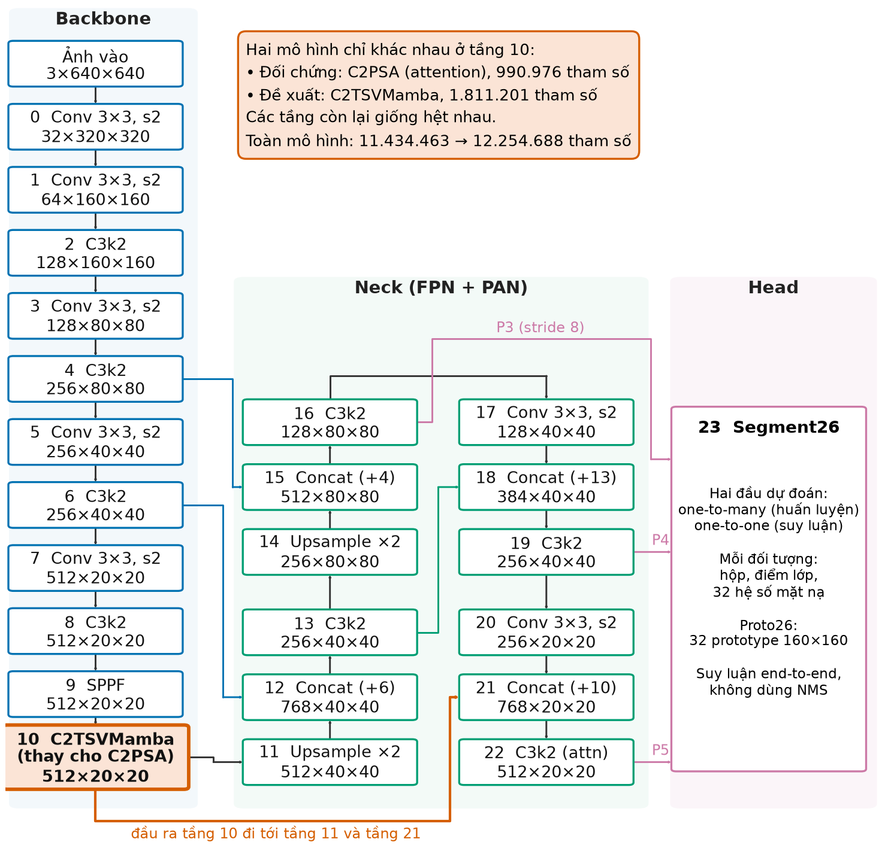
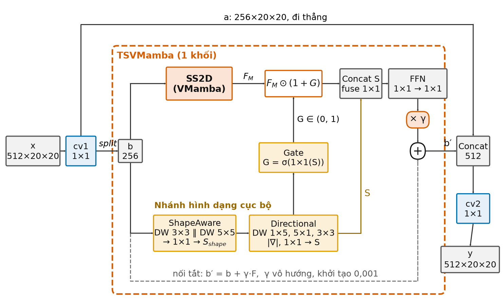
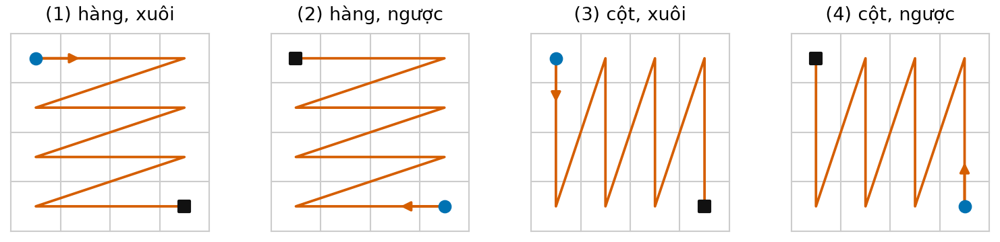
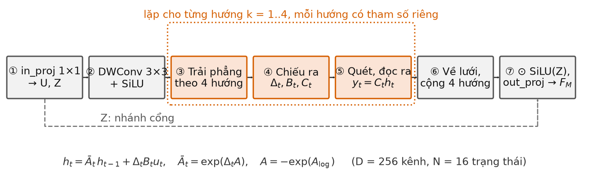
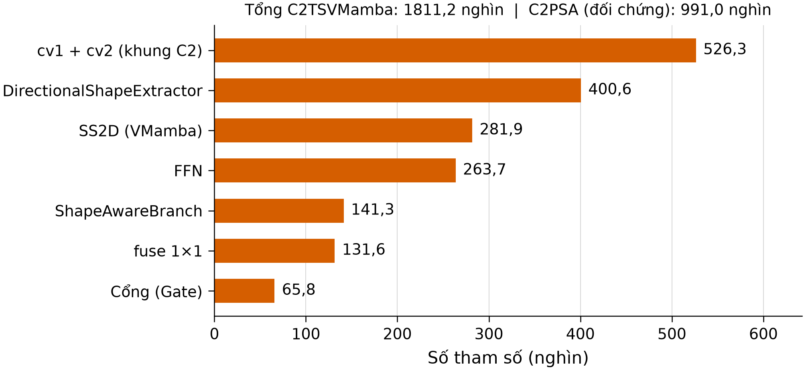

# CHƯƠNG 3. MÔ HÌNH ĐỀ XUẤT

Chương 2 đã trình bày các khối nền của YOLO26-seg và nguyên lý của mô hình không gian trạng thái. Chương này mô tả cách nhóm kết hợp hai phần đó. Mô hình đề xuất giữ nguyên gần như toàn bộ YOLO26s-seg, chỉ thay khối C2PSA ở tầng 10 bằng một khối mới tên là C2TSVMamba. Bên trong khối mới có hai nhánh. Nhánh SS2D quét đặc trưng theo kiểu VMamba. Nhánh hình dạng dùng tích chập có hướng và điều khiển nhánh SS2D thông qua một cổng.

Chương lần lượt trình bày các nội dung sau:
- ý tưởng thiết kế;
- kiến trúc tổng thể;
- cấu tạo từng nhánh;
- thuật toán quét song song;
- cách khởi tạo;
- quy trình suy luận và huấn luyện;
- ưu điểm và hạn chế của thiết kế.

Thông số trong chương được đọc từ mã nguồn đã dùng để huấn luyện: bản fork Ultralytics 8.4.127 [42] cùng mô-đun `topology_shape_vmamba.py`. Mọi thông số đều được kiểm tra lại bằng cách dựng mô hình rồi đếm tham số. Con số nào là ước tính tính tay thì có ghi rõ ngay tại chỗ.

**Quy ước thuật ngữ trong chương:**

| Thuật ngữ | Nghĩa trong chương này |
|---|---|
| *Khối C2TSVMamba* | Toàn bộ tầng 10. |
| *Khối TSVMamba* | Phần xử lý nằm bên trong C2TSVMamba. |
| *Nhánh SS2D* | Phần quét chọn lọc theo kiểu VMamba. |
| *Nhánh hình dạng* | Hai mô-đun ShapeAwareBranch và DirectionalShapeExtractor. |
| *Cổng* | Mô-đun TopologyShapeGate. |
| *Attention* | Cơ chế tự chú ý trong khối PSA. |
| *Lượt huấn luyện* | Một lần huấn luyện một mô hình với một seed. |

## 3.1. Ý tưởng và động cơ thiết kế

### 3.1.1. Vấn đề cần giải quyết

Polyp trong ảnh nội soi thường có ba đặc điểm gây khó cho phân đoạn:
- biên mờ;
- màu gần với niêm mạc xung quanh;
- kích thước rất khác nhau giữa các ảnh.

Vì vậy, để khoanh đúng vùng polyp, mô hình cần hai loại thông tin.
- **Ngữ cảnh rộng:** cho biết vùng đang xét là một khối lồi lên khỏi thành ruột, hay chỉ là vệt phản quang hoặc nếp gấp niêm mạc.
- **Hình dạng của vùng:** vùng đó trải theo hướng nào và có đường bao ra sao.

Trong YOLO26-seg, ngữ cảnh rộng ở cuối backbone do khối C2PSA đảm nhận. Khối này dùng attention [43] trên bản đồ đặc trưng P5 kích thước 20×20. Attention so khớp mọi cặp vị trí với nhau, nên nắm được quan hệ xa. Thông tin không gian cục bộ của khối này chỉ đến từ một tích chập theo chiều sâu 3×3 trên nhánh giá trị, đóng vai trò mã hóa vị trí. Ngoài tích chập đó, khối không có thành phần nào thiết kế riêng cho hình dạng.

Các công trình gần đây về phân đoạn polyp cho thấy thông tin biên và hình dạng là manh mối có ích [27], [28]. Cùng thời gian đó, Mamba [23] và VMamba [7] đưa ra một cách khác để thu ngữ cảnh toàn cục:
- trải bản đồ đặc trưng thành chuỗi;
- cập nhật một trạng thái ẩn có chọn lọc theo nội dung của từng vị trí.

Từ hai hướng này, đề tài đặt câu hỏi: nếu thay C2PSA bằng một khối kết hợp quét chọn lọc kiểu VMamba với một nhánh tích chập có hướng, thì
- chất lượng mặt nạ polyp của YOLO26s-seg thay đổi thế nào;
- chi phí tính toán phải trả thêm là bao nhiêu.

### 3.1.2. Vì sao chọn tầng 10

Khối mới được đặt đúng vào vị trí của C2PSA ở tầng 10, vì bốn lý do sau.

1. **Đây là khối attention duy nhất trong backbone của YOLO26s-seg.** Thay đúng khối này thì hai mô hình chỉ khác nhau ở cách tổng hợp ngữ cảnh tại một vị trí. Các tầng còn lại giống hệt nhau, nên phép so sánh rõ ràng.

2. **Chuỗi cần quét ngắn.** Tầng 10 nằm ở mức P5 (bước nhảy 32). Với ảnh vào 640×640, bản đồ đặc trưng chỉ có 20×20 = 400 vị trí. Ở mức sâu này, mỗi vị trí đã mang thông tin ngữ nghĩa cao. Dù vậy, như sẽ thấy ở mục 3.4.5 và Chương 6, cách cài đặt phép quét vẫn làm độ trễ tăng đáng kể.

3. **Đầu ra của tầng 10 lan tới cả ba mức của đầu Segment26.** Đầu ra này được dùng ở hai nơi trong neck:
   - tầng 11, nơi đặc trưng được phóng to rồi đi xuống nhánh P4 và P3;
   - tầng 21, nơi đặc trưng được ghép vào nhánh P5 đi lên.

   Vì vậy đặc trưng do khối mới tạo ra có mặt ở cả P3, P4 và P5.

4. **Giao diện không đổi.** C2PSA có vào/ra là 512×20×20, và khối mới giữ đúng giao diện này. Nhờ đó không phải sửa tầng nào khác, cũng không phải đổi neck, head hay hàm mất mát.

### 3.1.3. Phạm vi đóng góp

Các thành phần dùng trong khối mới đều đã có từ trước:
- SS2D là ý tưởng của VMamba [7];
- cơ chế quét chọn lọc đến từ Mamba [23];
- tích chập theo chiều sâu, cổng sigmoid và nối tắt có hệ số là các kỹ thuật quen thuộc.

Đề tài không nhận mình là tác giả của các thành phần trên. Đóng góp của đề tài gồm bốn phần:
1. Thiết kế khối C2TSVMamba: ghép các thành phần trên theo một cách cụ thể, trong đó có cổng để nhánh hình dạng điều biến nhánh SS2D.
2. Cài đặt lại SS2D bằng PyTorch thuần, không cần kernel CUDA riêng, để gắn được vào Ultralytics.
3. Tích hợp khối mới vào YOLO26s-seg cho bài toán phân đoạn polyp.
4. Đánh giá lặp lại trên 20 seed (seed 0–19), có kiểm định thống kê (Chương 6).

Hai công trình gần nhất, đã so sánh chi tiết ở Chương 1:
- **MambaPSA [30]** cũng thay C2PSA của YOLO26 bằng một khối Mamba. Tuy vậy, bài này giải bài toán phát hiện vật thể trên PASCAL VOC, nhắm tới giảm chi phí, và thêm khối BiViM vào neck. Đề tài này giải bài toán phân đoạn polyp và bổ sung nhánh hình dạng.
- **Mamba YOLO [29]** thay nhiều khối của YOLO bằng khối SSM, chứ không chỉ thay ở một vị trí.

## 3.2. Kiến trúc tổng thể

Hình 3.1 vẽ toàn bộ mô hình, gồm ba phần.

- **Backbone (tầng 0 đến 10):** năm lần tích chập bước 2, xen giữa là các khối C3k2, giảm độ phân giải từ 640×640 xuống 20×20. Tầng 9 là SPPF. Tầng 10 là vị trí thay đổi.
- **Neck (tầng 11 đến 22):** một nhánh đi từ trên xuống theo kiểu FPN [35] và một nhánh đi từ dưới lên theo kiểu PAN [36]. Neck cho ra ba bản đồ đặc trưng: P3 (80×80), P4 (40×40) và P5 (20×20).
- **Đầu Segment26 (tầng 23):** nhận cả ba mức để dự đoán hộp, điểm lớp và hệ số mặt nạ. Đầu này cũng sinh 32 mặt nạ mẫu (prototype) kích thước 160×160, theo cơ chế của YOLACT [19].



*Hình 3.1. Kiến trúc YOLO26s-seg và vị trí khối C2TSVMamba (tầng 10). Kích thước tensor ghi theo dạng C×H×W, tính cho ảnh vào 640×640 với hệ số quy mô s. Tầng 22 (C3k2, attn=True) có PSABlock ở cả hai mô hình.*

Tệp cấu hình của mô hình đề xuất được sao từ `yolo26-seg.yaml`. Ngoài phần chú thích, hai tệp chỉ khác nhau ở dòng khai báo tầng 10. Bảng 3.1 tóm tắt điểm khác nhau giữa hai mô hình.

*Bảng 3.1. So sánh mô hình đối chứng và mô hình đề xuất*

| Tiêu chí | YOLO26s-seg (đối chứng) | YOLO26s-seg + C2TSVMamba (đề xuất) |
|---|---|---|
| Khối ở tầng 10 | C2PSA (1 PSABlock, 4 đầu attention) | C2TSVMamba (1 khối TSVMamba) |
| Vào/ra tầng 10 | 512×20×20 | 512×20×20 |
| Tham số tầng 10 | 990.976 | 1.811.201 |
| Tham số toàn mô hình | 11.434.463 | 12.254.688 (+7,17%) |
| Tầng 0–9 và 11–23 | Giống nhau | Giống nhau |
| Hàm mất mát, dữ liệu, siêu tham số | Giống nhau | Giống nhau |

Tầng 22 của cả hai mô hình là khối C3k2 với tham số `attn=True`. Khi tham số này bật, mỗi khối con bên trong gồm một Bottleneck nối tiếp một PSABlock. Vì vậy, mô hình đề xuất không bỏ hết attention: nó chỉ thay attention ở tầng 10, còn PSABlock ở tầng 22 vẫn giữ nguyên trong cả hai mô hình.

Khi suy luận, YOLO26 chạy ở chế độ end-to-end:
- chỉ dùng đầu dự đoán một-một;
- lấy tối đa 300 đối tượng có điểm cao nhất rồi lọc theo ngưỡng tin cậy;
- không qua bước loại bỏ trùng lặp NMS.

Cơ chế này kế thừa từ YOLOv10 [20] và giữ nguyên ở cả hai mô hình.

## 3.3. Khối C2TSVMamba

### 3.3.1. Khung tách–xử lý–ghép

C2TSVMamba giữ nguyên khuôn ngoài của C2PSA và xử lý theo bốn bước:
1. Đặc trưng vào $x \in \mathbb{R}^{512\times20\times20}$ đi qua một tích chập 1×1, kèm chuẩn hóa lô và hàm SiLU.
2. Kết quả được chia đôi theo kênh thành $a$ và $b$, mỗi phần 256 kênh.
3. Phần $a$ đi thẳng; phần $b$ đi qua khối TSVMamba.
4. Hai phần được ghép lại rồi đi qua một tích chập 1×1 nữa.

$$ [a,\ b] = \mathrm{split}\big(\mathrm{Conv}_{1\times1}^{\,cv1}(x)\big), \qquad y = \mathrm{Conv}_{1\times1}^{\,cv2}\big([\,a \,\|\, \mathrm{TSVMamba}(b)\,]\big) \tag{3.1} $$

Trong đó $[\cdot\,\|\,\cdot]$ là phép ghép theo kênh. Tệp cấu hình ghi 2 khối lặp, nhưng với quy mô s, hệ số độ sâu 0,5 làm số khối thực tế còn $\max(\mathrm{round}(2\times0{,}5),1) = 1$.

Cách chia đôi này giống thiết kế CSP dùng trong họ YOLO từ YOLOv4 [39]. Một nửa số kênh không đi qua phần tính toán nặng, nhờ đó giảm chi phí và giữ đường truyền gradient ngắn.

Hình 3.2 vẽ cấu trúc bên trong khối TSVMamba:
1. Đặc trưng $b$ được đưa đồng thời vào nhánh SS2D và nhánh hình dạng.
2. Nhánh hình dạng sinh ra bản đồ cổng $G$ để điều biến đầu ra của SS2D.
3. Hai nhánh được hợp nhất, rồi tinh chỉnh qua một mạng truyền thẳng (FFN).
4. Kết quả được nhân với hệ số $\gamma$ rồi cộng trở lại vào $b$.



*Hình 3.2. Cấu trúc khối C2TSVMamba. Khung nét đứt là khối TSVMamba. Đặc trưng bên trong khối có kích thước 256×20×20. Chi tiết nhánh SS2D ở Hình 3.4.*

### 3.3.2. Nhánh SS2D

Nhánh này cài đặt lại mô-đun quét chọn lọc hai chiều (SS2D) của VMamba [7]. Mô-đun xử lý theo ba ý chính:
- biến bản đồ đặc trưng hai chiều thành các chuỗi một chiều;
- cho mỗi chuỗi đi qua một mô hình không gian trạng thái chọn lọc;
- gộp kết quả trở lại lưới.

Nếu chỉ duyệt một lần theo hàng, mỗi vị trí chỉ nhận được thông tin từ các vị trí đứng trước nó trong thứ tự duyệt. Vì vậy SS2D duyệt theo bốn thứ tự khác nhau, để mỗi vị trí nhận thông tin từ mọi phía (Hình 3.3).



*Hình 3.3. Bốn thứ tự duyệt của SS2D, minh họa trên lưới 4×4 (thực tế là 20×20, L = 400). Chấm tròn đánh dấu vị trí đầu chuỗi, ô vuông đánh dấu vị trí cuối chuỗi.*

Hình 3.4 tóm tắt các bước tính của SS2D trong mã. Các ký hiệu dùng trong mục này:
- $D = 256$: số kênh;
- $N = 16$: số chiều trạng thái;
- $L = H\times W = 400$: độ dài chuỗi.



*Hình 3.4. Các bước bên trong nhánh SS2D như được cài đặt. Bước ③ đến ⑤ được thực hiện riêng cho từng hướng.*

**Bước 1. Chiếu vào và tách nhánh cổng.** Một tích chập 1×1 không có độ lệch (bias) nâng $b$ từ 256 lên 512 kênh, rồi chia thành hai phần $U$ và $Z$, mỗi phần 256 kênh:
- $U$ là nội dung sẽ được quét;
- $Z$ được giữ lại để làm cổng ở bước cuối.

**Bước 2. Trộn cục bộ.** $U$ đi qua một tích chập theo chiều sâu 3×3 và hàm SiLU, cho ra $\tilde U$. Bước này cho mỗi vị trí nhận một ít thông tin từ lân cận trước khi quét. Mamba cũng đặt một tích chập ngắn trước SSM theo cách tương tự [23].

**Bước 3. Trải phẳng theo bốn hướng.** Lưới 20×20 được trải thành bốn chuỗi, mỗi chuỗi dài 400:
1. theo hàng, từ đầu đến cuối;
2. theo hàng, từ cuối về đầu;
3. theo cột, từ đầu đến cuối;
4. theo cột, từ cuối về đầu.

Gọi $\Pi_k$ là phép trải phẳng thứ $k$ ($k = 1..4$) và $u^{(k)} = \Pi_k(\tilde U)$.

**Bước 4. Sinh tham số phụ thuộc đầu vào.** Với mỗi hướng $k$, một phép chiếu tuyến tính riêng biến mỗi vectơ $u^{(k)}_t \in \mathbb{R}^{D}$ thành ba đại lượng: bước thời gian $\Delta_t$, ma trận vào $B_t$ và ma trận ra $C_t$.

$$ \Delta^{(k)}_t = \mathrm{softplus}\big(W^{(k)}_{\Delta}\, W^{(k)}_{x,\Delta}\, u^{(k)}_t + b^{(k)}_{\Delta}\big) \in \mathbb{R}^{D}, \quad B^{(k)}_t = W^{(k)}_{x,B}\, u^{(k)}_t \in \mathbb{R}^{N}, \quad C^{(k)}_t = W^{(k)}_{x,C}\, u^{(k)}_t \in \mathbb{R}^{N} \tag{3.2} $$

Một vài điểm về công thức (3.2):
- $\Delta$ được sinh qua một phép chiếu hạng thấp (hạng 16), rồi mở rộng lên 256 kênh.
- Hàm softplus bảo đảm $\Delta_t > 0$.
- Đây là cơ chế chọn lọc của Mamba [23]. Vì $\Delta$, $B$, $C$ phụ thuộc nội dung tại từng vị trí, mô hình tự quyết định giữ lại thông tin cũ hay ghi đè bằng thông tin mới.

**Bước 5. Rời rạc hóa, quét và đọc ra.** Ma trận trạng thái được tham số hóa dạng chéo và luôn âm, $A^{(k)} = -\exp(A^{(k)}_{\log}) \in \mathbb{R}^{D\times N}$, theo cách của S4D [44]. Hệ số chuyển trạng thái, phương trình truy hồi và đầu ra lần lượt là:

$$ \bar A^{(k)}_{t,d,n} = \exp\!\Big(\mathrm{clip}\big(\Delta^{(k)}_{t,d}\, A^{(k)}_{d,n},\ -50,\ 0\big)\Big) \tag{3.3} $$

$$ h^{(k)}_{t,d,n} = \bar A^{(k)}_{t,d,n}\, h^{(k)}_{t-1,d,n} + \Delta^{(k)}_{t,d}\, B^{(k)}_{t,n}\, u^{(k)}_{t,d}, \qquad h^{(k)}_{0} = 0 \tag{3.4} $$

$$ y^{(k)}_{t,d} = \sum_{n=1}^{N} C^{(k)}_{t,n}\, h^{(k)}_{t,d,n} \tag{3.5} $$

Giải thích các công thức (3.3)–(3.5):
- Vì $\Delta A \le 0$ nên $\bar A \in (0, 1]$. Trạng thái cũ luôn mờ dần, và tốc độ mờ do $\Delta$ quyết định.
- Số hạng đầu vào dùng xấp xỉ bậc một $\bar B \approx \Delta B$, thay cho công thức rời rạc hóa giữ bậc không (ZOH) đầy đủ. Mamba cũng dùng xấp xỉ này khi cài đặt [23].
- Phép cắt $\mathrm{clip}$ ở (3.3) chỉ có trong bản cài đặt này, nhằm tránh lấy $\exp$ của số âm quá lớn.
- Phương trình (3.4) không được giải bằng vòng lặp qua từng vị trí, mà bằng thuật toán quét song song ở mục 3.4.

**Bước 6. Gộp bốn hướng.** Mỗi chuỗi kết quả $y^{(k)}$ được đảo ngược phép trải phẳng để trở về lưới 20×20. Sau đó bốn lưới được cộng lại.

**Bước 7. Cổng và chiếu ra.** Tổng bốn hướng được nhân từng phần tử với $\mathrm{SiLU}(Z)$, rồi đi qua một tích chập 1×1 để cho ra đặc trưng toàn cục $F_M$:

$$ F_M = W_{\text{out}} * \Big( \big(\textstyle\sum_{k=1}^{4} \Pi_k^{-1}(y^{(k)})\big) \odot \mathrm{SiLU}(Z) \Big) \in \mathbb{R}^{256\times20\times20} \tag{3.6} $$

Mỗi hướng có bộ tham số chiếu và $A_{\log}$ riêng, nên bốn hướng có thể học bốn cách ghi nhớ khác nhau.

So với VMamba gốc [7], bản cài đặt này có năm điểm khác:
- Không có hạng tử nhảy $D\cdot u$ bên trong SSM. Đường tắt được thay bằng nối tắt có hệ số $\gamma$ ở ngoài khối (mục 3.3.5).
- Không có lớp chuẩn hóa LayerNorm sau khi gộp bốn hướng.
- Vẫn giữ cổng nhân $\mathrm{SiLU}(Z)$, trong khi khối VSS cải tiến của VMamba đã bỏ nhánh này.
- Phép chiếu $\Delta$ dùng khởi tạo mặc định của PyTorch. Mamba thì khởi tạo sao cho $\Delta$ nằm trong khoảng [0,001; 0,1] [23].
- Phép quét chạy bằng các phép toán tensor của PyTorch, không dùng kernel CUDA tối ưu.

### 3.3.3. Nhánh hình dạng

Nhánh hình dạng chỉ gồm các tích chập và có hai mô-đun nối tiếp. Theo ý đồ thiết kế, nhánh này cung cấp cho khối thông tin hình học của vùng đặc trưng: đặc trưng trải theo hướng nào và rộng hẹp ra sao.

Cần lưu ý rằng nhánh chạy ở mức P5, tức lưới 20×20 với bước nhảy 32. Một nhân 1×5 ở đây đã phủ khoảng 160 pixel trên ảnh gốc. Vì vậy nhánh này nắm hình dạng ở mức vùng lớn, không phải chi tiết đường biên ở mức pixel. Đề tài cũng chưa có thí nghiệm riêng để kiểm chứng nhánh thực sự học được thông tin hình dạng.

**ShapeAwareBranch** xử lý như sau:
1. Chạy song song hai tích chập theo chiều sâu kích thước 3×3 và 5×5. Mỗi tích chập kèm chuẩn hóa lô và SiLU.
2. Ghép hai kết quả lại.
3. Trộn kênh bằng tích chập 1×1.

$$ S_{\text{shape}} = \mathrm{Conv}_{1\times1}\big(\big[\mathrm{DW}_{3\times3}(b) \,\|\, \mathrm{DW}_{5\times5}(b)\big]\big) \tag{3.7} $$

Hai kích thước nhân cho hai vùng tiếp nhận có độ rộng khác nhau.

**DirectionalShapeExtractor** tách thông tin theo hướng:
1. Chạy song song ba tích chập theo chiều sâu trên $S_{\text{shape}}$: nhân dải ngang 1×5, nhân dải dọc 5×1 và nhân 3×3.
2. Từ hai đáp ứng ngang và dọc, tính thêm một đại lượng độ lớn $S_{grad}$.
3. Ghép bốn kết quả, trộn bằng tích chập 1×1 được $S_{topo}$.
4. Ghép $S_{topo}$ với $S_{\text{shape}}$, trộn thêm một lần 1×1 được đầu ra $S$.

$$ S_h = \mathrm{DW}_{1\times5}(S_{\text{shape}}),\quad S_v = \mathrm{DW}_{5\times1}(S_{\text{shape}}),\quad S_{loc} = \mathrm{DW}_{3\times3}(S_{\text{shape}}),\quad S_{grad} = \sqrt{S_h^2 + S_v^2 + 10^{-6}} \tag{3.8} $$

$$ S_{topo} = \mathrm{Conv}_{1\times1}\big([S_h \,\|\, S_v \,\|\, S_{loc} \,\|\, S_{grad}]\big), \qquad S = \mathrm{Conv}_{1\times1}\big([S_{\text{shape}} \,\|\, S_{topo}]\big) \tag{3.9} $$

Công thức của $S_{grad}$ có dạng giống độ lớn gradient trong xử lý ảnh [52]. Tuy vậy, $S_h$ và $S_v$ là đáp ứng của các nhân học được, đã qua chuẩn hóa lô và SiLU. Vì thế $S_{grad}$ không phải gradient ảnh như bộ lọc Sobel. Nó là độ lớn tổng hợp của hai đáp ứng ngang và dọc, cho mạng thêm một đặc trưng ít phụ thuộc vào hướng cụ thể. Đầu ra $S$ có kích thước 256×20×20.

### 3.3.4. Cổng

Cổng nối nhánh hình dạng với nhánh SS2D. Từ $S$, một tích chập 1×1 có độ lệch, theo sau là hàm sigmoid, sinh ra bản đồ cổng $G$ cùng kích thước với $F_M$. Đầu ra SS2D được điều biến như sau:

$$ G = \sigma\big(W_g * S + b_g\big) \in (0,1)^{256\times20\times20}, \qquad F'_M = F_M \odot (1 + G) \tag{3.10} $$

Đặc điểm của cổng:
- **Chỉ khuếch đại.** Hệ số $(1 + G)$ luôn nằm trong khoảng (1, 2), nên độ lớn của mỗi phần tử $F_M$ được giữ nguyên hoặc khuếch đại tối đa gấp đôi, không bao giờ bị giảm và không thể tắt hẳn một vị trí.
- **Vì sao dùng $(1+G)$ thay cho $G$:** để tránh trường hợp cổng gần 0 lúc mới huấn luyện làm mất tín hiệu của SS2D.
- **Tác dụng thực tế:** sau bước hợp nhất còn một lớp chuẩn hóa lô. Vì vậy tác dụng của cổng là thay đổi tầm quan trọng tương đối giữa các vị trí và các kênh, chứ không phải tăng biên độ tuyệt đối.
- **Thông tin đi một chiều:** nhánh hình dạng điều khiển nhánh SS2D, còn nhánh SS2D không tác động ngược lại.

Tên mô-đun trong mã là `TopologyShapeGate`. Chữ "topology" chỉ thể hiện ý đồ thiết kế: dùng đặc trưng hình dạng và hướng để dẫn dắt đặc trưng toàn cục. Đề tài không dùng hàm mất mát hay ràng buộc tô-pô nào. Vì vậy không có căn cứ để nói mô hình bảo toàn tô-pô của mặt nạ.

### 3.3.5. Hợp nhất, mạng truyền thẳng và nối tắt có hệ số

Phần cuối của khối TSVMamba xử lý theo bốn bước:
1. Ghép $F'_M$ với $S$, rồi dùng tích chập 1×1 (kèm chuẩn hóa lô và SiLU) đưa 512 kênh về 256 kênh.
2. Cho kết quả đi qua FFN gồm hai tích chập 1×1: tích chập đầu nâng 256 lên 512 kênh, có kích hoạt; tích chập sau hạ 512 về 256 kênh, không kích hoạt.
3. Nhân đầu ra với hệ số học được $\gamma$.
4. Cộng vào đặc trưng vào $b$.

$$ F = \mathrm{FFN}\big(\mathrm{Conv}^{\,fuse}_{1\times1}([F'_M \,\|\, S])\big), \qquad b' = b + \gamma\, F, \qquad \gamma_0 = 10^{-3} \tag{3.11} $$

$\gamma$ là một số vô hướng, dùng chung cho mọi kênh, khởi tạo bằng 0,001. Vì giá trị khởi tạo nhỏ, ở đầu quá trình huấn luyện khối TSVMamba gần như không làm thay đổi đầu vào ($b' \approx b$). Đóng góp của khối mới chỉ tăng dần trong lúc huấn luyện. Nhờ vậy, các tầng phía sau đã được tiền huấn luyện không bị xáo trộn đột ngột.

Gộp các công thức trên, khối TSVMamba viết gọn thành:

$$ \mathrm{TSVMamba}(b) = b + \gamma\cdot\mathrm{FFN}\Big(\mathrm{Conv}^{\,fuse}_{1\times1}\big(\big[\,\mathrm{SS2D}(b)\odot(1+G(b)) \,\|\, S(b)\,\big]\big)\Big) \tag{3.12} $$

### 3.3.6. Ví dụ truy vết kích thước tensor

Bảng 3.2 theo dõi một ảnh (lô 1) đi qua khối C2TSVMamba. Bảng giúp đối chiếu giữa các công thức và kích thước tensor trong mã.

*Bảng 3.2. Kích thước tensor qua khối C2TSVMamba (một ảnh 640×640)*

| Bước | Phép toán | Kích thước ra |
|---|---|---|
| Vào tầng 10 | $x$ | 512×20×20 |
| cv1, chia đôi | Conv 1×1, split | $a$: 256×20×20; $b$: 256×20×20 |
| SS2D, bước 1–2 | in_proj, DWConv 3×3 | $U$, $Z$: 256×20×20 mỗi phần |
| SS2D, bước 3 | Trải phẳng | 4 chuỗi, mỗi chuỗi 256×400 |
| SS2D, bước 4 | x_proj, dt_proj | $\Delta$: 256×400; $B$, $C$: 16×400 (mỗi hướng) |
| SS2D, bước 5 | $\bar A$, $\Delta B u$, quét | 256×16×400 (đệm lên 512 khi quét) |
| SS2D, bước 5–7 | Đọc ra, gộp 4 hướng, cổng Z, out_proj | $F_M$: 256×20×20 |
| Nhánh hình dạng | (3.7)–(3.9) | $S$: 256×20×20 |
| Cổng, điều biến | (3.10) | $G$, $F'_M$: 256×20×20 |
| fuse, FFN, nối tắt | (3.11) | $b'$: 256×20×20 |
| Ghép, cv2 | Concat, Conv 1×1 | $y$: 512×20×20 |

### 3.3.7. Số tham số

Bảng 3.3 liệt kê số tham số của từng phần trong tầng 10. Các số này được đếm khi dựng lại mô hình, rồi tính lại bằng tay theo kích thước từng lớp; hai cách cho cùng kết quả.

*Bảng 3.3. Số tham số của tầng 10 (quy mô s)*

| Thành phần | Số tham số | Tỉ lệ trong tầng 10 |
|---|---:|---:|
| cv1 + cv2 (khung C2) | 526.336 | 29,1% |
| SS2D | 281.856 | 15,6% |
| ShapeAwareBranch | 141.312 | 7,8% |
| DirectionalShapeExtractor | 400.640 | 22,1% |
| Cổng | 65.792 | 3,6% |
| fuse | 131.584 | 7,3% |
| FFN | 263.680 | 14,6% |
| $\gamma$ | 1 | ~0% |
| **Tổng C2TSVMamba** | **1.811.201** | 100% |
| C2PSA của mô hình đối chứng | 990.976 | |

Nhánh hình dạng (ShapeAwareBranch và DirectionalShapeExtractor) cộng với cổng chiếm khoảng 33,5% số tham số của tầng, nhiều hơn chính nhánh SS2D. Phần lớn tham số của DirectionalShapeExtractor nằm ở tích chập 1×1 trộn 1.024 kênh (262.656 tham số). Như vậy, phần tham số tăng thêm so với C2PSA (820.225) không chỉ đến từ SS2D. Hình 3.5 thể hiện cơ cấu này.



*Hình 3.5. Số tham số của từng thành phần trong khối C2TSVMamba. Tiêu đề hình ghi tổng của C2TSVMamba và của C2PSA để so sánh.*

## 3.4. Thuật toán quét kết hợp song song

### 3.4.1. Đưa phép truy hồi về phép quét

Xét riêng một kênh $d$ và một chiều trạng thái $n$, phương trình (3.4) có dạng truy hồi tuyến tính bậc một:

$$ h_t = a_t\, h_{t-1} + b_t, \qquad h_0 = 0, \qquad t = 1, \dots, L \tag{3.13} $$

với $a_t = \bar A_t$ và $b_t = \Delta_t B_t u_t$.

Nếu tính tuần tự, phải thực hiện $L - 1$ bước nối tiếp, bước sau chờ kết quả bước trước. Trên GPU, $4 \times 256 \times 16 = 16.384$ chuỗi độc lập vẫn có thể chạy song song với nhau. Tuy vậy, vòng lặp theo thời gian buộc phải gọi khoảng 400 lượt phép toán nhỏ nối tiếp nhau. Chi phí gọi lặp này làm chậm đáng kể.

Để song song hóa theo chiều thời gian, ta coi mỗi vị trí là một cặp $(a_t, b_t)$, biểu diễn phép biến đổi affine $h \mapsto a_t h + b_t$. Thực hiện liên tiếp hai phép biến đổi affine cho ra một phép biến đổi affine khác, ứng với toán tử:

$$ (a_1, b_1) \circ (a_2, b_2) = (a_2 a_1,\ a_2 b_1 + b_2) \tag{3.14} $$

Có thể kiểm tra trực tiếp rằng toán tử này có tính kết hợp:

$$ \big((a_1,b_1)\circ(a_2,b_2)\big)\circ(a_3,b_3) = (a_3a_2a_1,\ a_3a_2b_1 + a_3b_2 + b_3) = (a_1,b_1)\circ\big((a_2,b_2)\circ(a_3,b_3)\big) $$

Nhờ tính kết hợp, $h_t$ chính là thành phần thứ hai của tích tiền tố $(a_1,b_1)\circ\cdots\circ(a_t,b_t)$. Mọi tích tiền tố có thể tính bằng thuật toán quét song song (parallel prefix scan) [45].

### 3.4.2. Thuật toán trong mã

Mã của đề tài dùng biến thể quét song song của Hillis và Steele [46]. Thuật toán chạy qua nhiều vòng:
- Ở vòng thứ $j$, mỗi vị trí $t$ kết hợp kết quả hiện có của nó với kết quả của vị trí $t - 2^{j}$.
- Sau $\lceil\log_2 L\rceil$ vòng, mỗi vị trí đã gom được toàn bộ các phần tử đứng trước nó.

Thuật toán 3.1 viết lại hàm `parallel_associative_scan` dưới dạng giả mã.

*Thuật toán 3.1. Quét kết hợp song song (theo hàm `parallel_associative_scan`)*

```
Đầu vào : a[1..L], b[1..L]   (xử lý cùng lúc cho mọi kênh d, chiều trạng thái n, hướng k)
Đầu ra  : h[1..L] với h[t] = a[t]·h[t-1] + b[t], h[0] = 0

1. K ← ⌈log2 L⌉ ;  P ← 2^K
2. Đệm a đến độ dài P bằng giá trị 1, đệm b đến độ dài P bằng giá trị 0
   (cặp (1, 0) là phần tử đơn vị của phép ∘, nên không làm sai kết quả)
3. step ← 1
4. while step < P:
5.     với mọi t > step, đồng thời:
6.         b[t] ← a[t]·b[t − step] + b[t]
7.         a[t] ← a[t]·a[t − step]
8.     (các vị trí t ≤ step giữ nguyên)
9.     step ← 2·step
10. return b[1..L]
```

Dòng 6 và dòng 7 đều dùng giá trị của vòng trước ở vế phải. Vì vậy trong mã, hai dòng này được tính cùng lúc bằng phép cắt lát tensor rồi ghép lại (`torch.cat`). Với $L = 400$, mã đệm chuỗi lên $P = 512$ và chạy $K = 9$ vòng.

### 3.4.3. Ví dụ minh họa

Xét một chuỗi ngắn $L = 4$ với $a = (0{,}5;\ 0{,}8;\ 0{,}5;\ 0{,}9)$ và $b = (1;\ 2;\ 0;\ 1)$.

Tính tuần tự theo (3.13):
- $h_1 = 1$
- $h_2 = 0{,}8 \cdot 1 + 2 = 2{,}8$
- $h_3 = 0{,}5 \cdot 2{,}8 + 0 = 1{,}4$
- $h_4 = 0{,}9 \cdot 1{,}4 + 1 = 2{,}26$

Tính theo Thuật toán 3.1 ($K = 2$, không cần đệm) cho kết quả ở Bảng 3.4.

*Bảng 3.4. Các vòng của phép quét song song trên ví dụ*

| Vòng | Vị trí 1 | Vị trí 2 | Vị trí 3 | Vị trí 4 |
|---|---|---|---|---|
| Ban đầu $(a, b)$ | (0,5; 1) | (0,8; 2) | (0,5; 0) | (0,9; 1) |
| step = 1 | (0,5; 1) | (0,4; 0,8·1 + 2 = **2,8**) | (0,4; 0,5·2 + 0 = 1) | (0,45; 0,9·0 + 1 = 1) |
| step = 2 | (0,5; **1**) | (0,4; **2,8**) | (0,2; 0,4·1 + 1 = **1,4**) | (0,18; 0,45·2,8 + 1 = **2,26**) |

Sau vòng cuối, thành phần $b$ là $(1;\ 2{,}8;\ 1{,}4;\ 2{,}26)$, trùng với kết quả tính tuần tự.

Ở vòng step = 2, vị trí 4 kết hợp hai cặp:
- cặp của vị trí 2, đã chứa thông tin của vị trí 1 và 2;
- cặp của chính nó, đã chứa thông tin của vị trí 3 và 4.

Nhờ vậy, chỉ sau hai vòng, vị trí cuối đã gom đủ thông tin của cả bốn phần tử.

### 3.4.4. Độ phức tạp

**Độ sâu.** Thuật toán có độ sâu $\lceil\log_2 L\rceil$ vòng. Số bước phải chờ nhau giảm từ 399 bước nối tiếp xuống còn 9 vòng.

**Tổng khối lượng tính.** Ngược lại, tổng khối lượng tính tăng lên. Vòng thứ $j$ xử lý $P - 2^{j}$ vị trí, nên cộng lại có

$$ \sum_{j=0}^{K-1} \big(P - 2^{j}\big) = K\cdot P - (P - 1) \tag{3.15} $$

phép kết hợp. Với $P = 512$ và $K = 9$:
- Mỗi chuỗi cần 4.097 phép kết hợp. Nếu tính tuần tự chỉ cần 399 phép, tức ít hơn khoảng 10 lần.
- Mỗi ảnh có 16.384 chuỗi, nên phép quét tốn khoảng 67 triệu phép kết hợp.
- Mỗi phép kết hợp gồm hai phép nhân và một phép cộng (dòng 6 và 7 của Thuật toán 3.1).

Tổng công việc của biến thể này là $O(L\log L)$. Vì vậy không thể gọi bản cài đặt của đề tài là có độ phức tạp tuyến tính, dù Mamba gốc được giới thiệu là tuyến tính theo độ dài chuỗi. Mamba đạt mức tuyến tính nhờ hai yếu tố [23]:
- dùng biến thể quét hiệu quả về công việc của Blelloch [45], với tổng công việc $O(L)$;
- dùng kernel CUDA gộp các phép toán, và tính lại giá trị trung gian thay vì lưu lại.

Mã của đề tài không dùng các kỹ thuật này. Bù lại, bản cài đặt chỉ cần PyTorch, chạy được trên cả CPU lẫn GPU, và cho kết quả tất định.

**Tương quan với attention.** Ở $L = 400$, attention của C2PSA với chi phí $O(L^2)$ vẫn còn rẻ. Lợi thế về độ dài chuỗi của SSM chỉ thể hiện khi chuỗi rất dài. Nếu đặt khối ở P4 ($L = 1.600$) hay P3 ($L = 6.400$):
- số vòng quét tăng lên 11 và 13;
- số vị trí mỗi vòng tăng 4 và 16 lần, nếu giữ nguyên số kênh. Trên thực tế số kênh ở các mức này khác với P5.

### 3.4.5. Ước tính chi phí của tầng 10

Bảng 3.5 so sánh số phép nhân–cộng (MAC) trong phần xử lý chính của hai khối, tính tay theo kích thước từng lớp cho một ảnh 640×640. Đây là ước tính giải tích. Đề tài không báo cáo GFLOPs đo bằng công cụ, vì công cụ đếm tự động không đếm đúng phép quét tự viết.

*Bảng 3.5. Ước tính chi phí phần xử lý chính của tầng 10. Không tính cv1, cv2 vì hai khối dùng chung, khoảng 210 triệu MAC.*

| Khối | Thành phần | Triệu MAC |
|---|---|---:|
| PSABlock (C2PSA) | qkv 52,4; $QK^\top$ 20,5; nhân với V 41,0; proj 26,2; mã hóa vị trí 0,9; FFN 104,9 | ≈ 246 |
| TSVMamba | SS2D: các phép chiếu và tích chập | ≈ 112 |
| | Nhánh hình dạng, cổng, fuse, FFN | ≈ 399 |
| | **Cộng** | **≈ 511** |

Riêng phép quét song song không tính được bằng MAC. Như đã nêu ở mục 3.4.4, phép quét cần khoảng 67 triệu phép kết hợp, tức khoảng 200 triệu phép toán từng phần tử.

Theo ước tính này, phần xử lý chính của TSVMamba tốn gấp khoảng hai lần PSABlock. Phần lớn chi phí đó nằm ở nhánh hình dạng và FFN, không nằm ở SS2D. Tuy vậy, khoản tăng thêm chỉ khoảng 0,27 tỉ MAC, trong khi toàn mô hình theo ghi chú của Ultralytics cỡ 37 GFLOPs. Như vậy số phép tính của toàn mô hình chỉ tăng khoảng 1–2%.

Độ trễ thì tăng nhiều hơn hẳn. Trên CPU, mỗi ảnh mất khoảng 270 ms với mô hình đối chứng và 577 ms với mô hình đề xuất. Số liệu này đo với:
- chỉ chạy lan truyền xuôi (forward);
- 4 luồng xử lý;
- checkpoint của seed 0.

Chi tiết đo trình bày ở Chương 6. Như vậy, số phép tính không giải thích được mức tăng độ trễ khoảng hai lần. Phần lớn chênh lệch nhiều khả năng đến từ chi phí bộ nhớ của phép quét: mỗi vòng tạo các tensor trung gian kích thước 256×16×512 cho từng hướng, rồi ghép lại bằng `torch.cat`, lặp lại 9 vòng. Giả thuyết này chưa được kiểm chứng bằng công cụ đo hiệu năng (profiler).

## 3.5. Khởi tạo trọng số và học chuyển giao

Cả hai mô hình đều xuất phát từ trọng số `yolo26s-seg.pt`, được tiền huấn luyện trên COCO [41].
- **Mô hình đối chứng** nạp thẳng tệp này.
- **Mô hình đề xuất** được dựng từ tệp cấu hình mới rồi mới nạp `yolo26s-seg.pt`. Ultralytics chỉ chép những tensor trùng cả tên lẫn kích thước.

Kết quả nạp trọng số ở mô hình đề xuất:
- **Tầng 0–9 và 11–23:** nhận trọng số tiền huấn luyện giống hệt mô hình đối chứng. Ngoại lệ là các lớp đầu ra phụ thuộc số lớp của đầu Segment26: COCO có 80 lớp còn dữ liệu polyp có 1 lớp, nên các lớp này không chép được ở cả hai mô hình.
- **Tầng 10, phần kế thừa:** 12 trong 58 tensor tham số trùng tên và kích thước với C2PSA, tương ứng 790.016 trong 1.811.201 tham số. Đó là cv1, cv2 và FFN. FFN chép được vì PSABlock của C2PSA cũng có một FFN cùng tên và cùng kích thước.
- **Tầng 10, phần khởi tạo mới:** 1.021.185 tham số, gồm SS2D, nhánh hình dạng, cổng, fuse và $\gamma$.

FFN của TSVMamba nhận trọng số từ FFN của PSABlock chỉ vì trùng tên. Trong khối mới, đầu vào của FFN đã khác: đó là đầu ra của fuse, không còn là đầu ra của attention. Vì vậy đây là khởi tạo kế thừa theo tên, không phải tái sử dụng có chủ đích.

Cách khởi tạo các tham số mới:
- $A_{\log}$ đặt bằng $\log(1), \dots, \log(16)$ cho mọi kênh và mọi hướng, tức $A = -(1, 2, \dots, 16)$. Đây là cách khởi tạo S4D-Real [44] mà Mamba dùng.
- Các phép chiếu $\Delta$, tích chập và chuẩn hóa lô dùng khởi tạo mặc định.
- $\gamma = 0{,}001$.

Vì $\gamma$ nhỏ, ở những bước đầu tầng 10 hoạt động gần như $\mathrm{cv2}([a \,\|\, b])$, với cv1 và cv2 lấy từ C2PSA. Nói cách khác, mô hình đề xuất bắt đầu huấn luyện khi tầng 10 chưa có cơ chế tổng hợp ngữ cảnh nào, rồi mới học dần đóng góp của khối mới.

## 3.6. Hàm mất mát và chiến lược huấn luyện

Đề tài giữ nguyên hàm mất mát của YOLO26-seg. Hai mô hình dùng chung hàm mất mát, bộ siêu tham số và danh sách seed. Vì vậy, khác biệt có hệ thống giữa hai mô hình chỉ có thể quy cho tầng 10. Dao động ngẫu nhiên giữa các lượt huấn luyện (do khởi tạo, thứ tự dữ liệu và phần cứng được cấp) được xử lý bằng cách lặp lại trên 20 seed ghép cặp.

**Hai đầu dự đoán và trọng số thay đổi theo epoch.** YOLO26 huấn luyện đồng thời hai đầu [6], [20]:
- **Đầu một-nhiều:** mỗi đối tượng thật được gán nhiều điểm neo, giúp mô hình học nhanh.
- **Đầu một-một:** mỗi đối tượng thật chỉ được gán một điểm neo. Đây là đầu dùng khi suy luận.

Tổng mất mát là tổ hợp có trọng số của hai đầu:

$$ \mathcal{L} = \alpha(e)\,\mathcal{L}_{\text{o2m}} + \big(1-\alpha(e)\big)\,\mathcal{L}_{\text{o2o}}, \qquad \alpha(e) = 0{,}1 + 0{,}7\cdot\max\!\Big(1 - \frac{e}{E-1},\ 0\Big) \tag{3.16} $$

Với $E = 100$ epoch, trọng số của đầu một-nhiều giảm tuyến tính từ 0,8 xuống 0,1. Như vậy, càng về cuối, mô hình càng tập trung vào đầu dùng khi suy luận. Đặc trưng đi vào đầu một-một được tách khỏi đồ thị tính gradient, nên gradient của đầu này không chảy ngược về backbone.

**Gán nhãn.** Điểm neo dương được chọn theo độ đo căn chỉnh nhiệm vụ của TOOD [37]: $t = s^{0{,}5}\cdot u^{6}$, với $s$ là điểm lớp dự đoán và $u$ là IoU của hộp.
- Đầu một-nhiều lấy 10 điểm neo tốt nhất cho mỗi đối tượng.
- Đầu một-một chọn 7 ứng viên, rồi giữ lại 1 điểm neo tốt nhất.

YOLO26 bổ sung quy tắc STAL [6]: khi chọn ứng viên, đối tượng có cạnh nhỏ hơn 8 pixel được nới cạnh lên 16 pixel, để vật nhỏ không bị bỏ sót.

**Các thành phần mất mát.** Bảng 3.6 liệt kê các thành phần mất mát của mỗi đầu.

*Bảng 3.6. Các thành phần mất mát của YOLO26-seg (theo đúng nhánh mã đã chạy)*

| Thành phần | Nội dung | Hệ số |
|---|---|---:|
| Hộp (box) | $1 - \mathrm{CIoU}$ [38], có trọng số theo điểm căn chỉnh | 7,5 |
| L1 | Sai số tuyệt đối trên bốn khoảng cách tới biên hộp. Thay cho DFL vì `reg_max = 1` [6] | 1,5 |
| Lớp (cls) | Entropy chéo nhị phân, dùng nhãn mềm từ bộ gán nhãn | 0,5 |
| Mặt nạ (seg) | Entropy chéo nhị phân theo pixel giữa mặt nạ dự đoán và mặt nạ thật, chỉ tính trong hộp thật | 7,5 |
| Ngữ nghĩa (sem) | 0,5·BCE + 0,5·Dice trên nhánh phân đoạn ngữ nghĩa phụ của Proto26. Chỉ chạy khi huấn luyện | 7,5 |

Mặt nạ của mỗi đối tượng là tổ hợp tuyến tính của 32 mặt nạ mẫu, dùng 32 hệ số riêng của đối tượng đó: $\hat M_i = \sigma\big(\sum_{k=1}^{32} c_{ik} P_k\big)$. Sau đó mặt nạ được cắt theo hộp. Vì nhánh ngữ nghĩa phụ chỉ chạy ở chế độ huấn luyện, cột `val/sem_loss` trong nhật ký luôn bằng 0. Đây là hành vi đúng của mã, không phải lỗi.

**Bộ tối ưu và độ chính xác số.** Bài báo YOLO26 dùng bộ tối ưu MuSGD [6], còn đề tài dùng AdamW [40] cho cả hai mô hình. Cấu hình huấn luyện:
- tốc độ học ban đầu 0,001; hệ số suy giảm trọng số 0,0005;
- huấn luyện hoàn toàn ở độ chính xác FP32 (`amp=False`);
- 100 epoch, lô 8 ảnh;
- bật chế độ tất định, mỗi lượt huấn luyện dùng một seed cố định.

Chi tiết cấu hình và quy trình huấn luyện trình bày ở Chương 5.

Đề tài không thêm hàm mất mát nào về biên hay tô-pô. Nhánh hình dạng chỉ có thể tác động gián tiếp, thông qua các thành phần mất mát chuẩn ở Bảng 3.6.

## 3.7. Quy trình suy luận và huấn luyện của mô hình đề xuất

Thuật toán 3.2 tóm tắt hai quy trình của mô hình đề xuất: suy luận trên một ảnh, và một bước huấn luyện. Ở mô hình đối chứng, quy trình giống hệt; chỉ khác là bước 3 dùng C2PSA.

*Thuật toán 3.2. Suy luận và huấn luyện YOLO26s-seg + C2TSVMamba*

```
SUY LUẬN (một ảnh I)
1. Letterbox: co ảnh để cạnh dài bằng 640, giữ tỉ lệ, thêm viền xám
2. Backbone tầng 0–9: trích đặc trưng, ra 512×20×20 tại tầng 9
3. Tầng 10 – C2TSVMamba: cv1 → chia (a, b) → TSVMamba(b) theo (3.12) → ghép → cv2
4. Neck tầng 11–22: FPN đi xuống, PAN đi lên → P3, P4, P5
5. Segment26, đầu một-một: với mỗi điểm neo dự đoán hộp, điểm lớp, 32 hệ số mặt nạ;
   Proto26 sinh 32 mặt nạ mẫu 160×160
6. Lấy 300 dự đoán có điểm cao nhất, bỏ các dự đoán dưới ngưỡng tin cậy (không NMS)
7. Với mỗi dự đoán còn lại: tính Σ c_k·P_k, phóng về kích thước ảnh,
   nhị phân hóa (sigmoid > 0,5), rồi cắt theo hộp
8. Trả về danh sách (hộp, điểm tin cậy, mặt nạ)

MỘT BƯỚC HUẤN LUYỆN (lô ảnh đã tăng cường, epoch e)
1. Lan truyền xuôi như bước 2–5, cho cả hai đầu một-nhiều và một-một
2. Gán nhãn: TAL + STAL, top-10 cho đầu một-nhiều, top-7 rồi giữ 1 cho đầu một-một
3. Tính mất mát mỗi đầu theo Bảng 3.6; tổng hợp theo (3.16) với α(e)
4. Lan truyền ngược, cập nhật trọng số bằng AdamW; cập nhật bản trung bình động (EMA) của trọng số
5. Cuối epoch: kiểm định trên tập val bằng trọng số EMA, lưu best.pt khi chỉ số tốt hơn
```

## 3.8. Lưu trọng số ở dạng FP32

**Sự cố.** Trong lần huấn luyện đầu tiên, nhóm gặp lỗi khi lưu checkpoint:
- Mặc định, Ultralytics chuyển mô hình sang FP16 trước khi lưu tệp `best.pt`.
- Ở seed 5, giá trị trung bình chạy (`running_mean`) của lớp chuẩn hóa lô trong tích chập fuse ở tầng 10 lên tới khoảng 1,5 triệu. Con số này vượt giới hạn 65.504 của FP16.
- Khi lưu, giá trị bị tràn nên checkpoint cho kết quả sai khi suy luận, dù quá trình huấn luyện ở FP32 vẫn diễn ra bình thường.

**Cách sửa.**
- Khi lưu checkpoint (ở hàm lưu mô hình, ở MultiTrainer và ở hàm `strip_optimizer`), mô hình được giữ ở FP32 bằng `.float()` thay cho `.half()`.
- Mã gốc có xử lý tensor không hữu hạn trong bản EMA: thay bằng tensor tương ứng của mô hình đang huấn luyện, rồi gọi `nan_to_num_`. Mã sau khi sửa bỏ cách xử lý này. Nếu bản EMA còn giá trị NaN hoặc vô cùng, hàm lưu mô hình và hàm `strip_optimizer` sẽ báo lỗi ngay.

**Kiểm tra lại.** Các lượt TSVM được huấn luyện lại bằng mã đã sửa. So sánh tệp `results.csv` của hai lần chạy trên 20 seed (seed 0–19):
- 44.000 ô số liệu giống hệt nhau;
- 2.000 ô khác nhau, tất cả đều thuộc cột thời gian.

Như vậy bản sửa không làm thay đổi quá trình huấn luyện, chỉ làm checkpoint được lưu đúng. Tên "TSVM FP32" trong đề tài chỉ cách lưu checkpoint này, không phải một chế độ huấn luyện riêng.

**Nguyên nhân có thể có.** Nguyên nhân có thể nằm ở chính thiết kế. SS2D không có lớp chuẩn hóa ở đầu ra, và $F_M$ còn được nhân thêm hệ số $(1+G)$, tối đa gần 2, trước khi vào fuse. Vì vậy biên độ đặc trưng trước lớp chuẩn hóa lô của fuse không bị chặn. Đây mới là giả thuyết; đề tài chưa đo phân bố giá trị kích hoạt để kiểm chứng.

## 3.9. Ưu điểm và hạn chế của mô hình đề xuất

Phần này đánh giá mô hình đề xuất so với mô hình đối chứng. Ưu và nhược điểm chung của YOLO26-seg và của VMamba đã phân tích ở Chương 2.

**Ưu điểm**

- **Thay đổi tối thiểu.** Chỉ một tầng khác nhau và giao diện vào/ra giữ nguyên. Nhờ vậy, khác biệt có hệ thống giữa hai mô hình quy được cho khối mới, thay vì cho nhiều thay đổi diễn ra cùng lúc.
- **Ngữ cảnh toàn cục có chọn lọc.** SS2D quét theo bốn hướng, nên mỗi vị trí nhận thông tin từ cả bốn phía. Mức ghi nhớ được điều chỉnh theo nội dung qua $\Delta$, $B$, $C$.
- **Thông tin hình dạng dẫn dắt đặc trưng toàn cục.** Nhánh tích chập có hướng (1×5, 5×1) cùng cổng $(1+G)$ là một kênh riêng để thông tin hình dạng tác động lên đặc trưng toàn cục. C2PSA chỉ có tích chập 3×3 làm mã hóa vị trí.
- **Khởi đầu ổn định.** Hệ số $\gamma = 0{,}001$, cùng với việc kế thừa cv1, cv2 và FFN từ C2PSA, giúp mô hình bắt đầu từ trạng thái gần với mô hình gốc.
- **Dễ chạy ở nhiều nơi.** Bản cài đặt chỉ cần PyTorch, không phải biên dịch kernel CUDA, chạy được trên CPU và cho kết quả tất định.

**Hạn chế**

- **Chi phí tăng.**
  - Số tham số toàn mô hình tăng 7,17%.
  - Tệp checkpoint lớn hơn do lưu ở FP32.
  - Độ trễ trên CPU tăng khoảng 2,1 lần.
  - Thời gian huấn luyện mỗi lượt tăng từ khoảng 2,3 giờ lên 4,7 giờ.
- **Phép quét chưa tối ưu.** Biến thể Hillis–Steele có tổng công việc $O(L\log L)$ và tạo nhiều tensor trung gian.
- **Ở mức P5, lợi thế của SSM chưa thể hiện.** Với $L = 400$, attention vẫn rẻ, nên ưu điểm của SSM với chuỗi dài chưa có dịp phát huy.
- **Khác bản VMamba gốc.** Mã thiếu hạng tử nhảy $D$, thiếu LayerNorm ở đầu ra, và khởi tạo $\Delta$ theo mặc định. Những điểm này có thể liên quan đến sự cố số học ở mục 3.8.
- **Tên gọi chưa có bằng chứng đi kèm.** Chữ "topology" là ý đồ thiết kế. Khi đo lỗi Betti (số mảnh, số lỗ của mặt nạ) trên 20 seed, TSVM chỉ nhích hơn mô hình gốc và khác biệt không có ý nghĩa thống kê (Chương 6).
- **Chưa tách được đóng góp của từng nhánh.** Mã có sẵn các chế độ để tách đóng góp (mục 3.10), nhưng đề tài chưa huấn luyện các chế độ này.

## 3.10. Các chế độ tách thành phần có sẵn trong mã

Mô-đun TSVMamba có tham số `mode` để bật hoặc tắt từng nhánh. Bảng 3.7 liệt kê bốn chế độ và số tham số tương ứng của tầng 10. Số tham số của ba chế độ rút gọn được tính bằng cách cộng trừ các thành phần ở Bảng 3.3, chưa dựng mô hình để đo.

*Bảng 3.7. Bốn chế độ của khối TSVMamba*

| Chế độ | Công thức khối | Tham số tầng 10 (ước tính) |
|---|---|---:|
| `topology_shape_vmamba` (đầy đủ, dùng trong đề tài) | (3.12) | 1.811.201 |
| `shape_vmamba_no_guidance` | $b + \gamma\cdot\mathrm{FFN}(\mathrm{fuse}([\mathrm{SS2D}(b) \,\|\, S]))$, bỏ cổng | 1.745.409 |
| `shape_only` | $b + \gamma\cdot\mathrm{FFN}(S)$, bỏ SS2D | 1.331.969 |
| `vmamba_only` | $b + \gamma\cdot\mathrm{FFN}(\mathrm{SS2D}(b))$, bỏ nhánh hình dạng | 1.071.873 |

Mọi lượt huấn luyện chính của TSVM đều dùng chế độ đầy đủ. Các chế độ còn lại là nền tảng có sẵn cho thí nghiệm tách thành phần (ablation). Khi thực hiện thí nghiệm này, nên:
- chạy cùng các seed đã dùng cho mô hình chính để so sánh ghép cặp;
- thêm một mô hình đối chứng có số tham số tương đương, vì các chế độ chênh nhau tới khoảng 740 nghìn tham số.

## 3.11. Kết chương

Chương 3 đã trình bày mô hình YOLO26s-seg + C2TSVMamba. Mô hình giữ nguyên YOLO26s-seg, chỉ thay khối C2PSA ở tầng 10 bằng khối C2TSVMamba có cùng giao diện 512×20×20. Bên trong khối có ba phần chính:
- **Nhánh SS2D:** cài đặt lại theo VMamba, quét đặc trưng theo bốn hướng bằng mô hình không gian trạng thái chọn lọc.
- **Nhánh hình dạng và cổng:** tích chập có hướng sinh đặc trưng hình dạng và một cổng $(1+G)$ để khuếch đại đầu ra SS2D.
- **Hợp nhất và nối tắt:** hai nhánh được hợp nhất, rồi cộng trở lại vào đặc trưng vào qua hệ số $\gamma$ khởi tạo rất nhỏ.

Phương trình truy hồi của SSM được giải bằng phép quét kết hợp song song kiểu Hillis–Steele. Phép quét này có độ sâu 9 vòng nhưng tổng công việc là $O(L\log L)$.

So với C2PSA, khối mới thêm 820.225 tham số. Số phép tính ở tầng 10 tăng khoảng gấp đôi, nhưng chỉ chiếm khoảng 1–2% chi phí toàn mô hình. Độ trễ trên CPU thì tăng khoảng hai lần, chủ yếu do cách cài đặt phép quét. Hàm mất mát, dữ liệu và siêu tham số giữ giống hệt mô hình đối chứng.

Các chương tiếp theo:
- Chương 4 trình bày dữ liệu dùng để huấn luyện.
- Chương 5 mô tả phần cài đặt.
- Chương 6 đánh giá xem mức chi phí tăng thêm này đổi lại được bao nhiêu về chất lượng phân đoạn.
