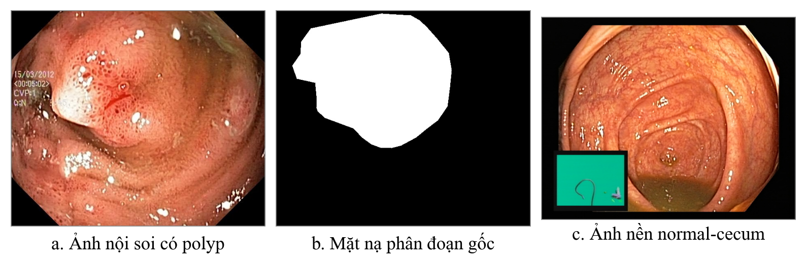
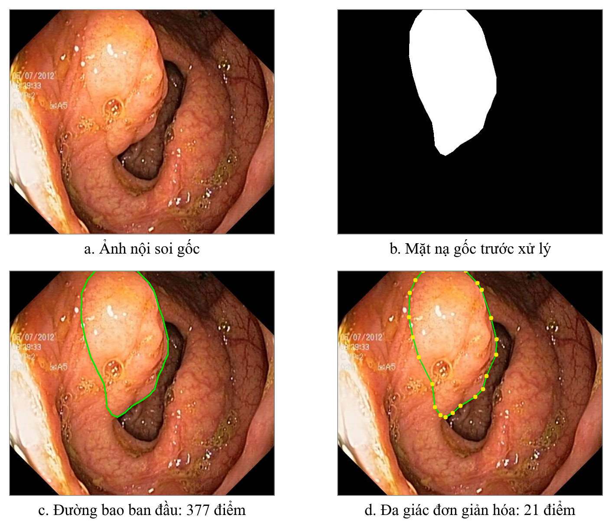
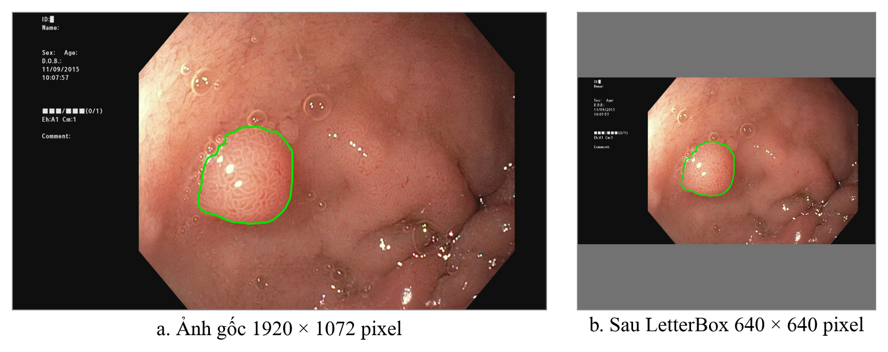
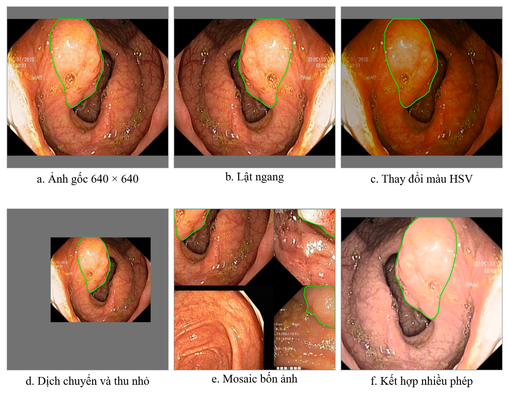
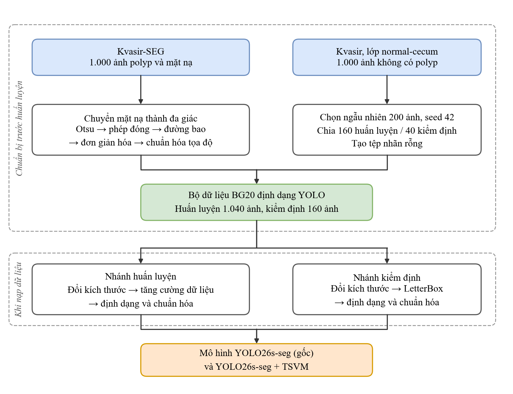

# CHƯƠNG 4. XÂY DỰNG BỘ DỮ LIỆU VÀ TIỀN XỬ LÝ DỮ LIỆU

> **Ghi chú cho người biên tập (xóa khi ghép Word):**
> - Nội dung chương lấy từ `06_bao_cao/Tien_Xu_Ly_Du_Lieu_v3.docx` (bản rút gọn của bạn cùng nhóm, 28/10/2026). Chỉ đổi số mục, hình, bảng, công thức 3.x → 4.x và đổi số tài liệu tham khảo riêng của chương sang số chung của báo cáo. Bản cũ dài hơn nằm trong lịch sử git.
> - Bảng đổi số tài liệu: [1] → [5] Kvasir-SEG; [2] → [8] Kvasir; [3] → [53] trang Kaggle; [4] → [42] (trang tài liệu Ultralytics về nhãn phân đoạn, gộp vào phần mềm Ultralytics khi rút gọn danh mục 30/10/2026); [5] OpenCV: bỏ số trích, giữ tên thư viện (rút gọn 30/10/2026); [6] → [54] Otsu; [7] → [52] Gonzalez–Woods; [8] → [55] Suzuki–Abe; [9] → [56] Douglas–Peucker; [10] → [39] YOLOv4; [11] → [42] (trang tài liệu Ultralytics về tăng cường dữ liệu, gộp như [4]) (số chung của báo cáo, đánh lại theo IEEE).
> - Ba chỗ sửa so với v3, cần báo người viết chương:
>   1. **Mục 4.2:** v3 viết "bộ tải từ Kaggle không kèm sẵn cách chia tập, nhóm đề tài chia…". Câu này **sai**: bản Kaggle của D. Jha có sẵn `train.txt`, `val.txt` và README ghi "We have provided train-val split for the fair comparison"; tệp của nhóm trùng md5 với bản gốc (kiểm 27/10/2026). Đã viết lại theo hướng danh sách do nhóm tác giả cung cấp.
>   2. **Mục 4.1.2:** thêm "phiên bản 2" cho Kvasir (8 lớp × 1.000 ảnh là của Kvasir v2; bản đầu [8] có 500 ảnh mỗi lớp).
>   3. **Mục 4.8:** câu cuối "chương thực nghiệm" đổi thành "Chương 6".
> - **31/10/2026:** năm dòng chèn hình đổi từ `` sang `` để script ghép Word nhận chú thích (đưa vào danh mục hình) và giới hạn cỡ hình trong khổ chữ. Nội dung không đổi.
> - **Hình 4.5 đã sửa ô cuối (29/10/2026):** khối cuối trước ghi "Mô hình YOLO26-seg + TSVM", trong khi quy trình dùng chung cho cả hai mô hình. Nay ghi "Mô hình YOLO26s-seg (gốc) và YOLO26s-seg + TSVM", cùng phông và cỡ chữ với các ô khác. Bản gốc giữ ở `../hinh/chuong4/h4_5_ban_goc.png`. Nếu nhóm còn tệp nguồn của hình (draw.io…), nên sửa cả ở đó.

Chất lượng dữ liệu đầu vào ảnh hưởng trực tiếp đến khả năng học của mô hình phân đoạn. Chương này trình bày cách đề tài xây dựng bộ dữ liệu BG20 từ hai nguồn ảnh nội soi công khai và các bước đưa ảnh cùng nhãn về dạng mà mô hình YOLO26-seg tích hợp khối TSVM sử dụng được. Quá trình gồm hai giai đoạn. Giai đoạn chuẩn bị chỉ thực hiện một lần trước khi huấn luyện, gồm chọn ảnh, chia tập và chuyển mặt nạ thành nhãn đa giác. Giai đoạn nạp dữ liệu diễn ra mỗi khi ảnh được đưa vào mô hình, gồm đổi kích thước, tăng cường dữ liệu và chuẩn hóa.

## 4.1. Nguồn dữ liệu

### 4.1.1. Bộ dữ liệu Kvasir-SEG

Kvasir-SEG là bộ dữ liệu công khai gồm 1.000 ảnh nội soi đường tiêu hóa có polyp, do Jha và cộng sự công bố năm 2020 [5]. Mỗi ảnh đi kèm một mặt nạ do kỹ sư và bác sĩ khoanh vùng, sau đó được bác sĩ chuyên khoa tiêu hóa kiểm tra lại. Trên mặt nạ, pixel thuộc polyp có màu trắng, các pixel còn lại có màu đen.

Dữ liệu có ba đặc điểm cần xử lý. Thứ nhất, kích thước ảnh không đồng nhất, gồm 333 kích thước khác nhau với chiều rộng từ 332 đến 1.920 pixel. Thứ hai, kích thước polyp chênh lệch lớn, vùng nhỏ nhất chỉ chiếm 0,15% diện tích ảnh, vùng lớn nhất chiếm khoảng 81% và gần một nửa số vùng (khoảng 48%) chiếm không quá 10%. Thứ ba, cả ảnh và mặt nạ đều được lưu ở định dạng nén JPEG [5], nên dọc theo biên polyp xuất hiện các pixel có mức xám trung gian và mặt nạ cần được nhị phân hóa lại như trình bày ở mục 4.3.

### 4.1.2. Ảnh nền normal-cecum

Bộ dữ liệu Kvasir phiên bản 2 gồm 8 lớp ảnh, mỗi lớp 1.000 ảnh [5], [8]. Đề tài dùng lớp normal-cecum, tức ảnh manh tràng bình thường có kích thước 720 × 576 pixel, làm ảnh nền. Ảnh nền là mẫu âm tính, không chứa polyp. Nếu chỉ học trên ảnh có polyp, mô hình dễ cho rằng ảnh nào cũng có polyp và khoanh nhầm các nếp gấp hay vùng phản quang. Việc bổ sung ảnh nền nhằm giúp mô hình học được trường hợp không có đối tượng cần phân đoạn. Hình 4.1 minh họa hai nguồn dữ liệu này.

*Hình 4.1. Ví dụ ảnh có polyp, mặt nạ phân đoạn gốc và ảnh nền trong bộ dữ liệu BG20*

*Nguồn: ảnh a và b từ bộ dữ liệu Kvasir-SEG [5], ảnh c từ lớp normal-cecum của bộ dữ liệu Kvasir [8], đề tài ghép và đặt chú thích.*

## 4.2. Xây dựng và phân chia bộ dữ liệu BG20

Ảnh polyp được chia theo danh sách có sẵn gồm 880 ảnh huấn luyện và 120 ảnh kiểm định, do nhóm tác giả Kvasir-SEG cung cấp kèm bản phát hành trên Kaggle trong hai tệp train.txt và val.txt [53]. Dùng danh sách có sẵn giúp kết quả của đề tài so sánh được với các nghiên cứu dùng cùng cách chia. Với ảnh nền, chương trình sắp xếp 1.000 tên tệp normal-cecum, cố định seed bằng 42 rồi chọn ngẫu nhiên 200 ảnh, gồm 160 ảnh cho tập huấn luyện và 40 ảnh cho tập kiểm định. Nhờ cố định seed, mỗi lần chạy lại đều cho đúng 200 ảnh như nhau.

Tên BG20 thể hiện số ảnh nền bằng 20% số ảnh polyp. Tính trên toàn bộ 1.200 ảnh, ảnh nền chiếm 16,67%. Phân bố bộ dữ liệu được tổng hợp trong Bảng 4.1.

*Bảng 4.1. Phân bố ảnh và nhãn trong bộ dữ liệu BG20*

| Thành phần | Huấn luyện | Kiểm định | Tổng |
|---|---:|---:|---:|
| Ảnh có polyp | 880 | 120 | 1.000 |
| Ảnh nền normal-cecum | 160 | 40 | 200 |
| Tổng số ảnh | 1.040 | 160 | 1.200 |
| Số vùng polyp được gán nhãn | 936 | 127 | 1.063 |

*Nguồn: đề tài thống kê từ bộ dữ liệu BG20.*

Số vùng polyp lớn hơn số ảnh polyp vì một ảnh có thể chứa nhiều polyp tách rời, mỗi polyp được gán một nhãn riêng. Bộ dữ liệu được tổ chức theo định dạng Ultralytics với hai thư mục images và labels, mỗi ảnh có một tệp nhãn văn bản cùng tên. Dữ liệu chỉ có một lớp là polyp với chỉ số 0. Ảnh nền đi kèm một tệp nhãn rỗng để cho mô hình biết ảnh không chứa polyp, vì vậy ảnh nền không phải là một lớp thứ hai.

## 4.3. Chuyển mặt nạ phân đoạn thành nhãn đa giác

Mặt nạ của Kvasir-SEG là ảnh, trong khi YOLO26-seg yêu cầu nhãn dạng văn bản. Mỗi dòng nhãn gồm chỉ số lớp và tọa độ các đỉnh của đa giác bao quanh đối tượng, chuẩn hóa về đoạn từ 0 đến 1 [42]. Đề tài chuyển mỗi mặt nạ thành nhãn đa giác qua năm bước dưới đây bằng thư viện OpenCV, còn ảnh nội soi được giữ nguyên.

### 4.3.1. Nhị phân hóa mặt nạ bằng phương pháp Otsu

Mặt nạ được đọc thành ảnh xám có giá trị từ 0 đến 255. Do nén JPEG, mặt nạ có thêm các mức xám trung gian, ví dụ mặt nạ trong Hình 4.2 có 15 mức xám. Nhị phân hóa là chọn một ngưỡng $t$, pixel lớn hơn $t$ được gán 255 và thuộc polyp, các pixel còn lại được gán 0. Phương pháp Otsu [54] chọn $t$ tự động bằng cách thử mọi ngưỡng và giữ lại ngưỡng làm phương sai giữa nhóm tối và nhóm sáng lớn nhất:

$$\sigma_B^2(t) = \omega_0(t)\,\omega_1(t)\,\left[\mu_0(t) - \mu_1(t)\right]^2 \tag{4.1}$$

$$t^* = \underset{0 \le t \le 255}{\arg\max}\; \sigma_B^2(t) \tag{4.2}$$

Trong đó, $\omega_0$ và $\omega_1$ là tỷ lệ số pixel của nhóm tối và nhóm sáng, $\mu_0$ và $\mu_1$ là mức xám trung bình của hai nhóm. Trên 1.000 mặt nạ của đề tài, ngưỡng $t^*$ chỉ nằm trong khoảng từ 5 đến 8. Điều này cho thấy mặt nạ gốc gần như đã nhị phân và bước Otsu chủ yếu loại bỏ nhiễu do nén ảnh.

### 4.3.2. Làm liền vùng polyp bằng phép đóng hình thái học

Sau khi nhị phân hóa, mặt nạ có thể còn lỗ nhỏ bên trong vùng polyp hoặc khe hở mảnh trên đường biên. Đề tài dùng phép đóng (Closing) của hình thái học [52] để làm liền các chỗ này:

$$A \bullet B = (A \oplus B) \ominus B \tag{4.3}$$

Trong đó, $A$ là tập pixel trắng của mặt nạ, $B$ là phần tử cấu trúc hình vuông 3 × 3 pixel. Phép giãn nở $\oplus$ làm vùng trắng phình ra một pixel để lấp lỗ và khe, sau đó phép co $\ominus$ thu vùng trắng lại một pixel để biên trở về gần vị trí cũ. Nhờ vậy, vùng polyp liền mạch hơn nhưng kích thước gần như không đổi.

### 4.3.3. Tìm đường bao và loại bỏ vùng nhiễu nhỏ

OpenCV tìm đường bao bằng thuật toán dò biên của Suzuki và Abe [55]. Đề tài chỉ lấy đường bao ngoài cùng của mỗi vùng, vì nhãn YOLO mô tả mỗi đối tượng bằng một đa giác khép kín. Các đường bao có diện tích nhỏ hơn 20 pixel vuông bị loại vì thường là đốm nhiễu. Trên 1.000 mặt nạ, chương trình tìm được 1.206 đường bao, loại 143 và còn đúng 1.063 vùng polyp như trong Bảng 4.1.

### 4.3.4. Đơn giản hóa đường bao

Đường bao bám theo từng pixel trên biên nên trung bình có khoảng 333 điểm cho mỗi polyp. Để nhãn gọn hơn, đề tài dùng thuật toán Douglas–Peucker [56]. Thuật toán chỉ giữ lại những điểm lệch khỏi đoạn thẳng nối hai đầu đường cong nhiều hơn ngưỡng sai số $\varepsilon$, với $\varepsilon$ được tính theo chu vi đường bao:

$$\varepsilon = 0{,}002 \cdot L \tag{4.4}$$

Trong đó, $L$ là chu vi đường bao tính bằng pixel. Ví dụ, polyp có chu vi 1.000 pixel sẽ có $\varepsilon$ bằng 2 pixel. Cách tính theo chu vi giúp polyp lớn và nhỏ được rút gọn tương xứng. Kết quả, số điểm trung bình của mỗi đa giác giảm từ 333,2 xuống 24,6, tức giảm 92,6%, và mỗi đa giác có từ 10 đến 80 đỉnh.

### 4.3.5. Chuẩn hóa tọa độ và ghi tệp nhãn

Cuối cùng, tọa độ mỗi đỉnh được chia cho chiều rộng $W$ và chiều cao $H$ của mặt nạ để đưa về đoạn từ 0 đến 1:

$$\hat{x} = \frac{x}{W}, \qquad \hat{y} = \frac{y}{H} \tag{4.5}$$

Giá trị sau chuẩn hóa được làm tròn đến 6 chữ số thập phân. Mỗi polyp được ghi thành một dòng gồm chỉ số lớp, tiếp theo là các cặp tọa độ $\hat{x}$ và $\hat{y}$ của từng đỉnh. Nhờ chuẩn hóa, nhãn không phụ thuộc kích thước ảnh, nên khi ảnh được thu phóng ở các bước sau, đa giác vẫn khớp đúng vị trí polyp. Hình 4.2 minh họa toàn bộ công đoạn chuyển đổi trên một ảnh của tập huấn luyện.

*Hình 4.2. Trước và sau khi chuyển mặt nạ phân đoạn thành nhãn đa giác*

*Nguồn: ảnh a và b từ bộ dữ liệu Kvasir-SEG [5], ảnh c và d do đề tài tạo bằng chương trình chuyển đổi mặt nạ của đề tài.*

Đường bao ở ảnh c gồm 377 điểm bám sát biên polyp. Sau khi đơn giản hóa, đa giác ở ảnh d chỉ còn 21 đỉnh nhưng vẫn giữ được hình dạng polyp.

## 4.4. Đổi kích thước ảnh

Từ mục này trở đi, các bước xử lý diễn ra mỗi khi ảnh được nạp vào mô hình. Mô hình dùng kích thước đầu vào 640 pixel. Nếu kéo giãn trực tiếp ảnh thành hình vuông, polyp sẽ bị méo. Vì vậy, ảnh được thu phóng giữ nguyên tỷ lệ sao cho cạnh dài nhất bằng 640 pixel:

$$r = \frac{640}{\max(W, H)} \tag{4.6}$$

$$W' = \lceil r \cdot W \rceil, \qquad H' = \lceil r \cdot H \rceil \tag{4.7}$$

Trong đó, $W$ và $H$ là kích thước ảnh gốc, $r$ là hệ số thu phóng, $W'$ và $H'$ là kích thước sau khi thu phóng, được làm tròn lên thành số nguyên. Ảnh lúc này có cạnh dài bằng 640 nhưng cạnh ngắn vẫn nhỏ hơn 640.

Phần còn thiếu của cạnh ngắn được bù bằng kỹ thuật LetterBox. Ảnh được đặt vào giữa khung đích, phần trống được tô màu xám có giá trị 114 và chia đều cho hai phía:

$$p_x = \frac{640 - W'}{2}, \qquad p_y = \frac{640 - H'}{2} \tag{4.8}$$

Trong đó, $p_x$ là độ rộng viền thêm vào mỗi bên trái và phải, $p_y$ là độ rộng viền thêm vào mỗi phía trên và dưới. Tọa độ đa giác cũng được nhân với $r$ và cộng thêm $p_x$, $p_y$, nhờ đó nhãn luôn trùng với vị trí polyp trên ảnh mới. Ở nhánh huấn luyện, khung đích là 640 × 640. Ở nhánh kiểm định, các ảnh có tỷ lệ khung hình gần nhau được gom thành lô 16 ảnh, khung của mỗi lô được làm tròn lên bội số của 32 và cộng thêm nửa bước, nên có cạnh dài 672 pixel. Hình 4.3 minh họa công đoạn này với khung 640 × 640.

*Hình 4.3. Trước và sau khi đổi kích thước ảnh bằng thu phóng giữ tỷ lệ và LetterBox*

*Nguồn: ảnh a từ bộ dữ liệu Kvasir-SEG [5], ảnh b do đề tài tạo theo cách xử lý LetterBox trong mã nguồn Ultralytics.*

Ảnh gốc 1.920 × 1.072 pixel được thu nhỏ còn 640 × 358 pixel, sau đó được thêm hai dải xám cao 141 pixel ở phía trên và phía dưới. Polyp không bị méo và đường bao vẫn nằm đúng vị trí.

## 4.5. Tăng cường dữ liệu

Tập huấn luyện chỉ có 1.040 ảnh, khá ít đối với một mô hình học sâu, nên mô hình dễ ghi nhớ từng ảnh thay vì học đặc điểm chung của polyp. Tăng cường dữ liệu tạo ra một biến thể ngẫu nhiên khác nhau mỗi lần ảnh được nạp và chỉ áp dụng cho tập huấn luyện. Các phép biến đổi chia thành hai nhóm. Nhóm hình học làm thay đổi vị trí pixel nên đa giác nhãn được biến đổi theo. Nhóm màu chỉ đổi giá trị màu nên nhãn giữ nguyên. Thông số của từng phép được lấy từ tệp cấu hình huấn luyện và tổng hợp trong Bảng 4.2.

Mosaic [39] ghép bốn ảnh huấn luyện vào bốn góc quanh một tâm ngẫu nhiên rồi cắt về 640 × 640 pixel. Ảnh thu được chứa polyp ở nhiều vị trí và kích thước, ảnh nền cũng có thể được ghép chung với ảnh polyp. Vì ảnh ghép không giống ảnh nội soi thật, Mosaic được tắt trong 10 epoch cuối [42]. Khi đó, mô hình học trên từng ảnh đơn lẻ nhưng vẫn kèm các phép biến đổi khác.

Phép biến đổi affine dịch tâm ảnh lệch tối đa 10% khung và thu phóng với hệ số từ 0,5 đến 1,5, giúp mô hình nhận ra polyp ở nhiều khoảng cách và vị trí khác nhau. Phần ảnh ra ngoài khung bị cắt, phần trống được tô màu xám 114. Phép biến đổi màu trong không gian HSV gần như giữ nguyên sắc độ để màu niêm mạc không trở nên phi thực tế, nhưng thay đổi mạnh độ bão hòa và độ sáng để mô phỏng các điều kiện chiếu sáng khác nhau. Cuối cùng, mỗi ảnh có xác suất 0,5 bị lật ngang. Các phép lật dọc, xoay, cắt xiên và trộn ảnh không được sử dụng.

*Bảng 4.2. Thông số tăng cường dữ liệu trong cấu hình huấn luyện*

| Phép biến đổi | Tham số | Giá trị | Ý nghĩa |
|---|---|---:|---|
| Mosaic | mosaic | 1,0 | Luôn ghép bốn ảnh |
| Tắt Mosaic | close_mosaic | 10 | Tắt trong 10 epoch cuối |
| Dịch chuyển | translate | 0,1 | Lệch tối đa 10% khung |
| Thu phóng | scale | 0,5 | Hệ số từ 0,5 đến 1,5 |
| Sắc độ | hsv_h | 0,015 | Dịch sắc độ rất nhẹ |
| Độ bão hòa | hsv_s | 0,7 | Thay đổi tối đa 70% |
| Độ sáng | hsv_v | 0,4 | Thay đổi tối đa 40% |
| Lật ngang | fliplr | 0,5 | Xác suất 50% |
| Lật dọc, xoay, cắt xiên, phối cảnh | flipud, degrees, shear, perspective | 0 | Không sử dụng |
| Trộn ảnh | mixup, cutmix, copy_paste | 0 | Không sử dụng |

*Nguồn: tệp cấu hình huấn luyện của đề tài.*

Hình 4.4 minh họa tác động của từng phép tăng cường lên cùng một ảnh huấn luyện. Để dễ quan sát, các hệ số trong hình được chọn cố định trong phạm vi của Bảng 4.2.

*Hình 4.4. Ảnh huấn luyện trước và sau các phép tăng cường dữ liệu*

*Nguồn: ảnh gốc từ bộ dữ liệu Kvasir-SEG [5] và Kvasir [8], các phép biến đổi do đề tài tạo minh họa theo thông số trong Bảng 4.2.*

Ở cả sáu trường hợp, đường bao luôn khớp với polyp, cho thấy nhãn được biến đổi đồng bộ với ảnh.

## 4.6. Định dạng và chuẩn hóa dữ liệu đầu vào

Trước khi đưa vào mạng, ảnh được đổi thứ tự kênh màu từ BGR của OpenCV sang RGB, sắp xếp lại chiều thành số kênh, chiều cao, chiều rộng và ghép thành lô 8 ảnh. Giá trị pixel được chia cho 255 để đưa về đoạn từ 0 đến 1, đề tài không trừ trung bình hay chia độ lệch chuẩn của ImageNet. Đồng thời, đa giác trong tệp nhãn được tô đầy để tạo lại mặt nạ huấn luyện có kích thước 160 × 160, nhỏ hơn ảnh 4 lần để tiết kiệm bộ nhớ. Với ảnh nền, mặt nạ chỉ gồm giá trị 0.

## 4.7. Kiểm tra tính toàn vẹn của dữ liệu

Chương trình chuyển đổi tự kiểm tra số ảnh và số tệp nhãn của từng tập và dừng lại nếu có sai lệch. Đề tài kiểm tra thêm một lượt độc lập. Kết quả cho thấy mỗi ảnh có đúng một tệp nhãn, toàn bộ 1.063 dòng nhãn đều hợp lệ, và không có ảnh nào trùng tên hoặc trùng nội dung theo mã băm SHA-256 giữa hai tập. Khi chạy lại chương trình bằng OpenCV 5.0.0, cả 1.000 tệp nhãn đều trùng khớp từng ký tự với nhãn đang dùng, và bước chọn ảnh nền với seed 42 cho ra đúng danh sách đã lưu.

Lượt kiểm tra này vẫn có giới hạn. Dữ liệu không có thông tin định danh bệnh nhân nên chưa thể khẳng định hai tập không chứa ảnh của cùng một bệnh nhân. Mã băm chỉ phát hiện ảnh trùng hoàn toàn, chưa phát hiện ảnh gần giống nhau. Ngoài ra, bộ dữ liệu không có tập kiểm thử độc lập, nên kết quả ở các chương sau được đánh giá trên tập kiểm định.

## 4.8. Tổng hợp quy trình tiền xử lý

Hình 4.5 tóm tắt toàn bộ quy trình đã trình bày trong chương.

*Hình 4.5. Quy trình xây dựng bộ dữ liệu BG20 và tiền xử lý dữ liệu*

*Nguồn: đề tài tự xây dựng.*

Phần trên của sơ đồ là giai đoạn chuẩn bị dữ liệu, chỉ thực hiện một lần. Phần dưới là giai đoạn nạp dữ liệu, gồm nhánh huấn luyện có tăng cường dữ liệu và nhánh kiểm định chỉ đổi kích thước bằng LetterBox. Cả hai nhánh đều kết thúc bằng bước chuẩn hóa trước khi đưa vào mô hình.

Khối TSVM nằm bên trong mô hình và chỉ xử lý đặc trưng sau khi ảnh đã được chuẩn hóa. Mô hình YOLO26-seg gốc và mô hình tích hợp TSVM dùng chung quy trình tiền xử lý, nên dữ liệu không phải là nguồn tạo ra khác biệt giữa hai mô hình. Dao động ngẫu nhiên giữa các lần huấn luyện được kiểm soát bằng 20 seed ghép cặp ở Chương 6.
