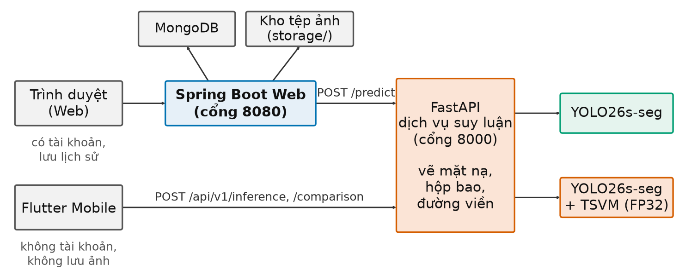

# CHƯƠNG 5. CÀI ĐẶT VÀ ỨNG DỤNG

> **Ghi chú soạn thảo (xóa khi nộp):**
> - Khung **[CHỤP HÌNH 5.x]** là ảnh giao diện nhóm cần chụp. Mỗi khung ghi rõ: màn hình nào, thao tác gì trước khi chụp, ảnh mẫu nào, và trên ảnh phải thấy được gì. Danh sách tổng hợp ở cuối tệp (mục "Danh sách hình cần chụp").
> - **[CHỜ KẾT QUẢ]** là số liệu chưa đo. **[CẦN KIỂM TRA]** là điểm cần nhóm xác nhận trước khi nộp.
> - Thông tin ứng dụng lấy từ mã nguồn và README trong `Ung_Dung/polypweb/`. Thông tin huấn luyện lấy từ `args.yaml` của các lượt chạy và `00_tai_lieu_tong_quan/05_CAU_HINH_HUAN_LUYEN.md`.

Chương này trình bày phần cài đặt của đề tài gồm hai mảng:
- **cài đặt thực nghiệm:** môi trường, cách cài đặt mô hình gốc và mô hình tích hợp, quy trình huấn luyện trên Kaggle, cách lưu và tính lại kết quả;
- **ứng dụng minh họa PolypVision:** kiến trúc hệ thống, dịch vụ suy luận, tổ chức lưu trữ, giao diện Web và Mobile, chức năng so sánh hai mô hình.

## 5.1. Cấu hình hệ thống và môi trường thực nghiệm

### 5.1.1. Môi trường huấn luyện

Huấn luyện chạy trên nền tảng Kaggle, theo đề cương đã duyệt. Kaggle cung cấp GPU miễn phí với hạn mức khoảng 30 giờ mỗi tuần cho mỗi tài khoản. Vì mỗi lượt huấn luyện mô hình tích hợp mất khoảng 4,7 giờ, các lượt được chia cho nhiều tài khoản để chạy song song.

*Bảng 5.1. Môi trường huấn luyện*

| Thành phần | Giá trị | Ghi chú |
|---|---|---|
| Nền tảng | Kaggle Notebook | Chế độ "Save & Run All" chạy nền, không cần giữ trình duyệt |
| GPU | NVIDIA Tesla T4, 15 GB **[CẦN KIỂM TRA]** | Theo nhật ký Kaggle còn lưu; nhật ký này thuộc lượt chạy thử, chưa có nhật ký gắn với từng lượt chính |
| Hệ điều hành | Linux (máy ảo Kaggle) | |
| Python | 3.12 **[CẦN KIỂM TRA]** | Cùng nguồn với dòng GPU |
| PyTorch | 2.10.0 + CUDA 12.8 **[CẦN KIỂM TRA]** | Cùng nguồn với dòng GPU |
| Ultralytics | 8.4.127 | Ghi trong mọi tệp `best.pt` |
| Thời gian một lượt (100 epoch) | Mô hình gốc khoảng 2,3 giờ; mô hình tích hợp khoảng 4,7 giờ | Trung bình 20 seed, phụ thuộc phần cứng Kaggle cấp |

### 5.1.2. Môi trường đánh giá và đo hiệu năng

Sau khi huấn luyện, các tệp kết quả được tải về máy cá nhân để tính lại số liệu, vẽ hình và đo tốc độ.

*Bảng 5.2. Môi trường đánh giá cục bộ*

| Thành phần | Giá trị | Dùng cho |
|---|---|---|
| CPU | AMD Ryzen 7 250 (8 lõi, 16 luồng), RAM 15,3 GiB | Đo độ trễ trên CPU, chạy dịch vụ suy luận |
| GPU | NVIDIA GeForce RTX 5050 Laptop | Đánh giá theo điểm ảnh (Dice, IoU), đo tốc độ trên GPU (mục 6.5) |
| Hệ điều hành | Windows 11 | |
| Môi trường Python có GPU | Python, PyTorch 2.13.0 + CUDA 13.0 | Script đánh giá theo điểm ảnh |
| Môi trường của dịch vụ suy luận | Python 3.12, PyTorch 2.6.0 (CPU), Ultralytics 8.4.127 theo `requirements.txt` **[CẦN KIỂM TRA: môi trường ảo hiện cài 8.4.103, nên cài lại cho khớp]** | Ứng dụng PolypVision |

### 5.1.3. Ngôn ngữ và công cụ

Đề cương quy định Python cho phần mô hình và API, Java cho phần Web. Nhóm bổ sung Dart/Flutter cho ứng dụng di động. Đề cương có nêu cả PyTorch và TensorFlow; đề tài chỉ dùng PyTorch, vì Ultralytics YOLO26 và các bản cài đặt Mamba đều viết trên PyTorch. Dùng một framework giúp khối C2TSVMamba ghép thẳng vào mô hình gốc mà không phải chuyển đổi trọng số.

*Bảng 5.3. Ngôn ngữ, framework và lý do lựa chọn*

| Hạng mục | Lựa chọn | Lý do |
|---|---|---|
| Học sâu | Python, PyTorch, Ultralytics [42] | YOLO26 được cài đặt chính thức trên Ultralytics; PyTorch cho phép viết khối SS2D tùy biến mà không cần biên dịch kernel riêng |
| Xử lý dữ liệu, thống kê | NumPy, pandas, OpenCV, SciPy, Matplotlib | Chuyển nhãn, tính chỉ số, kiểm định thống kê, vẽ hình |
| Dịch vụ suy luận | Python, FastAPI, Uvicorn | Cùng ngôn ngữ với mô hình nên nạp checkpoint trực tiếp; FastAPI nhẹ và tự sinh tài liệu API |
| Web | Java 17, Spring Boot 4.1, Thymeleaf, Spring Security, Bootstrap 5 | Theo yêu cầu đề cương; Spring Boot có sẵn bảo mật, phiên đăng nhập, kết nối MongoDB |
| Cơ sở dữ liệu | MongoDB | Lưu tài khoản và lịch sử phân tích dạng tài liệu, dễ mở rộng trường |
| Di động | Flutter, Dart | Một mã nguồn chạy được trên Android và iOS |
| Quản lý mã | Git | Theo dõi thay đổi mã, cấu hình và tài liệu |

## 5.2. Cài đặt mô hình gốc YOLO26s-seg

Mô hình gốc dùng nguyên bản Ultralytics 8.4.127, cài bằng `pip`. Trọng số khởi tạo là `yolo26s-seg.pt`, đã được huấn luyện sẵn trên COCO [41]. Lớp đầu ra được đổi từ 80 lớp của COCO sang 1 lớp `polyp`.

Tệp mô tả dữ liệu `data_bg20.yaml`:

```yaml
path: <thư mục bộ dữ liệu BG20>
train: images/train
val: images/val
nc: 1
names: {0: polyp}
```

Lệnh huấn luyện chính (rút gọn):

```python
model = YOLO("yolo26s-seg.pt")
model.train(data="data_bg20.yaml", epochs=100, imgsz=640, batch=8,
            optimizer="AdamW", lr0=0.001, warmup_epochs=5.0,
            amp=False, deterministic=True, seed=SEED, workers=2,
            patience=100, close_mosaic=10)
```

*Bảng 5.4. Siêu tham số huấn luyện (giống nhau ở mọi lượt của cả hai mô hình)*

| Nhóm | Tham số |
|---|---|
| Dữ liệu | Ảnh vào 640×640; không lưu đệm ảnh (`cache=False`) |
| Tối ưu | AdamW [40]; tốc độ học ban đầu 0,001, cuối 0,01 × ban đầu; momentum 0,937; suy giảm trọng số 0,0005; khởi động 5 epoch |
| Lịch | 100 epoch; lô 8 ảnh; không dừng sớm (`patience=100`); tắt Mosaic ở 10 epoch cuối |
| Tăng cường | Mosaic [39] 1,0; lật ngang 0,5; co giãn 0,5; dịch 0,1; đổi màu HSV (0,015; 0,7; 0,4); không xoay, không lật dọc, không MixUp |
| Mặt nạ | Tỉ lệ thu nhỏ mặt nạ 4 (mặt nạ 160×160) |
| Độ chính xác số | FP32 hoàn toàn (`amp=False`) |
| Tất định | `deterministic=True`, 2 luồng nạp dữ liệu, seed cố định cho từng lượt |

**Khóa tất định.** Trước khi huấn luyện, notebook đặt seed cho `random`, `numpy`, `torch` (cả CUDA), đặt `PYTHONHASHSEED`, `CUBLAS_WORKSPACE_CONFIG=:4096:8`, tắt `cudnn.benchmark` và bật `torch.use_deterministic_algorithms(True)`. Nhờ vậy, cùng seed thì cùng thứ tự dữ liệu và cùng khởi tạo, nên hai mô hình ở cùng seed so sánh được với nhau.

## 5.3. Cài đặt mô hình tích hợp VMamba

### 5.3.1. Tổ chức mã nguồn

Khối C2TSVMamba không có trong Ultralytics gốc, nên nhóm tạo một bản sao (fork) của Ultralytics 8.4.127 và thêm khối mới. Các thay đổi:

*Bảng 5.5. Các tệp được thêm hoặc sửa trong fork*

| Tệp | Nội dung thay đổi |
|---|---|
| `nn/modules/topology_shape_vmamba.py` (mới) | Cài đặt SS2D, ShapeAwareBranch, DirectionalShapeExtractor, TopologyShapeGate, TSVMamba và C2TSVMamba |
| `nn/modules/__init__.py` | Xuất các lớp mới |
| `nn/tasks.py` | Đăng ký `C2TSVMamba` để trình đọc YAML dựng được mô hình và tự tính số kênh |
| `cfg/models/26/yolo26-seg-TopologyShapeVMamba.yaml` (mới) | Cấu hình mô hình: giống `yolo26-seg.yaml`, chỉ đổi tầng 10 |
| `engine/trainer.py`, `utils/torch_utils.py` | Bản vá lưu checkpoint ở FP32 (mục 5.3.3), mô tả trong `PATCH_FP32.md` |
| `tests/test_topology_shape_vmamba.py` (mới) | Kiểm thử tự động cho khối mới |

Trong tệp YAML, chỉ một dòng khác mô hình gốc:

```yaml
# yolo26-seg.yaml (gốc)
- [-1, 2, C2PSA, [1024]]          # 10
# yolo26-seg-TopologyShapeVMamba.yaml (tích hợp)
- [-1, 2, C2TSVMamba, [1024]]     # 10
```

Chi tiết cấu tạo khối đã trình bày ở Chương 3.

### 5.3.2. Khởi tạo và huấn luyện

Mô hình tích hợp được dựng từ YAML ở cỡ *s*, sau đó nạp trọng số `yolo26s-seg.pt`:

```python
model = YOLO("yolo26s-seg-TopologyShapeVMamba.yaml").load("yolo26s-seg.pt")
model.train(...)   # cùng tham số với mô hình gốc ở Bảng 5.4
```

Hàm `load` chỉ chép những tensor trùng tên và trùng kích thước. Toàn bộ các tầng khác tầng 10 nhận trọng số tiền huấn luyện. Ở tầng 10, phần khung `cv1`, `cv2` và mạng truyền thẳng trùng cấu trúc với C2PSA nên cũng được kế thừa; các nhánh mới (SS2D, nhánh hình dạng, cổng, fuse) được khởi tạo mới.

**Lưu ý khi cài đặt:** Ultralytics đoán cỡ mô hình từ **tên tệp YAML**, không chỉ từ khóa `scale` trong tệp. Tên tệp phải chứa `yolo26s`; nếu không, mô hình bị dựng ở cỡ *n* và không nạp được trọng số. Notebook của thí nghiệm tách thành phần có thêm bước kiểm tra số tham số tầng 10 trước khi huấn luyện để phát hiện lỗi này sớm.

### 5.3.3. Bản vá lưu checkpoint ở FP32

Ultralytics mặc định chuyển mô hình sang FP16 khi lưu `best.pt`. Với khối mới, một giá trị thống kê của lớp chuẩn hóa lô trong tầng 10 vượt giới hạn 65.504 của FP16, làm checkpoint sai khi suy luận (Chương 3, mục 3.8). Bản vá đổi ba chỗ:
- hàm lưu mô hình và `MultiTrainer` dùng `.float()` thay cho `.half()`;
- hàm `strip_optimizer` dùng `.float()`;
- nếu gặp giá trị NaN hoặc vô cùng thì báo lỗi ngay, thay vì âm thầm thay bằng 0.

Vì vậy mô hình tích hợp được gọi là **TSVM FP32**. Tệp `best.pt` của mô hình tích hợp lớn hơn của mô hình gốc vì lưu ở FP32.

### 5.3.4. Thí nghiệm tách thành phần

Mã TSVMamba có tham số `mode` để bật hoặc tắt từng nhánh. Thí nghiệm tách thành phần dùng cùng notebook, chỉ đổi đối số của tầng 10 trong YAML:

```yaml
- [-1, 2, C2TSVMamba, [1024, 0.5, 16, 3, "vmamba_only"]]
```

*Bảng 5.6. Các cấu hình tách thành phần*

| Chế độ | Giữ lại | Bỏ đi | Số tham số tầng 10 |
|---|---|---|---:|
| Đầy đủ | SS2D, nhánh hình dạng, cổng | – | 1.811.201 |
| `vmamba_only` | SS2D | Nhánh hình dạng, cổng, fuse | 1.071.873 |
| `shape_only` | Nhánh hình dạng | SS2D, cổng, fuse | 1.331.969 |
| `shape_vmamba_no_guidance` | SS2D và nhánh hình dạng | Cổng $(1+G)$ | 1.745.409 |

Mỗi chế độ chạy với seed 0–4, tổng cộng 15 lượt, chia cho 6 tài khoản Kaggle. Kết quả ở mục 6.6.

## 5.4. Quy trình huấn luyện và tổ chức lưu trữ kết quả thực nghiệm

### 5.4.1. Notebook Kaggle

Đề tài dùng ba notebook:
- **Notebook mô hình gốc** (3 ô): tạo `data_bg20.yaml`; cài `ultralytics==8.4.127` bằng pip; khóa tất định và huấn luyện, rồi nén kết quả.
- **Notebook mô hình tích hợp** (4 ô): nạp fork Ultralytics bằng liên kết tượng trưng (symlink) tên `ultralytics`, tạo YAML cỡ *s* và `data_bg20.yaml`; tải `yolo26s-seg.pt`; khóa tất định và huấn luyện; nén kết quả.
- **Notebook tách thành phần** (6 ô): như notebook mô hình tích hợp, thêm ô chọn chế độ và seed ở đầu, và ô **kiểm tra mô hình** trước khi huấn luyện (dựng mô hình, kiểm tra chế độ và số tham số tầng 10; sai thì dừng ngay, không tốn giờ GPU).

**Lưu ý về bản lưu trữ:** bản notebook mô hình tích hợp còn lưu trong kho mã trỏ tới fork cũ (lưu FP16) và tên lượt chạy chưa có hậu tố `_FP32`. Khi chạy các lượt chính, đường dẫn và tên đã được sửa sang fork FP32; bằng chứng là mọi tệp `best.pt` của mô hình tích hợp đều lưu ở FP32 **[NÊN LƯU LẠI BẢN NOTEBOOK ĐÃ SỬA VÀO KHO MÃ]**.

> **[CHỤP HÌNH 5.1] Notebook Kaggle đang chạy.**
> - **Màn hình:** notebook tách thành phần trên Kaggle (đang chạy), khung bên phải mở mục *Input* (thấy hai dataset `kvasir-yolo-seg-bg20` và `ultralytics-topology-shape-aware-vmamba-fp32`) và *Settings* (thấy Accelerator là GPU).
> - **Cần thấy:** đầu ra của ô kiểm tra mô hình, có dòng "Tham số tầng 10 = … ✅", và vài dòng nhật ký huấn luyện có cột epoch, loss, mAP. Chỉ notebook tách thành phần mới có ô kiểm tra này.
> - **Lưu ý:** che tên tài khoản Kaggle nếu không muốn công khai.

### 5.4.2. Cấu trúc lưu trữ kết quả

Mỗi lượt huấn luyện lưu riêng một thư mục, tên có dạng `Kvasir_BG20_<Mô hình>_s<seed>_w2`:

```
03_ket_qua_huan_luyen/
├── Baseline_YOLO26s_seg/
│   └── Kvasir_BG20_Baseline_YOLO26s_seg_s0_w2/
│       ├── args.yaml        # toàn bộ cấu hình đã dùng
│       ├── results.csv      # chỉ số và loss từng epoch
│       └── weights/best.pt  # trọng số tốt nhất
├── TSVM_FP32/
│   └── Kvasir_BG20_YOLO26s_seg_TSVM_FP32_s0_w2/ …
└── Vmamba_only/, Shape_only/, No_guidance/   # thí nghiệm tách thành phần, seed 0–4 (mục 6.6)
```

Từ các tệp này, script `tinh_lai_so_lieu.py` tính lại mọi số liệu và ghi ra các bảng CSV. Script `danh_gia_pixel.py` suy luận lại trên tập kiểm định để tính Dice và IoU theo điểm ảnh cho bốn mô hình. Script `ve_hinh.py` đọc các bảng để vẽ hình. Mọi con số trong Chương 6 đều truy được về bảng và script tương ứng.

*Bảng 5.7. Các tệp kết quả chính*

| Tệp | Nội dung |
|---|---|
| `bang/02_ket_qua_tung_seed.csv` | Chỉ số của từng lượt tại epoch đạt mask mAP50–95 cao nhất |
| `bang/04_thong_ke_ghep_cap.csv` | Trung bình, độ lệch chuẩn, chênh lệch, khoảng tin cậy, giá trị $p$ |
| `bang/05_duong_cong_theo_epoch.csv` | Trung bình và độ lệch chuẩn theo epoch |
| `bang/06_ma_tran_nham_lan_tung_seed.csv` | TP, FP, FN của từng lượt |
| `bang/11_pixel_tung_seed.csv`, `12_pixel_thong_ke.csv` | Dice, IoU, Precision, Recall theo điểm ảnh của 4 mô hình |

## 5.5. Ứng dụng PolypVision: tổng quan

### 5.5.1. Yêu cầu chức năng

Theo đề cương, ứng dụng cần:
1. giao diện cho phép tải ảnh nội soi lên;
2. chức năng nhận diện và phân đoạn polyp, hiển thị mặt nạ, đường biên và độ tin cậy;
3. tổ chức lưu trữ kết quả dự đoán;
4. chức năng so sánh mô hình YOLO26-seg gốc với mô hình tích hợp VMamba.

Ngoài ra, nhóm bổ sung: quản lý tài khoản và phân quyền, lịch sử phân tích, trang quản trị, ứng dụng di động.

*Bảng 5.8. Đối chiếu yêu cầu đề cương với chức năng đã cài đặt*

| Yêu cầu | Web | Mobile | Ghi chú |
|---|---|---|---|
| Tải ảnh nội soi | Có | Có (chọn từ thư viện hoặc chụp) | JPG, JPEG, PNG; tối đa 10 MB |
| Hiển thị mặt nạ phân đoạn | Có | Có | Ảnh chồng (overlay) mặt nạ lên ảnh gốc |
| Hiển thị đường biên polyp | Có | Có | Sau khi `plot()` của Ultralytics tô mặt nạ và vẽ hộp bao, hàm `draw_polyp_contours` trong dịch vụ suy luận vẽ thêm một đường viền khép kín màu vàng theo đa giác của từng mặt nạ (`masks.xy`), độ dày tỉ lệ với kích thước ảnh. Web và Mobile cùng nhận ảnh này nên không phải sửa phía giao diện |
| Hiển thị độ tin cậy | Có (thanh tiến trình, %) | Có | Lấy độ tin cậy cao nhất trong các đối tượng phát hiện. Dịch vụ suy luận trả thang 0–1; Website đổi sang thang 0–100 trước khi lưu và hiển thị |
| Lưu trữ kết quả | Có (MongoDB + tệp ảnh) | Không lưu | Mobile cố ý không lưu ảnh để bảo vệ quyền riêng tư |
| So sánh hai mô hình | Có | Có | Chạy lần lượt hai mô hình trên cùng ảnh |

### 5.5.2. Kiến trúc hệ thống

Hệ thống gồm ba thành phần. **Dịch vụ suy luận FastAPI** giữ hai mô hình và được dùng chung cho hai giao diện:
- **Nhánh Web:** Trình duyệt → Spring Boot → FastAPI → mô hình. Spring Boot quản lý tài khoản, phiên đăng nhập, lịch sử, MongoDB và tệp ảnh.
- **Nhánh Mobile:** Flutter → FastAPI → mô hình. Ứng dụng di động gọi thẳng dịch vụ suy luận, không có tài khoản và không lưu lịch sử.



*Hình 5.2. Kiến trúc hệ thống PolypVision. Website (Spring Boot, cổng 8080) và ứng dụng di động (Flutter) là hai client độc lập của cùng dịch vụ suy luận FastAPI (cổng 8000). Chỉ nhánh Web có MongoDB và kho tệp ảnh.*

Tách dịch vụ suy luận ra riêng có ba lợi ích:
- Web và Mobile dùng chung một nơi nạp mô hình, tránh nạp hai lần;
- phần Java không cần biết gì về PyTorch;
- có thể chuyển dịch vụ suy luận sang máy có GPU mà không đổi Web và Mobile.

## 5.6. Dịch vụ suy luận FastAPI

### 5.6.1. Nạp mô hình

Khi khởi động, dịch vụ nạp hai checkpoint lấy từ **seed 0** của thực nghiệm:

*Bảng 5.9. Hai mô hình trong dịch vụ suy luận*

| Khóa mô hình | Vai trò | Tệp checkpoint |
|---|---|---|
| `YOLO26s-seg` | Mô hình gốc | `yolo26s-seg-best.pt` |
| `YOLO26s-TSVM-FP32-seg` | Mô hình tích hợp | `yolo26s-tsvm-fp32-best.pt` |

Một số điểm cài đặt:
- Mã của khối C2TSVMamba được chép vào dịch vụ (`custom_ultralytics/topology_shape_vmamba.py`) và đăng ký đúng đường dẫn mô-đun ghi trong checkpoint trước khi nạp. Nếu không làm vậy, PyTorch không dựng lại được mô hình.
- Mô hình được ép về FP32 và suy luận với `half=False`, tránh lại lỗi tràn số.
- Tệp `models/experiment_manifest.json` lưu nguồn gốc và mã băm SHA-256 của từng checkpoint. Khi chạy, dịch vụ tính mã băm của tệp đang nạp và trả ra ở API `/health`, để đối chiếu thủ công với manifest.
- Hai checkpoint cùng seed 0 để so sánh công bằng trên ứng dụng. `best.pt` được Ultralytics chọn theo chỉ số tổng hợp hộp và mặt nạ, nên nói chung epoch của nó có thể khác epoch có mask mAP50–95 cao nhất dùng ở Chương 6. Ở seed 0, hai epoch này trùng nhau (mô hình gốc: epoch 89; mô hình tích hợp: epoch 88). Cũng cần lưu ý: ở riêng seed 0, mô hình tích hợp có mask mAP50–95 **thấp hơn** mô hình gốc (0,7245 so với 0,7366). Vì vậy các hình so sánh trên ứng dụng chỉ có tính minh họa, không đại diện cho kết quả trung bình.

Các tham số suy luận đọc từ biến môi trường: ngưỡng tin cậy mặc định 0,25, kích thước ảnh 640, thiết bị tự chọn (CPU hoặc GPU). Riêng nhánh Mobile có thêm giới hạn số yêu cầu suy luận đồng thời và thời gian chờ tối đa; nhánh Web dùng khóa riêng cho từng mô hình, còn Spring Boot tự đặt thời gian chờ khi gọi dịch vụ.

### 5.6.2. Các API

*Bảng 5.10. Các API của dịch vụ suy luận*

| Phương thức | Đường dẫn | Dùng cho | Chức năng |
|---|---|---|---|
| GET | `/health` | Web | Trạng thái dịch vụ, thiết bị, danh sách mô hình |
| POST | `/predict` | Web | Nhận ảnh (`image`) và tên mô hình (`modelType`), trả kết quả một mô hình |
| GET | `/api/v1/health` | Mobile | Trạng thái tổng hợp |
| GET | `/api/v1/models` | Mobile | Danh sách hai mô hình và trạng thái sẵn sàng |
| POST | `/api/v1/inference` | Mobile | Nhận ảnh (`image`) và khóa mô hình (`modelKey`), suy luận một mô hình |
| POST | `/api/v1/comparison` | Mobile | Nhận ảnh (`image`), chạy cả hai mô hình trên cùng ảnh |

Kết quả suy luận của API `/predict` (nhánh Web) gồm các trường chính dưới đây; ngoài ra còn `success`, `modelType`, `originalFileName` và `message`.

*Bảng 5.11. Các trường chính trong kết quả suy luận*

| Trường | Kiểu | Ý nghĩa |
|---|---|---|
| `detected` | logic | Có phát hiện polyp hay không |
| `label` | chuỗi | Tên lớp (`polyp`) |
| `confidence` | số thực | Độ tin cậy cao nhất trong các đối tượng phát hiện |
| `maskCount` | số nguyên | Số mặt nạ (số polyp) phát hiện được |
| `processingTimeMs` | số thực | Thời gian gọi mô hình, tính bằng mili giây |
| `resultImageBase64` | chuỗi | Ảnh JPEG chồng mặt nạ và hộp bao, mã hóa Base64 |

Các API cho Mobile dùng cấu trúc riêng: mỗi kết quả có `modelKey`, `modelName`, `modelFamily`, các trường suy luận như trên, và ảnh kết quả đặt trong `overlay.data` (thay cho `resultImageBase64`); kèm theo là `requestId`, kích thước ảnh gốc và một câu cảnh báo nghiên cứu. Kết quả so sánh gồm hai phần `baseline`, `vmamba` và tổng thời gian `totalProcessingTimeMs`. Khi lỗi, các API `/api/v1/*` trả một cấu trúc JSON thống nhất gồm `requestId`, `status`, `code`, `message`, `fieldErrors`; API `/predict` dùng thông báo lỗi mặc định của FastAPI. Dịch vụ kiểm tra ảnh đầu vào (định dạng, giải mã được, dung lượng) trước khi suy luận và không lưu ảnh lại sau khi xử lý.

**Lưu ý:** `processingTimeMs` là thời gian đo trên máy chạy dịch vụ, gồm cả bước tiền xử lý và hậu xử lý của Ultralytics. Đây không phải phép đo hiệu năng khoa học; số liệu hiệu năng chính thức ở Chương 6.

> **[CHỤP HÌNH 5.3] Tài liệu API tự sinh của FastAPI.**
> - **Thao tác:** chạy dịch vụ, mở `http://127.0.0.1:8000/docs`, mở rộng mục `GET /api/v1/models` rồi bấm *Try it out* → *Execute*.
> - **Cần thấy:** danh sách các API như Bảng 5.10, và kết quả trả về có hai mô hình ở trạng thái sẵn sàng.

## 5.7. Tổ chức lưu trữ kết quả

Chỉ nhánh Web lưu kết quả. Dữ liệu chia làm hai nơi: thông tin dạng bản ghi lưu trong MongoDB, còn ảnh lưu thành tệp trên đĩa.

**MongoDB** có hai tập (collection):

*Bảng 5.12. Tập `users`*

| Trường | Ý nghĩa |
|---|---|
| `id` | Mã tài khoản |
| `fullName`, `email` | Họ tên và email; email là duy nhất |
| `passwordHash` | Mật khẩu đã băm bằng BCrypt, không lưu mật khẩu gốc |
| `role` | `USER` hoặc `ADMIN` |
| `enabled` | Tài khoản đang hoạt động hay bị khóa |
| `createdAt`, `updatedAt` | Thời điểm tạo và cập nhật |

*Bảng 5.13. Tập `diagnosis_history`*

| Trường | Ý nghĩa |
|---|---|
| `id`, `userId` | Mã bản ghi, tài khoản sở hữu |
| `fileName` | Tên tệp ảnh người dùng tải lên |
| `modelType` | Mô hình đã dùng |
| `detected`, `label`, `confidence`, `maskCount` | Kết quả suy luận; `confidence` lưu theo thang 0–100 |
| `processingTimeMs` | Thời gian xử lý |
| `imageWidth`, `imageHeight` | Kích thước ảnh |
| `originalImageUrl`, `resultImageUrl` | Đường dẫn tới ảnh gốc và ảnh kết quả |
| `createdAt` | Thời điểm phân tích |
| `comparisonGroupId`, `comparisonResult` | Gắn hai bản ghi của cùng một lần so sánh với nhau |

**Kho tệp ảnh** nằm trong thư mục `storage/` (đổi được bằng biến môi trường):

```
storage/
├── original/   # ảnh gốc người dùng tải lên
└── results/    # ảnh kết quả có chồng mặt nạ
```

Một lần **so sánh** tạo hai bản ghi trong `diagnosis_history`, một cho mỗi mô hình, có cùng `comparisonGroupId`. Cách làm này cho phép dùng chung một cấu trúc cho cả phân tích đơn lẻ và so sánh, đồng thời lọc riêng lịch sử so sánh khi cần.

Người dùng thường chỉ xem và xóa được dữ liệu của chính mình. Tài khoản quản trị xem được thống kê toàn hệ thống và mở được bản ghi, ảnh của mọi người dùng. Ứng dụng di động không lưu ảnh, không lưu lịch sử, chỉ gửi ảnh tới địa chỉ dịch vụ suy luận đã cấu hình.

> **[CHỤP HÌNH 5.19] Dữ liệu lưu trữ.** *(Minh chứng cho mục "tổ chức lưu trữ kết quả" của đề cương)*
> - **Thao tác:** mở MongoDB Compass, chọn tập `diagnosis_history`, mở một bản ghi của lần phân tích đã chụp ở Hình 5.7. Mở thêm thư mục `storage/` bằng trình quản lý tệp.
> - **Cần thấy:** các trường như Bảng 5.13 (`modelType`, `confidence`, `originalImageUrl`, `resultImageUrl`, `createdAt`…) và hai thư mục `original/`, `results/` có tệp ảnh tương ứng. Ghép thành một hình hai phần.
> - **Lưu ý:** không chụp tập `users` (có email và mã băm mật khẩu).

## 5.8. Giao diện và chức năng

### 5.8.1. Website

Website dùng Spring Boot với giao diện Thymeleaf và Bootstrap 5. Các chức năng chính:
- đăng ký, đăng nhập, đăng xuất; phân quyền `USER` và `ADMIN`;
- phân tích một ảnh bằng một trong hai mô hình;
- so sánh hai mô hình trên cùng ảnh;
- xem lại lịch sử phân tích và lịch sử so sánh, có tìm kiếm, lọc, phân trang;
- tải ảnh kết quả, xuất thông tin kết quả, xóa dữ liệu của mình;
- trang hồ sơ, đổi mật khẩu; trang quản trị tài khoản và thống kê.

Website có các cơ chế bảo mật cơ bản: phiên đăng nhập, chống giả mạo yêu cầu (CSRF), băm mật khẩu bằng BCrypt và các tiêu đề HTTP bảo mật. Ngoài giao diện web, Spring Boot còn cung cấp một bộ REST API riêng (`/api/v1/auth`, `/api/v1/diagnoses`, `/api/v1/comparisons`, `/api/v1/dashboard`, `/api/v1/me`), dùng cho phiên bản ứng dụng di động trước đây có đăng nhập.

> **[CHỤP HÌNH 5.4] Trang chủ Website.**
> - **Thao tác:** chạy theo thứ tự MongoDB → FastAPI → Spring Boot, mở `http://localhost:8080`, **chưa đăng nhập**.
> - **Cần thấy:** tên PolypVision, phần giới thiệu, nút đăng nhập/đăng ký và dòng cảnh báo "không thay thế chẩn đoán".

> **[CHỤP HÌNH 5.5] Trang đăng nhập.**
> - **Thao tác:** bấm *Đăng nhập*. Dùng **tài khoản thử tạo riêng cho việc chụp hình**, không chụp lúc đang gõ mật khẩu.
> - **Cần thấy:** biểu mẫu email/mật khẩu, liên kết sang trang đăng ký. Trường mật khẩu để trống hoặc đã che.

> **[CHỤP HÌNH 5.6] Trang phân tích ảnh, trước khi chạy.**
> - **Thao tác:** đăng nhập, vào trang *Phân tích* (`/diagnose`). **Không chụp trang `/diagnoses/demo`**: trang này hiển thị kết quả mẫu cố định, không phải kết quả thật. Chọn một ảnh trong tập kiểm định có polyp rõ (gợi ý: một trong ba ảnh đã dùng ở hình `q01` Chương 6, để thống nhất), chọn mô hình *YOLO26s-TSVM-FP32-seg*.
> - **Cần thấy:** ô chọn tệp đã có tên ảnh, danh sách chọn mô hình, nút *Phân tích*.

> **[CHỤP HÌNH 5.7] Kết quả phân tích một ảnh.** *(Hình quan trọng nhất của chương)*
> - **Thao tác:** bấm *Phân tích* trên ảnh ở Hình 5.6, chờ trang kết quả.
> - **Cần thấy cùng lúc:** ảnh gốc và ảnh có mặt nạ chồng lên; **ô độ tin cậy dạng %** có thanh tiến trình; số polyp phát hiện; thời gian xử lý; tên mô hình; dòng cảnh báo y khoa.
> - **Nên chụp thêm một bản** với ảnh nền không có polyp, để thấy cách hệ thống báo "không phát hiện".

> **[CHỤP HÌNH 5.8] Kết quả so sánh hai mô hình.**
> - **Thao tác:** vào trang *So sánh* (`/compare`), tải **cùng ảnh** ở Hình 5.7, bấm chạy; trang tự chuyển sang `/comparisons/{id}`.
> - **Cần thấy:** hai cột kết quả đặt cạnh nhau, mỗi cột có ảnh overlay, độ tin cậy cao nhất, số mặt nạ và thời gian xử lý của mô hình đó.
> - **Gợi ý:** nếu có ảnh mà hai mô hình cho mặt nạ khác nhau rõ, chụp thêm ảnh đó. Chú thích hình chỉ mô tả, **không kết luận** mô hình nào tốt hơn từ một ảnh.

> **[CHỤP HÌNH 5.9] Lịch sử phân tích.**
> - **Thao tác:** sau khi đã phân tích vài ảnh (cả đơn lẻ và so sánh), vào trang *Lịch sử* (`/history`); chụp thêm trang *Lịch sử so sánh* (`/comparisons`).
> - **Cần thấy:** danh sách bản ghi có ảnh thu nhỏ, tên mô hình, độ tin cậy, thời điểm; ô tìm kiếm, bộ lọc theo mô hình và phân trang.

> **[CHỤP HÌNH 5.10] Bảng điều khiển.**
> - **Thao tác:** vào `/dashboard` của tài khoản thường; sau đó đăng nhập tài khoản quản trị và mở `/admin/dashboard`.
> - **Cần thấy:** số lượt phân tích theo mô hình, theo ngày, hoạt động gần đây. Có thể ghép hai ảnh (người dùng và quản trị) thành một hình hai phần.

> **[CHỤP HÌNH 5.11] Trang quản trị tài khoản** (`/admin/users`, tùy chọn).

> **[CHỤP HÌNH 5.20] Thông báo lỗi khi tải tệp sai** *(tùy chọn)*. Tải một tệp không phải ảnh hoặc lớn hơn 10 MB lên trang `/diagnose`; cần thấy thông báo lỗi rõ ràng, không lộ chi tiết kỹ thuật.
> - **Cần thấy:** danh sách tài khoản, vai trò, nút đổi vai trò. **Che email thật** nếu có.

### 5.8.2. Ứng dụng di động

Ứng dụng Flutter gọi thẳng dịch vụ suy luận, phục vụ trình diễn nhanh trên điện thoại. Chức năng:
- màn hình chính hiển thị trạng thái dịch vụ và hai mô hình;
- suy luận một mô hình và so sánh hai mô hình trên cùng ảnh;
- chọn và kiểm tra ảnh (JPG, JPEG, PNG, tối đa 10 MB);
- hiển thị tiến trình tải lên, cho phép hủy, thử lại, báo lỗi rõ ràng;
- xem ảnh kết quả toàn màn hình, phóng to và kéo;
- giao diện tự co giãn theo điện thoại hoặc máy tính bảng, xoay ngang hoặc dọc; chế độ sáng, tối.

> **[CHỤP HÌNH 5.12] Màn hình chính ứng dụng di động.**
> - **Thao tác:** chạy dịch vụ suy luận với `--host 0.0.0.0`, chạy ứng dụng trên máy ảo Android (`AI_BASE_URL=http://10.0.2.2:8000`) hoặc điện thoại thật cùng mạng.
> - **Cần thấy:** trạng thái dịch vụ "sẵn sàng" và hai mô hình.

> **[CHỤP HÌNH 5.13] Kết quả suy luận trên di động.**
> - **Thao tác:** chọn cùng ảnh đã dùng ở Hình 5.7, chọn mô hình tích hợp, chạy.
> - **Cần thấy:** ảnh overlay, độ tin cậy, số mặt nạ, thời gian xử lý.

> **[CHỤP HÌNH 5.14] So sánh hai mô hình trên di động.**
> - **Cần thấy:** kết quả của hai mô hình trên cùng màn hình (hoặc hai thẻ kết quả liền nhau).
> - **Gợi ý trình bày:** ghép Hình 5.12–5.14 thành một hình ba phần (a), (b), (c), mỗi phần là ảnh chụp màn hình điện thoại để dọc.

> **[CHỤP HÌNH 5.15] Chế độ tối và xem toàn màn hình** *(tùy chọn)*.

### 5.8.3. Kiểm thử phần mềm

Mỗi thành phần có bộ kiểm thử tự động riêng. Theo README của dự án tại lần cập nhật gần nhất:

*Bảng 5.14. Kết quả kiểm thử tự động* **[CẦN KIỂM TRA: chạy lại các lệnh kiểm thử trước khi nộp và cập nhật số]**

| Thành phần | Công cụ | Kết quả ghi nhận |
|---|---|---|
| Ứng dụng di động | `flutter test` | 498/498 ca đạt |
| Dịch vụ suy luận | `pytest` | 50/50 ca đạt |
| Website | `mvnw test` (JUnit) | 261/261 ca đạt |

Ngoài ra, nhóm đã kiểm thử thủ công trên điện thoại Android thật các chức năng: kiểm tra trạng thái, suy luận từng mô hình, so sánh, phóng to toàn màn hình, thử lại khi lỗi, xoay màn hình, chế độ tối và nút quay lại.

> **[CHỤP HÌNH 5.16] Kết quả chạy kiểm thử** *(tùy chọn)*. Chụp phần cuối đầu ra của ba lệnh kiểm thử, thấy dòng tổng kết số ca đạt.

## 5.9. Triển khai trên dữ liệu thực tế

Để kiểm tra mô hình trên ảnh **khác nguồn** với dữ liệu huấn luyện, nhóm dùng bốn bộ dữ liệu công khai: CVC-ClinicDB (612 ảnh), CVC-ColonDB (380 ảnh), ETIS-Larib (196 ảnh) và phần ảnh đơn của PolypGen (1.537 ảnh từ 6 trung tâm). Các ảnh này không tham gia huấn luyện.

Việc triển khai gồm hai phần:
1. **Đánh giá định lượng:** chạy checkpoint 20 seed của bốn mô hình (hai mô hình YOLO, PraNet, U-Net) trên toàn bộ bốn bộ dữ liệu, tính Dice, IoU, Precision, Recall theo điểm ảnh như trên tập kiểm định. Kết quả ở mục 6.7.
2. **Minh họa trên ứng dụng:** tải một số ảnh của ba bộ dữ liệu lên PolypVision, dùng chức năng so sánh để xem hai mô hình hoạt động trên ảnh lạ.

> **[CHỤP HÌNH 5.17] So sánh hai mô hình trên ảnh CVC-ClinicDB.**
> **[CHỤP HÌNH 5.18] So sánh hai mô hình trên ảnh ETIS-Larib.**
> - **Thao tác:** dùng trang *So sánh* của Website. Mỗi bộ chọn 1–2 ảnh: một ảnh polyp rõ và một ảnh khó (polyp nhỏ hoặc phản quang). Nên chọn ảnh sau khi có kết quả định lượng, để ảnh minh họa đại diện cho xu hướng chung chứ không phải trường hợp hiếm.
> - **Cần thấy:** ảnh overlay và độ tin cậy của hai mô hình. Chú thích ghi rõ tên bộ dữ liệu và tên tệp ảnh.

Kết quả trên ứng dụng chỉ có tính minh họa. Kết luận về khả năng tổng quát hóa dựa trên đánh giá định lượng ở Chương 6. Bốn bộ dữ liệu này là ảnh công khai khác nguồn, không phải dữ liệu lâm sàng thu tại bệnh viện.

## 5.10. Hạn chế của phần cài đặt

- **Tốc độ.** Phép quét của SS2D viết bằng PyTorch thuần, không dùng kernel CUDA tối ưu. Trên CPU, mô hình tích hợp chậm khoảng gấp đôi mô hình gốc.
- **Nhật ký môi trường.** Thông tin GPU và phiên bản PyTorch trên Kaggle chỉ có từ nhật ký lượt chạy thử, chưa có cho từng lượt chính.
- **Ứng dụng di động** chưa có tài khoản, lịch sử và chưa chạy được khi không có mạng.
- **Triển khai thực tế** chưa có HTTPS, chưa giới hạn tần suất gọi API; Website lưu ảnh trên đĩa cục bộ.
- **Không phải thiết bị y tế.** Ứng dụng chỉ phục vụ nghiên cứu và minh họa; độ tin cậy hiển thị là điểm của mô hình, không phải xác suất mắc bệnh.

## 5.11. Kết chương

Chương 5 đã trình bày:
- môi trường huấn luyện trên Kaggle và môi trường đánh giá cục bộ, cùng lý do chọn ngôn ngữ và thư viện;
- cách cài đặt mô hình gốc và mô hình tích hợp: fork Ultralytics, tệp YAML chỉ khác tầng 10, cách nạp trọng số, bản vá lưu FP32 và các chế độ tách thành phần;
- quy trình huấn luyện có khóa tất định và cấu trúc lưu trữ kết quả, đảm bảo mọi số liệu truy được về tệp gốc;
- ứng dụng PolypVision gồm dịch vụ suy luận FastAPI dùng chung, Website Spring Boot có lưu trữ trong MongoDB và ứng dụng di động Flutter, đáp ứng các yêu cầu tải ảnh, hiển thị mặt nạ và độ tin cậy, lưu trữ và so sánh hai mô hình.

Chương 6 trình bày kết quả thực nghiệm: so sánh hai mô hình qua nhiều seed, thí nghiệm tách thành phần, chi phí tính toán, so sánh với PraNet và U-Net, và kết quả trên dữ liệu thực tế.


---

## Danh sách hình cần chụp (ghi chú soạn thảo, xóa khi nộp)

| Mã | Nội dung | Bắt buộc |
|---|---|---|
| 5.1 | Notebook tách thành phần chạy trên Kaggle | Có |
| 5.3 | Tài liệu API FastAPI `/docs` | Có |
| 5.4 | Trang chủ Website | Có |
| 5.5 | Trang đăng nhập | Có |
| 5.6 | Trang phân tích trước khi chạy | Có |
| 5.7 | Kết quả phân tích: mặt nạ, độ tin cậy (thêm bản ảnh nền) | **Rất quan trọng** |
| 5.8 | Kết quả so sánh hai mô hình | **Rất quan trọng** |
| 5.9 | Lịch sử phân tích và lịch sử so sánh | Có |
| 5.10 | Dashboard người dùng và quản trị | Có |
| 5.11 | Quản trị tài khoản | Tùy chọn |
| 5.12–5.14 | Mobile: màn hình chính, kết quả, so sánh | Có |
| 5.15 | Mobile: chế độ tối, toàn màn hình | Tùy chọn |
| 5.16 | Kết quả chạy kiểm thử | Tùy chọn |
| 5.17–5.18 | So sánh trên ảnh CVC-ClinicDB, ETIS-Larib | Có (sau khi có kết quả định lượng) |
| 5.19 | MongoDB Compass và thư mục `storage/` | **Có (minh chứng lưu trữ)** |
| 5.20 | Thông báo lỗi khi tải tệp sai | Tùy chọn |

Hình 5.2 (kiến trúc hệ thống) là hình vẽ, không phải ảnh chụp. Đường viền polyp đã được bổ sung ngày 28/10/2026, nên các hình 5.7, 5.8, 5.13, 5.14, 5.17, 5.18 phải chụp sau ngày này để thấy đường viền.
