# CHƯƠNG 6. THỰC NGHIỆM VÀ ĐÁNH GIÁ

> **Ghi chú cho người biên tập (xóa khi ghép Word):**
> - Mọi con số trong chương lấy từ `00_tai_lieu_tong_quan/bang/*.csv` và `08_du_lieu_thuc_te/bang/20seed/*.csv`. Nguồn từng bảng ghi ngay dưới bảng.
> - Mục 6.6 (thí nghiệm tách thành phần) để trống các ô **[CHỜ KẾT QUẢ]**. Khi có kết quả Kaggle chỉ cần điền số vào Bảng 6.12, chèn Hình 6.16 và viết đoạn nhận xét; các mục khác không phải sửa.
> - Số tài liệu tham khảo đã đánh lại theo thứ tự trích dẫn (IEEE) ngày 28/10/2026, danh mục ở `08_TAI_LIEU_THAM_KHAO.md`.

Chương 3 đã giới thiệu mô hình YOLO26s-seg tích hợp khối C2TSVMamba, gọi tắt là **mô hình đề xuất** hay **TSVM**. Chương 5 đã mô tả cách huấn luyện. Chương này trả lời câu hỏi: khi thay khối C2PSA ở tầng 10 bằng C2TSVMamba, chất lượng phân đoạn thay đổi thế nào, và chi phí tính toán tăng bao nhiêu.

Nội dung chương gồm:
- thiết lập thực nghiệm và cách kiểm định;
- so sánh hai mô hình YOLO trên 20 seed bằng các chỉ số của Ultralytics;
- đánh giá theo pixel và so sánh với PraNet, U-Net;
- chỉ số topology của mặt nạ;
- chi phí tính toán;
- thí nghiệm tách thành phần;
- kết quả trên bốn bộ dữ liệu ngoài;
- thảo luận và giới hạn.

## 6.1. Thiết lập thực nghiệm

### 6.1.1. Các mô hình và cấu hình huấn luyện

*Bảng 6.1. Các mô hình được đánh giá*

| Mô hình | Vai trò | Số lượt | Ghi chú |
|---|---|---:|---|
| YOLO26s-seg | Mô hình gốc (đối chứng) | 20 | Tầng 10 là C2PSA |
| YOLO26s-seg + C2TSVMamba (TSVM) | Mô hình đề xuất | 20 | Chỉ khác tầng 10, lưu trọng số FP32 |
| PraNet (ResNet-50) | So sánh | 20 | Mô hình phân đoạn polyp chuyên dụng [9] |
| U-Net | So sánh | 20 | Mô hình phân đoạn y tế kinh điển [10] |

*Nguồn: đề tài tổng hợp.*

Hai mô hình YOLO dùng chung mọi thiết lập: dữ liệu BG20 (Chương 4), ảnh vào 640 pixel, 100 epoch, lô 8 ảnh, bộ tối ưu AdamW, khởi tạo từ trọng số COCO và cùng các phép tăng cường dữ liệu. Mỗi mô hình được huấn luyện 20 lần với seed 0 đến 19. Lượt của mô hình gốc và mô hình đề xuất có cùng seed tạo thành một **cặp**. Nhờ ghép cặp, phần dao động do seed gây ra (khởi tạo, thứ tự ảnh, phép tăng cường) được trừ bớt khi so sánh [39].

Trên Kaggle, một lượt 100 epoch của mô hình gốc mất trung bình khoảng 2,3 giờ, của mô hình đề xuất khoảng 4,7 giờ (theo cột `train_time_s` của 40 lượt).

PraNet và U-Net được huấn luyện ở 352 × 352 pixel, không dùng tăng cường dữ liệu, cũng với 20 seed. Hai mô hình này chỉ dùng để đặt kết quả của đề tài vào bối cảnh. Chúng không phải đối tượng cải tiến.

### 6.1.2. Tập đánh giá

Mọi kết quả trong mục 6.2 đến 6.6 được tính trên **tập kiểm định của BG20**, gồm 160 ảnh: 120 ảnh có polyp với 127 vùng polyp và 40 ảnh nền. Bộ dữ liệu không có tập kiểm thử riêng. Tập kiểm định vừa được dùng để chọn epoch tốt nhất, vừa dùng để báo cáo, nên kết quả tuyệt đối có thể hơi lạc quan. Do hai mô hình chịu cùng thiên lệch này, phép so sánh giữa chúng vẫn công bằng. Mục 6.7 bổ sung đánh giá trên bốn bộ dữ liệu không tham gia huấn luyện.

### 6.1.3. Chỉ số chính và cách trích số

**Chỉ số chính** của đề tài là **mask mAP50–95**, tức mAP của mặt nạ lấy trung bình trên 10 ngưỡng IoU từ 0,50 đến 0,95 (mục 2.7.3). Chỉ số này được chọn trước khi xem kết quả vì nó phạt cả việc khoanh thiếu lẫn biên mặt nạ lệch. Các chỉ số còn lại đều là chỉ số phụ, chỉ mang tính thăm dò.

Với mỗi lượt huấn luyện, đề tài lấy **epoch có mask mAP50–95 lớn nhất** trong 100 epoch, rồi lấy mọi chỉ số khác ở cùng epoch đó. Quy tắc này có thiên lệch lựa chọn, nên mục 6.2.3 kiểm tra lại với hai quy tắc khác.

### 6.1.4. Kiểm định thống kê

Với mỗi chỉ số, đề tài tính hiệu ghép cặp $d_i = x_i^{\text{TSVM}} - x_i^{\text{gốc}}$ cho 20 seed, rồi dùng:
- **kiểm định t ghép cặp** [61] (mục 2.8.2) để kiểm tra trung bình của $d_i$ có khác 0 không, kèm khoảng tin cậy 95% (CI 95%);
- **kiểm định Wilcoxon dấu–hạng** [62] (mục 2.8.3) để đối chiếu, vì kiểm định này không cần giả định phân phối chuẩn;
- **cỡ hiệu ứng Cohen $d_z$** [64] để biết chênh lệch lớn hay nhỏ so với dao động;
- số seed mà TSVM tốt hơn.

Mức ý nghĩa là $\alpha = 0{,}05$. Đề tài kiểm định nhiều chỉ số nhưng không hiệu chỉnh đa kiểm định, nên chỉ kết luận chắc chắn trên chỉ số chính. Các chỉ số phụ chỉ dùng để mô tả xu hướng [63].

Để so sánh độ dao động giữa các seed của hai mô hình, đề tài dùng **kiểm định Levene dạng trung vị** (còn gọi là kiểm định Brown–Forsythe) [76]. Kiểm định này coi hai nhóm 20 seed là độc lập, không tận dụng cấu trúc ghép cặp, nên kết quả chỉ mang tính thăm dò.

Các phép tính dùng thư viện SciPy [75].

### 6.1.5. Đánh giá theo pixel

PraNet và U-Net là mô hình phân đoạn ngữ nghĩa, không cho ra từng đối tượng kèm điểm tin cậy, nên không tính được mAP theo cách của Ultralytics. Để so sánh bốn mô hình trên cùng một thước đo, đề tài chạy lại suy luận và tính chỉ số **theo pixel** (Dice, IoU, Precision, Recall, mục 2.7.2):
- **Nhãn:** mặt nạ vẽ lại từ nhãn đa giác ở độ phân giải gốc của ảnh, tức đúng nhãn mà các mô hình được huấn luyện.
- **YOLO:** ảnh vào 640 pixel, ngưỡng tin cậy 0,25, ngưỡng IoU 0,7. Mọi mặt nạ của một ảnh được gộp thành một mặt nạ. Dùng tệp `best.pt` của từng lượt.
- **PraNet, U-Net:** ảnh vào 352 × 352, ngưỡng xác suất 0,5, rồi phóng mặt nạ về kích thước gốc.
- **Cách lấy trung bình:** chỉ số được tính trên **từng ảnh** của 120 ảnh có polyp, lấy trung bình trong mỗi seed, rồi tính trung bình và độ lệch chuẩn qua 20 seed. Nếu ảnh có polyp mà mô hình không dự đoán pixel nào, Dice và IoU của ảnh đó bằng 0. Đây là cách lấy trung bình theo ảnh đã nêu ở mục 2.7.2. Dice gộp toàn bộ pixel của 120 ảnh được ghi kèm để đối chiếu.
- **Ảnh nền:** với 40 ảnh nền, đề tài đếm tỉ lệ ảnh có ít nhất một pixel bị dự đoán là polyp, gọi là tỉ lệ **báo nhầm**.

Trong toàn chương, mọi giá trị được ghi dưới dạng **trung bình ± độ lệch chuẩn qua 20 seed**.

## 6.2. So sánh mô hình gốc và mô hình đề xuất trên 20 seed

### 6.2.1. Kết quả tổng hợp

*Bảng 6.2. Chỉ số mặt nạ của hai mô hình (20 seed, epoch có mask mAP50–95 lớn nhất)*

| Chỉ số | YOLO26s-seg | TSVM | Δ (TSVM − gốc) | CI 95% của Δ | p (t) | p (Wilcoxon) | Seed TSVM tốt hơn |
|---|---:|---:|---:|---:|---:|---:|---:|
| **Mask mAP50–95** | 0,7189 ± 0,0118 | 0,7232 ± 0,0072 | **+0,0043** | [−0,0002; 0,0088] | 0,061 | 0,070 | 13/20 |
| Mask mAP50 | 0,9069 ± 0,0125 | 0,9083 ± 0,0086 | +0,0014 | [−0,0053; 0,0080] | 0,668 | 0,812 | 10/20 |
| Mask Precision | 0,9041 ± 0,0287 | 0,9145 ± 0,0233 | +0,0104 | [−0,0086; 0,0293] | 0,266 | 0,498 | 11/20 |
| Mask Recall | 0,8594 ± 0,0241 | 0,8590 ± 0,0179 | −0,0004 | [−0,0126; 0,0119] | 0,948 | 0,926 | 9/20 |
| Mask F1 | 0,8806 ± 0,0142 | 0,8856 ± 0,0129 | +0,0049 | | 0,259 | 0,388 | 12/20 |
| Box mAP50–95 | 0,7228 ± 0,0159 | 0,7273 ± 0,0134 | +0,0045 | [−0,0031; 0,0121] | 0,227 | 0,105 | 13/20 |
| Box mAP50 | 0,9006 ± 0,0116 | 0,9014 ± 0,0083 | +0,0008 | [−0,0053; 0,0069] | 0,778 | 1,000 | 11/20 |

*Nguồn: đề tài tính từ 40 tệp `results.csv` (`bang/02_ket_qua_tung_seed.csv`, `bang/04_thong_ke_ghep_cap.csv`). Mask F1 tính từ Precision và Recall của cùng epoch theo công thức $F_1 = 2PR/(P+R)$.*

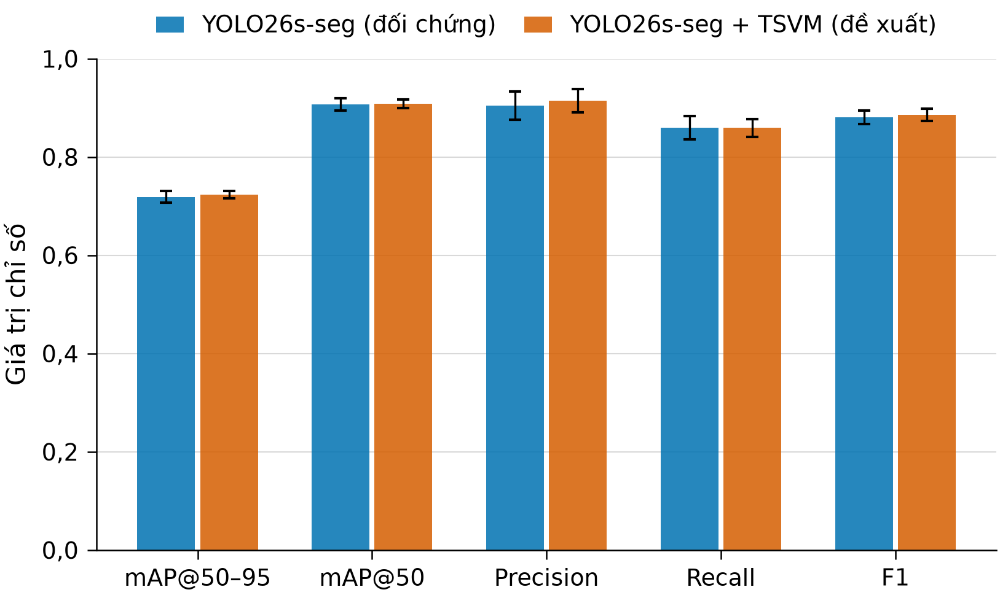

*Hình 6.1. Trung bình các chỉ số mặt nạ của hai mô hình trên 20 seed. Thanh lỗi là ±1 độ lệch chuẩn qua các seed.*

Trên chỉ số chính, mô hình đề xuất đạt 0,7232, cao hơn mô hình gốc 0,0043, tức khoảng 0,6% tương đối. TSVM cao hơn ở 13/20 seed. Tuy vậy, khoảng tin cậy 95% của hiệu số vẫn chứa 0, kiểm định t cho $p = 0{,}061$ và Wilcoxon cho $p = 0{,}070$. Cỡ hiệu ứng $d_z = 0{,}44$, ở mức nhỏ đến vừa theo quy ước của Cohen [65]. **Như vậy, ở mức ý nghĩa 0,05, chưa đủ bằng chứng để khẳng định TSVM tốt hơn mô hình gốc.** Kết quả chỉ cho thấy một xu hướng tăng nhỏ.

Cần lưu ý chiều ngược lại: $p > 0{,}05$ cũng không chứng minh hai mô hình tương đương. Khoảng tin cậy cho thấy hiệu số thật có thể nằm trong khoảng từ gần 0 đến khoảng +0,009.

Các chỉ số phụ đi cùng chiều nhưng yếu hơn. Precision tăng khoảng 1 điểm phần trăm, Recall gần như không đổi, F1 tăng 0,005. Ở mAP50, hai mô hình gần như bằng nhau (+0,0014). Điều này gợi ý rằng phần chênh lệch nhỏ của mAP50–95 nằm ở các ngưỡng IoU cao, tức mức khớp biên mặt nạ, chứ không ở khả năng tìm ra polyp. Không chỉ số phụ nào có ý nghĩa thống kê.

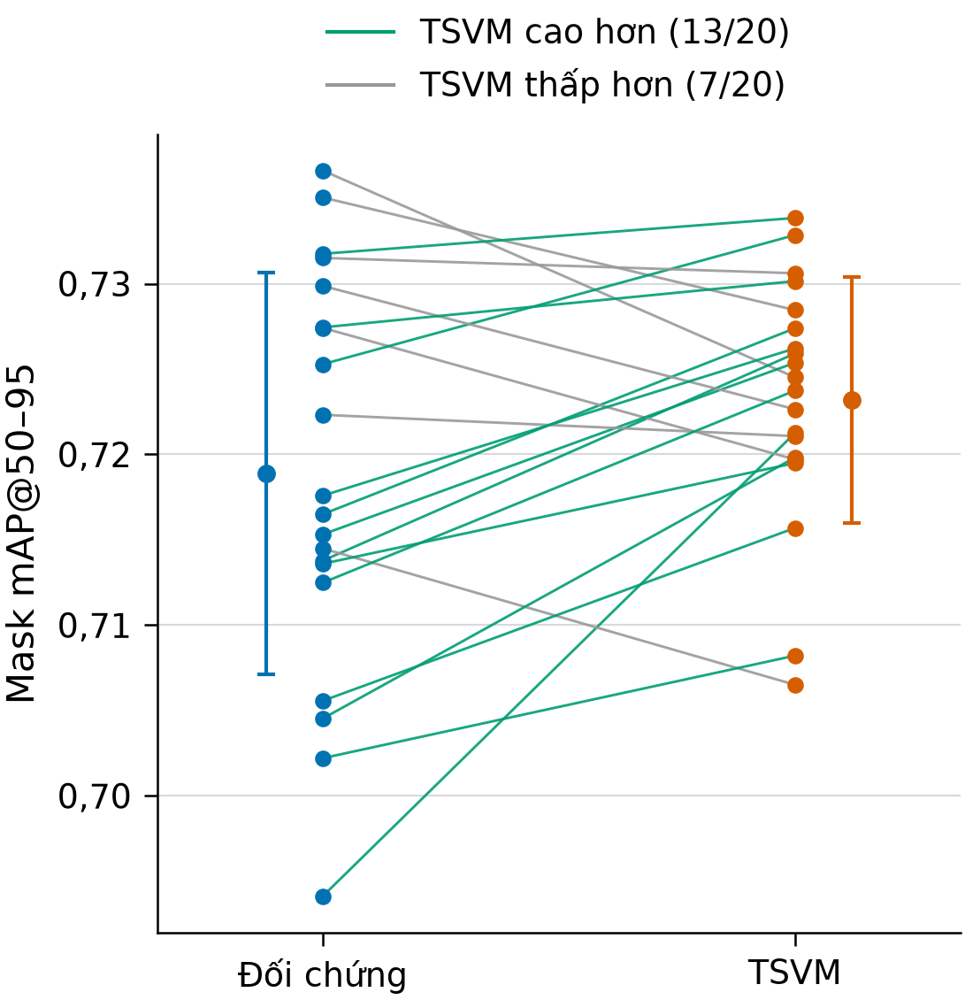

*Hình 6.2. Mask mAP50–95 của từng seed. Mỗi đường nối hai lượt cùng seed của hai mô hình.*

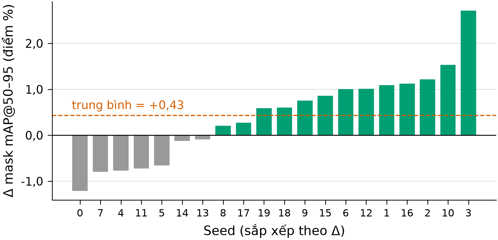

*Hình 6.3. Hiệu số mask mAP50–95 (TSVM − gốc) của từng seed, sắp xếp từ nhỏ đến lớn.*

Hình 6.2 và Hình 6.3 cho thấy hiệu số dao động khá rộng, từ −0,0121 (seed 0) đến +0,0272 (seed 3). Lượt tốt nhất của mô hình gốc (0,7366, seed 0) còn cao hơn lượt tốt nhất của TSVM (0,7339, seed 8). Các hiệu số dương lớn nhất rơi vào những seed mà mô hình gốc cho kết quả thấp, ví dụ seed 3 (0,6941 so với 0,7213) và seed 10 (0,7045 so với 0,7198).

### 6.2.2. Độ ổn định giữa các seed

*Bảng 6.3. Mức dao động của mask mAP50–95 qua 20 seed*

| | YOLO26s-seg | TSVM |
|---|---:|---:|
| Độ lệch chuẩn | 0,0118 | 0,0072 |
| Nhỏ nhất | 0,6941 | 0,7065 |
| Lớn nhất | 0,7366 | 0,7339 |
| Khoảng (lớn nhất − nhỏ nhất) | 0,0425 | 0,0274 |

*Nguồn: `bang/02_ket_qua_tung_seed.csv`.*

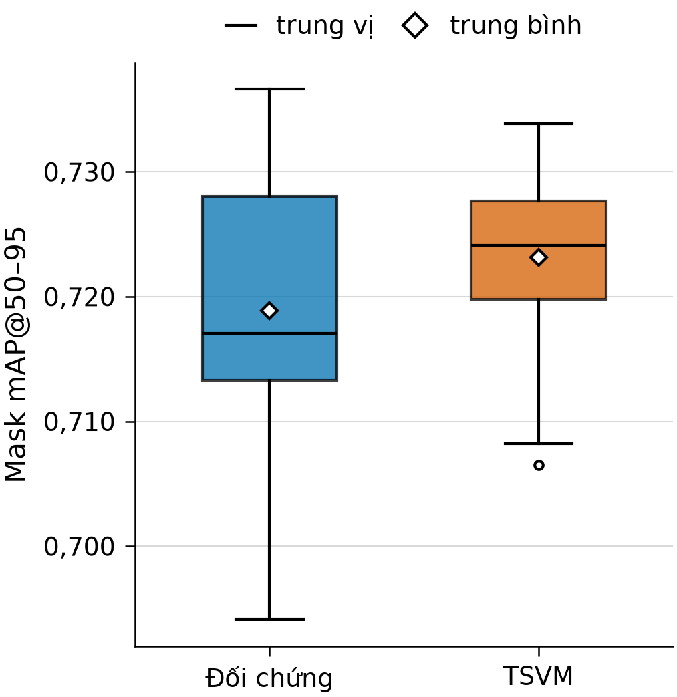

*Hình 6.4. Phân bố mask mAP50–95 qua 20 seed của hai mô hình.*

Độ lệch chuẩn của TSVM nhỏ hơn khoảng 39%. Kiểm định Levene dạng trung vị cho $p = 0{,}026$. Đây là kết quả duy nhất trong phần so sánh trên tập kiểm định có $p < 0{,}05$. Do kiểm định này bỏ qua cấu trúc ghép cặp và không phải chỉ số chính, đề tài chỉ coi đây là dấu hiệu thăm dò: **TSVM cho kết quả ít phụ thuộc vào seed hơn**.

Dấu hiệu này cũng có giới hạn:
- Nó chỉ đúng ở epoch tốt nhất. Ở epoch 100, độ lệch chuẩn của hai mô hình gần bằng nhau (0,0132 và 0,0130).
- Trong 100 epoch, có 34 epoch mà độ lệch chuẩn của TSVM lớn hơn của mô hình gốc.
- Trên dữ liệu ngoài (mục 6.7), độ lệch chuẩn của TSVM không nhỏ hơn.

### 6.2.3. Độ nhạy theo quy tắc chọn epoch

Chọn epoch tốt nhất trên chính tập dùng để báo cáo có thể làm kết quả lạc quan. Bảng 6.4 so sánh ba quy tắc chọn epoch.

*Bảng 6.4. Mask mAP50–95 theo ba quy tắc chọn epoch*

| Quy tắc | YOLO26s-seg | TSVM | Δ | p (t) | p (Wilcoxon) | Seed TSVM tốt hơn |
|---|---:|---:|---:|---:|---:|---:|
| Mask mAP50–95 lớn nhất (chỉ số chính) | 0,7189 ± 0,0118 | 0,7232 ± 0,0072 | +0,0043 | 0,061 | 0,070 | 13/20 |
| Epoch của `best.pt` (chỉ số tổng hợp hộp và mặt nạ) | 0,7174 ± 0,0129 | 0,7222 ± 0,0075 | +0,0048 | 0,062 | 0,076 | 14/20 |
| Epoch 100 (cuối huấn luyện) | 0,7093 ± 0,0132 | 0,7119 ± 0,0130 | +0,0025 | 0,456 | 0,349 | 12/20 |

*Nguồn: `bang/04b_do_nhay_quy_tac_epoch.csv`.*

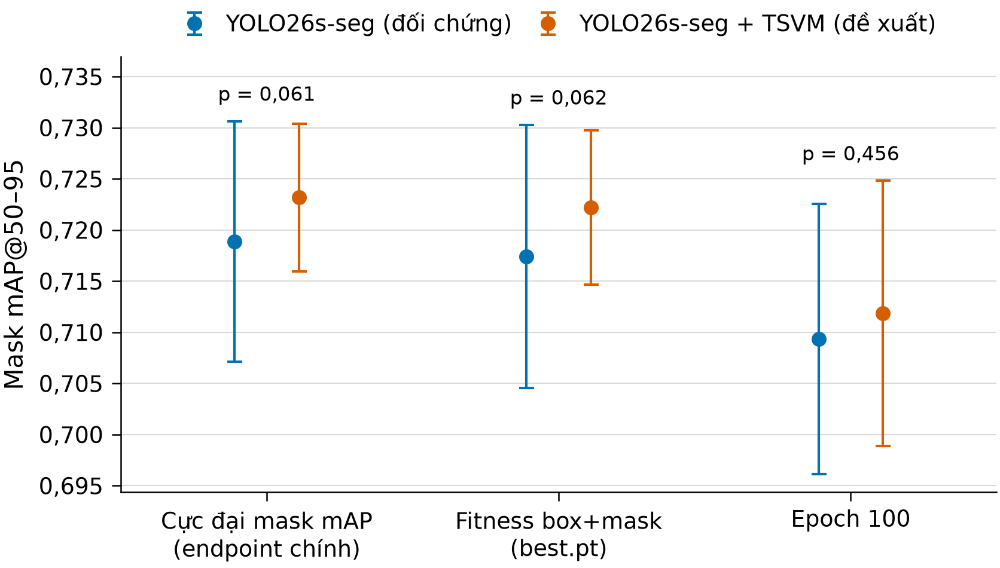

*Hình 6.5. Mask mAP50–95 theo ba quy tắc chọn epoch. Điểm là trung bình, thanh là ±1 độ lệch chuẩn.*

Hai quy tắc dựa trên epoch tốt nhất cho kết luận gần như nhau. Nếu lấy epoch cuối, khoảng cách thu hẹp còn +0,0025 và không còn dấu hiệu ổn định hơn. Như vậy kết luận "xu hướng tăng nhỏ, chưa có ý nghĩa thống kê" không phụ thuộc vào cách chọn epoch.

### 6.2.4. Quá trình hội tụ

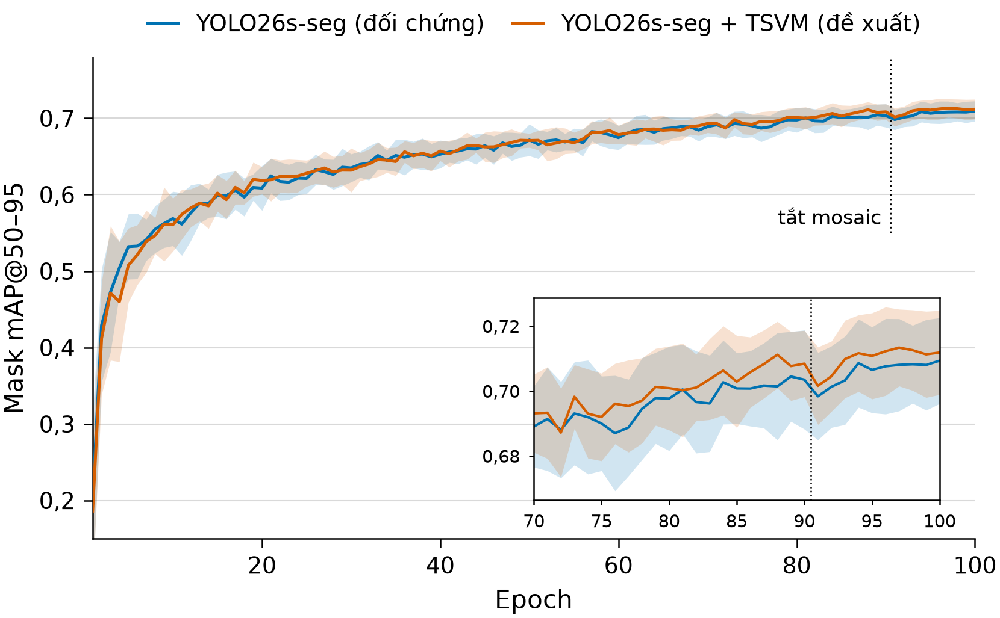

*Hình 6.6. Mask mAP50–95 trên tập kiểm định theo epoch. Đường là trung bình 20 seed, miền tô là ±1 độ lệch chuẩn. Ô nhỏ phóng to đoạn epoch 70–100.*

*Bảng 6.5. Mask mAP50–95 tại một số epoch*

| Epoch | YOLO26s-seg | TSVM |
|---:|---:|---:|
| 5 | 0,5320 ± 0,0427 | 0,5076 ± 0,0485 |
| 10 | 0,5687 ± 0,0355 | 0,5606 ± 0,0347 |
| 30 | 0,6349 ± 0,0183 | 0,6320 ± 0,0287 |
| 50 | 0,6716 ± 0,0208 | 0,6709 ± 0,0091 |
| 70 | 0,6890 ± 0,0125 | 0,6931 ± 0,0120 |
| 90 | 0,7035 ± 0,0152 | 0,7084 ± 0,0102 |
| 100 | 0,7093 ± 0,0132 | 0,7119 ± 0,0130 |

*Nguồn: `bang/05_duong_cong_theo_epoch.csv`.*

Hình 6.6 và Bảng 6.5 cho thấy ba giai đoạn:
1. **Khoảng 10 epoch đầu:** TSVM tăng chậm hơn. Điều này phù hợp với cách khởi tạo ở mục 3.5: phần mới của tầng 10 có hơn một triệu tham số khởi tạo ngẫu nhiên, và hệ số $\gamma = 0{,}001$ làm khối mới gần như "tắt" lúc đầu.
2. **Epoch 50 đến 81:** hai đường đan xen nhau.
3. **Epoch 82 đến 100:** trung bình của TSVM luôn cao hơn.

Phần lớn các lượt đạt cực đại muộn: trung vị epoch tốt nhất là 88 với mô hình gốc và 92 với TSVM. Khi tắt Mosaic ở epoch 91, mAP của cả hai mô hình giảm nhẹ một epoch rồi tăng lại.

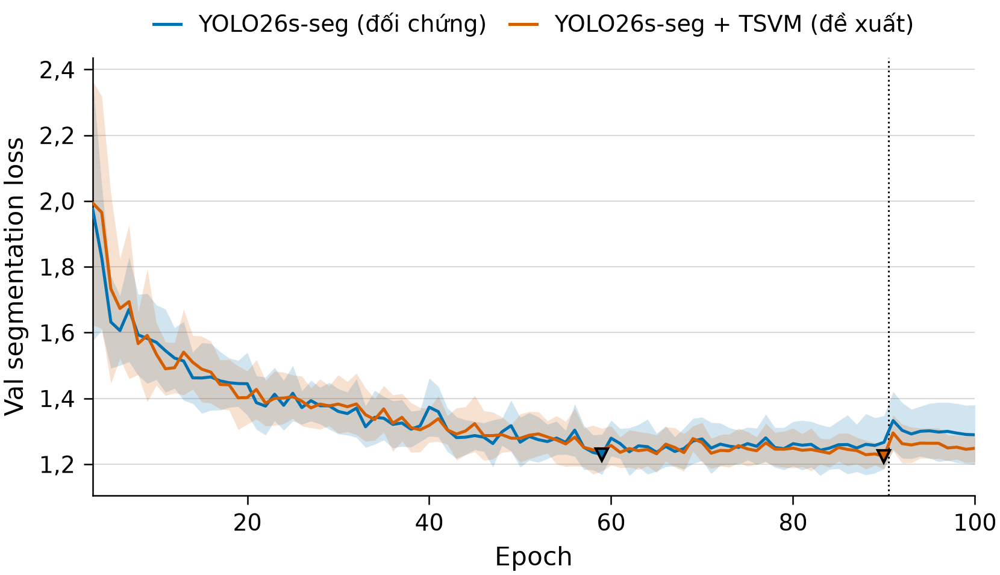

*Hình 6.7. Hàm mất mát phân đoạn trên tập kiểm định theo epoch. Dấu ▼ đánh dấu epoch có giá trị trung bình thấp nhất.*

Hàm mất mát phân đoạn trên tập kiểm định của mô hình gốc thấp nhất ở epoch 59 (1,2294) rồi tăng lên 1,2893 ở epoch 100. Của TSVM thấp nhất ở epoch 90 (1,2236). Mô hình gốc có dấu hiệu quá khớp sớm hơn trên hàm mất mát, dù mAP của nó vẫn tăng tới cuối. Đây là quan sát mô tả, chưa kiểm định.

### 6.2.5. Ma trận nhầm lẫn theo đối tượng

Ma trận nhầm lẫn do Ultralytics tính khi đánh giá `best.pt` ở cuối mỗi lượt. Đơn vị là **vùng polyp**, không phải ảnh.

*Bảng 6.6. Số vùng polyp phát hiện đúng, bỏ sót và dự đoán thừa (trên 127 vùng polyp)*

| | YOLO26s-seg | TSVM | Δ | p (Wilcoxon) |
|---|---:|---:|---:|---:|
| Phát hiện đúng (TP) | 110,55 ± 2,95 | 110,65 ± 1,87 | +0,10 | 1,000 |
| Bỏ sót (FN) | 16,45 ± 2,95 | 16,35 ± 1,87 | −0,10 | 1,000 |
| Dự đoán thừa (FP) | 16,45 ± 3,43 | 15,75 ± 3,02 | −0,70 | 0,671 |

*Nguồn: `bang/06_ma_tran_nham_lan_tung_seed.csv`, đã đối chiếu với 40 ảnh `confusion_matrix.png`.*

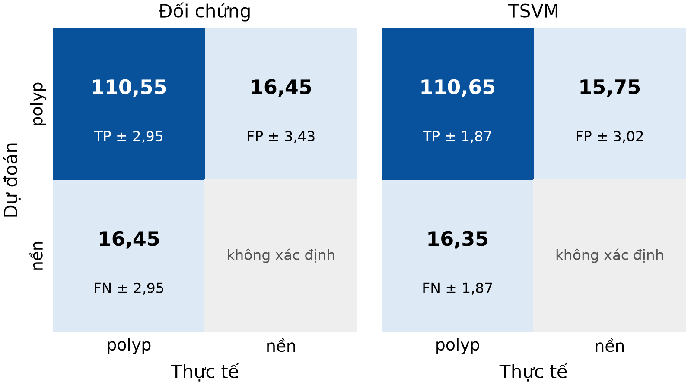

*Hình 6.8. Ma trận nhầm lẫn trung bình 20 seed. Ô nền–nền để trống vì không xác định được ở mức đối tượng.*

Hai mô hình tìm được gần như cùng số polyp, khoảng 110,6/127 vùng (87%). TSVM dự đoán thừa ít hơn trung bình 0,7 vùng, nhưng khác biệt không có ý nghĩa thống kê.

Ô "đúng là nền" (TN) không xác định được: dự đoán thừa có thể nằm trên ảnh nền hoặc ngay trên ảnh có polyp, và một ảnh có thể có nhiều dự đoán thừa. Vì vậy đề tài không tính độ đặc hiệu hay độ chính xác theo ảnh từ bảng này. Tỉ lệ báo nhầm trên ảnh nền được đo riêng ở mục 6.3.

## 6.3. Đánh giá theo pixel và so sánh với PraNet, U-Net

*Bảng 6.7. Chỉ số theo pixel của bốn mô hình trên tập kiểm định (20 seed)*

| Mô hình | Dice | IoU | Precision | Recall | Dice gộp pixel | Ảnh nền báo nhầm (%) |
|---|---:|---:|---:|---:|---:|---:|
| YOLO26s-seg | 0,8486 ± 0,0171 | 0,7927 ± 0,0170 | 0,8585 ± 0,0170 | 0,8703 ± 0,0193 | 0,8659 ± 0,0313 | 1,2 ± 1,9 |
| TSVM | 0,8540 ± 0,0129 | **0,7998 ± 0,0129** | 0,8632 ± 0,0173 | 0,8730 ± 0,0112 | **0,8785 ± 0,0243** | 1,5 ± 2,1 |
| PraNet | **0,8541 ± 0,0068** | 0,7785 ± 0,0063 | **0,8687 ± 0,0117** | **0,8881 ± 0,0145** | 0,8715 ± 0,0060 | **0,8 ± 1,2** |
| U-Net | 0,7097 ± 0,0221 | 0,6069 ± 0,0221 | 0,7964 ± 0,0213 | 0,7167 ± 0,0327 | 0,7412 ± 0,0185 | 20,4 ± 6,4 |

*Nguồn: `bang/11_pixel_tung_seed.csv`, `bang/12_pixel_thong_ke.csv`. Số in đậm là giá trị tốt nhất của mỗi cột.*

*Bảng 6.8. So sánh ghép cặp TSVM với từng mô hình theo pixel (cùng seed)*

| So với | Chỉ số | Δ (TSVM − mô hình kia) | p (t) | p (Wilcoxon) | Seed TSVM cao hơn |
|---|---|---:|---:|---:|---:|
| YOLO26s-seg | Dice | +0,0054 | 0,260 | 0,246 | 13/20 |
| | IoU | +0,0071 | 0,130 | 0,114 | 14/20 |
| | Ảnh nền báo nhầm | +0,25 điểm % | 0,694 | 0,793 | |
| PraNet | Dice | −0,0001 | 0,982 | 0,927 | 12/20 |
| | IoU | +0,0213 | < 0,001 | < 0,001 | 19/20 |
| | Recall | −0,0151 | 0,002 | 0,001 | 5/20 |
| U-Net | Dice | +0,1443 | < 0,001 | < 0,001 | 20/20 |
| | Ảnh nền báo nhầm | −18,9 điểm % | < 0,001 | < 0,001 | |

*Nguồn: `bang/12_pixel_thong_ke.csv`.*

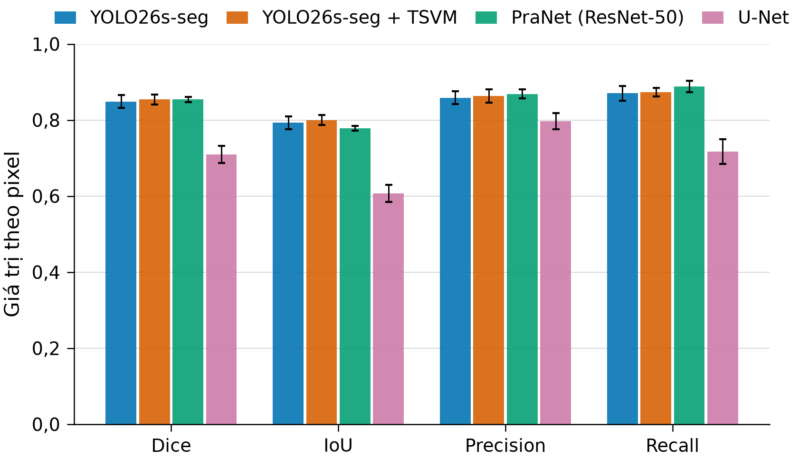

*Hình 6.9. Dice, IoU, Precision và Recall theo pixel của bốn mô hình. Thanh lỗi là ±1 độ lệch chuẩn qua 20 seed.*

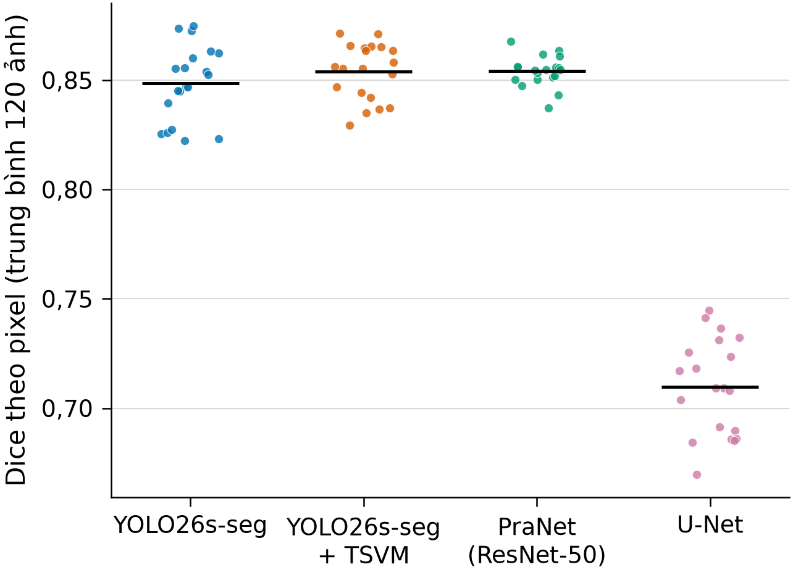

*Hình 6.10. Dice theo pixel của từng seed.*

**So với mô hình gốc.** Theo pixel, TSVM vẫn có xu hướng tăng nhẹ (Dice +0,005, IoU +0,007, cao hơn ở 13–14/20 seed) nhưng không có ý nghĩa thống kê. Kết luận này khớp với kết luận theo mAP ở mục 6.2.

**So với PraNet.** Dice trung bình của TSVM và PraNet gần như bằng nhau. Hai mô hình mạnh ở hai mặt khác nhau:
- TSVM có **IoU cao hơn** ở 19/20 seed ($p < 0{,}001$). Khi đã khoanh được polyp, mặt nạ của TSVM khớp với nhãn sát hơn.
- PraNet có **Recall cao hơn** ($p = 0{,}002$) và **ổn định hơn nhiều** giữa các seed (độ lệch chuẩn Dice 0,0068 so với 0,0129).

Một nguyên nhân làm Dice trung bình của hai mô hình YOLO bị kéo xuống là các ảnh bị **bỏ sót hoàn toàn**. Ở ngưỡng tin cậy 0,25, YOLO không dự đoán pixel nào trên trung bình khoảng 6,5/120 ảnh có polyp mỗi seed (mô hình gốc 6,45, TSVM 6,65). PraNet chỉ bỏ sót 0,95 ảnh. Mỗi ảnh bỏ sót có Dice bằng 0. Vì vậy, khi gộp pixel cả 120 ảnh (ảnh lớn có trọng số lớn hơn), Dice của TSVM là 0,8785, cao hơn PraNet (0,8715).

**So với U-Net.** Ba mô hình còn lại đều hơn U-Net rất xa. U-Net còn báo nhầm khoảng 20% ảnh nền.

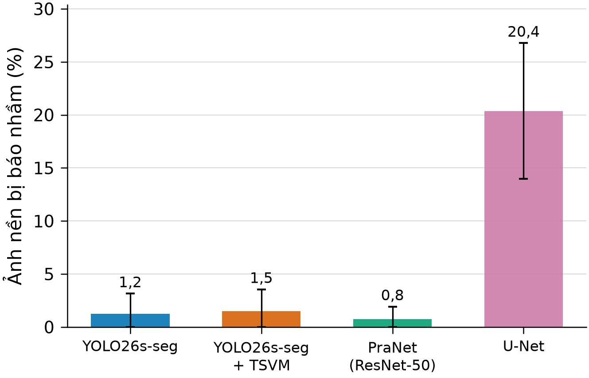

*Hình 6.11. Tỉ lệ ảnh nền bị báo nhầm (có ít nhất một pixel dự đoán là polyp) trên 40 ảnh nền.*

Trên 40 ảnh nền, cả hai mô hình YOLO và PraNet đều báo nhầm rất ít (khoảng 1–1,5%, tức dưới một ảnh mỗi seed). Ảnh nền trong tập kiểm định đều lấy từ lớp manh tràng bình thường, khá đồng nhất, nên con số này chưa đại diện cho niêm mạc bình thường nói chung.

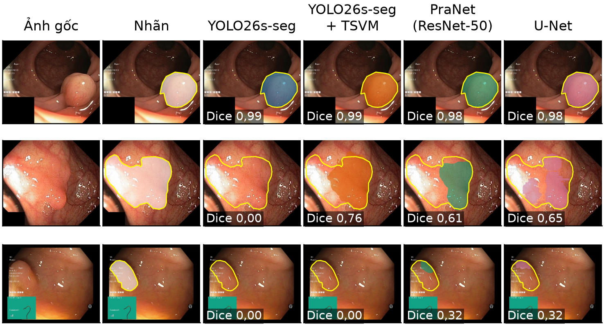

*Hình 6.12. Ví dụ dự đoán của bốn mô hình (seed 0). Ba ảnh được chọn tự động: ảnh cả bốn mô hình đều tốt, ảnh TSVM hơn mô hình gốc nhiều nhất và ảnh khó nhất.*

Hình 6.12 chỉ có tính minh họa. Các ảnh được chọn theo tiêu chí nêu trong chú thích, không phải chọn ngẫu nhiên, nên không dùng hình này để kết luận mô hình nào tốt hơn.

**Giới hạn của phép so sánh.** Bốn mô hình được huấn luyện với thiết lập khác nhau. YOLO dùng ảnh 640 pixel, có tăng cường dữ liệu và khởi tạo từ COCO. PraNet và U-Net dùng ảnh 352 pixel, không tăng cường dữ liệu. PraNet trong đề tài dùng xương sống ResNet-50 thay cho Res2Net-50 của bản gốc. Ngưỡng của từng mô hình cũng chưa được tối ưu riêng. Vì vậy kết quả phản ánh các cấu hình cụ thể này, không phải giới hạn tối đa của từng kiến trúc, và không so trực tiếp với số trong bài báo gốc của PraNet.

## 6.4. Chỉ số topology của mặt nạ

### 6.4.1. Mục đích và cách đo

Tên khối đề xuất có chữ "topology", nhưng mAP và Dice gần như không phạt các lỗi về hình dạng tổng thể của mặt nạ, như mặt nạ bị vỡ thành nhiều mảnh hoặc có lỗ thủng nhỏ. Các lỗi này chỉ chiếm ít pixel. Đề tài đo trực tiếp hai đại lượng topology của mặt nạ:
- $b_0$: **số mảnh**, tức số thành phần liên thông của vùng polyp (liên thông 8 hướng);
- $b_1$: **số lỗ**, tức số vùng nền nằm hẳn bên trong vùng polyp (liên thông 4 hướng, không chạm biên ảnh).

Hai đại lượng này là hai số Betti đầu tiên của mặt nạ. Mảnh và lỗ có diện tích dưới 20 pixel không được đếm, trùng với ngưỡng loại đốm nhiễu khi tạo nhãn ở Chương 4. Trên 120 ảnh có polyp, nhãn có 113 ảnh một mảnh, 7 ảnh hai mảnh và không ảnh nào có lỗ.

Một ảnh được coi là **đúng topology** nếu cả $b_0$ và $b_1$ của dự đoán đều bằng của nhãn. Giao thức suy luận giống mục 6.1.5.

### 6.4.2. Kết quả

*Bảng 6.9. Chỉ số topology của bốn mô hình (ngưỡng 20 pixel, 20 seed)*

| Chỉ số | YOLO26s-seg | TSVM | PraNet | U-Net |
|---|---:|---:|---:|---:|
| Ảnh đúng topology ↑ | 0,797 ± 0,027 | 0,808 ± 0,026 | **0,914 ± 0,021** | 0,260 ± 0,045 |
| Lỗi $b_0$ trung bình ↓ | 0,198 ± 0,045 | 0,191 ± 0,032 | **0,086 ± 0,025** | 2,745 ± 0,641 |
| Lỗi $b_1$ trung bình ↓ | 0,105 ± 0,039 | 0,094 ± 0,027 | **0,004 ± 0,006** | 1,215 ± 0,419 |
| Ảnh thừa mảnh ↓ | 0,082 ± 0,027 | 0,082 ± 0,018 | **0,057 ± 0,021** | 0,638 ± 0,046 |
| Ảnh có lỗ ↓ | 0,073 ± 0,020 | 0,063 ± 0,014 | **0,004 ± 0,005** | 0,432 ± 0,069 |
| Ảnh thiếu mảnh ↓ | 0,071 ± 0,023 | 0,066 ± 0,016 | **0,027 ± 0,008** | 0,028 ± 0,016 |

*Nguồn: `bang/14_topology_tung_seed.csv`, `bang/15_topology_thong_ke.csv`. ↑ là càng cao càng tốt, ↓ là càng thấp càng tốt. Lỗi $b_0$, $b_1$ là trung bình của |dự đoán − nhãn| trên 120 ảnh có polyp.*

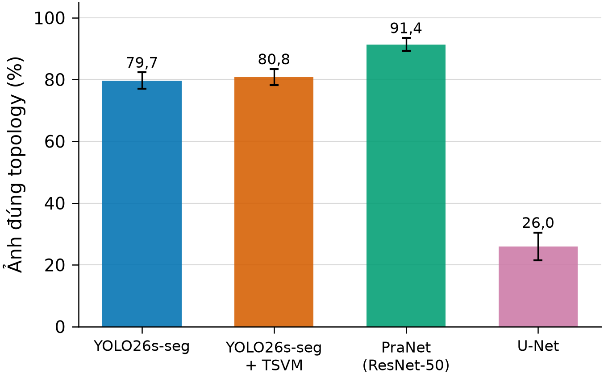

*Hình 6.13. Tỉ lệ ảnh có polyp được dự đoán đúng topology (số mảnh và số lỗ khớp nhãn).*

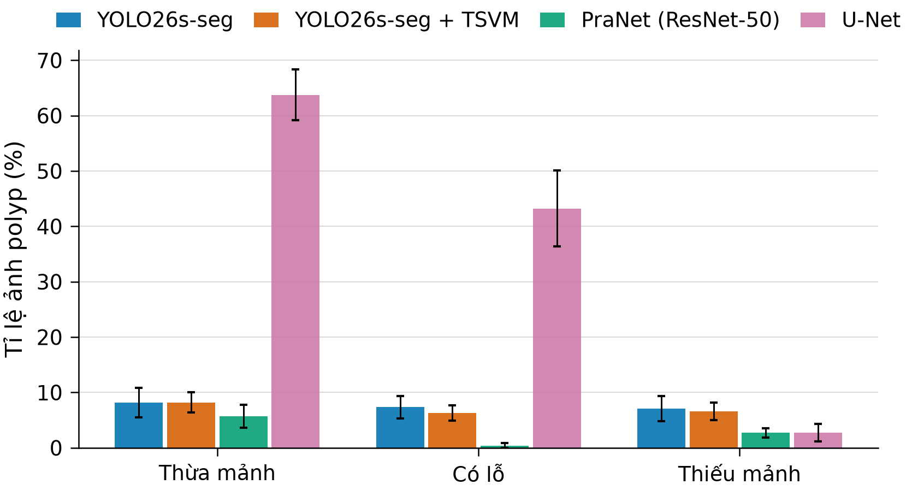

*Hình 6.14. Tỉ lệ ảnh mắc từng kiểu lỗi topology: thừa mảnh, có lỗ và thiếu mảnh.*

So với mô hình gốc, mọi chỉ số topology của TSVM đều nhích theo chiều có lợi: tỉ lệ ảnh đúng topology tăng 1,1 điểm phần trăm và tỉ lệ ảnh có lỗ giảm 1 điểm phần trăm. Tuy vậy, không chỉ số nào có ý nghĩa thống kê: ảnh đúng topology có $p = 0{,}139$, ảnh có lỗ có $p = 0{,}099$, tỉ lệ ảnh thừa mảnh gần như không đổi. Khi đếm cả mảnh nhỏ hơn 20 pixel, kết luận không đổi (0,758 so với 0,770; $p = 0{,}086$). **Vì vậy đề tài không khẳng định khối đề xuất cải thiện topology của mặt nạ.**

PraNet có topology tốt nhất rõ rệt: 91% ảnh đúng so với 81% của TSVM, TSVM kém hơn ở cả 20/20 seed ($p < 0{,}001$), và mặt nạ của PraNet hầu như không có lỗ. Một cách giải thích hợp lý là khác biệt ở cách tạo mặt nạ. PraNet xuất một bản đồ xác suất trơn rồi lấy ngưỡng. YOLO ghép mặt nạ từ các mặt nạ mẫu 160 × 160 rồi phóng lên (mục 2.3.4), dễ tạo lỗ nhỏ và mép răng cưa. Giải thích này chưa được kiểm chứng bằng thí nghiệm riêng.

Ở hai mô hình YOLO, lỗi topology chia khá đều giữa ba kiểu (thừa mảnh, có lỗ, thiếu mảnh), mỗi kiểu khoảng 6–8% số ảnh.

## 6.5. Chi phí tính toán

### 6.5.1. Số tham số và số phép tính

*Bảng 6.10. Số tham số và số phép tính của hai mô hình*

| | YOLO26s-seg | TSVM | Chênh lệch |
|---|---:|---:|---:|
| Tham số toàn mô hình | 11.434.463 | 12.254.688 | +820.225 (+7,2%) |
| Tham số tầng 10 | 990.976 (C2PSA) | 1.811.201 (C2TSVMamba) | +82,8% |
| GFLOPs (`FlopCounterMode` của PyTorch) | 34,29 | 34,82 | +1,5% |
| GFLOPs (cách đếm của Ultralytics) | 37,32 | 37,86 | +1,4% |
| Tệp `best.pt` | 22,27 MiB (FP16) | 47,37 MiB (FP32) | |

*Nguồn: `bang/08_kien_truc_dung_lai.csv`, `bang/16_flops_do_tre_gpu.csv`, `bang/07_checkpoint_best_pt.csv`. FLOPs đo trên một ảnh 640 × 640 sau khi gộp tích chập với chuẩn hóa lô.*

Bộ đếm `FlopCounterMode` của PyTorch [74] chỉ đếm các phép tích chập và nhân ma trận. Các phép theo từng phần tử trong phép quét SS2D không được đếm, nên số GFLOPs của TSVM là **cận dưới**. Bộ đếm của Ultralytics cho số lớn hơn khoảng 3 GFLOPs ở cả hai mô hình do khác cách đếm, nhưng tỉ lệ giữa hai mô hình như nhau. Tệp `best.pt` của TSVM lớn gấp khoảng hai lần chủ yếu vì được lưu ở FP32 (mục 3.8), không phải vì số tham số.

### 6.5.2. Độ trễ suy luận

Độ trễ được đo trên hai loại phần cứng với checkpoint seed 0, lô 1 ảnh, ảnh vào 640 × 640, FP32.

*Bảng 6.11. Độ trễ suy luận của hai mô hình*

| Phần cứng | Cách đo | YOLO26s-seg (ms) | TSVM (ms) | Tỉ lệ |
|---|---|---:|---:|---:|
| CPU AMD Ryzen 7 250, 4 luồng | Chỉ lan truyền xuôi, trung bình 100 lần | 269,56 ± 18,71 | 577,36 ± 24,40 | 2,14 lần |
| | Cả quy trình dự đoán (tiền xử lý, lan truyền xuôi, hậu xử lý), 20 ảnh | 286,56 ± 20,09 | 567,86 ± 24,45 | 1,98 lần |
| GPU RTX 5050 Laptop | Chỉ lan truyền xuôi, nhỏ nhất | 11,77 | 20,39 | 1,73 lần |
| | Phân vị 10% | 12,91 | 22,68 | 1,76 lần |
| | Trung vị vòng đo đầu tiên | 13,68 | 23,76 | 1,74 lần |

*Nguồn: CPU: `04_phan_tich_20seed/efficiency_benchmark/tables/efficiency_summary.csv`; GPU: `bang/16_flops_do_tre_gpu.csv`, `bang/16b_do_tre_gpu_tung_lan.csv` (1.800 lần đo). Môi trường CPU: PyTorch 2.6.0. Môi trường GPU: PyTorch 2.13.0, CUDA 13.0.*

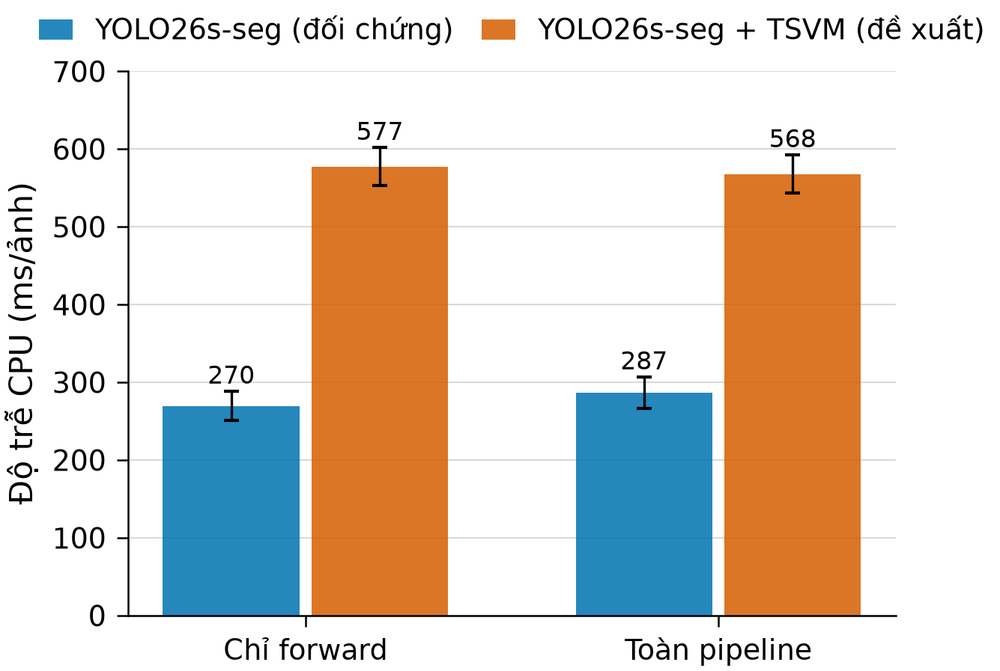

*Hình 6.15. Độ trễ trên CPU của hai mô hình ở hai chế độ đo. Thanh lỗi là ±1 độ lệch chuẩn qua 100 lần đo.*

Trên GPU, mỗi mô hình được đo 3 vòng, mỗi vòng 300 lần sau 50 lần chạy khởi động, xen kẽ hai mô hình. GPU của máy tính xách tay tự hạ xung nhịp khi nóng, làm độ trễ của cả hai mô hình tăng dần qua các vòng. Nếu lấy trung vị của cả 3 vòng, tỉ lệ lên tới 2,47 lần, nhưng con số này bị nhiễu bởi nhiệt độ. Vì vậy Bảng 6.11 dùng ba cách đo ít bị ảnh hưởng nhất: giá trị nhỏ nhất, phân vị 10% và trung vị của vòng đầu. Ba cách cho tỉ lệ gần nhau, khoảng **1,7 lần**.

### 6.5.3. Nhận xét

Số phép tính chỉ tăng khoảng 1,5%, nhưng độ trễ tăng khoảng 1,7 lần trên GPU và 2,1 lần trên CPU. Như vậy GFLOPs không phản ánh đúng tốc độ của khối Mamba viết bằng PyTorch thuần. Nguyên nhân chính là phép quét song song (mục 3.4): với chuỗi dài 400 vị trí, phép quét chạy 9 vòng nối tiếp, mỗi vòng tạo các tensor trung gian và nhiều phép tính theo từng phần tử. Các phép này bị giới hạn bởi băng thông bộ nhớ và số lần gọi kernel, chứ không bởi số phép nhân. Bản Mamba gốc tránh được chi phí này nhờ kernel CUDA viết riêng [26].

Đặt cạnh kết quả ở mục 6.2, mô hình đề xuất **tốn thêm khoảng 70–110% thời gian suy luận để đổi lấy mức tăng mAP50–95 khoảng 0,004 chưa có ý nghĩa thống kê**. Ở độ trễ khoảng 20 ms trên GPU, mô hình vẫn xử lý được khoảng 50 ảnh mỗi giây khi chỉ tính lan truyền xuôi. Tuy vậy, đây là đo trên một máy, một checkpoint, nên không suy ra tốc độ trên hệ thống nội soi thật.

## 6.6. Thí nghiệm tách thành phần

### 6.6.1. Thiết kế

Khối TSVMamba gồm ba thành phần: nhánh SS2D, nhánh hình dạng và cổng $(1+G)$ (Chương 3). Để biết thành phần nào đóng góp vào kết quả, đề tài huấn luyện thêm ba biến thể, mỗi biến thể bỏ bớt một phần (Bảng 5.6):
- `vmamba_only`: chỉ giữ nhánh SS2D;
- `shape_only`: chỉ giữ nhánh hình dạng;
- `shape_vmamba_no_guidance`: giữ cả hai nhánh nhưng bỏ cổng, hai nhánh chỉ được nối lại rồi trộn bằng tích chập 1 × 1.

Mọi thiết lập khác giữ nguyên như mô hình đầy đủ. Do giới hạn giờ GPU, mỗi biến thể chạy với **5 seed (seed 0–4)**, cùng seed với các lượt chính để so sánh ghép cặp.

### 6.6.2. Kết quả

*Bảng 6.12. Kết quả thí nghiệm tách thành phần (mask mAP50–95, seed 0–4)*

| Cấu hình | SS2D | Nhánh hình dạng | Cổng | Tham số tầng 10 | Mask mAP50–95 | Δ so với gốc | Δ so với đầy đủ |
|---|:---:|:---:|:---:|---:|---:|---:|---:|
| YOLO26s-seg (C2PSA) | | | | 990.976 | 0,7177 ± 0,0160 | – | −0,0061 |
| TSVM đầy đủ | ✓ | ✓ | ✓ | 1.811.201 | 0,7238 ± 0,0032 | +0,0061 | – |
| `vmamba_only` | ✓ | | | 1.071.873 | **[CHỜ KẾT QUẢ]** | **[CHỜ]** | **[CHỜ]** |
| `shape_only` | | ✓ | | 1.331.969 | **[CHỜ KẾT QUẢ]** | **[CHỜ]** | **[CHỜ]** |
| `shape_vmamba_no_guidance` | ✓ | ✓ | | 1.745.409 | **[CHỜ KẾT QUẢ]** | **[CHỜ]** | **[CHỜ]** |

*Nguồn: hai dòng đầu từ `bang/02_ket_qua_tung_seed.csv` (seed 0–4 của các lượt chính); ba dòng sau từ `03_ket_qua_huan_luyen/{Vmamba_only, Shape_only, No_guidance}/` **[CHỜ KẾT QUẢ]**. Số tham số tầng 10 của ba biến thể là ước tính ở Bảng 3.7.*

> **[CHỜ KẾT QUẢ] Hình 6.16.** Mask mAP50–95 từng seed (0–4) của năm cấu hình, dạng điểm nối cặp theo seed. Vẽ bằng `ve_hinh.py` khi đủ 15 lượt.

**[CHỜ KẾT QUẢ: đoạn nhận xét.]** Khi viết, trả lời ba câu hỏi theo thứ tự:
1. Bỏ nhánh hình dạng (`vmamba_only`) thì mAP thay đổi thế nào so với mô hình đầy đủ?
2. Bỏ SS2D (`shape_only`) thì sao?
3. Bỏ cổng (`shape_vmamba_no_guidance`) thì sao? Cổng có thực sự cần không?

### 6.6.3. Cách đọc kết quả

Với 5 seed, kiểm định ghép cặp có lực kiểm định thấp. Ở mục 6.2, ngay cả 20 seed cũng chưa đủ để thấy chênh lệch 0,004 có ý nghĩa thống kê. Vì vậy, phần tách thành phần chỉ dùng để **mô tả xu hướng**: biến thể nào gần mô hình đầy đủ, biến thể nào gần mô hình gốc. Nếu khoảng cách giữa các cấu hình nhỏ hơn độ lệch chuẩn giữa các seed (khoảng 0,007–0,012 ở mục 6.2), không nên kết luận thành phần nào quan trọng hơn.

Ngoài ra, các biến thể có số tham số tầng 10 chênh nhau tới khoảng 740 nghìn. Nếu một biến thể tốt hơn, chưa thể tách được phần do cấu trúc và phần do có thêm tham số.

## 6.7. Kết quả trên dữ liệu thực tế

### 6.7.1. Dữ liệu và giao thức

Để đánh giá khả năng tổng quát hóa, đề tài lấy nguyên các checkpoint đã huấn luyện trên BG20, chạy trên bốn bộ dữ liệu **khác nguồn** mà không huấn luyện lại hay tinh chỉnh.

*Bảng 6.13. Các bộ dữ liệu ngoài*

| Bộ dữ liệu | Số ảnh dùng | Kích thước ảnh | Đặc điểm |
|---|---:|---|---|
| CVC-ClinicDB [14] | 612 | 384 × 288 | Khung hình từ video nội soi |
| CVC-ColonDB [15] | 380 | 574 × 500 | Khung hình từ video nội soi |
| ETIS-Larib [16] | 196 | 1.225 × 966 | Nhiều polyp nhỏ, khó |
| PolypGen [13] | 1.537 (1.412 có polyp, 125 không polyp) | Tới 1.920 × 1.080 | Ảnh đơn từ 6 trung tâm (C1–C6) |

*Nguồn: đề tài thống kê. Riêng PolypGen chỉ dùng phần ảnh đơn, không dùng phần chuỗi video.*

Ba bộ CVC-ClinicDB, CVC-ColonDB và ETIS-Larib chỉ có ảnh có polyp. PolypGen có 125 ảnh mà mặt nạ rỗng. Các ảnh này không tính vào Dice và IoU, mà dùng để đo tỉ lệ báo nhầm. Giao thức suy luận và cách tính chỉ số giống hệt mục 6.1.5, với cả bốn mô hình và 20 seed.

Trước khi đánh giá, đề tài kiểm tra PolypGen có trùng ảnh với Kvasir-SEG không bằng ba cách: mã băm MD5 của tệp, mã băm cảm nhận (pHash, dHash) và tương quan ảnh xám thu nhỏ. Không có cặp ảnh nào trùng, nên không loại ảnh nào.

Đây là ảnh công khai thu từ các thiết bị và trung tâm khác Kvasir-SEG, không phải dữ liệu lâm sàng do nhóm thu tại bệnh viện.

### 6.7.2. Kết quả

*Bảng 6.14. Dice và IoU theo pixel trên bốn bộ dữ liệu ngoài (20 seed)*

| Bộ dữ liệu | Chỉ số | YOLO26s-seg | TSVM | PraNet | U-Net | TSVM − gốc | p (t) | p (Wilcoxon) | Seed TSVM cao hơn |
|---|---|---:|---:|---:|---:|---:|---:|---:|---:|
| CVC-ClinicDB | Dice | **0,786** | 0,770 | 0,752 | 0,525 | −0,016 | 0,006 | 0,006 | 5/20 |
| | IoU | **0,725** | 0,712 | 0,676 | 0,425 | −0,013 | 0,010 | 0,015 | 6/20 |
| CVC-ColonDB | Dice | **0,631** | 0,601 | 0,539 | 0,375 | −0,030 | < 0,001 | < 0,001 | 3/20 |
| | IoU | **0,574** | 0,549 | 0,474 | 0,304 | −0,025 | 0,001 | < 0,001 | 3/20 |
| ETIS-Larib | Dice | **0,535** | 0,529 | 0,466 | 0,284 | −0,005 | 0,766 | 0,498 | 7/20 |
| | IoU | **0,493** | 0,490 | 0,416 | 0,225 | −0,003 | 0,851 | 0,571 | 8/20 |
| PolypGen (gộp) | Dice | **0,719** | 0,715 | 0,683 | 0,484 | −0,004 | 0,551 | 0,246 | 7/20 |
| | IoU | **0,665** | 0,663 | 0,616 | 0,402 | −0,003 | 0,605 | 0,312 | 7/20 |

*Nguồn: `08_du_lieu_thuc_te/bang/20seed/01_ngoai_tung_seed.csv`, `02_ngoai_thong_ke.csv`.*

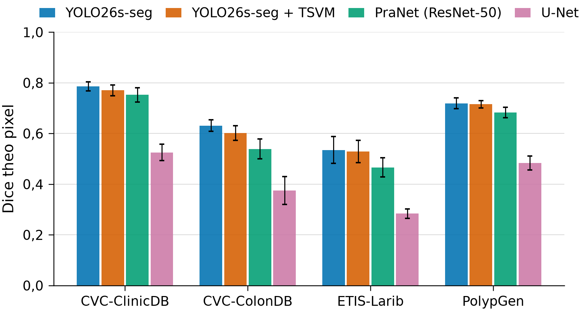

*Hình 6.17. Dice theo pixel của bốn mô hình trên bốn bộ dữ liệu ngoài. Thanh lỗi là ±1 độ lệch chuẩn qua 20 seed.*

*Bảng 6.15. Tỉ lệ ảnh có polyp bị bỏ sót hoàn toàn (mô hình không dự đoán pixel nào)*

| Bộ dữ liệu | YOLO26s-seg | TSVM | PraNet | U-Net | TSVM − gốc | p (t) |
|---|---:|---:|---:|---:|---:|---:|
| CVC-ClinicDB | 11,3% | 13,4% | 10,1% | 7,9% | +2,1 điểm % | 0,003 |
| CVC-ColonDB | 28,2% | 32,0% | 32,0% | 27,0% | +3,8 điểm % | < 0,001 |
| ETIS-Larib | 37,3% | 38,6% | 39,4% | 20,6% | +1,3 điểm % | 0,580 |
| PolypGen (gộp) | 18,1% | 18,9% | 16,3% | 11,5% | +0,8 điểm % | 0,296 |

*Nguồn: như Bảng 6.14 (chỉ số `no_pred_rate`).*

Từ Bảng 6.14 và Bảng 6.15 rút ra bốn điểm:
1. **Mọi mô hình đều giảm mạnh khi gặp dữ liệu khác nguồn.** Dice của TSVM giảm từ 0,854 trên tập kiểm định xuống còn 0,53–0,77. Tỉ lệ ảnh bị bỏ sót hoàn toàn tăng từ khoảng 5% lên 11–39%. ETIS-Larib khó nhất vì có nhiều polyp nhỏ.
2. **TSVM không tổng quát hóa tốt hơn mô hình gốc.** Trên CVC-ClinicDB và CVC-ColonDB, TSVM **thấp hơn có ý nghĩa thống kê** (Dice −0,016 và −0,030, cả hai kiểm định đều có $p < 0{,}01$) và bỏ sót trọn ảnh nhiều hơn. Trên ETIS-Larib và PolypGen, hai mô hình không khác biệt có ý nghĩa.
3. **Hai mô hình YOLO tốt hơn PraNet và U-Net trên dữ liệu ngoài.** TSVM cao hơn PraNet ở cả bốn bộ ($p < 0{,}05$), dù trên tập kiểm định hai mô hình này có Dice ngang nhau. Một phần nguyên nhân có thể là YOLO được huấn luyện với tăng cường dữ liệu, còn PraNet thì không.
4. **Độ ổn định không còn.** Trên dữ liệu ngoài, độ lệch chuẩn giữa các seed của TSVM không nhỏ hơn mô hình gốc, thậm chí lớn hơn ở CVC-ClinicDB và CVC-ColonDB.

### 6.7.3. Kết quả theo trung tâm của PolypGen

*Bảng 6.16. Dice theo pixel trên từng trung tâm của PolypGen (20 seed)*

| Trung tâm | Ảnh có polyp | YOLO26s-seg | TSVM | PraNet | U-Net | TSVM − gốc | p (t) | p (Wilcoxon) |
|---|---:|---:|---:|---:|---:|---:|---:|---:|
| C1 | 251 | 0,753 | 0,752 | 0,724 | 0,511 | −0,001 | 0,85 | 0,87 |
| C2 | 270 | 0,753 | 0,749 | 0,759 | 0,543 | −0,005 | 0,52 | 0,50 |
| C3 | 456 | 0,855 | 0,856 | 0,806 | 0,593 | +0,002 | 0,69 | 0,99 |
| C4 | 146 | 0,516 | 0,503 | 0,449 | 0,255 | −0,013 | 0,28 | 0,048 |
| C5 | 206 | 0,474 | 0,472 | 0,418 | 0,292 | −0,002 | 0,85 | 0,45 |
| C6 | 83 | 0,720 | 0,699 | 0,708 | 0,492 | −0,021 | 0,032 | 0,019 |
| **Gộp** | **1.412** | **0,719** | **0,715** | **0,683** | **0,484** | −0,004 | 0,55 | 0,25 |

*Nguồn: `08_du_lieu_thuc_te/bang/20seed/02_ngoai_thong_ke.csv`.*

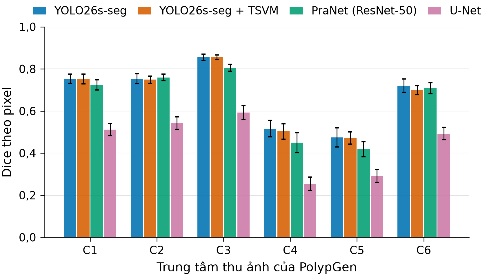

*Hình 6.18. Dice theo pixel trên từng trung tâm của PolypGen.*

Chất lượng phân đoạn khác nhau rất nhiều giữa các trung tâm: Dice của TSVM từ 0,47 (C5) đến 0,86 (C3). Điều này cho thấy thiết bị và cách thu ảnh ảnh hưởng mạnh hơn nhiều so với lựa chọn giữa hai mô hình YOLO. Chỉ ở C6 TSVM thấp hơn mô hình gốc với cả hai kiểm định, nhưng C6 chỉ có 83 ảnh và đề tài thực hiện nhiều phép so sánh, nên cần thận trọng. PraNet chỉ tốt hơn hai mô hình YOLO ở C2.

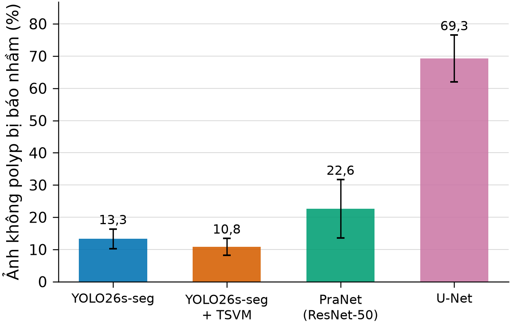

*Hình 6.19. Tỉ lệ ảnh không có polyp của PolypGen (125 ảnh) bị báo nhầm.*

Trên 125 ảnh không có polyp của PolypGen, tỉ lệ báo nhầm là 13,3% với mô hình gốc, 10,8% với TSVM, 22,6% với PraNet và 69,3% với U-Net. TSVM báo nhầm ít hơn mô hình gốc 2,5 điểm phần trăm ($p = 0{,}011$; Wilcoxon $p = 0{,}018$), chủ yếu ở C2 và C4. Đây là chỉ số phụ, nên chỉ coi là một dấu hiệu tích cực cần kiểm chứng thêm. Tỉ lệ báo nhầm ở đây cao hơn nhiều so với 40 ảnh nền của tập kiểm định (khoảng 1%), cho thấy ảnh nền của BG20 chưa đủ đa dạng.

## 6.8. Thảo luận

### 6.8.1. Trả lời câu hỏi nghiên cứu

**Thay C2PSA bằng C2TSVMamba có cải thiện chất lượng phân đoạn không?** Trên tập kiểm định của BG20, mô hình đề xuất có mask mAP50–95 cao hơn 0,0043 và cao hơn ở 13/20 seed, nhưng chưa có ý nghĩa thống kê ($p = 0{,}061$). Các đánh giá theo pixel và theo topology cho cùng kết luận: có xu hướng tăng nhỏ, chưa đủ bằng chứng. Trên dữ liệu ngoài, mô hình đề xuất không tốt hơn, và thấp hơn có ý nghĩa ở hai trong bốn bộ.

**Mô hình đề xuất có ổn định hơn không?** Trên tập kiểm định, độ lệch chuẩn giữa các seed nhỏ hơn khoảng 39% (Levene $p = 0{,}026$, thăm dò). Nhưng dấu hiệu này chỉ có ở epoch tốt nhất và không còn trên dữ liệu ngoài.

**Chi phí tăng bao nhiêu?** Tham số tăng 7,2%, GFLOPs tăng 1,5%, nhưng độ trễ tăng khoảng 1,7 lần trên GPU và 2,1 lần trên CPU, thời gian huấn luyện tăng khoảng 2 lần.

### 6.8.2. Vì sao mức cải thiện nhỏ

Đề tài đưa ra một số giải thích. Các giải thích này hợp lý nhưng chưa được kiểm chứng riêng:
- **Phạm vi thay đổi hẹp.** Chỉ tầng 10 thay đổi, nằm ở mức đặc trưng 20 × 20. Khối C2PSA ban đầu đã có cơ chế tự chú ý toàn cục. Ở kích thước 400 vị trí, chi phí bậc hai của attention không lớn, nên lợi thế chi phí tuyến tính của SSM gần như không phát huy.
- **Khởi tạo bất lợi.** Khoảng một triệu tham số mới của tầng 10 được khởi tạo ngẫu nhiên, trong khi C2PSA của mô hình gốc được tiền huấn luyện trên COCO. Với 1.040 ảnh huấn luyện, khối mới có ít dữ liệu để học.
- **Dữ liệu nhỏ và chỉ số gần bão hòa.** mAP50 của cả hai mô hình đã khoảng 0,91, nên dư địa cải thiện chủ yếu nằm ở mức khớp biên.

Giả thuyết khởi tạo cũng có thể giải thích kết quả trên dữ liệu ngoài: khối mới chỉ học từ ảnh Kvasir nên dễ khớp theo đặc điểm riêng của bộ dữ liệu này hơn khối đã tiền huấn luyện trên COCO.

### 6.8.3. Giới hạn của thực nghiệm

- **Không có tập kiểm thử độc lập.** Tập kiểm định vừa dùng để chọn epoch vừa dùng để báo cáo. Đánh giá trên dữ liệu ngoài bù một phần cho giới hạn này.
- **Một bộ dữ liệu huấn luyện.** Mọi mô hình chỉ học từ Kvasir-SEG cộng 200 ảnh nền của một lớp Kvasir.
- **Thiết lập so sánh khác nhau.** PraNet và U-Net được huấn luyện ở độ phân giải khác và không tăng cường dữ liệu.
- **Nhiều phép so sánh không hiệu chỉnh.** Ngoài chỉ số chính, các kết quả có $p < 0{,}05$ ở chỉ số phụ hoặc ở từng trung tâm của PolypGen chỉ nên coi là gợi ý.
- **Độ trễ đo trên một máy, một checkpoint.** GPU máy tính xách tay bị hạ xung khi nóng. Phép quét chưa được tối ưu bằng kernel CUDA.
- **Tách thành phần chỉ có 5 seed** (mục 6.6).
- **Topology** chỉ đo trên tập kiểm định, nhãn đa giác vốn không có lỗ.

## 6.9. Kết chương

Chương 6 đã so sánh mô hình YOLO26s-seg gốc với mô hình tích hợp khối C2TSVMamba qua 20 cặp lượt huấn luyện, đánh giá thêm theo pixel, theo topology, về chi phí tính toán và trên bốn bộ dữ liệu ngoài. Các kết quả chính:
- Mask mAP50–95 tăng 0,0043 (0,7189 lên 0,7232), cao hơn ở 13/20 seed, nhưng **chưa có ý nghĩa thống kê** ($p = 0{,}061$).
- Độ lệch chuẩn giữa các seed nhỏ hơn khoảng 39% (Levene $p = 0{,}026$, thăm dò), chỉ đúng ở epoch tốt nhất.
- Theo pixel, TSVM có Dice ngang PraNet (0,854) và IoU cao hơn PraNet, nhưng topology kém PraNet rõ rệt. Cả ba mô hình đều hơn U-Net rất xa.
- Số phép tính gần như không đổi, nhưng độ trễ tăng khoảng 1,7 lần trên GPU và 2,1 lần trên CPU.
- Trên dữ liệu ngoài, TSVM không tốt hơn mô hình gốc và thấp hơn có ý nghĩa ở CVC-ClinicDB và CVC-ColonDB. Hai mô hình YOLO vẫn tốt hơn PraNet và U-Net.
- Thí nghiệm tách thành phần: **[CHỜ KẾT QUẢ]**.

Như vậy, với cách tích hợp và dữ liệu hiện có, khối C2TSVMamba chưa mang lại cải thiện chất lượng đủ rõ để bù cho chi phí suy luận tăng thêm. Phần Kết luận tổng hợp lại các kết quả này và đề xuất hướng phát triển.
