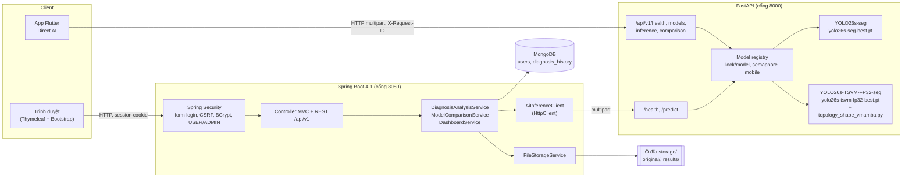
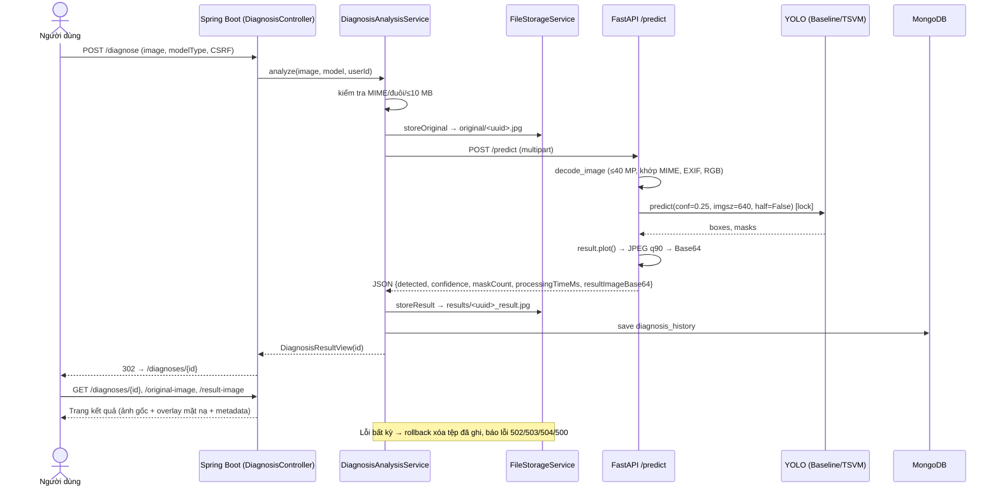
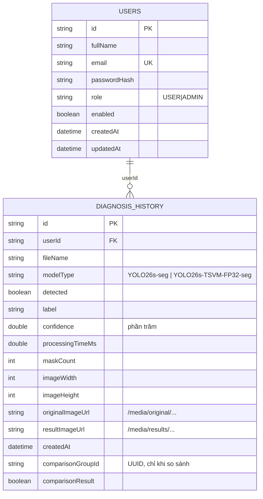

# C. Khảo sát ứng dụng minh họa PolypVision (phục vụ Chương 5)

- Ngày khảo sát: 26/10/2026. Người khảo sát: tác tử "Kiến trúc sư phần mềm".
- Phạm vi: **chỉ đọc mã nguồn và báo cáo**. Không chạy, không build, không chạy test, không cài đặt, không sửa gì trong `Ung_Dung` hay repo khóa luận.
- Gốc đường dẫn: mọi đường dẫn dưới đây tính từ `Ung_Dung\polypweb\`, trừ khi ghi rõ là `Test_Mau\...`. Số dòng ghi theo trạng thái mã tại ngày khảo sát.
- Bảo mật: `GhiChu.txt` có tài khoản test kèm mật khẩu. Báo cáo này **không chép** tài khoản hay mật khẩu đó. Chuỗi kết nối MongoDB và biến bí mật được thay bằng `<đã ẩn>` hoặc chỉ ghi tên biến môi trường.
- Quy ước mức chứng cứ:
  - **[Mã]**: có trong mã nguồn, chưa chắc đã được kiểm thử.
  - **[Đã KT – nguồn]**: đã có người chạy kiểm thử và ghi kết quả trong báo cáo được dẫn. Tác tử này không chạy lại.
  - **[README]**: chỉ là phát biểu trong README của ứng dụng.

---

## 1. Kiến trúc tổng thể

### 1.1 Thành phần

| # | Thành phần | Công nghệ | Thư mục | Cổng mặc định | Vai trò |
|---|---|---|---|---|---|
| 1 | Web PolypVision | Java 17, Spring Boot 4.1.0, Spring MVC + Thymeleaf, Spring Security, Spring Data MongoDB, Actuator, Bootstrap 5.3.8 (CDN) | `polypweb/` | 8080 (mặc định của Spring, không cấu hình `server.port`; README gốc dòng 227 ghi `http://localhost:8080`) | Giao diện người dùng, tài khoản, phiên đăng nhập, CSRF, lịch sử, dashboard, quản trị, lưu ảnh và metadata |
| 2 | Dịch vụ suy luận AI | Python, FastAPI 0.139.2, Uvicorn 0.51.0, PyTorch 2.6.0, Ultralytics 8.4.127 | `polypweb/ai-service/` | 8000 (`GhiChu.txt`, `polypweb/ai-service/README.md` mục 7) | Nạp 2 checkpoint, kiểm tra ảnh, suy luận, vẽ mặt nạ, trả JSON kèm ảnh overlay Base64. Không có tài khoản, không có CSDL |
| 3 | Ứng dụng di động | Flutter (Dart SDK `^3.12.2`), Riverpod, Dio, go_router, image_picker | `app_polyp/` | – | Chế độ "Direct AI": gọi thẳng FastAPI, không đăng nhập, không lưu lịch sử |
| 4 | Cơ sở dữ liệu | MongoDB | – | 27017 (`application-dev.properties` dòng 3, URI dạng `mongodb://localhost:27017/polypweb`, không có thông tin đăng nhập) | Chỉ nhánh Web dùng. Có 2 collection `users` và `diagnosis_history` |
| 5 | Kho ảnh | Hệ thống tệp cục bộ | `${POLYPVISION_STORAGE_ROOT:storage}` gồm 2 thư mục con `original/` và `results/` | – | Lưu ảnh gốc và ảnh overlay của Web |

Nguồn: `polypweb/pom.xml` dòng 5–30; `polypweb/ai-service/requirements.txt`; `app_polyp/pubspec.yaml`; `README.md` (gốc) mục 2 và 4.

### 1.2 Giao tiếp

| Chiều gọi | Giao thức | Endpoint | Ghi chú |
|---|---|---|---|
| Trình duyệt → Web | HTTP, form POST theo mẫu PRG (gửi xong chuyển hướng), phiên cookie `JSESSIONID`, CSRF | `/diagnose`, `/compare`, ... | `static/js/diagnose.js` và `compare.js` chỉ khóa nút và hiện trạng thái. Không gọi AJAX (`compare.js` dòng 22–48) |
| Client JSON → Web | REST `/api/v1/**` của Web, phiên cookie + CSRF | Mục 3.2 | Dùng cho app Flutter đời cũ (`LegacyPolypVisionApp`). App hiện hành không dùng |
| Web → FastAPI | HTTP `java.net.http.HttpClient`, multipart | `GET /health`, `POST /predict` | `client/AiInferenceClient.java` dòng 45–46, 89. Timeout: connect 3 s, read 15 s, health 2 s (`application-dev.properties` dòng 4–7) |
| Flutter → FastAPI | HTTP (Dio), multipart | `/api/v1/health`, `/api/v1/models`, `/api/v1/inference`, `/api/v1/comparison` | `app_polyp/lib/features/ai/data/ai_repository.dart` dòng 64–109 |
| Web → MongoDB | Spring Data MongoDB | – | `spring.mongodb.uri` = `${POLYPVISION_MONGODB_URI:<mặc định localhost>}`. Bản prod bắt buộc có biến môi trường (`application-prod.properties` dòng 3) |

Lưu ý: hai cổng `/api/v1/health` khác nhau. Một cổng thuộc FastAPI (cho mobile), cổng kia thuộc không gian `/api/v1/**` của Web. Hai server khác nhau nên không xung đột.

### 1.3 Xác thực và phân quyền (Web) [Mã]

Nguồn: `polypweb/src/main/java/com/polyp/polypweb/config/SecurityConfig.java`.

- Mật khẩu băm bằng `BCryptPasswordEncoder` (dòng 29). Người dùng nạp từ MongoDB qua `security/MongoUserDetailsService.java` (dòng 19).
- Đăng nhập bằng form: trang `/login`, tham số `email`/`password`, lỗi chuyển về `/login?error`. Đăng xuất qua `/logout`, xóa `JSESSIONID` (dòng 105–120).
- Đường dẫn công khai: `/`, `/about`, `/login`, `/register`, tài nguyên tĩnh, `/privacy`, `/terms`, `/disclaimer`, `/actuator/health`, `/actuator/info`. Với API: `GET /api/v1/auth/csrf`, `POST /api/v1/auth/register`, `POST /api/v1/auth/login` (dòng 68–91).
- `/admin/**` yêu cầu `hasRole("ADMIN")` (dòng 92). Mọi đường dẫn còn lại, gồm `/diagnose/**`, `/compare/**`, `/history/**`, `/dashboard`, `/profile/**`, `/media/**`, `/api/v1/**`, yêu cầu đăng nhập.
- Vai trò: `USER`, `ADMIN` (`document/UserRole.java`). Tài khoản admin được seed từ biến môi trường `POLYPVISION_ADMIN_EMAIL`, `POLYPVISION_ADMIN_PASSWORD` (giá trị `<đã ẩn>`), `POLYPVISION_ADMIN_NAME` (`config/AdminSeedRunner.java` dòng 28–30). Mã không hard-code mật khẩu admin.
- Phân quyền theo chủ sở hữu: các truy vấn `findByIdAccessible`/`findDocumentAccessible(id, userId, isAdmin)` (`service/DiagnosisHistoryService.java` dòng 56–78) bảo đảm người dùng chỉ xem, tải, xóa bản ghi của mình. ADMIN xem được tất cả.
- Header bảo mật: CSP, `Referrer-Policy`, `Permissions-Policy`. HSTS bật bằng cờ `app.security.hsts-enabled`. Cookie phiên `http-only`, `same-site=lax`, hết hạn sau 30 phút (`application.properties`).
- API `/api/v1/**` của Web trả 401 dạng JSON (`api/security/ApiAuthenticationEntryPoint.java`). Trang HTML chuyển hướng về `/login`.
- **FastAPI không có xác thực** (`ai-service/README.md` mục 7, 10, 12). README khuyến cáo chỉ chạy trong mạng tin cậy.

### 1.4 Luồng một yêu cầu chẩn đoán trên Web, từ tải ảnh đến hiển thị mặt nạ [Mã]

1. Người dùng đã đăng nhập mở `GET /diagnose` (`controller/DiagnosisController.java` dòng 48). Trang `templates/diagnose.html` gồm vùng kéo thả ảnh và ô chọn 1 trong 2 mô hình: `yolo26s-seg` hoặc `yolo26s-tsvm-fp32-seg` (dòng 30–40).
2. Form gửi `POST /diagnose` (multipart: `image`, `modelType`) kèm token CSRF (dòng 54–101). Controller kiểm tra ảnh rỗng và mã mô hình, rồi gọi `DiagnosisAnalysisService.analyze(...)`.
3. `service/DiagnosisAnalysisService.java` dòng 40–115:
   - `ImageUploadValidator` kiểm tra MIME (jpeg/png), phần mở rộng (jpg/jpeg/png) và kích thước ≤ 10 MB.
   - Ảnh gốc được ghi nguyên tử thành `original/<UUID>.jpg|png` (`FileStorageService.storeOriginal`, dòng 94–100). Trước khi ghi, mã kiểm tra chữ ký JPEG/PNG và thử giải mã.
   - `AiInferenceClient.predict` dựng multipart thủ công rồi gọi `POST {ai.api.base-url}/predict` (dòng 89–160). Client kiểm tra `success`, đối chiếu `modelType` trả về với mô hình đã chọn và kiểm tra `resultImageBase64` khác rỗng.
   - Ảnh overlay Base64 được giải mã, kiểm tra JPEG ≤ 15 MB, rồi ghi `results/<UUID>_result.jpg` (`storeResult`, dòng 106–141).
   - `confidence` (0–1) được đổi sang phần trăm và kẹp vào khoảng 0–100. `processingTimeMs` và `maskCount` được lấy từ phản hồi (dòng 130–162).
   - Bản ghi lưu vào collection `diagnosis_history` (`DiagnosisHistoryService.saveResult`).
   - Khi có lỗi AI, lỗi lưu tệp hoặc lỗi CSDL, mã **xóa tệp đã ghi** (`rollback`, dòng 193–196) rồi ánh xạ sang mã lỗi: `MODEL_UNAVAILABLE` 503, `AI_SERVICE_TIMEOUT` 504, `MODEL_RESPONSE_MISMATCH` 502, `STORAGE_FAILURE` 500.
4. Phía FastAPI (`ai-service/main.py`), với `POST /predict` (dòng 538–607):
   - Tìm runtime mô hình. Kiểm tra MIME, kích thước ≤ 10 MB và ảnh khác rỗng.
   - `decode_image`: kiểm tra ≤ 40 triệu pixel, định dạng thật phải khớp MIME khai báo, xoay ảnh theo EXIF, chuyển RGB.
   - Dưới `asyncio.Lock` riêng của mô hình, `run_inference` chạy trong `asyncio.to_thread`.
   - `model.predict(conf, imgsz, device, half=False)` nhận đầu vào là ảnh PIL RGB.
   - `result.plot()` vẽ hộp và mặt nạ, đổi BGR sang RGB, mã hóa JPEG chất lượng 90, rồi Base64 (dòng 450–458).
5. Web chuyển hướng `redirect:/diagnoses/{id}`. `GET /diagnoses/{id}` dựng `templates/diagnosis-result.html` gồm 2 khối "Ảnh gốc" và "Ảnh sau phân đoạn", cùng bảng "Chi tiết lượt phân tích": mô hình, badge BASELINE/VMAMBA lấy từ enum `DiagnosisModel` (`DiagnosisController.java` dòng 143–153), detected, confidence, số mask, thời gian xử lý, kích thước ảnh.
6. Ảnh được phục vụ có kiểm tra chủ sở hữu qua `GET /diagnoses/{id}/original-image` và `/result-image` (`controller/MediaController.java` dòng 32–60). Ảnh tải về qua `/diagnoses/{id}/download/original|result`. Metadata xuất qua `/diagnoses/{id}/metadata.json` (`controller/ExportController.java` dòng 43–76).

Luồng so sánh (`service/ModelComparisonService.java` dòng 57–150):

1. Kiểm tra ảnh, rồi gọi `requireModelsAvailable` qua `/health` để chắc chắn cả 2 mô hình `ready`.
2. Lưu ảnh gốc 1 lần.
3. Gọi **tuần tự** `/predict` cho Baseline rồi đến TSVM. Lưu `<UUID>_baseline_result.jpg` và `<UUID>_vmamba_result.jpg`.
4. Lưu **2 document** `diagnosis_history` có chung `comparisonGroupId` và `comparisonResult=true`.
5. Khi lỗi, mã rollback cả document lẫn tệp.

Trang kết quả là `comparison-result.html` ("Ảnh gốc dùng chung", 2 cột YOLO26s-seg / YOLO26s-TSVM-FP32-seg, "Bảng kết quả trên cùng một ảnh").

---

## 2. Dịch vụ AI (FastAPI) – `polypweb/ai-service/`

### 2.1 Danh sách endpoint [Mã]

| Phương thức | Đường dẫn | Đầu vào | Đầu ra (JSON) | Người dùng | Nguồn |
|---|---|---|---|---|---|
| GET | `/health` | – | `status` ("ok"/"degraded"), `service`, `device`, `readyModels`, `totalModels`, `models{<key>: status, loaded, family, checkpoint, checkpointSha256, error}` | Web | `main.py` dòng 388–409 |
| POST | `/predict` | multipart: `image` (jpeg/png), `modelType` (`YOLO26s-seg` \| `YOLO26s-TSVM-FP32-seg`, không phân biệt hoa thường) | `PredictionResponse`: `success, detected, label, confidence, processingTimeMs, maskCount, modelType, originalFileName, resultImageBase64, message` | Web | `main.py` dòng 163–173, 538–607 |
| GET | `/api/v1/health` | header `X-Request-ID` (tùy chọn) | `requestId, status` ("ok"/"degraded"/"unavailable", trả 503 khi không mô hình nào sẵn sàng), `service, ready, device` (cuda/cpu/...), `readyModels, totalModels, timestamp` | Mobile | `mobile_routes.py` dòng 56–77; `mobile_contract.py` dòng 22–30 |
| GET | `/api/v1/models` | – | `requestId, models[{key, name, family, ready}]` | Mobile | `mobile_routes.py` dòng 79–93 |
| POST | `/api/v1/inference` | multipart: `image`, `modelKey` | `requestId, originalFileName, originalWidth, originalHeight, modelKey, modelName, modelFamily, detected, label, confidence, maskCount, processingTimeMs, overlay{mediaType:"image/jpeg", encoding:"base64", data}, warning` | Mobile | `mobile_routes.py` dòng 95–115; `mobile_contract.py` dòng 45–68 |
| POST | `/api/v1/comparison` | multipart: `image` | `requestId, originalFileName, originalWidth, originalHeight, totalProcessingTimeMs, baseline{...}, vmamba{...}, warning` | Mobile | `mobile_routes.py` dòng 117–151; `mobile_contract.py` dòng 71–79 |

Ngoài ra FastAPI tự sinh `/docs` (Swagger UI) vì mã không tắt tính năng này. Ứng dụng khai báo `title="PolypVision AI API"`, `version="0.3.0"` (`main.py` dòng 274–279).

Lỗi cho nhánh `/api/v1/**` được chuẩn hóa thành `{requestId, status, code, message, fieldErrors}`. Các mã lỗi gồm `UNSUPPORTED_MEDIA_TYPE` 415, `INVALID_IMAGE` 422, `FILE_TOO_LARGE` 413, `MODEL_NOT_FOUND` 404, `MODEL_NOT_READY` 503, `SERVICE_BUSY` 503, `TIMEOUT` 504, `INFERENCE_FAILED` 500, `VALIDATION_ERROR` 422, `INTERNAL_ERROR` 500 (`main.py` dòng 287–385; `mobile_routes.py`). Nhánh cũ `/predict` giữ dạng lỗi mặc định của FastAPI (`{"detail": ...}`).

### 2.2 Mô hình được nạp [Mã]

| Model key | family | Checkpoint mặc định | Biến môi trường ghi đè | SHA-256 theo manifest |
|---|---|---|---|---|
| `YOLO26s-seg` | baseline | `ai-service/models/yolo26s-seg-best.pt` (23.350.941 byte) | `AI_BASELINE_MODEL_PATH`, dự phòng `AI_MODEL_PATH` | `61ebd028…a3906` |
| `YOLO26s-TSVM-FP32-seg` | vmamba | `ai-service/models/yolo26s-tsvm-fp32-best.pt` (49.669.130 byte) | `AI_VMAMBA_MODEL_PATH` | `b0578c76…2c7a8` |

- Nguồn: `main.py` dòng 134–160; `models/experiment_manifest.json`. Manifest ghi: thí nghiệm "Kvasir BG20 20 seeds FP32", **seed 0**, `best.pt` chọn theo fitness box+mask của Ultralytics, "not the max-mask summary epoch". Run nguồn là `Kvasir_BG20_Baseline_YOLO26s_seg_s0_w2` và `Kvasir_BG20_YOLO26s_seg_TSVM_FP32_s0_w2`.
- Thư mục `models/` còn 2 checkpoint Nano cũ, `yolo26n-seg-best.pt` và `yolo26n-vmamba-seg-best.pt`. **Registry không nạp 2 tệp này.**
- Phiên bản Ultralytics: `ultralytics==8.4.127` (`requirements.txt`).
- Cách nạp TSVM tùy biến (`main.py` dòng 41–75):
  - Trước khi `from ultralytics import YOLO`, hàm `register_vmamba_module()` nạp tệp `custom_ultralytics/topology_shape_vmamba.py` bằng `importlib` dưới tên module `ultralytics.nn.modules.topology_shape_vmamba`. Đây chính là đường dẫn module mà checkpoint pickle tham chiếu.
  - Hàm gắn các lớp `C2TSVMamba, TSVMamba, SS2D, ShapeAwareBranch, DirectionalShapeExtractor, TopologyShapeGate` vào `ultralytics.nn.modules` và `ultralytics.nn.tasks`.
  - Nếu đăng ký lỗi, chỉ mô hình họ "vmamba" bị đánh dấu `error`, Baseline vẫn chạy.
  - Tệp `custom_ultralytics/vmamba.py` (VMambaBlock đời Nano) **không được dùng** cho checkpoint hiện hành.
- Kiểm tra khi nạp (`load_model_runtime`, dòng 194–239): tệp tồn tại, `task == "segment"`, tên lớp có `polyp`, `model.to(device)` và `model.model.float()` (ép FP32). Riêng TSVM phải chứa ít nhất một lớp `C2TSVMamba`. Mã tính SHA-256 của checkpoint và trả về qua `/health`.

### 2.3 Tham số suy luận [Mã]

| Tham số | Giá trị | Nguồn |
|---|---|---|
| `imgsz` | `AI_IMAGE_SIZE`, mặc định 640 | `main.py` dòng 80, 471 |
| `conf` | `AI_CONFIDENCE_THRESHOLD`, mặc định 0.25 | dòng 79, 470 |
| `iou` | **Không truyền.** Dùng giá trị mặc định của Ultralytics (cần đối chiếu tài liệu Ultralytics nếu muốn ghi con số) | dòng 468–475 |
| `half` | `False` (FP32) | dòng 473 |
| `device` | `AI_DEVICE`, mặc định `auto` → `cuda:0` nếu có CUDA, ngược lại `cpu`. Nếu yêu cầu CUDA mà máy không có thì báo lỗi, không tự đổi | dòng 78, 176–183 |
| Đầu vào | Ảnh PIL RGB, đã xoay theo EXIF. Mã chú thích rằng đầu vào ndarray sẽ bị hiểu là BGR | dòng 438, 469 |
| Giới hạn tệp | ≤ 10 MB, ≤ 40.000.000 pixel, chỉ JPEG/PNG | dòng 81–84 |

### 2.4 Hậu xử lý [Mã]

- `detected = có mask VÀ có box`. `maskCount` là số mask. `confidence` và `label` lấy theo box có độ tin cậy cao nhất. Mã kiểm tra NaN/Inf (`main.py` dòng 483–502).
- Ảnh overlay: `result.plot()` của Ultralytics vẽ mặt nạ, hộp và nhãn trên ảnh, rồi chuyển RGB, mã hóa JPEG q=90 và Base64 không kèm tiền tố data-URI (dòng 450–458). Nhánh mobile kiểm tra thêm byte đầu `FF D8 FF` (`mobile_routes.py` dòng 335–342).
- **Không có** tính diện tích mặt nạ, không trả polygon hay mask nhị phân, không trả tọa độ box ra ngoài. Đầu ra chỉ gồm các số tổng hợp và ảnh overlay. Không nên ghi "diện tích polyp" trong Chương 5.
- `processingTimeMs` đo quanh lệnh `model.predict` bằng `perf_counter` (dòng 467–476). Thời gian này không gồm giải mã ảnh và mã hóa Base64. README dặn không coi đây là benchmark.

### 2.5 Xử lý đồng thời và lỗi [Mã]

- Mỗi mô hình có một `asyncio.Lock`. Suy luận chạy trong luồng phụ (`asyncio.to_thread`) để không chặn vòng lặp sự kiện (`main.py` dòng 572–579).
- Nhánh mobile thêm một semaphore toàn cục `AI_MAX_CONCURRENT_INFERENCE` (mặc định 1). Hàng chờ tối đa `AI_INFERENCE_QUEUE_TIMEOUT_SECONDS` = 5 s, quá thì trả `SERVICE_BUSY`. Mỗi lượt suy luận có timeout `AI_INFERENCE_TIMEOUT_SECONDS` = 120 s, quá thì trả `TIMEOUT` 504. Khi timeout, mã vẫn giữ lock cho đến khi luồng phụ chạy xong để tránh 2 lượt chạy chồng (`mobile_routes.py` dòng 229–286).
- `/api/v1/comparison` giữ semaphore suốt 2 lượt Baseline và TSVM. Hai lượt chạy **tuần tự**, không song song (dòng 128–132).
- Nhánh `/predict` của Web chỉ có lock theo mô hình, không đi qua semaphore và không có timeout phía server. Timeout nằm phía Web: read-timeout 15 s.
- Middleware gắn `X-Request-ID` và ghi log thời gian cho `/api/v1/**`. Mã không ghi log byte ảnh hay chuỗi Base64 (`main.py` dòng 308–340).

---

## 3. Web Spring Boot – `polypweb/`

### 3.1 Controller và trang Thymeleaf [Mã]

| Nhóm | URL (phương thức) | Template | Controller (dòng) | Quyền |
|---|---|---|---|---|
| Trang chủ | `/` (GET) | `index.html` | `controller/HomeController.java` 16–32 | Công khai |
| Giới thiệu | `/about` (GET) | `about.html` | `HomeController.java` 34–39 | Công khai |
| Pháp lý | `/privacy`, `/terms`, `/disclaimer` (GET) | `legal/*.html` | `LegalController.java` 10–25 | Công khai |
| Đăng nhập / đăng ký | `/login` (GET, POST do Spring Security xử lý), `/register` (GET/POST), `/logout` | `auth/login.html`, `auth/register.html` | `AuthController.java` 30–81 | Công khai |
| Phân tích 1 ảnh | `/diagnose` (GET/POST), `/diagnose/mock` (POST, cùng handler) | `diagnose.html` | `DiagnosisController.java` 48–101 | Đăng nhập |
| Kết quả | `/diagnoses/{id}` (GET), `/diagnoses/demo` (GET, kết quả minh họa giả lập, không có ảnh) | `diagnosis-result.html` | `DiagnosisController.java` 104–135 | Đăng nhập |
| Ảnh / xuất | `/diagnoses/{id}/original-image`, `/result-image`, `/download/original`, `/download/result`, `/metadata.json`; `/comparisons/{gid}/metadata.json` | – | `MediaController.java` 32–60; `ExportController.java` 43–98 | Đăng nhập + chủ sở hữu/ADMIN |
| So sánh 2 mô hình | `/compare` (GET/POST) | `compare.html` | `ComparisonController.java` 30–64 | Đăng nhập |
| Kết quả so sánh | `/comparisons/{gid}` (GET) | `comparison-result.html` | `ComparisonController.java` 67–91 | Đăng nhập |
| Lịch sử so sánh | `/comparisons` (GET), `/comparisons/{gid}/delete` (POST) | `comparison-history.html` | `ComparisonController.java` 94–134 | Đăng nhập |
| Lịch sử phân tích | `/history` (GET), `/history/{id}/delete` (POST) | `history.html` | `HistoryController.java` 27–61 | Đăng nhập |
| Dashboard cá nhân | `/dashboard` (GET) | `dashboard.html` | `DashboardController.java` 19–28 | Đăng nhập |
| Dashboard quản trị | `/admin/dashboard` (GET) | `admin/dashboard.html` | `DashboardController.java` 31–35 | ADMIN |
| Quản lý người dùng | `/admin`, `/admin/users` (GET), `/admin/users/{id}/toggle-enabled` (POST), `/admin/users/{id}/role` (POST) | `admin/users.html` | `AdminController.java` 31–99 | ADMIN |
| Hồ sơ | `/profile` (GET/POST), `/profile/change-password` (GET/POST) | `profile/index.html`, `profile/change-password.html` | `ProfileController.java` 33–103 | Đăng nhập |
| Trang lỗi | `/error/403`; các template `error/400, 403, 404, 413, 415, 422, 500, 503.html` | `error/*.html` | `AccessDeniedController.java`, `GlobalErrorHandler.java` | – |

Bộ lọc lịch sử [Mã]:

- Lịch sử phân tích (`view/filter/HistoryFilter.java`): từ khóa ≤ 100 ký tự, mô hình (ALL/Baseline/TSVM), kết quả (ALL/có/không phát hiện), khoảng ngày, 6 kiểu sắp xếp (mới/cũ nhất, confidence tăng/giảm, thời gian xử lý tăng/giảm), cỡ trang 10/20/50.
- Lịch sử so sánh (`ComparisonSortOption.java`): sắp xếp theo thời gian, confidence của từng mô hình, tổng thời gian.

Nội dung dashboard [Mã] (`service/DashboardService.java` dòng 62–112):

- Dashboard người dùng: số lượt phân tích đơn, số phiên so sánh, tổng lượt suy luận, số có/không phát hiện, số lượt dùng mỗi mô hình, tổng số mask, thời gian xử lý trung bình, confidence trung bình khi có phát hiện, biểu đồ 7 ngày, hoạt động gần đây.
- Dashboard admin: thêm số người dùng (tổng, đang bật, đang tắt, USER, ADMIN), hoạt động 24 giờ qua, người dùng mới và trạng thái FastAPI cùng từng mô hình. Trạng thái này lấy từ `AiInferenceClient.dashboardHealth()`, dòng 66–80.

### 3.2 REST API `/api/v1/**` của Web [Mã]

| Phương thức | Đường dẫn | Controller |
|---|---|---|
| GET | `/api/v1/auth/csrf` | `api/ApiAuthController.java` 65 |
| POST | `/api/v1/auth/register`, `/api/v1/auth/login`, `/api/v1/auth/logout` | 77, 93, 147 |
| GET | `/api/v1/me`; PATCH `/api/v1/me`; PUT `/api/v1/me/password` | `ApiAuthController.java` 142; `ApiUserController.java` 43, 72 |
| POST/GET | `/api/v1/diagnoses` (multipart tạo mới / danh sách phân trang) | `ApiDiagnosisController.java` 55, 71 |
| GET/DELETE | `/api/v1/diagnoses/{id}`, `/{id}/images/original`, `/{id}/images/result`, `/{id}/metadata` | 84–120 |
| POST/GET | `/api/v1/comparisons`, `/{gid}`, `/{gid}/metadata`; DELETE `/{gid}` | `ApiComparisonController.java` 42–94 |
| GET | `/api/v1/dashboard` | `ApiDashboardController.java` 24 |

App Flutter đời cũ (`LegacyPolypVisionApp`) dùng nhóm API này. **App hiện hành không gọi** (mục 4).

### 3.3 Mô hình dữ liệu MongoDB [Mã]

`document/UserAccount.java` → collection `users`:

| Trường | Kiểu | Ghi chú |
|---|---|---|
| `id` | String (`@Id`) | |
| `fullName` | String | |
| `email` | String | `@Indexed(unique = true)` |
| `passwordHash` | String | BCrypt |
| `role` | `UserRole` (USER/ADMIN) | |
| `enabled` | boolean | ADMIN bật/tắt được |
| `createdAt`, `updatedAt` | LocalDateTime | |

`document/DiagnosisHistory.java` → collection `diagnosis_history`:

| Trường | Kiểu | Ghi chú |
|---|---|---|
| `id` | String | |
| `userId` | String | Liên kết tới `users.id` (tham chiếu logic, không có DBRef) |
| `fileName` | String | Tên tệp đã làm sạch |
| `modelType` | String | `YOLO26s-seg` / `YOLO26s-TSVM-FP32-seg` |
| `detected`, `label`, `confidence` (%), `processingTimeMs`, `maskCount` | | Lấy từ FastAPI |
| `imageWidth`, `imageHeight` | Integer | Bổ sung trong đợt sửa 26/10/2026 |
| `originalImageUrl`, `resultImageUrl` | String | Dạng `/media/original/<uuid>.jpg`, `/media/results/<uuid>_result.jpg` (`FileStorageService.java` dòng 409–411) |
| `createdAt` | LocalDateTime | |
| `comparisonGroupId` | String (UUID) | Chỉ có ở bản ghi so sánh |
| `comparisonResult` | boolean | `true` nếu thuộc phiên so sánh |

Chỉ mục (`config/DiagnosisHistoryIndexInitializer.java` dòng 26–44): `history_user_type_created`, `history_user_comparison_group`, `history_user_model_created`, `history_user_detected_created`. Phiên so sánh **không có collection riêng**. Mỗi phiên gồm 2 document có chung `comparisonGroupId`. Danh sách lịch sử so sánh được gom bằng aggregation trong `repository/ComparisonHistorySearchRepository.java`.

### 3.4 Service chính [Mã]

| Service | Vai trò |
|---|---|
| `DiagnosisAnalysisService` | Điều phối phân tích 1 ảnh: kiểm tra, lưu ảnh gốc, gọi AI, lưu overlay, lưu bản ghi, rollback khi lỗi |
| `ModelComparisonService` | Điều phối phiên so sánh 2 mô hình tuần tự: kiểm tra mô hình sẵn sàng, rollback, tìm/xóa theo chủ sở hữu |
| `DiagnosisHistoryService` | Lưu, đọc theo quyền, xóa, chuyển sang view, đọc kích thước ảnh |
| `FileStorageService` | Ghi tệp nguyên tử (tệp tạm + move), chống path traversal (`startsWith(categoryDirectory)`), kiểm tra JPEG/PNG, giới hạn 10 MB / 15 MB, kiểm tra quyền ghi cho health |
| `UserAccountService` | Đăng ký, cập nhật hồ sơ, đổi mật khẩu, bật/tắt tài khoản, đổi vai trò, tạo admin |
| `DashboardService` | Thống kê qua `DashboardStatisticsRepository` (aggregation) |
| `AiInferenceClient` | Client HTTP gọi FastAPI (`/predict`, `/health`) |
| `health/AiServiceHealthIndicator`, `StorageHealthIndicator` | Gắn vào Actuator `/actuator/health`. Chi tiết chỉ hiện cho ADMIN |

---

## 4. Ứng dụng di động Flutter – `app_polyp/`

- Điểm vào: `lib/main.dart` → `ProviderScope(child: PolypVisionApp())`. `lib/app/polypvision_app.dart` kiểm tra `AiServiceConfig.fromEnvironment()`. Nếu cấu hình sai, app hiện `InvalidConfigurationScreen`. Nếu đúng, app dùng `directAiRouterProvider` [Mã].
- **Chế độ Direct AI**: app gọi thẳng FastAPI, không qua Spring Boot, không đăng nhập, không MongoDB, không lưu lịch sử (`app_polyp/README.md` mục 1–2). Mã đời cũ dùng Spring (`lib/app/legacy_polypvision_app.dart` cùng các thư mục `features/auth`, `diagnosis`, `history`, `dashboard`, `account`) vẫn được giữ để rollback và chạy test hồi quy, nhưng `main.dart` không khởi tạo. Test `test/m6_direct_ai_hardening_test.dart` dòng 24 kiểm tra rằng `main` không chứa `LegacyPolypVisionApp`.
- Màn hình (`lib/navigation/direct_ai_router.dart`, `direct_ai_app_shell.dart`). App dùng `NavigationBar` trên điện thoại và `NavigationRail` trên màn hình rộng, gồm 4 tab:
  1. `/` **Trang chủ** (`features/home/ai_home_screen.dart`): thẻ "Trạng thái dịch vụ AI" và "Mô hình nghiên cứu" lấy từ `/api/v1/health` và `/api/v1/models`, nút "Phân tích ảnh" và "So sánh mô hình".
  2. `/analyze` **Phân tích** (`features/analysis/direct_analysis_screen.dart`): chọn ảnh từ thư viện (`ImageSource.gallery`, không dùng camera, xem `shared/medical_image/medical_image.dart` dòng 25–45), chọn mô hình, gọi `/api/v1/inference`.
  3. `/compare` **So sánh** (`features/comparison/direct_comparison_screen.dart`): gọi `/api/v1/comparison`.
  4. `/about` **Giới thiệu**. Ngoài ra có các trang con `/privacy`, `/terms`, `/disclaimer`.
  - Có màn hình xem ảnh toàn màn hình với zoom/pan (`shared/widgets/fullscreen_memory_image.dart`) và chế độ sáng/tối (`app/theme_controller.dart`, lưu bằng `shared_preferences`).
- Cấu hình `AI_BASE_URL` (`lib/core/config/ai_service_config.dart`):
  - Truyền bằng `--dart-define=AI_BASE_URL=...`.
  - Bản debug mặc định là `http://10.0.2.2:8000` (localhost của máy host khi chạy Android Emulator).
  - URL không được chứa user-info, query hay fragment.
  - Bản release bắt buộc HTTPS và từ chối host phát triển hoặc IP mạng riêng.
- Timeout Dio (`lib/core/network/direct_ai_client.dart` dòng 12–16): yêu cầu ngắn 15 s; inference gửi 120 s / nhận 150 s; comparison gửi 240 s / nhận 300 s.
- Lưu ý vận hành: `GhiChu.txt` chạy FastAPI với `--host 127.0.0.1` nhưng chạy app trên máy thật với `AI_BASE_URL=http://<IP-LAN>:8000`. Theo `ai-service/README.md` mục 7 và `README.md` gốc mục 10.4, muốn điện thoại thật truy cập được thì FastAPI phải bind `0.0.0.0` và firewall phải mở TCP 8000. Khi chụp ảnh mobile cần chạy đúng lệnh này.

---

## 5. Kiểm thử

### 5.1 Bộ test trong mã nguồn (đếm tĩnh ngày 26/10/2026, không chạy)

| Phần | Thư mục | Số tệp test | Số ca theo đếm tĩnh |
|---|---|---|---|
| Web Java (JUnit 5, MockMvc, Spring Security Test) | `polypweb/src/test/java/...` | 21 lớp | 263 `@Test` + 1 `@ParameterizedTest` (`@CsvSource` trong `controller/NavigationAdviceTests.java`, tạo 11 ca). Theo log Maven, tổng là **274 ca** |
| FastAPI (pytest, pytest-asyncio, httpx) | `polypweb/ai-service/tests/` | 6 tệp test + `conftest.py` | **51** hàm `def test_`: legacy_contract 4, mobile_comparison 7, mobile_errors_concurrency 15, mobile_health_models 5, mobile_inference 19, rgb_inference 1 |
| Flutter (`flutter_test`) | `app_polyp/test/` | 16 tệp + `support/fakes.dart` | Khoảng **430** lời gọi `test(`/`testWidgets(` đếm bằng regex. README ghi 498 ca, phần chênh có thể do test sinh trong vòng lặp. Chưa xác minh |

Các lớp test Java (theo log Maven, số ca): `SecurityIntegrationTests` 48, `ApiDiagnosisIntegrationTests` 35, `ApiAuthenticationIntegrationTests` 30, `ApiComparisonIntegrationTests` 27, `ApiUserFeaturesIntegrationTests` 22, `ModelComparisonServiceTests` 17, `UserAccountServiceTests` 15, `DashboardServiceTests` 13, `NavigationAdviceTests` 11, `DiagnosisAnalysisServiceTests` 10, `OwnershipServiceTests` 8, `HistoryFilterTests` 8, `ConfigurationProfileTests` 5, `HealthIndicatorTests` 5, `ImageMetadataRegressionTests` 5, `ComparisonHistoryMongoIntegrationTests` 4 (MongoDB thật), `DashboardStatisticsRepositoryTests` 3, `HistorySearchRepositoryTests` 3, `ComparisonHistorySearchRepositoryTests` 2, `FileStorageServiceTests` 2, `PolypwebApplicationTests` 1. Tổng 274.

### 5.2 Kết quả đã ghi nhận (tác tử này KHÔNG chạy lại)

| Phép kiểm | Kết quả | Ngày | Nguồn |
|---|---|---|---|
| Java toàn bộ, gồm MongoDB thật | **274 đạt, 0 lỗi, 0 bỏ qua**, 21 suite, BUILD SUCCESS | 26/10/2026 | `Test_Mau\07_kiem_toan_va_sua\fix_20261026\FIX_REPORT.md` (bảng "Bằng chứng kiểm thử"); `...\fix_20261026\integration\java_test_summary.json`; `...\integration\logs\maven_full.log` dòng 402, 429 |
| FastAPI pytest | **51 đạt**, 3 cảnh báo thư viện | 26/10/2026 | `FIX_REPORT.md`; `...\integration\logs\ai_tests.log` (dòng cuối "51 passed, 3 warnings in 1.63s") |
| HTTP tích hợp Web + AI + MongoDB riêng | **39/39 đạt**: 2 lượt suy luận thật, nhóm so sánh, lịch sử rỗng/có dữ liệu, tải ảnh/metadata, chặn người không sở hữu | 26/10/2026 | `...\integration\runtime_summary.json`; `FIX_REPORT.md` |
| Kiểm tra trình duyệt sau sửa | Trang chủ hiện đúng 2 mô hình s; `/comparisons` mở được (Baseline 88,3%, VMamba 58,4%); kết quả TSVM có badge VMAMBA, 2 mask, 621×530 px | 26/10/2026 | `...\integration\browser_verification.md`; `...\integration\screenshots\comparison_history.png`, `tsvm_result.png` |
| Kiểm toán trước sửa | Java 261 đạt; FastAPI 51 đạt; HTTP/browser phát hiện lỗi E-001…E-006 (E-004 mức cao: lịch sử so sánh lỗi `$facet` lồng, MongoDB mã 40600) | 25/10/2026 | `Test_Mau\07_kiem_toan_va_sua\audit_20261025_193105\E_application\report.md`, `issues.csv` |
| Suy luận thật trên ảnh minh họa | `cju0s690hkp960855tjuaqvv0.jpg`: Baseline 1 mask (conf 0,883), TSVM 2 mask (conf 0,584). Ảnh nền: cả 2 mô hình 0 mask | 25/10/2026 | `audit_.../E_application/report.md` mục E-006 |
| Flutter | **498/498** và `flutter analyze` PASS, theo README M8. Đây là log cũ, **không chạy lại** trong kiểm toán và đợt sửa | không ghi ngày (README M8) | `app_polyp/README.md` dòng 193; `README.md` gốc mục 12; `FIX_REPORT.md` mục 3 ("498 Flutter là log cũ") |
| Kiểm thử thủ công Android thật | Health, readiness, Baseline, VMamba, comparison, zoom/pan, retry, xoay màn hình, dark mode, back. Thiết bị tham chiếu Samsung Galaxy A51 | M1–M7 (không ghi ngày) | `app_polyp/README.md` mục 17 [README] |

Đối chiếu số liệu cũ và mới:

- README gốc và `ai-service/README.md` vẫn ghi **FastAPI 50/50** và **Java 261/261**. Đó là số cũ.
- Số hiện hành, có log, là **274 Java** và **51 FastAPI** (26/10/2026). Đếm tĩnh mã nguồn hôm nay cũng cho đúng 51 hàm test Python và 274 ca Java khi tính cả ca tham số hóa, nhất quán với log.
- Chương 5 nên dùng 274/51/39 và ghi rõ 498 Flutter là số tự báo cáo trong README, chưa chạy lại.

Các giới hạn kiểm thử đã được báo cáo nêu (audit mục "Phần chưa kiểm chứng"; FIX_REPORT "Những điểm còn mở"): chưa kiểm UI admin, đổi mật khẩu, mọi tổ hợp bộ lọc, tải đồng thời, nhiều trình duyệt/thiết bị, triển khai production. Thời gian phản hồi đo được không phải benchmark.

---

## 6. Môi trường (theo tệp cấu hình)

| Thành phần | Phiên bản / cấu hình | Nguồn |
|---|---|---|
| Java | 17 (`<java.version>17`). Kiểm toán chạy trên 17.0.19 | `polypweb/pom.xml` dòng 30; audit report |
| Spring Boot | 4.1.0 (parent `spring-boot-starter-parent`) | `pom.xml` dòng 5–8 |
| Maven | Wrapper 3.9.16 | `polypweb/.mvn/wrapper/maven-wrapper.properties` |
| Starter chính | webmvc, thymeleaf, security, data-mongodb, validation, actuator, devtools, lombok | `pom.xml` dòng 34–70 |
| Giao diện | Bootstrap 5.3.8, Bootstrap Icons 1.13.1 (CDN jsDelivr) | `templates/fragments/header.html` dòng 27–30 |
| Profile | `dev` mặc định (`spring.profiles.default=dev`); `prod` bắt buộc `POLYPVISION_MONGODB_URI`, `POLYPVISION_AI_BASE_URL` | `application*.properties` |
| Upload Web | `max-file-size`/`max-request-size` 10 MB; overlay ≤ 15 MB | `application.properties` |
| Python libs | fastapi 0.139.2, uvicorn 0.51.0, python-multipart 0.0.32, numpy 2.2.6, pillow 11.3.0, opencv-python 4.12.0.88, torch 2.6.0, torchvision 0.21.0, ultralytics 8.4.127; test: pytest 8.4.2, pytest-asyncio 1.2.0, httpx 0.28.1 | `ai-service/requirements.txt`, `requirements-dev.txt` |
| Python interpreter | Không khóa phiên bản trong tệp cấu hình (README: "tương thích các phiên bản khóa trong requirements") | `ai-service/README.md` mục 6 |
| Flutter / Dart | Dart SDK `^3.12.2`; flutter_riverpod ^3.4.2, dio ^5.11.0, go_router ^17.3.0, image_picker ^1.2.3, shared_preferences ^2.5.5; Android minSdk 24 (launcher icons) | `app_polyp/pubspec.yaml` |
| MongoDB | Không khóa phiên bản server trong cấu hình. Dev: `localhost:27017/polypweb`. Prod: biến môi trường `<đã ẩn>` | `application-dev.properties` dòng 3 |
| Thiết bị suy luận | `AI_DEVICE=auto` (CUDA nếu có, ngược lại CPU). Kiểm toán chạy PyTorch CPU | `main.py`; audit report |

---

## 7. Đề xuất ảnh chụp màn hình cho Chương 5

Chuẩn bị chung (dựa trên `GhiChu.txt` và các README, không chứa mật khẩu):

```powershell
# (1) MongoDB local chạy ở 27017
# (2) FastAPI – cho Web chỉ cần 127.0.0.1; cho điện thoại thật dùng 0.0.0.0
cd "...\Ung_Dung\polypweb\polypweb\ai-service"
.\.venv\Scripts\python.exe -m uvicorn main:app --host 0.0.0.0 --port 8000
# (3) Web
cd "...\Ung_Dung\polypweb\polypweb"
$env:SPRING_PROFILES_ACTIVE="dev"
.\mvnw.cmd spring-boot:run          # mở http://localhost:8080
# (4) Mobile (thiết bị thật, cùng mạng LAN)
cd "...\Ung_Dung\polypweb\app_polyp"
flutter run -d <DEVICE_ID> --dart-define=AI_BASE_URL=http://<IP-LAN>:8000
```

- Đăng nhập bằng **tài khoản test** (xem tệp ghi chú riêng của chủ dự án, không đưa vào báo cáo). Với ảnh admin, dùng tài khoản ADMIN được seed qua biến môi trường.
- Dùng cùng một ảnh minh họa cho mọi hình, ví dụ `cju0s690hkp960855tjuaqvv0.jpg` (đã có kết quả đối chiếu trong audit), để số liệu nhất quán.
- Che email người dùng trên ảnh nếu cần.

| Mã | Nội dung | Cách lấy / URL / màn hình | Tệp lưu gợi ý |
|---|---|---|---|
| H5.1 | Trang chủ Web, hiện 2 mô hình hỗ trợ | Mở `http://localhost:8080/` (chưa cần đăng nhập) | `06_bao_cao/hinh/chuong5/h5_1_web_trang_chu.png` |
| H5.2 | Trang đăng nhập | `http://localhost:8080/login` (ô email để trống hoặc làm mờ) | `06_bao_cao/hinh/chuong5/h5_2_web_dang_nhap.png` |
| H5.3 | Trang phân tích ảnh: đã chọn ảnh, đang chọn mô hình TSVM | Đăng nhập bằng tài khoản test → `/diagnose`, kéo thả ảnh, chọn YOLO26s-TSVM-FP32-seg, chụp trước khi bấm | `06_bao_cao/hinh/chuong5/h5_3_web_phan_tich.png` |
| H5.4 | Kết quả phân tích 1 ảnh: ảnh gốc, ảnh overlay mặt nạ, bảng chi tiết (badge VMAMBA, confidence, số mask, thời gian, kích thước) | Bấm phân tích → trang `/diagnoses/{id}`. Chụp toàn trang (full-page) để thấy cả bảng metadata | `06_bao_cao/hinh/chuong5/h5_4_web_ket_qua_tsvm.png` |
| H5.5 | Trang so sánh 2 mô hình (form) | `/compare`, chọn ảnh | `06_bao_cao/hinh/chuong5/h5_5_web_so_sanh_form.png` |
| H5.6 | Kết quả so sánh Baseline và TSVM trên cùng ảnh | Gửi form → `/comparisons/{gid}` (ảnh gốc dùng chung, 2 overlay, bảng kết quả) | `06_bao_cao/hinh/chuong5/h5_6_web_so_sanh_ket_qua.png` |
| H5.7 | Lịch sử phân tích có bộ lọc và phân trang | `/history` (sau khi đã có vài lượt) | `06_bao_cao/hinh/chuong5/h5_7_web_lich_su.png` |
| H5.8 | Lịch sử so sánh | `/comparisons` | `06_bao_cao/hinh/chuong5/h5_8_web_lich_su_so_sanh.png` |
| H5.9 | Dashboard cá nhân (thống kê, biểu đồ 7 ngày) | `/dashboard` | `06_bao_cao/hinh/chuong5/h5_9_web_dashboard.png` |
| H5.10 | Dashboard quản trị + trạng thái FastAPI và mô hình | Đăng nhập tài khoản ADMIN → `/admin/dashboard` | `06_bao_cao/hinh/chuong5/h5_10_web_admin_dashboard.png` |
| H5.11 | Quản lý người dùng (bật/tắt, đổi vai trò) | `/admin/users` (làm mờ email) | `06_bao_cao/hinh/chuong5/h5_11_web_admin_users.png` |
| H5.12 | Trạng thái dịch vụ AI: JSON `/health` hoặc Swagger `/docs` | Trình duyệt mở `http://127.0.0.1:8000/health` (thấy 2 mô hình `ready`, SHA-256) hoặc `http://127.0.0.1:8000/docs` | `06_bao_cao/hinh/chuong5/h5_12_ai_health_docs.png` |
| H5.13 | Mobile – Trang chủ AI (trạng thái dịch vụ, 2 mô hình ready) | App trên điện thoại, tab "Trang chủ" | `06_bao_cao/hinh/chuong5/h5_13_mobile_trang_chu.png` |
| H5.14 | Mobile – Kết quả phân tích 1 ảnh (overlay + metadata) | Tab "Phân tích" → chọn ảnh từ thư viện → chọn TSVM → chạy | `06_bao_cao/hinh/chuong5/h5_14_mobile_phan_tich.png` |
| H5.15 | Mobile – So sánh 2 mô hình | Tab "So sánh" → chọn ảnh → chạy | `06_bao_cao/hinh/chuong5/h5_15_mobile_so_sanh.png` |

Ảnh tùy chọn, không bắt buộc:

- `h5_16_web_loi_ai_khong_san_sang.png`: tắt FastAPI rồi gửi phân tích, Web báo dịch vụ AI không khả dụng (minh họa xử lý lỗi).
- `h5_17_ket_qua_kiem_thu.png`: cửa sổ terminal hiện `Tests run: 274 ... BUILD SUCCESS` và `51 passed`. Chỉ nên chụp khi chủ dự án tự chạy lại. Nếu không chạy lại thì dẫn log ngày 26/10/2026.

Ảnh có sẵn từ đợt sửa (có thể dùng tạm, dữ liệu là tài khoản fixture): `Test_Mau\07_kiem_toan_va_sua\fix_20261026\integration\screenshots\comparison_history.png`, `tsvm_result.png`.

### 7.1 Sơ đồ đề xuất

**S5.1 – Sơ đồ kiến trúc thành phần** (`h5_s1_kien_truc.png`)



**S5.2 – Sơ đồ tuần tự luồng chẩn đoán 1 ảnh trên Web** (`h5_s2_tuan_tu_chan_doan.png`)



**S5.3 – Sơ đồ dữ liệu** (`h5_s3_du_lieu.png`)



Ghi chú cho S5.3: một phiên so sánh gồm 2 bản ghi `DIAGNOSIS_HISTORY` có cùng `comparisonGroupId`. Tệp ảnh nằm trên đĩa, CSDL chỉ lưu URL logic.

Sơ đồ tùy chọn S5.4: tuần tự mobile `Flutter → /api/v1/comparison → semaphore → Baseline → TSVM → JSON có 2 overlay`.

---

## 8. Dàn ý chi tiết Chương 5 (phần ứng dụng)

**5.1 Mục tiêu và phạm vi ứng dụng**
- Mục đích: minh họa việc đưa 2 mô hình của khóa luận (YOLO26s-seg Baseline và YOLO26s-seg + TSVM FP32) vào một hệ thống dùng được. Ứng dụng chỉ phục vụ nghiên cứu, không phải thiết bị chẩn đoán (`mobile_contract.py` dòng 8–11, `RESEARCH_WARNING`).
- Đối tượng sử dụng: người dùng nghiên cứu (USER) và quản trị viên (ADMIN). Bản mobile là công cụ trình diễn nhanh, không cần tài khoản.
- Phạm vi: phân tích 1 ảnh, so sánh 2 mô hình trên cùng ảnh, lưu lịch sử (Web). Ngoài phạm vi: video thời gian thực, đánh giá lâm sàng, triển khai production.

**5.2 Phân tích yêu cầu**
- 5.2.1 Yêu cầu chức năng: đăng ký/đăng nhập; phân tích ảnh; so sánh; lịch sử có lọc, phân trang, xóa; tải ảnh và xuất metadata JSON; dashboard; quản trị người dùng; mobile Direct AI.
- 5.2.2 Yêu cầu phi chức năng: chỉ nhận JPEG/PNG ≤ 10 MB, ≤ 40 MP; suy luận FP32; phân quyền theo chủ sở hữu; CSRF; BCrypt; header bảo mật; rollback khi lỗi; thông báo lỗi tiếng Việt.
- 5.2.3 Sơ đồ use case: tác nhân Khách, USER, ADMIN, người dùng Mobile.

**5.3 Kiến trúc hệ thống**
- 5.3.1 Kiến trúc tổng thể 3 tầng: client (Web/Mobile) → Web Spring Boot → FastAPI, cộng MongoDB và kho tệp (Sơ đồ S5.1).
- 5.3.2 Lý do tách dịch vụ AI bằng Python: dùng trực tiếp Ultralytics/PyTorch và mô-đun TSVM tùy biến. Web và Mobile là 2 client độc lập.
- 5.3.3 Giao tiếp và hợp đồng API: bảng endpoint mục 2.1 và 3.2; định dạng lỗi chuẩn; `X-Request-ID`.
- 5.3.4 Thiết kế dữ liệu: sơ đồ S5.3, chỉ mục, cách lưu ảnh (tệp + URL logic), phiên so sánh qua `comparisonGroupId`.
- 5.3.5 Bảo mật: Spring Security, vai trò, chủ sở hữu, CSRF, CSP/HSTS, seed admin bằng biến môi trường. Giới hạn: FastAPI chưa có xác thực, chỉ chạy trong mạng tin cậy.

**5.4 Cài đặt dịch vụ suy luận**
- 5.4.1 Đăng ký mô-đun TSVM trước khi nạp checkpoint (`register_vmamba_module`); kiểm tra `C2TSVMamba`, lớp `polyp`, ép float32; manifest và SHA-256 (seed 0, chọn `best.pt` theo fitness, khác epoch mask tốt nhất trong bảng 20 seed).
- 5.4.2 Tiền xử lý và kiểm tra ảnh (MIME khớp nội dung, EXIF, RGB qua PIL).
- 5.4.3 Tham số suy luận (`imgsz=640`, `conf=0.25`, `half=False`, `device=auto`; `iou` mặc định) và hậu xử lý (`result.plot()`, JPEG Base64; confidence lấy theo box cao nhất; maskCount).
- 5.4.4 Đồng thời và timeout (lock theo mô hình, semaphore mobile, 5 s / 120 s, không hủy cứng được luồng GPU).

**5.5 Cài đặt ứng dụng Web**
- 5.5.1 Cấu trúc gói (controller, api, service, repository, document, client, config, security, view).
- 5.5.2 Luồng phân tích 1 ảnh (Sơ đồ S5.2) và rollback.
- 5.5.3 Luồng so sánh 2 mô hình (gọi tuần tự, kiểm tra cả 2 mô hình sẵn sàng trước khi chạy).
- 5.5.4 Lịch sử, dashboard (aggregation MongoDB), xuất dữ liệu, quản trị.
- 5.5.5 Giao diện: H5.1–H5.11.

**5.6 Cài đặt ứng dụng di động**
- 5.6.1 Kiến trúc Direct AI (Riverpod, Dio, go_router); cấu hình `AI_BASE_URL` và các ràng buộc release.
- 5.6.2 Các màn hình: H5.13–H5.15; zoom/pan; chế độ tối; các trang pháp lý.
- 5.6.3 Giới hạn: không đăng nhập, không lưu lịch sử, cần mạng LAN hoặc HTTPS.

**5.7 Môi trường triển khai và hướng dẫn chạy**
- Bảng phiên bản (mục 6); các bước khởi động MongoDB → FastAPI → Web → Mobile; biến môi trường chính. Không ghi tài khoản hay mật khẩu.

**5.8 Kiểm thử ứng dụng**
- 5.8.1 Chiến lược: unit/MockMvc (Java), pytest với test double (FastAPI), widget test (Flutter), kiểm thử tích hợp HTTP và trình duyệt với MongoDB riêng.
- 5.8.2 Kết quả: Java 274/274 (gồm 4 ca MongoDB thật), FastAPI 51/51, HTTP 39/39 (26/10/2026); Flutter 498 theo README (chưa chạy lại); kiểm thử thủ công Android.
- 5.8.3 Lỗi phát hiện qua kiểm toán và đã sửa: E-001 tên mô hình Nano trên trang chủ, E-002 badge TSVM sai, E-003 kích thước ảnh cố định, E-004 `$facet` lồng (cao). Có thể đưa vào như minh chứng quy trình kiểm thử.
- 5.8.4 Ví dụ minh họa trên 1 ảnh: Baseline 1 mask, TSVM 2 mask. **Không** dùng 1 ảnh để kết luận mô hình nào tốt hơn. Kết luận dựa vào Chương 4 (20 seed, p≈0,0614).

**5.9 Đánh giá và hạn chế**
- Thời gian xử lý trên giao diện không phải benchmark. FastAPI chưa có xác thực, chưa giới hạn tần suất (rate limit), chưa có TLS. Kho tệp cục bộ. So sánh chạy tuần tự. Chưa kiểm tải đồng thời. Mobile chưa có tài khoản.
- Hướng phát triển: triển khai HTTPS, xác thực API, hàng đợi job/tách tiến trình, object storage, đồng bộ tài khoản mobile, suy luận video.

---

## 9. Ghi chú, sai lệch phát hiện khi đọc mã (để tránh ghi sai trong báo cáo)

1. **Không có tính diện tích mặt nạ** trong ai-service hay Web. Chỉ có `maskCount`, `confidence`, `detected`, `processingTimeMs` và ảnh overlay.
2. **So sánh chạy tuần tự**, không song song: cả ở Web (`ModelComparisonService`) và mobile (`/api/v1/comparison`).
3. `iou` không được cấu hình rõ trong mã.
4. README cũ còn ghi số test 50 (FastAPI) / 261 (Java). Số hiện hành có log là 51 / 274. `ai-service/README.md` mục 11 liệt kê `custom_ultralytics/vmamba.py`, nhưng mã thật nạp `topology_shape_vmamba.py`.
5. Thư mục `models/` còn 2 checkpoint Nano không được nạp. Không mô tả chúng là mô hình của ứng dụng.
6. `GhiChu.txt` chạy FastAPI ở `127.0.0.1`, nhưng điện thoại thật cần `0.0.0.0` (theo README).
7. Web read-timeout tới AI là 15 s. Khi chạy CPU với ảnh lớn có thể chạm ngưỡng, nên chụp ảnh trên máy có GPU hoặc tăng `POLYPVISION_AI_READ_TIMEOUT`. Đây là nhận xét từ mã, chưa kiểm chứng.
8. `/diagnoses/demo` là trang kết quả giả lập (số liệu cố định, không có ảnh). Không chụp trang này làm "kết quả thật".
9. Mã Flutter đời cũ (gọi Spring, có đăng nhập) vẫn nằm trong `lib/` và có test, nhưng không phải luồng chạy hiện hành.
