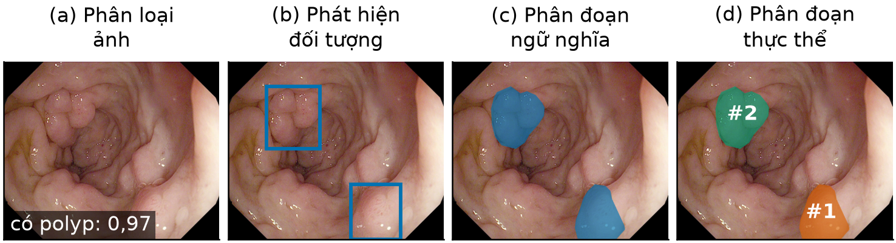
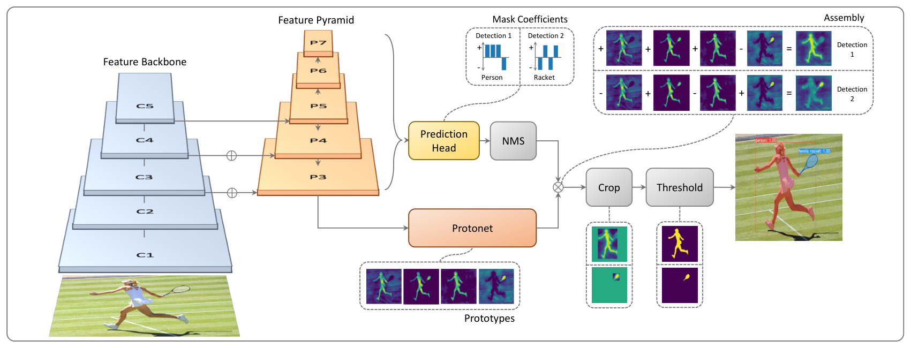
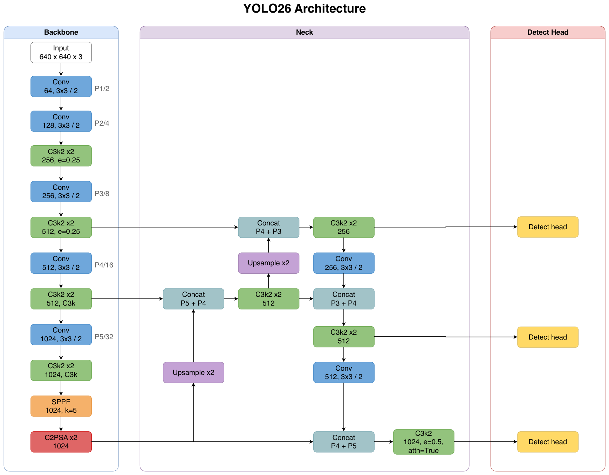
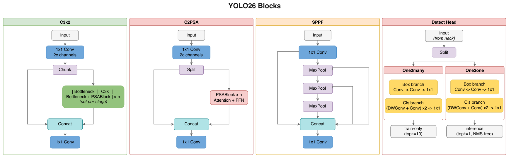
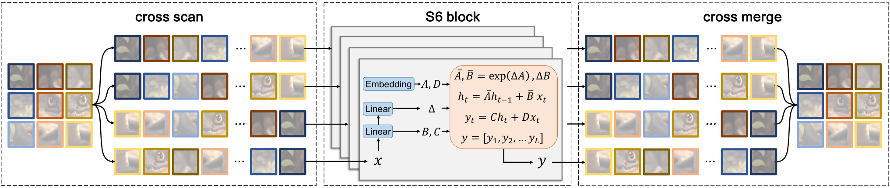

# CHƯƠNG 2. CƠ SỞ LÝ THUYẾT

> **Ghi chú soạn thảo (xóa khi nộp):** bản mẫu cho dàn ý 70 trang (03/11/2026), biên tập từ Ch.2 trong `KHOA_LUAN_CHUONG_1_2.docx` của nhóm. Đã giảm từ 28 xuống 9 công thức đánh số; các công thức cơ bản (tổng mất mát, dạng liên tục và rời rạc hóa đầy đủ của SSM, B và C, độ lớn gradient, Precision/Recall/F1, nội suy AP, FLOPs của tích chập, khoảng tin cậy, d_z) chuyển thành lời. Bỏ Hình 2.2 (phép tích chập) và Hình 2.3 (phép chú ý). Sửa ba điểm: mất mát YOLO26 nêu đủ thành phần (thêm L1, nhánh ngữ nghĩa phụ, hai đầu); phần gán nhãn trích TOOD thay vì YOLOv10; bổ sung tham chiếu sang các chương sau. Số tài liệu theo danh sách của Ch.1–Ch.2 bản nhóm, chèn thêm TOOD ở [16] (có sẵn trong danh sách 57 mục), các số từ [16] cũ trở đi tăng 1. Đánh số lại toàn quyển ở bước gộp tài liệu tham khảo.

Để khoanh đúng polyp, mô hình vừa phải nhìn kỹ đường biên, vừa phải nắm được ngữ cảnh của cả ảnh. Chương này trình bày các kiến thức nền cho cách tiếp cận đó: bài toán phân đoạn polyp, mạng tích chập và cơ chế chú ý, hai mô hình chính của đề tài là YOLO26-seg và VMamba, cơ sở của nhánh hình dạng và cơ chế cổng, cuối cùng là các độ đo và phương pháp thống kê dùng để so sánh hai mô hình.

## 2.1. Bài toán phân đoạn polyp

### 2.1.1. Học có giám sát

Đề tài thuộc dạng học có giám sát [11]. Nhóm đưa cho mô hình nhiều ảnh nội soi, mỗi ảnh đi kèm mặt nạ polyp do chuyên gia vẽ sẵn. Với mỗi ảnh, mô hình đưa ra dự đoán, và một hàm mất mát đo xem dự đoán lệch so với mặt nạ thật bao nhiêu. Thuật toán lan truyền ngược cho biết mỗi tham số cần thay đổi theo hướng nào để mất mát giảm, rồi bộ tối ưu điều chỉnh tham số một bước nhỏ theo hướng đó. Lặp lại qua nhiều lượt duyệt hết dữ liệu, gọi là các epoch, mô hình dần học được cách nhận ra polyp. Vì mô hình có thể ghi nhớ cả những chi tiết ngẫu nhiên của ảnh huấn luyện, dữ liệu luôn được chia thành tập huấn luyện để học và tập kiểm định để theo dõi chất lượng [11].

### 2.1.2. Các dạng bài toán thị giác

Với cùng một ảnh nội soi, có thể đặt ra các câu hỏi ở mức chi tiết khác nhau. Bài toán phân loại ảnh chỉ hỏi ảnh có polyp hay không. Bài toán phát hiện đối tượng hỏi polyp nằm ở đâu, đầu ra là các hộp chữ nhật kèm độ tin cậy. Bài toán phân đoạn hỏi chính xác những điểm ảnh nào thuộc polyp, đầu ra là một mặt nạ cùng kích thước với ảnh.

Phân đoạn lại có hai dạng. Phân đoạn ngữ nghĩa chỉ gán mỗi điểm ảnh vào một lớp, nên nếu ảnh có hai polyp thì cả hai nằm chung một mặt nạ; nhiều mạng phân đoạn polyp quen thuộc như PraNet [6] thuộc dạng này. Phân đoạn thực thể thì tách riêng từng polyp, mỗi polyp có hộp bao, độ tin cậy và mặt nạ riêng (Hình 2.1).

*Hình 2.1. Bốn dạng đầu ra trên cùng một ảnh polyp*

*Nguồn: ảnh từ Kvasir-SEG [10], nhóm vẽ minh họa.*

Đi từ (a) đến (d), đầu ra càng chi tiết thì việc gán nhãn càng tốn công: nhãn phân loại chỉ cần một từ, nhãn hộp cần bốn tọa độ, còn nhãn mặt nạ cần vẽ đường biên từng điểm. Đề tài chọn phân đoạn thực thể vì dạng đầu ra này vừa có mặt nạ để bác sĩ quan sát đường biên, vừa có hộp bao và độ tin cậy để ứng dụng hiển thị và đếm số polyp.

## 2.2. Mạng nơ-ron tích chập

Mạng nơ-ron tích chập (CNN) là nền tảng của phần lớn các mô hình thị giác hiện nay, trong đó có YOLO26-seg. Thành phần cơ bản của nó là phép tích chập: một bộ lọc nhỏ, thường 3×3, trượt trên ảnh; tại mỗi vị trí, các trọng số của bộ lọc nhân với các điểm ảnh bên dưới rồi cộng lại [11]. Có thể hình dung mỗi bộ lọc như một mẫu nhỏ mà mạng đi tìm, chẳng hạn một đường biên hay một vùng đổi màu: chỗ nào khớp thì đầu ra lớn. Ví dụ, một bộ lọc 3×3 có cột trái bằng −1, cột giữa bằng 0, cột phải bằng 1 đặt lên vùng ảnh có cột trái độ sáng 10 và cột phải độ sáng 80 sẽ cho đầu ra 3 × (80 − 10) = 210, báo hiệu một biên dọc; đặt lên vùng đồng đều thì đầu ra bằng 0. Các bộ lọc do mạng tự học và dùng chung cho mọi vị trí, nên polyp nằm ở đâu cũng được nhận ra theo cùng một cách. Khi bộ lọc trượt mỗi lần hai ô, kích thước đầu ra giảm còn khoảng một nửa [12]; YOLO26-seg dùng cách này để thu ảnh 640×640 xuống còn 20×20.

Đề tài còn dùng ba biến thể gọn nhẹ: tích chập 1×1 để trộn thông tin giữa các kênh, tích chập theo chiều sâu (depthwise) xử lý riêng từng kênh nên rất ít tham số, và bộ lọc dạng dải chỉ nhìn theo chiều ngang hoặc chiều dọc. Đây cũng là các thành phần chính của nhánh hình dạng trong khối đề xuất. Mỗi khối tích chập của YOLO gồm phép tích chập, chuẩn hóa theo lô (batch normalization) và hàm kích hoạt, thường kèm kết nối tắt để mạng sâu dễ huấn luyện [11].

Giới hạn quan trọng của CNN là mỗi điểm đầu ra chỉ nhìn thấy một vùng nhỏ của ảnh, gọi là trường tiếp nhận, và vùng này chỉ rộng dần khi xếp chồng nhiều tầng. Vì vậy CNN bám tốt đường biên nhưng khó nắm mối liên hệ giữa những vùng nằm xa nhau. Hai mục tiếp theo trình bày hai cách bổ sung ngữ cảnh toàn cục.

## 2.3. Cơ chế chú ý

Cơ chế tự chú ý (self-attention) của Transformer [13] cho mỗi vị trí so sánh trực tiếp với mọi vị trí khác trong ảnh. Bản đồ đặc trưng được trải thành $N$ vị trí; từ mỗi vị trí, mô hình tạo ba vectơ: truy vấn $q$ (vị trí này đang tìm gì), khóa $k$ (vị trí này có gì) và giá trị $v$ (thông tin vị trí này mang theo). Xếp chúng thành ma trận $Q$, $K$, $V$, phép chú ý được tính như sau:

$$ \mathrm{Attention}(Q, K, V) = \mathrm{softmax}\Big(\frac{QK^{\top}}{\sqrt{d_k}}\Big) V \tag{2.1} $$

Tích $QK^{\top}$ là ma trận $N \times N$ cho biết mức liên quan giữa từng cặp vị trí; hàm softmax biến mỗi hàng thành các trọng số dương có tổng bằng 1, và đầu ra tại mỗi vị trí là trung bình có trọng số của các vectơ giá trị. Hệ số $\sqrt{d_k}$ giữ cho các tích không quá lớn. Thực tế mô hình chạy song song nhiều phép chú ý như vậy rồi ghép lại, gọi là chú ý đa đầu.

Cái giá của khả năng nhìn toàn cục là chi phí: số vị trí tăng gấp đôi thì khối lượng tính toán tăng gấp bốn. Vì vậy YOLO26 chỉ đặt khối chú ý ở mức đặc trưng sâu nhất, nơi bản đồ còn 20×20, trong đó có khối C2PSA ở tầng 10 [4] mà đề tài thay thế. Mô hình không gian trạng thái ở mục 2.5 là một cách khác để nhìn toàn cục, với chi phí chỉ tăng tỉ lệ thuận với số vị trí.

## 2.4. Mô hình YOLO26-seg

### 2.4.1. Ý tưởng chính

Các mô hình họ YOLO (You Only Look Once) là mô hình một giai đoạn: ảnh chỉ đi qua mạng một lần, và tại mỗi điểm trên các bản đồ đặc trưng, mô hình dự đoán trực tiếp hộp bao, lớp và độ tin cậy. Cách làm này giúp YOLO đủ nhanh cho các ứng dụng thời gian thực [4].

Các phiên bản YOLO trước thường dự đoán nhiều hộp chồng lên nhau cho cùng một đối tượng, rồi phải chạy thêm thuật toán loại bỏ không cực đại (NMS) để giữ hộp tốt nhất. YOLOv10 [14] bỏ được bước này bằng cách huấn luyện song song hai đầu dự đoán: đầu một-nhiều gán mỗi đối tượng thật cho nhiều điểm dự đoán để có nhiều tín hiệu học, còn đầu một-một chỉ gán cho đúng một điểm nên đầu ra không bị trùng. Khi suy luận, mô hình chỉ dùng đầu một-một nên không cần NMS. YOLO26 kế thừa thiết kế này [4].

Ngoài ra, YOLO26 bỏ thành phần DFL ở đầu dự đoán để đầu nhẹ hơn, dùng bộ tối ưu MuSGD, hàm mất mát dồn dần trọng số sang đầu một-một và cách gán nhãn STAL giúp vật nhỏ luôn có điểm dự đoán phụ trách [4]. Với phân đoạn, nhánh mặt nạ mẫu gộp đặc trưng từ nhiều mức và có thêm một nhánh giám sát ngữ nghĩa phụ chỉ dùng khi huấn luyện.

### 2.4.2. Tạo mặt nạ bằng mặt nạ mẫu

Để có mặt nạ riêng cho từng đối tượng mà vẫn nhanh, YOLO-seg dùng lại cách làm của YOLACT [15]. Mô hình sinh $K$ mặt nạ mẫu (prototype) $P_1, \ldots, P_K$ dùng chung cho cả ảnh; với mỗi đối tượng, mô hình chỉ cần dự đoán thêm $K$ hệ số $c_1, \ldots, c_K$. Mặt nạ của đối tượng là tổ hợp các mặt nạ mẫu theo những hệ số này, đưa qua hàm sigmoid rồi cắt theo hộp bao:

$$ \hat M = \sigma\Big(\sum_{k=1}^{K} c_k P_k\Big) \tag{2.2} $$

Một điểm ảnh thuộc đối tượng khi $\hat M$ tại đó lớn hơn 0,5. Có thể hiểu cách này giống như pha màu: các mặt nạ mẫu là những màu gốc dùng chung, còn mỗi polyp chỉ cần một bộ hệ số cho biết lấy mỗi màu gốc nhiều hay ít (Hình 2.2). Nhờ vậy, mỗi polyp có mặt nạ riêng mà không phải chạy một mạng phân đoạn cho từng polyp. YOLO26-seg dùng $K = 32$ mặt nạ mẫu, và bước NMS của YOLACT được thay bằng đầu một-một.

**Ví dụ (số tự đặt).** Xét lưới 2×2 với hai mặt nạ mẫu: $P_1$ có giá trị 4 ở hàng trên và −4 ở hàng dưới (làm nổi nửa trên), $P_2$ có giá trị 4 ở cột trái và −4 ở cột phải (làm nổi nửa trái). Một đối tượng có hệ số (1, 1) cho tổng 8 ở ô trên–trái, 0 ở hai ô chéo và −8 ở ô dưới–phải; qua sigmoid và ngưỡng 0,5, chỉ ô trên–trái thuộc đối tượng. Một đối tượng khác có hệ số (−1, 0) cho tổng −4 ở hàng trên và 4 ở hàng dưới, tức đối tượng nằm ở nửa dưới. Chỉ với hai con số, mỗi đối tượng đã có mặt nạ riêng.

*Hình 2.2. Cách YOLACT tạo mặt nạ từ các mặt nạ mẫu*

*Nguồn: [15].*

### 2.4.3. Kiến trúc YOLO26s-seg

Đề tài dùng YOLO26-seg cỡ small (YOLO26s-seg), gồm ba phần (Hình 2.3). Phần trích đặc trưng (backbone) thu nhỏ ảnh qua nhiều tầng tích chập để tạo ba mức đặc trưng; ở cuối phần này là khối C2PSA (tầng 10), dùng cơ chế chú ý một phần của YOLOv10 [14] để nắm ngữ cảnh toàn ảnh. Phần kết hợp đặc trưng (neck) trộn thông tin giữa ba mức, còn phần dự đoán (head) cho ra hộp bao, lớp và mặt nạ.

*Hình 2.3. Kiến trúc YOLO26, phần backbone và neck dùng chung cho các tác vụ*

*Nguồn: [4].*

Khối C2PSA có cấu tạo tách, xử lý rồi ghép (Hình 2.4). Đặc trưng vào qua một tích chập 1×1 rồi chia làm hai nửa theo kênh; một nửa đi qua khối PSA gồm phép chú ý và mạng truyền thẳng, nửa còn lại giữ nguyên; sau đó hai nửa được ghép lại và trộn bằng một tích chập 1×1 [14]. Vì chỉ một nửa số kênh đi qua phép chú ý, chi phí giảm đáng kể. Khối đề xuất ở Chương 3 giữ nguyên khuôn tách–ghép này và chỉ thay phần xử lý ở giữa.

*Hình 2.4. Cấu tạo các khối C3k2, C2PSA, SPPF và đầu dự đoán của YOLO26*

*Nguồn: [4].*

### 2.4.4. Các bước thực hiện của thuật toán

Khi suy luận trên một ảnh, YOLO26-seg thực hiện sáu bước.

1. Tiền xử lý: thu nhỏ ảnh sao cho cạnh dài bằng 640 điểm ảnh mà vẫn giữ tỉ lệ, thêm viền cho đủ kích thước, đưa giá trị điểm ảnh về khoảng 0 đến 1.
2. Trích đặc trưng: ảnh đi qua backbone để tạo ba mức đặc trưng; mức sâu nhất đi qua khối C2PSA ở tầng 10.
3. Kết hợp đặc trưng: neck trộn thông tin giữa ba mức.
4. Dự đoán: tại mỗi điểm của ba mức, đầu một-một dự đoán khoảng cách tới bốn cạnh hộp, điểm lớp và 32 hệ số mặt nạ; nhánh mặt nạ mẫu sinh 32 mặt nạ mẫu.
5. Chọn đối tượng: giữ tối đa 300 dự đoán có điểm cao nhất, bỏ các dự đoán dưới ngưỡng tin cậy, không cần NMS.
6. Tạo mặt nạ: tính mặt nạ từng đối tượng theo (2.2), phóng lên kích thước ảnh, lấy ngưỡng 0,5, cắt theo hộp và trả về danh sách hộp, độ tin cậy, mặt nạ.

Khi huấn luyện, mỗi lô ảnh được tăng cường (ghép ảnh, lật, co giãn, đổi màu) rồi đi qua mạng để lấy dự đoán của cả hai đầu. Với mỗi polyp thật, mô hình chọn những điểm dự đoán chịu trách nhiệm cho nó theo độ đo căn chỉnh của TOOD [16], tức điểm vừa có điểm lớp cao vừa có hộp trùng tốt với hộp thật. Mất mát của mỗi đầu gồm phần hộp (độ trùng khớp hộp và sai số tuyệt đối tới bốn cạnh, dùng thay cho DFL), phần lớp, và phần mặt nạ đo sai khác từng điểm ảnh bằng entropy chéo nhị phân [15]; khi huấn luyện còn có mất mát của nhánh ngữ nghĩa phụ. Mất mát của hai đầu được cộng có trọng số, trọng số dồn dần từ đầu một-nhiều sang đầu một-một [4]. Các hệ số cụ thể được liệt kê ở Chương 3.

### 2.4.5. Ưu và nhược điểm

Ưu điểm lớn nhất của YOLO26-seg là chạy một lần đã có đủ hộp bao, độ tin cậy và mặt nạ của từng polyp. Không cần NMS nên tốc độ ổn định và mô hình dễ đưa vào ứng dụng. Mô hình có sẵn trọng số học trên bộ dữ liệu lớn COCO [17], giúp học nhanh khi dữ liệu y tế ít, và có nhiều cỡ để chọn giữa tốc độ và độ chính xác [4].

Bên cạnh đó, mặt nạ được ghép từ các mặt nạ mẫu có độ phân giải thấp nên đường biên polyp nhỏ dễ mất chi tiết, và mặt nạ bị cắt theo hộp nên hộp sai thì mặt nạ cũng sai. Mô hình vốn được thiết kế cho ảnh đời thường, chưa có phần nào dành riêng cho đường biên mờ của polyp, và chỉ nắm ngữ cảnh toàn ảnh ở mức đặc trưng sâu nhất. Ngoài ra, bài báo YOLO26 mới là bản tiền ấn phẩm nên một số chi tiết phải kiểm tra qua mã nguồn.

## 2.5. Mô hình Mamba và VMamba

### 2.5.1. Mô hình không gian trạng thái

Mô hình không gian trạng thái (SSM) bắt nguồn từ cách mô tả các hệ liên tục kinh điển: một trạng thái ẩn đóng vai trò bộ nhớ, nhận tín hiệu vào và cho tín hiệu ra [18]. Ảnh và văn bản là dữ liệu rời rạc, tức một chuỗi $x_1, x_2, \ldots, x_L$, nên mô hình được rời rạc hóa với một bước thời gian $\Delta$ và trở thành phép truy hồi:

$$ h_t = \bar A\, h_{t-1} + \bar B\, x_t, \qquad y_t = C\, h_t \tag{2.3} $$

Trong đó $h_t$ là trạng thái tại bước $t$, $\bar A = \exp(\Delta A)$ là hệ số phai, $\bar B \approx \Delta B$ quyết định thông tin vào được ghi vào trạng thái ra sao, còn $C$ quyết định cách đọc đầu ra. Mamba chọn $A$ là ma trận chéo với các phần tử âm, nên $\bar A$ luôn nằm giữa 0 và 1 [18]. Công thức (2.3) có cách đọc rất tự nhiên: trạng thái mới bằng trạng thái cũ nhân với hệ số phai, cộng thêm phần thông tin mới. Bước $\Delta$ càng lớn thì $\bar A$ càng nhỏ, nghĩa là mô hình quên quá khứ nhanh hơn và chú ý nhiều hơn tới đầu vào hiện tại.

### 2.5.2. Mamba và cơ chế chọn lọc

Ở các SSM trước Mamba, $\Delta$, $B$ và $C$ là cố định, nên mọi phần tử của chuỗi được đối xử như nhau. Mamba [18] cho ba đại lượng này thay đổi theo chính đầu vào tại từng vị trí; riêng bước $\Delta$ được tính qua hàm softplus để luôn dương:

$$ \Delta_t = \mathrm{softplus}(W_\Delta x_t + b_\Delta), \qquad B_t = W_B\, x_t, \qquad C_t = W_C\, x_t \tag{2.4} $$

Nhờ đó, tại mỗi vị trí mô hình tự quyết định nên giữ hay nên quên: gặp thông tin quan trọng thì tăng $\Delta$ để ghi đậm thông tin mới, gặp thông tin không quan trọng thì giảm $\Delta$ để giữ những gì đã nhớ. Các tác giả gọi đây là cơ chế chọn lọc [18].

**Ví dụ (số tự đặt).** Lấy $A = -1$, $B = C = 1$, bước $\Delta = 0{,}5$ và chuỗi vào (1; 0; 2). Khi đó hệ số phai $\bar A \approx 0{,}607$ và trạng thái lần lượt là 0,500; 0,303; 1,184: ở bước thứ hai không có đầu vào mới nên thông tin cũ mờ dần. Nếu ở bước thứ ba mô hình chọn $\Delta = 2$, hệ số phai chỉ còn khoảng 0,135, phần quá khứ gần như bị xóa, còn trọng số của đầu vào mới (tính theo công thức rời rạc hóa đầy đủ, chưa xấp xỉ) tăng từ 0,393 lên 0,865: mô hình đã "chọn" tập trung vào đầu vào hiện tại.

Vì $\Delta$, $B$, $C$ thay đổi theo từng vị trí, phép truy hồi (2.3) về nguyên tắc phải tính lần lượt từ đầu đến cuối chuỗi. Tuy vậy, hai bước liên tiếp luôn gộp được thành một bước cùng dạng, nên phép tính có thể chia thành nhiều phần chạy song song theo kiểu cây, gọi là phép quét song song. Mamba cài đặt phép quét này trực tiếp trên GPU, nhờ đó chi phí chỉ tăng tuyến tính theo độ dài chuỗi [18]. Cách cài đặt phép quét của đề tài được trình bày ở Chương 3.

### 2.5.3. VMamba và mô-đun SS2D

Văn bản có thứ tự tự nhiên từ trái sang phải, nhưng ảnh hai chiều thì không. Nếu trải ảnh thành một chuỗi theo hàng rồi quét một lần, mỗi vị trí chỉ nhận được thông tin từ các vị trí đứng trước nó. VMamba [5] giải quyết vấn đề này bằng mô-đun quét chọn lọc hai chiều SS2D (Hình 2.5), gồm năm bước.

1. Chuẩn hóa đặc trưng vào, chiếu tuyến tính, rồi cho qua một tích chập theo chiều sâu 3×3 và hàm kích hoạt để mỗi vị trí nhận thêm một ít thông tin từ lân cận. Kết quả là $U$.
2. Quét chéo: trải $U$ thành bốn chuỗi theo bốn thứ tự, gồm theo hàng, theo cột và chiều ngược lại của hai thứ tự đó. Gọi $\Pi_k$ là phép trải thứ $k$.
3. Quét chọn lọc: mỗi chuỗi đi qua một khối SSM chọn lọc riêng (ký hiệu S6) tính theo (2.3) và (2.4).
4. Gộp chéo: đưa bốn chuỗi kết quả về lại dạng lưới và cộng lại.
5. Chuẩn hóa, chiếu về số kênh ban đầu và cộng nối tắt với đặc trưng vào, rồi qua một mạng truyền thẳng cũng có nối tắt.

Bước 2 đến bước 4 viết gọn thành:

$$ Y = \sum_{k=1}^{4} \Pi_k^{-1}\Big(\mathrm{S6}_k\big(\Pi_k(U)\big)\Big) \tag{2.5} $$

*Hình 2.5. Mô-đun SS2D của VMamba*

*Nguồn: [5].*

Nhờ quét bốn hướng rồi cộng lại, mỗi vị trí nhận được thông tin từ cả bốn phía của ảnh. Ví dụ với lưới 2×2 gồm các ô a, b ở hàng trên và c, d ở hàng dưới, bốn chuỗi quét là (a, b, c, d), (d, c, b, a), (a, c, b, d) và (d, b, c, a). Ô b nhận thông tin từ a ở chuỗi thứ nhất, từ d và c ở chuỗi thứ hai, từ a và c ở chuỗi thứ ba, từ d ở chuỗi thứ tư; sau khi cộng, b đã nhận được thông tin từ cả ba ô còn lại, điều mà một lần quét không làm được. Trong đề tài, khối này chạy trên lưới 20×20, nên mỗi chuỗi dài 400 phần tử. Phiên bản đầu của VMamba có thêm một nhánh cổng nhân với đầu ra SS2D; ở phiên bản cuối, các tác giả bỏ nhánh này vì tính chọn lọc của SS2D đã có tác dụng tương tự, đồng thời thêm mạng truyền thẳng như bước 5 [5]. Nhánh SS2D trong khối đề xuất vẫn giữ nhánh cổng theo thiết kế ban đầu, và còn có thêm một cổng do nhánh hình dạng điều khiển.

### 2.5.4. Ưu và nhược điểm

Điểm mạnh của VMamba là chỉ sau một khối, mỗi vị trí đã nhận được thông tin từ toàn bộ ảnh, giống cơ chế chú ý nhưng không cần tính ma trận $N \times N$. Với cài đặt tối ưu, chi phí chỉ tăng tuyến tính theo số vị trí và rẻ hơn hẳn phép chú ý khi ảnh lớn [5]. Cơ chế chọn lọc còn cho phép giữ hay quên thông tin tùy nội dung từng vùng. Các mô hình dựa trên Mamba cũng đã cho kết quả tốt trong phân đoạn polyp, chẳng hạn Topo-VM-UNetV2 [8].

Bên cạnh đó, thứ tự quét là cố định và không thật sự tự nhiên với ảnh: hai điểm sát nhau theo chiều dọc có thể cách xa nhau trong chuỗi quét theo hàng. Ở bản đồ nhỏ như lưới 20×20 của đề tài, lợi thế chi phí so với phép chú ý không còn rõ. Ngoài ra, cài đặt tối ưu của phép quét cần mã CUDA viết riêng; nếu viết bằng PyTorch thông thường, phép quét chạy chậm hơn nhiều.

## 2.6. Đặc trưng hình dạng, đường biên và cơ chế cổng

Đường biên mờ là một trong những khó khăn chính của phân đoạn polyp. PraNet [6] dùng cơ chế chú ý ngược để tập trung vào vùng biên, còn Topo-VM-UNetV2 [8] bổ sung thông tin tô-pô về hình dạng vào một mạng dựa trên Mamba. Mục này trình bày ba ý tưởng làm nền cho nhánh hình dạng và cơ chế cổng trong khối đề xuất.

Ý tưởng thứ nhất đến từ xử lý ảnh truyền thống: biên là nơi độ sáng thay đổi nhanh. Nếu lấy đáp ứng của ảnh với hai bộ lọc đạo hàm theo chiều ngang và chiều dọc, chẳng hạn bộ lọc Sobel, thì căn bậc hai của tổng bình phương hai đáp ứng cho độ mạnh của biên tại mỗi điểm [19]. Đại lượng này lớn ở biên theo bất kỳ hướng nào và gần bằng 0 ở vùng đồng đều. Nhánh hình dạng của khối đề xuất dùng một đại lượng cùng dạng, nhưng hai bộ lọc được thay bằng các bộ lọc dải 1×5 và 5×1 học được từ dữ liệu.

Ý tưởng thứ hai là nhìn đặc trưng ở nhiều kích thước và nhiều hướng cùng lúc. Bộ lọc 3×3 và 5×5 đặt song song cho hai vùng nhìn có độ rộng khác nhau, còn các bộ lọc dải ngang và dọc nhạy với cấu trúc trải theo từng hướng.

Ý tưởng thứ ba là cơ chế cổng, một kỹ thuật quen thuộc trong học sâu, chẳng hạn trong mạng hồi quy LSTM [11]. Một nhánh sinh ra bản đồ cổng có giá trị từ 0 đến 1 nhờ hàm sigmoid, rồi nhân từng phần tử với đặc trưng của nhánh khác để quyết định phần nào được nhấn mạnh:

$$ G = \sigma(W_g * S + b_g), \qquad F' = F \odot G \tag{2.6} $$

Trong đó $S$ là đặc trưng điều khiển, $F$ là đặc trưng bị điều biến, $*$ là phép tích chập và $\odot$ là phép nhân từng phần tử. Khối đề xuất dùng một biến thể của công thức này, trong đó nhánh hình dạng điều khiển nhánh SS2D.

## 2.7. Các độ đo đánh giá

### 2.7.1. Precision, Recall và F1

Khi so dự đoán với nhãn thật, mỗi kết quả rơi vào một trong bốn trường hợp: dương tính đúng (TP) là chỗ mô hình báo polyp và đúng là polyp; dương tính giả (FP) là chỗ báo polyp nhưng không phải; âm tính giả (FN) là polyp thật bị bỏ sót; âm tính đúng (TN) là vùng nền được nhận đúng là nền. Precision bằng TP chia cho TP + FP, cho biết trong những gì mô hình báo là polyp có bao nhiêu phần đúng; Recall bằng TP chia cho TP + FN, cho biết mô hình tìm ra được bao nhiêu phần polyp thật. Trong nội soi, Recall thấp nghĩa là bỏ sót polyp, còn Precision thấp nghĩa là báo nhầm nhiều. F1 là trung bình điều hòa của hai đại lượng, chỉ cao khi cả hai cùng cao. Các độ đo này tính được ở mức điểm ảnh hoặc ở mức đối tượng, khi mỗi polyp là một mẫu và một dự đoán chỉ được tính là đúng nếu trùng đủ nhiều với một polyp thật.

### 2.7.2. IoU và Dice

Hai độ đo phổ biến nhất để so mặt nạ dự đoán $P$ với mặt nạ thật $G$ là IoU và Dice:

$$ \mathrm{IoU} = \frac{|P \cap G|}{|P \cup G|}, \qquad \mathrm{Dice} = \frac{2|P \cap G|}{|P| + |G|} \tag{2.7} $$

IoU là tỉ lệ giữa phần giao và phần hợp của hai mặt nạ, còn Dice đo phần giao so với kích thước trung bình của hai mặt nạ. Hai độ đo luôn biến thiên cùng chiều và Dice không bao giờ nhỏ hơn IoU; ở mức điểm ảnh, Dice chính là F1.

**Ví dụ (số tự đặt)** trên lưới 4×4, trong đó 1 là polyp:

$$ G = \begin{bmatrix} 0&1&1&0\\ 1&1&1&0\\ 1&1&1&0\\ 0&1&0&0 \end{bmatrix}, \qquad P = \begin{bmatrix} 0&1&1&1\\ 0&1&1&0\\ 1&1&1&0\\ 0&0&0&0 \end{bmatrix} $$

Đếm được 7 ô dự đoán đúng (TP), 1 ô báo thừa (FP) và 2 ô bỏ sót (FN). Khi đó Precision = 7/8 = 0,875; Recall = 7/9 = 0,778; F1 = Dice = 14/17 = 0,824; IoU = 7/10 = 0,700. Khi đánh giá trên cả tập dữ liệu, có thể tính Dice cho từng ảnh rồi lấy trung bình, hoặc cộng TP, FP, FN của mọi ảnh rồi mới tính; hai cách cho kết quả khác nhau khi kích thước polyp chênh lệch lớn, nên khi báo cáo cần ghi rõ cách đã dùng.

### 2.7.3. AP, mAP50 và mAP50–95

Ở mức đối tượng, mỗi dự đoán có một độ tin cậy, và mỗi ngưỡng tin cậy cho một cặp Precision, Recall khác nhau. Sắp xếp dự đoán theo độ tin cậy giảm dần và tính Precision, Recall sau mỗi dự đoán, ta được đường Precision–Recall. Độ chính xác trung bình AP tóm tắt đường này thành một con số; theo cách đánh giá của COCO, AP là trung bình Precision tại 101 mức Recall cách đều từ 0 đến 1, sau khi làm phẳng đường cong [20]. Ví dụ (số tự đặt), tập có 3 polyp và 4 dự đoán xếp theo độ tin cậy giảm dần là đúng, sai, đúng, đúng: Precision bằng 1,0 trên đoạn Recall từ 0 đến 1/3 và bằng 0,75 trên đoạn còn lại, nên AP xấp xỉ 1/3 × 1,0 + 2/3 × 0,75 ≈ 0,833.

AP phụ thuộc ngưỡng IoU dùng để quyết định một dự đoán là đúng. mAP50 là AP ở ngưỡng 0,5, còn mAP50–95 là trung bình AP ở mười ngưỡng từ 0,50 đến 0,95, bước 0,05 [20]:

$$ \mathrm{mAP}_{50\text{–}95} = \frac{1}{10}\sum_{\tau \in \{0{,}50;\ 0{,}55;\ \ldots;\ 0{,}95\}} \mathrm{AP}_{\tau} \tag{2.8} $$

Chữ "m" (mean) vốn chỉ việc lấy trung bình qua các lớp, nhưng đề tài chỉ có một lớp là polyp nên mAP bằng AP. Ở các ngưỡng cao như 0,9, chỉ những mặt nạ bám rất sát đường biên mới được tính là đúng, nên mAP50–95 phản ánh độ chính xác của đường biên tốt hơn hẳn mAP50. Với phân đoạn, IoU được tính giữa hai mặt nạ thay vì giữa hai hộp, gọi là mask mAP [20]. Đề tài chọn mask mAP50–95 làm độ đo chính.

### 2.7.4. Chi phí tính toán

Ngoài chất lượng, đề tài đo mức tốn kém của mô hình qua ba đại lượng. Số tham số là tổng số trọng số học được, quyết định dung lượng lưu trữ. Số phép tính (FLOPs) cho biết mô hình cần bao nhiêu phép tính dấu phẩy động để xử lý một ảnh. Thời gian suy luận là số mili giây xử lý một ảnh trên một phần cứng cụ thể. FLOPs thấp chưa chắc đã chạy nhanh: một khối ít phép tính nhưng phải tính tuần tự, như phép quét trong SS2D, vẫn có thể chậm hơn một khối nhiều phép tính nhưng chạy song song tốt.

## 2.8. So sánh hai mô hình qua nhiều lần huấn luyện

Huấn luyện mạng nơ-ron có nhiều yếu tố ngẫu nhiên, như giá trị khởi tạo trọng số, thứ tự đưa ảnh vào và các phép tăng cường dữ liệu. Các yếu tố này được điều khiển bởi một số nguyên gọi là seed. Cùng một mô hình, chỉ cần đổi seed là kết quả thay đổi, và mức dao động này có khi lớn ngang chênh lệch giữa hai mô hình [9]. Vì vậy đề tài huấn luyện mỗi mô hình với cùng 20 seed rồi so sánh theo từng cặp: với seed thứ $i$, chênh lệch là $d_i$, bằng độ đo của mô hình đề xuất trừ độ đo của mô hình gốc. So sánh theo cặp giúp loại bỏ phần dao động mà hai mô hình cùng chịu ở một seed.

Để biết chênh lệch trung bình $\bar d$ có đáng tin hay chỉ do ngẫu nhiên, đề tài dùng kiểm định t ghép cặp [21]. Với $n$ cặp và độ lệch chuẩn của các chênh lệch là $s_d$, thống kê kiểm định là:

$$ t = \frac{\bar d}{s_d / \sqrt{n}} \tag{2.9} $$

Nếu hai mô hình thực chất như nhau, $t$ tuân theo phân phối Student với $n - 1$ bậc tự do. Giá trị $p$ là xác suất gặp một giá trị $|t|$ lớn như vậy hoặc lớn hơn khi hai mô hình như nhau; nếu $p < 0{,}05$, chênh lệch được coi là có ý nghĩa thống kê. Đi kèm $p$ là khoảng tin cậy 95% của chênh lệch trung bình: nếu khoảng này chứa số 0, dữ liệu chưa đủ để khẳng định mô hình nào tốt hơn.

Kiểm định t giả định các chênh lệch có phân phối gần chuẩn, điều khó kiểm chứng khi số seed ít, nên đề tài dùng thêm kiểm định Wilcoxon dấu và hạng. Kiểm định này chỉ dựa vào thứ hạng và dấu của các chênh lệch, không cần giả định phân phối chuẩn, và được Demšar [21] khuyến nghị khi so sánh hai mô hình học máy. Cuối cùng, vì $p$ chỉ cho biết chênh lệch có đáng tin hay không chứ không cho biết lớn hay nhỏ, đề tài báo cáo thêm cỡ hiệu ứng $d_z$, bằng chênh lệch trung bình chia cho độ lệch chuẩn của các chênh lệch; theo quy ước thường dùng, $d_z$ khoảng 0,2 là nhỏ, 0,5 là vừa và 0,8 là lớn [22].

**Ví dụ (số tự đặt).** Năm seed cho chênh lệch 0,010; −0,004; 0,006; 0,002; 0,008. Khi đó $\bar d = 0{,}0044$, $s_d \approx 0{,}0055$, $t \approx 1{,}77$ với $p \approx 0{,}15$, khoảng tin cậy 95% là [−0,0025; 0,0113] chứa số 0, trong khi $d_z \approx 0{,}79$. Dù trung bình dương và cỡ hiệu ứng không nhỏ, với ít cặp và dao động lớn giữa các seed, kết quả vẫn chưa có ý nghĩa thống kê. Đây cũng là lý do đề tài dùng 20 seed thay vì vài seed.

## 2.9. Kết chương

Mạng tích chập bám tốt chi tiết cục bộ nhưng tầm nhìn hạn chế, còn cơ chế chú ý nhìn được toàn ảnh nhưng chi phí lớn. YOLO26-seg là mô hình phân đoạn thực thể một giai đoạn, giao phần ngữ cảnh toàn cục cho khối C2PSA ở tầng 10. VMamba thu ngữ cảnh toàn cục bằng phép quét chọn lọc theo bốn hướng với chi phí thấp hơn. Cùng với đặc trưng hình dạng và cơ chế cổng, đây là các thành phần được kết hợp thành khối C2TSVMamba ở Chương 3. Các độ đo và phương pháp thống kê nêu trên được dùng để đánh giá mô hình ở Chương 4.

## Tài liệu tham khảo dùng trong Chương 2 (tạm, gộp vào danh sách chung ở bước cuối)

> Số [1]–[10] như Chương 1 bản nhóm. Thay đổi so với danh sách của bạn: chèn [16] TOOD (có sẵn trong danh sách 57 mục, số cũ [37]); các mục [16]–[21] cũ thành [17]–[22].

[11] I. Goodfellow, Y. Bengio, and A. Courville, *Deep Learning*. Cambridge, MA, USA: MIT Press, 2016. [Online]. Available: https://www.deeplearningbook.org

[12] V. Dumoulin and F. Visin, "A guide to convolution arithmetic for deep learning," 2016, *arXiv:1603.07285*, doi: 10.48550/arXiv.1603.07285.

[13] A. Vaswani *et al.*, "Attention is all you need," in *Adv. Neural Inf. Process. Syst. (NeurIPS)*, vol. 30, 2017, pp. 5998–6008.

[14] A. Wang *et al.*, "YOLOv10: Real-time end-to-end object detection," in *Adv. Neural Inf. Process. Syst. (NeurIPS)*, vol. 37, 2024, pp. 107984–108011, doi: 10.52202/079017-3429.

[15] D. Bolya, C. Zhou, F. Xiao, and Y. J. Lee, "YOLACT: Real-time instance segmentation," in *Proc. IEEE/CVF Int. Conf. Comput. Vis. (ICCV)*, Seoul, South Korea, 2019, pp. 9156–9165, doi: 10.1109/ICCV.2019.00925.

[16] C. Feng, Y. Zhong, Y. Gao, M. R. Scott, and W. Huang, "TOOD: Task-aligned one-stage object detection," in *Proc. IEEE/CVF Int. Conf. Comput. Vis. (ICCV)*, Montreal, QC, Canada, 2021, pp. 3490–3499, doi: 10.1109/ICCV48922.2021.00349.

[17] T.-Y. Lin *et al.*, "Microsoft COCO: Common objects in context," in *Computer Vision – ECCV 2014* (Lecture Notes in Computer Science, vol. 8693). Cham, Switzerland: Springer, 2014, pp. 740–755, doi: 10.1007/978-3-319-10602-1_48.

[18] A. Gu and T. Dao, "Mamba: Linear-time sequence modeling with selective state spaces," in *Proc. 1st Conf. Lang. Model. (COLM)*, Philadelphia, PA, USA, 2024. [Online]. Available: https://openreview.net/forum?id=tEYskw1VY2

[19] R. C. Gonzalez and R. E. Woods, *Digital Image Processing*, 4th ed. New York, NY, USA: Pearson, 2018.

[20] COCO Consortium, "Detection evaluation," *COCO: Common Objects in Context*. [Online]. Available: https://cocodataset.org/#detection-eval (accessed Nov. 2, 2026).

[21] J. Demšar, "Statistical comparisons of classifiers over multiple data sets," *J. Mach. Learn. Res.*, vol. 7, pp. 1–30, 2006. [Online]. Available: https://www.jmlr.org/papers/v7/demsar06a.html

[22] D. Lakens, "Calculating and reporting effect sizes to facilitate cumulative science: A practical primer for t-tests and ANOVAs," *Front. Psychol.*, vol. 4, Art. no. 863, 2013, doi: 10.3389/fpsyg.2013.00863.
