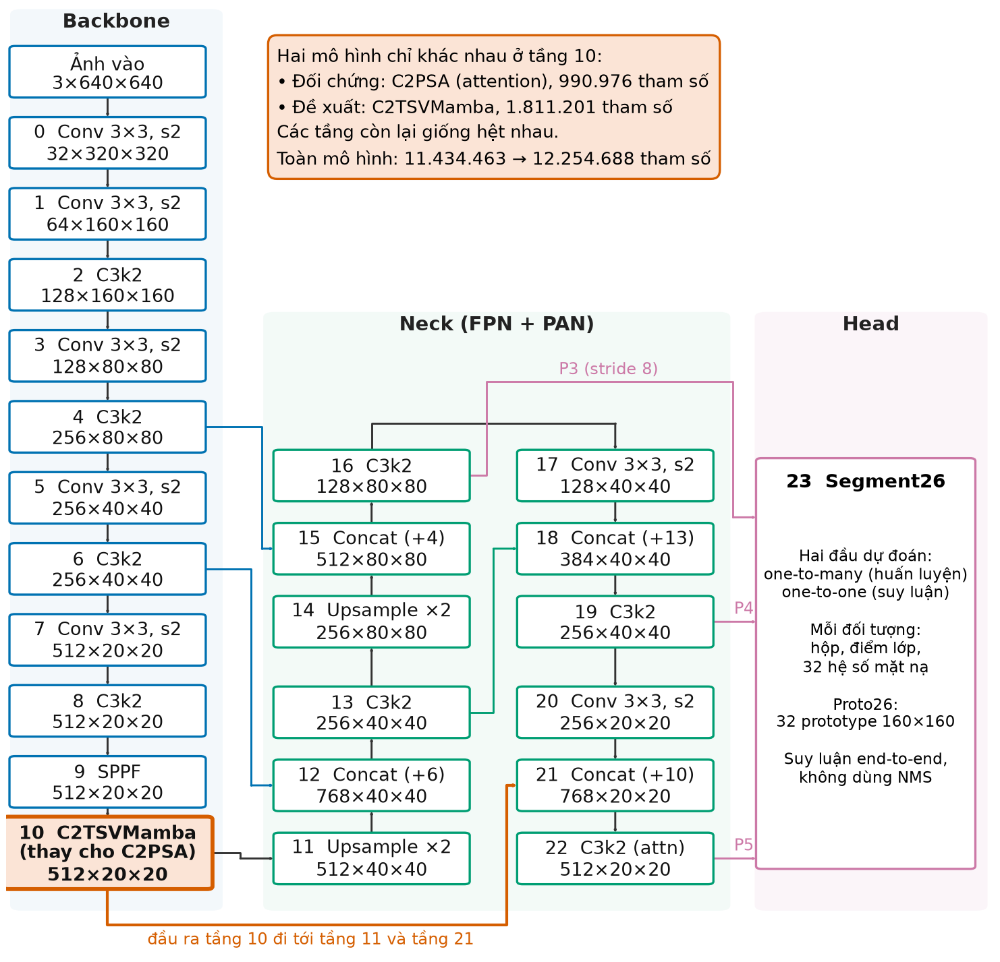
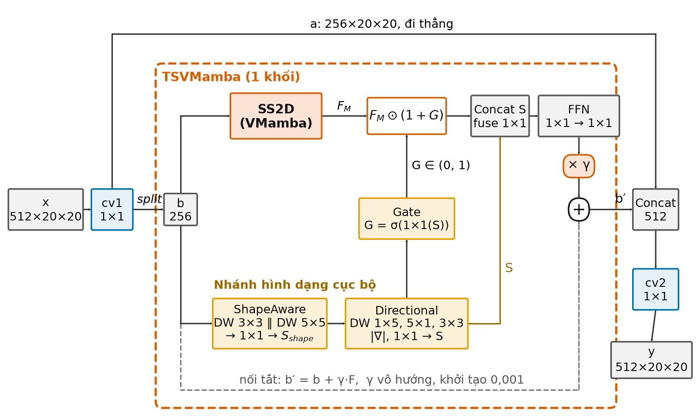
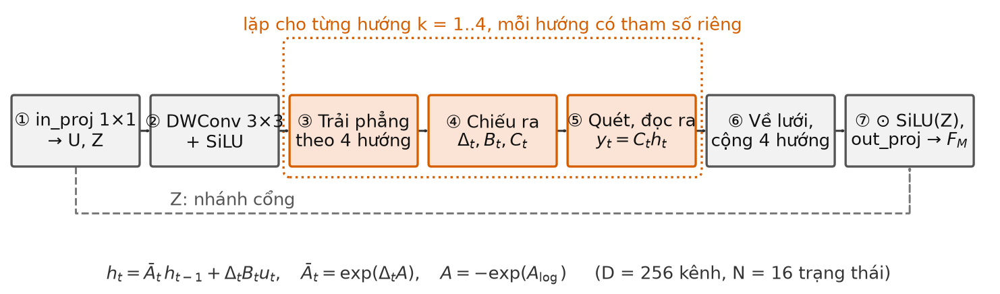

# CHƯƠNG 3. MÔ HÌNH ĐỀ XUẤT

> **Ghi chú soạn thảo (xóa khi nộp):** bản mẫu cho dàn ý 70 trang (03/11/2026), biên tập từ `md_bao_cao_rut_gon/04_CHUONG_3_MO_HINH_DE_XUAT.md`, viết theo cách trình bày của Ch.2 bản nhóm. Giảm từ 15 xuống 5 công thức: bỏ công thức sinh Δ, B, C và rời rạc hóa (đã có ở 2.5), ba công thức của nhánh hình dạng (thay bằng lời), hệ số α(e) của mất mát; bỏ Thuật toán 3.1 dạng mã giả (viết thành các bước bằng lời), bỏ Bảng 3.3 thành phần mất mát và mục 3.6 ưu/nhược (đưa ý chính vào Kết chương); bỏ Hình 3.3 (bốn thứ tự quét, đã có Hình 2.5). Không còn tên hàm, tên tệp trong mã. Mọi con số giữ nguyên bản rút gọn. Số tài liệu tiếp theo Ch.2 (đến [22]); [23]–[28] lấy từ danh sách 57 mục: [42], [29], [44], [45], [46], [40] cũ.

Mô hình đề xuất giữ nguyên gần như toàn bộ YOLO26s-seg, chỉ thay khối C2PSA ở tầng 10 bằng một khối mới gọi là C2TSVMamba. Bên trong khối có nhánh SS2D quét đặc trưng theo kiểu VMamba và một nhánh hình dạng dùng tích chập có hướng; nhánh hình dạng điều khiển nhánh SS2D qua một cổng. Chương này trình bày lý do chọn vị trí thay thế, cấu tạo của khối mới, cách giải phép quét, cách khởi tạo và huấn luyện, cuối cùng là các chế độ tắt bớt thành phần dùng cho thí nghiệm tách thành phần. Mọi thông số trong chương được đọc từ mã nguồn đã dùng để huấn luyện, dựa trên Ultralytics phiên bản 8.4.127 [23], và được kiểm tra lại bằng cách dựng mô hình rồi đếm tham số.

## 3.1. Ý tưởng và lý do chọn tầng 10

Để khoanh đúng một polyp có biên mờ, màu gần giống niêm mạc và kích thước thay đổi nhiều, mô hình cần hai loại thông tin. Thứ nhất là ngữ cảnh rộng, để biết vùng đang xét là một khối lồi lên hay chỉ là vùng phản quang, nếp gấp. Thứ hai là hình dạng của vùng, tức vùng trải theo hướng nào và đường bao ra sao. Trong YOLO26-seg, ngữ cảnh rộng ở cuối backbone do khối C2PSA đảm nhận bằng phép chú ý trên bản đồ 20×20; thông tin hình học cục bộ của khối này chỉ đến từ một tích chập 3×3 dùng để mã hóa vị trí. Như đã trình bày ở Chương 2, PraNet [6] và Topo-VM-UNetV2 [8] cho thấy biên và hình dạng là manh mối có ích cho polyp, còn VMamba [5] là một cách khác để thu ngữ cảnh toàn cục. Từ đó, đề tài thay C2PSA bằng một khối kết hợp quét chọn lọc kiểu VMamba với một nhánh tích chập có hướng.

Tầng 10 được chọn vì bốn lý do. Đây là khối chú ý duy nhất trong backbone, nên hai mô hình chỉ khác nhau ở cách tổng hợp ngữ cảnh tại một vị trí. Bản đồ ở đây chỉ có 20×20 = 400 vị trí, chuỗi cần quét ngắn và mỗi vị trí đã mang thông tin ngữ nghĩa cao. Đầu ra của tầng 10 đi vào cả nhánh đi xuống và nhánh đi lên của neck, nên đặc trưng của khối mới có mặt ở cả ba mức của đầu dự đoán. Cuối cùng, kích thước vào và ra 512×20×20 được giữ nguyên, nên không phải sửa neck, đầu dự đoán hay hàm mất mát.

Đề cương cho phép đặt khối VMamba ở backbone hoặc ở vùng kết hợp đặc trưng đa tỉ lệ (neck). Đề tài chọn một phương án duy nhất là tầng 10 của backbone, và dùng thí nghiệm tách thành phần để so sánh các biến thể của khối tại vị trí này. Phương án đặt khối ở neck chưa được thử: ở các mức P3, P4, chuỗi cần quét dài 1.600 đến 6.400 vị trí, phép quét viết bằng PyTorch thuần sẽ còn chậm hơn nhiều, trong khi giờ GPU có hạn. Đây là một hạn chế của đề tài và là hướng phát triển tiếp theo.

Cần nói rõ phạm vi đóng góp. SS2D là ý tưởng của VMamba [5], quét chọn lọc đến từ Mamba [18]; tích chập theo chiều sâu, cổng sigmoid và nối tắt có hệ số đều là kỹ thuật quen thuộc. Đóng góp của đề tài là cách ghép các thành phần này, trong đó nhánh hình dạng điều biến nhánh SS2D qua cổng; cài đặt lại SS2D bằng PyTorch thuần; tích hợp vào YOLO26s-seg cho bài toán phân đoạn polyp và đánh giá trên 20 seed. Khác với MambaPSA [9] (phát hiện vật thể, nhắm tới giảm chi phí) và Mamba YOLO [24] (thay nhiều khối trong mạng), đề tài chỉ thay một tầng và bổ sung nhánh hình dạng.

## 3.2. Kiến trúc tổng thể

Mô hình gồm ba phần như YOLO26s-seg gốc (Hình 3.1). Backbone gồm tầng 0 đến tầng 10, thu ảnh từ 640×640 xuống 20×20; tầng 10 là vị trí thay đổi. Neck gồm tầng 11 đến tầng 22, trộn đặc trưng để cho ba mức P3 (80×80), P4 (40×40) và P5 (20×20). Đầu Segment26 ở tầng 23 dự đoán hộp, điểm lớp, hệ số mặt nạ và sinh 32 mặt nạ mẫu kích thước 160×160 theo cách của YOLACT [15].

*Hình 3.1. Kiến trúc YOLO26s-seg và vị trí khối C2TSVMamba ở tầng 10*

Tệp cấu hình của mô hình đề xuất được sao từ cấu hình gốc của YOLO26-seg, chỉ khác dòng khai báo tầng 10 (Bảng 3.1). Tầng 22 của cả hai mô hình vẫn có một khối chú ý, nên mô hình đề xuất chỉ thay phép chú ý ở tầng 10. Khi suy luận, cả hai mô hình chỉ dùng đầu một-một, lấy tối đa 300 đối tượng và không cần NMS.

*Bảng 3.1. So sánh mô hình đối chứng và mô hình đề xuất*

| Tiêu chí | YOLO26s-seg (đối chứng) | YOLO26s-seg + C2TSVMamba (đề xuất) |
|---|---|---|
| Khối ở tầng 10 | C2PSA (1 khối PSA, 4 đầu chú ý) | C2TSVMamba (1 khối TSVMamba) |
| Kích thước vào/ra tầng 10 | 512×20×20 | 512×20×20 |
| Số tham số tầng 10 | 990.976 | 1.811.201 |
| Số tham số toàn mô hình | 11.434.463 | 12.254.688 (+7,17%) |
| Tầng 0–9 và 11–23 | Giống nhau | Giống nhau |
| Hàm mất mát, dữ liệu, siêu tham số | Giống nhau | Giống nhau |

## 3.3. Khối C2TSVMamba

### 3.3.1. Khung tách–xử lý–ghép

C2TSVMamba giữ nguyên khuôn ngoài của C2PSA (mục 2.4.3). Đặc trưng vào $x$ có 512 kênh, đi qua một tích chập 1×1 rồi được chia đôi theo kênh thành $a$ và $b$, mỗi phần 256 kênh. Phần $a$ đi thẳng, phần $b$ đi qua khối TSVMamba; hai phần được ghép lại rồi qua một tích chập 1×1 nữa:

$$ [a,\ b] = \mathrm{split}\big(\mathrm{Conv}_{1\times1}(x)\big), \qquad y = \mathrm{Conv}_{1\times1}\big([\,a \,\|\, \mathrm{TSVMamba}(b)\,]\big) \tag{3.1} $$

Trong đó $\|$ là phép ghép theo kênh. Cách chia đôi này giúp chỉ một nửa số kênh phải đi qua phần tính toán nặng, đồng thời giữ một đường đi ngắn cho tín hiệu. Với cỡ small, khối chỉ chứa một khối TSVMamba.

Bên trong TSVMamba (Hình 3.2), $b$ đi đồng thời vào hai nhánh. Nhánh SS2D thu ngữ cảnh toàn cục; nhánh hình dạng trích thông tin hình học và sinh ra một bản đồ cổng để điều chỉnh đầu ra của nhánh SS2D. Hai nhánh được hợp nhất, tinh chỉnh qua một mạng truyền thẳng, nhân với một hệ số nhỏ $\gamma$ rồi cộng trở lại vào $b$.

*Hình 3.2. Cấu trúc khối C2TSVMamba; khung nét đứt là khối TSVMamba, đặc trưng bên trong có kích thước 256×20×20*

### 3.3.2. Nhánh SS2D

Nhánh này cài đặt lại mô-đun SS2D của VMamba theo đúng năm bước ở mục 2.5.3, với 256 kênh, 16 chiều trạng thái và chuỗi dài 400 (Hình 3.3). Trước hết, một tích chập 1×1 nâng $b$ lên 512 kênh rồi chia thành hai phần: $U$ là nội dung sẽ được quét, còn $Z$ dùng làm cổng ở bước cuối. $U$ đi qua tích chập theo chiều sâu 3×3 và hàm kích hoạt SiLU để trộn thông tin lân cận, sau đó được trải thành bốn chuỗi theo bốn thứ tự. Với mỗi chuỗi, mô hình tính các đại lượng $\Delta$, $B$, $C$ phụ thuộc đầu vào theo (2.4) và chạy phép truy hồi (2.3). Ma trận $A$ là ma trận chéo luôn âm theo cách khởi tạo S4D [25], nên hệ số phai luôn nằm giữa 0 và 1 và trạng thái cũ luôn mờ dần. Bốn kết quả được đưa về lưới 20×20 và cộng lại, nhân với cổng SiLU($Z$), rồi chiếu ra:

$$ F_M = W_{\text{out}}\Big( \Big(\sum_{k=1}^{4} \Pi_k^{-1}\big(y^{(k)}\big)\Big) \odot \mathrm{SiLU}(Z) \Big) \tag{3.2} $$

Trong đó $y^{(k)}$ là đầu ra của chuỗi theo hướng thứ $k$, $\Pi_k^{-1}$ đưa chuỗi về lại dạng lưới, $W_{\text{out}}$ là phép chiếu 1×1 và $F_M$ có kích thước 256×20×20. Mỗi hướng có tham số riêng.

*Hình 3.3. Các bước bên trong nhánh SS2D như được cài đặt; bước ③ đến ⑤ thực hiện riêng cho từng hướng*

So với VMamba gốc, bản cài đặt của đề tài có bốn khác biệt: không có hạng tử nhảy (thay bằng nối tắt có hệ số $\gamma$ ở ngoài khối), không có lớp chuẩn hóa sau bước gộp, vẫn giữ cổng SiLU($Z$) mà phiên bản cuối của VMamba đã bỏ, và không dùng mã CUDA tối ưu. Khác biệt thứ hai có thể liên quan đến sự cố số học ở mục 3.5.

### 3.3.3. Nhánh hình dạng

Nhánh hình dạng chỉ gồm các tích chập, áp dụng ba ý tưởng ở mục 2.6. Ở tầng thứ nhất, hai tích chập theo chiều sâu 3×3 và 5×5 chạy song song để nhìn vùng lân cận ở hai độ rộng khác nhau, kết quả được ghép lại và trộn kênh bằng tích chập 1×1. Ở tầng thứ hai, ba tích chập theo chiều sâu chạy song song: dải ngang 1×5, dải dọc 5×1 và 3×3. Từ hai đáp ứng dải ngang và dải dọc, nhánh tính thêm một đại lượng có cùng dạng với độ mạnh của biên ở mục 2.6, tức căn bậc hai của tổng bình phương hai đáp ứng. Bốn kết quả được ghép và trộn lại, rồi ghép tiếp với đầu ra tầng thứ nhất và trộn một lần nữa, cho ra đặc trưng hình dạng $S$ kích thước 256×20×20.

Cần hiểu đúng vai trò của nhánh này. Vì các bộ lọc dải là bộ lọc học được chứ không phải bộ lọc Sobel cố định, đại lượng "độ mạnh biên" ở đây là một đặc trưng ít phụ thuộc hướng chứ không phải gradient ảnh thật. Ở mức P5, một bộ lọc 1×5 đã phủ khoảng 160 điểm ảnh của ảnh gốc, nên nhánh nắm hình dạng ở mức vùng lớn, không phải chi tiết biên từng điểm ảnh. Đề tài chưa có thí nghiệm riêng để kiểm chứng nhánh thực sự học được hình dạng.

### 3.3.4. Cổng, hợp nhất và nối tắt có hệ số

Từ đặc trưng hình dạng $S$, một tích chập 1×1 và hàm sigmoid sinh bản đồ cổng $G$ theo dạng (2.6), nhưng cổng được dùng để khuếch đại thay vì để chặn:

$$ G = \sigma(W_g * S + b_g), \qquad F'_M = F_M \odot (1 + G) \tag{3.3} $$

Vì $G$ nằm giữa 0 và 1, hệ số $(1 + G)$ luôn nằm giữa 1 và 2: cổng chỉ làm nổi một số vị trí và kênh, không tắt hẳn vị trí nào, nhờ đó tín hiệu SS2D không bị mất khi mô hình mới bắt đầu học. Thông tin đi một chiều, từ nhánh hình dạng sang nhánh SS2D. Chữ "topology" trong tên khối chỉ là ý đồ thiết kế; đề tài không dùng hàm mất mát hay ràng buộc tô-pô nào.

Sau đó, $F'_M$ được ghép với $S$, qua một tích chập 1×1 đưa 512 kênh về 256 kênh, qua mạng truyền thẳng gồm hai tích chập 1×1 (256 → 512 → 256), nhân với hệ số $\gamma$ rồi cộng vào $b$. Gộp lại, cả khối được viết thành:

$$ \mathrm{TSVMamba}(b) = b + \gamma \cdot \mathrm{FFN}\Big(\mathrm{Conv}_{1\times1}\big([\,F_M \odot (1 + G) \,\|\, S\,]\big)\Big) \tag{3.4} $$

Hệ số $\gamma$ là một số học được, khởi tạo bằng 0,001. Vì vậy lúc đầu khối gần như giữ nguyên đầu vào và đóng góp của nó tăng dần trong quá trình huấn luyện, tránh làm xáo trộn các tầng đã được tiền huấn luyện.

### 3.3.5. Số tham số

Bảng 3.2 cho số tham số từng thành phần của tầng 10. Nhánh hình dạng cộng với cổng chiếm khoảng 33,5% số tham số của tầng, nhiều hơn chính SS2D. Như vậy, phần tăng thêm so với C2PSA (820.225 tham số) không chỉ đến từ SS2D.

*Bảng 3.2. Số tham số của tầng 10 (cỡ small)*

| Thành phần | Số tham số | Tỉ lệ trong tầng 10 |
|---|---:|---:|
| Khung tách–ghép (hai tích chập 1×1) | 526.336 | 29,1% |
| Nhánh SS2D | 281.856 | 15,6% |
| Nhánh hình dạng, tầng thứ nhất | 141.312 | 7,8% |
| Nhánh hình dạng, tầng thứ hai | 400.640 | 22,1% |
| Cổng | 65.792 | 3,6% |
| Tích chập hợp nhất | 131.584 | 7,3% |
| Mạng truyền thẳng | 263.680 | 14,6% |
| Hệ số $\gamma$ | 1 | ~0% |
| **Tổng C2TSVMamba** | **1.811.201** | 100% |
| C2PSA của mô hình đối chứng | 990.976 | |

## 3.4. Phép quét song song

Với một kênh và một chiều trạng thái, phép truy hồi (2.3) có dạng $h_t = a_t h_{t-1} + b_t$, với $h_0 = 0$, trong đó $a_t$ là hệ số phai và $b_t$ là phần thông tin mới tại bước $t$. Tính lần lượt từ đầu đến cuối cần 399 bước nối tiếp nhau, rất chậm trên GPU dù có tới $4 \times 256 \times 16 = 16.384$ chuỗi chạy song song với nhau. Mấu chốt để tăng tốc là coi mỗi bước như một phép biến đổi $h \mapsto a_t h + b_t$; hai bước liên tiếp hợp lại vẫn là một phép biến đổi cùng dạng:

$$ (a_1, b_1) \circ (a_2, b_2) = (a_2 a_1,\ a_2 b_1 + b_2) \tag{3.5} $$

Phép hợp này có tính kết hợp, nên $h_t$ chính là thành phần thứ hai của tích $(a_1,b_1)\circ\cdots\circ(a_t,b_t)$ và có thể tính bằng phép quét song song [26]. Mã của đề tài dùng biến thể Hillis–Steele [27], gồm ba bước:

1. Đệm chuỗi từ độ dài 400 lên 512 bằng cặp $(1, 0)$; cặp này không làm thay đổi kết quả của phép hợp.
2. Lặp 9 vòng. Ở vòng thứ $j$, mọi vị trí $t$ đồng thời hợp với vị trí $t - 2^{j}$ đứng trước nó theo (3.5); các vị trí đầu chuỗi không có vị trí đứng trước thì giữ nguyên.
3. Sau 9 vòng, mỗi vị trí đã gom đủ mọi phần tử đứng trước; lấy thành phần thứ hai của 400 vị trí đầu làm kết quả $h_t$.

Số bước phải chờ nhau giảm từ 399 xuống 9 vòng, nhưng tổng khối lượng tính lại tăng: mỗi chuỗi cần 4.097 phép hợp so với 399 khi tính tuần tự. Vì vậy bản cài đặt không đạt chi phí tuyến tính như Mamba gốc, vốn dùng biến thể Blelloch [26] và mã CUDA gộp phép toán [18]. Bù lại, mã chỉ cần PyTorch, chạy được trên cả CPU lẫn GPU và cho kết quả tất định.

Về chi phí, ước tính tay cho thấy phần xử lý chính của TSVMamba tốn khoảng 511 triệu phép nhân cộng, gấp khoảng hai lần khối PSA (khoảng 246 triệu), chủ yếu ở nhánh hình dạng và mạng truyền thẳng chứ không ở SS2D; với cả mô hình, số phép tính chỉ tăng khoảng 1–2%. Độ trễ thì tăng nhiều hơn hẳn (Chương 4), nhiều khả năng do mỗi vòng quét tạo ra các tensor trung gian lớn cho từng hướng. Giả thuyết này chưa được kiểm chứng bằng công cụ đo hiệu năng chi tiết.

## 3.5. Khởi tạo, huấn luyện và lưu trọng số

**Khởi tạo.** Cả hai mô hình xuất phát từ trọng số YOLO26s-seg đã tiền huấn luyện trên COCO [17]; chỉ những tensor trùng cả tên lẫn kích thước mới được chép. Ở mô hình đề xuất, tầng 0–9 và 11–23 nhận trọng số giống hệt mô hình đối chứng. Ở tầng 10, 12 trong 58 tensor (gồm hai tích chập của khung tách–ghép và mạng truyền thẳng, tổng 790.016 tham số) trùng tên và kích thước với C2PSA nên được kế thừa; mạng truyền thẳng được kế thừa chỉ vì trùng tên, không phải do chủ ý. 1.021.185 tham số còn lại khởi tạo mới, trong đó $A = -(1, 2, \ldots, 16)$ theo S4D [25] và $\gamma = 0{,}001$. Vì $\gamma$ nhỏ, ở những bước đầu tầng 10 hoạt động gần như chỉ có khung tách–ghép, rồi mô hình học dần đóng góp của khối mới.

**Huấn luyện.** Hai mô hình dùng chung hàm mất mát của YOLO26-seg (mục 2.4.4), cùng siêu tham số và cùng danh sách seed, nên khác biệt có hệ thống chỉ quy được cho tầng 10. Hệ số của các thành phần mất mát là 7,5 cho hộp, 1,5 cho sai số tuyệt đối tới bốn cạnh hộp, 0,5 cho lớp, 7,5 cho mặt nạ và 7,5 cho nhánh ngữ nghĩa phụ; trọng số của đầu một-nhiều giảm dần từ 0,8 xuống 0,1 trong 100 epoch. Bài báo YOLO26 dùng MuSGD, còn đề tài dùng AdamW [28] cho cả hai mô hình với tốc độ học 0,001, huấn luyện hoàn toàn bằng số thực 32 bit (FP32), lô 8 ảnh, 100 epoch, chế độ tất định với seed cố định. Đề tài không thêm hàm mất mát nào về biên hay tô-pô. Cấu hình đầy đủ ở Chương 4.

**Lưu trọng số ở dạng FP32.** Mặc định, Ultralytics chuyển mô hình sang số thực 16 bit (FP16) trước khi lưu trọng số tốt nhất. Ở seed 5, giá trị trung bình tích lũy của lớp chuẩn hóa theo lô trong tích chập hợp nhất ở tầng 10 lên tới khoảng 1,5 triệu, vượt giới hạn 65.504 của FP16, nên tệp trọng số bị tràn số và suy luận sai dù quá trình huấn luyện vẫn bình thường. Đề tài sửa mã lưu để giữ nguyên FP32, rồi huấn luyện lại các lượt của mô hình đề xuất. So sánh nhật ký huấn luyện trên 20 seed cho thấy 44.000 ô số liệu giống hệt, 2.000 ô khác đều thuộc cột thời gian; như vậy bản sửa chỉ làm cho trọng số được lưu đúng, không đổi kết quả huấn luyện. Tên gọi "TSVM FP32" trong báo cáo chỉ cách lưu này. Nguyên nhân có thể nằm ở thiết kế: nhánh SS2D không có lớp chuẩn hóa ở đầu ra và còn được nhân thêm $(1 + G)$ trước bước hợp nhất, nên biên độ đặc trưng không bị chặn. Đây mới là giả thuyết.

## 3.6. Các chế độ tách thành phần

Khối TSVMamba có thể bật hoặc tắt từng nhánh để đo đóng góp của mỗi thành phần (Bảng 3.3). Số tham số tầng 10 của cả bốn chế độ được đếm lại từ trọng số đã huấn luyện. Mọi lượt chính của mô hình đề xuất dùng chế độ đầy đủ; ba chế độ còn lại được huấn luyện với seed 0–4 để ghép cặp với chế độ đầy đủ, kết quả ở Chương 4. Với chỉ 5 seed, đóng góp của từng nhánh mới ở mức thăm dò. Ngoài ra, vì các chế độ chênh nhau tới khoảng 740 nghìn tham số, thí nghiệm này chưa tách được phần do cấu trúc với phần do số tham số tăng thêm.

*Bảng 3.3. Bốn chế độ của khối TSVMamba*

| Chế độ | Nhánh SS2D | Nhánh hình dạng | Cổng | Số tham số tầng 10 |
|---|:---:|:---:|:---:|---:|
| Đầy đủ (dùng trong đề tài), theo (3.4) | Có | Có | Có | 1.811.201 |
| Bỏ cổng: ghép thẳng hai nhánh | Có | Có | Không | 1.745.409 |
| Chỉ nhánh hình dạng | Không | Có | Không | 1.331.969 |
| Chỉ nhánh SS2D | Có | Không | Không | 1.071.873 |

## 3.7. Kết chương

Mô hình đề xuất chỉ thay C2PSA ở tầng 10 bằng C2TSVMamba, giữ nguyên kích thước vào và ra 512×20×20. Khối mới gồm nhánh SS2D quét bốn hướng, nhánh hình dạng có hướng điều khiển SS2D qua cổng $(1 + G)$, và một nối tắt có hệ số $\gamma$ khởi tạo nhỏ để bắt đầu gần mô hình gốc. Phép truy hồi được giải bằng quét song song trong 9 vòng, chỉ cần PyTorch và cho kết quả tất định.

Đổi lại, khối mới thêm 820.225 tham số (+7,17% cho cả mô hình), cần lưu trọng số ở FP32, và tuy số phép tính chỉ tăng khoảng 1–2% nhưng độ trễ tăng đáng kể do cách cài đặt phép quét; thời gian huấn luyện mỗi lượt cũng tăng từ khoảng 2,3 giờ lên 4,7 giờ. Bản cài đặt còn khác VMamba gốc ở vài điểm, và vai trò "hình dạng" của nhánh mới chưa được kiểm chứng trực tiếp. Chương 4 đánh giá chi phí này đổi lại được bao nhiêu về chất lượng phân đoạn.

## Tài liệu tham khảo dùng trong Chương 3 (tạm, gộp vào danh sách chung ở bước cuối)

> Dùng lại từ Ch.1–Ch.2: [5], [6], [8], [9], [15], [17], [18]. Mục mới tiếp theo Ch.2, lấy nguyên từ danh sách 57 mục (số cũ trong ngoặc).

[23] G. Jocher, J. Qiu, and A. Chaurasia, *Ultralytics YOLO*, version 8.4.127. Ultralytics, 2026. [Online]. Available: https://github.com/ultralytics/ultralytics *(cũ [42])*

[24] Z. Wang, C. Li, H. Xu, X. Zhu, and H. Li, "Mamba YOLO: A simple baseline for object detection with state space model," in *Proc. AAAI Conf. Artif. Intell.*, vol. 39, no. 8, 2025, pp. 8205–8213, doi: 10.1609/aaai.v39i8.32885. *(cũ [29])*

[25] A. Gu, K. Goel, A. Gupta, and C. Ré, "On the parameterization and initialization of diagonal state space models," in *Adv. Neural Inf. Process. Syst. (NeurIPS)*, vol. 35, 2022, pp. 35971–35983, doi: 10.52202/068431-2607. *(cũ [44])*

[26] G. E. Blelloch, "Prefix sums and their applications," School Comput. Sci., Carnegie Mellon Univ., Pittsburgh, PA, USA, Tech. Rep. CMU-CS-90-190, Nov. 1990. *(cũ [45])*

[27] W. D. Hillis and G. L. Steele Jr., "Data parallel algorithms," *Commun. ACM*, vol. 29, no. 12, pp. 1170–1183, Dec. 1986, doi: 10.1145/7902.7903. *(cũ [46])*

[28] I. Loshchilov and F. Hutter, "Decoupled weight decay regularization," in *Proc. Int. Conf. Learn. Represent. (ICLR)*, 2019. [Online]. Available: https://arxiv.org/abs/1711.05101 *(cũ [40])*
