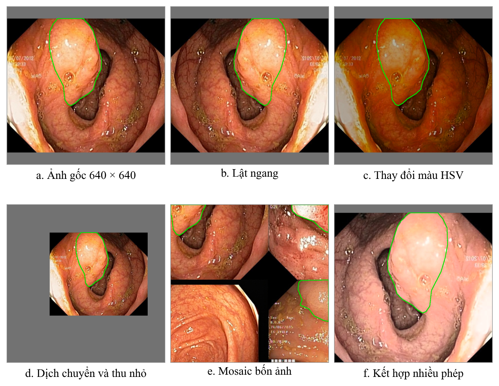
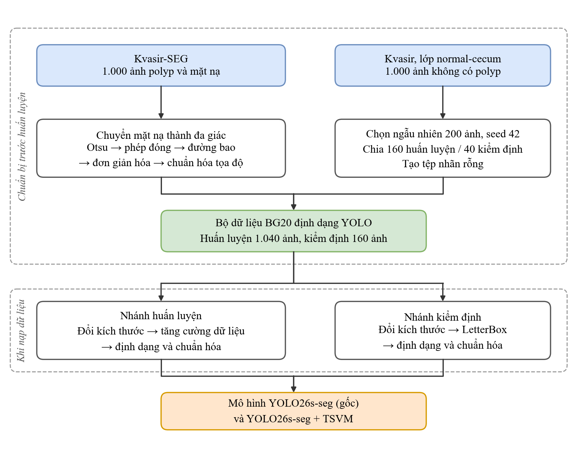
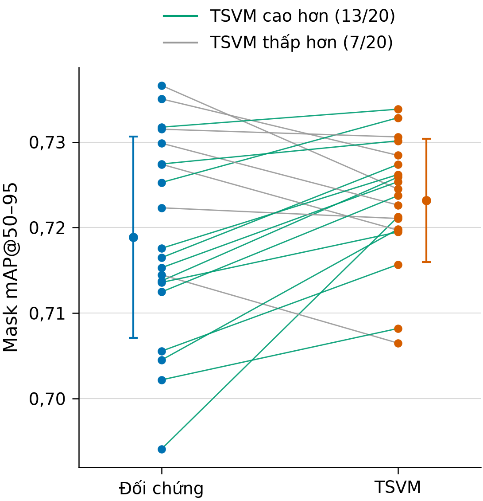
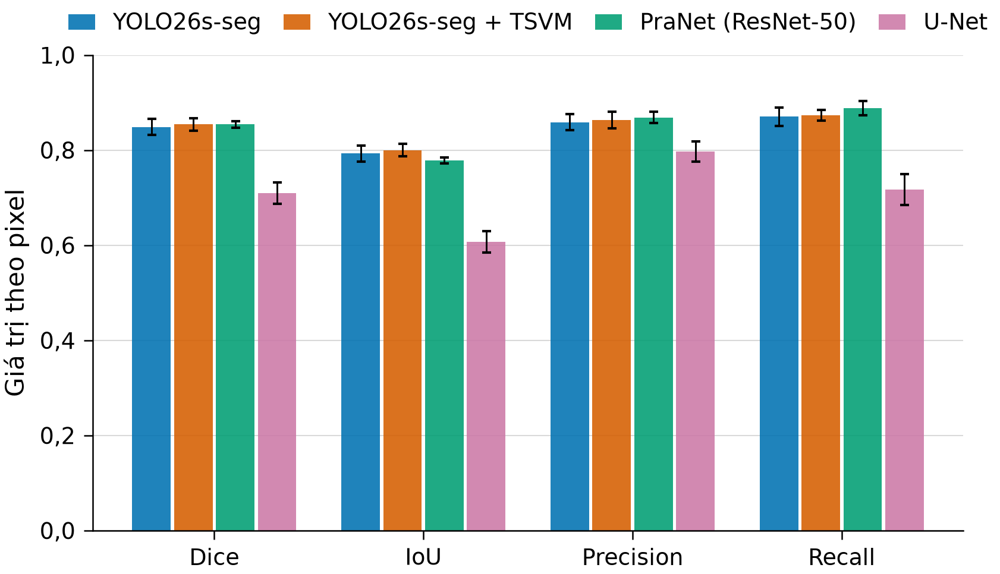
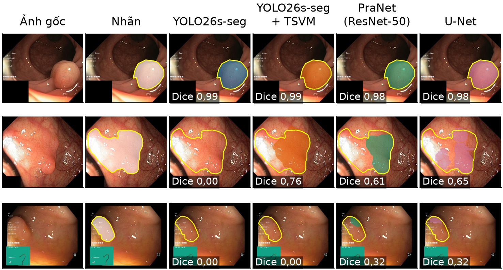
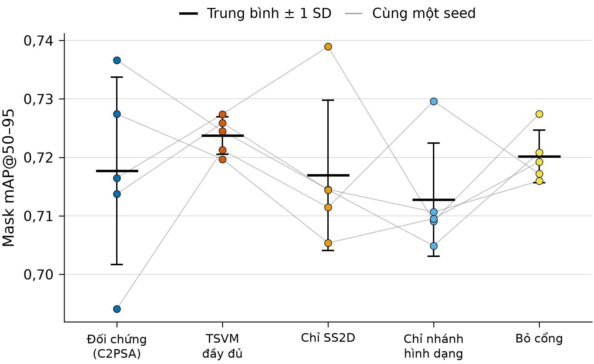
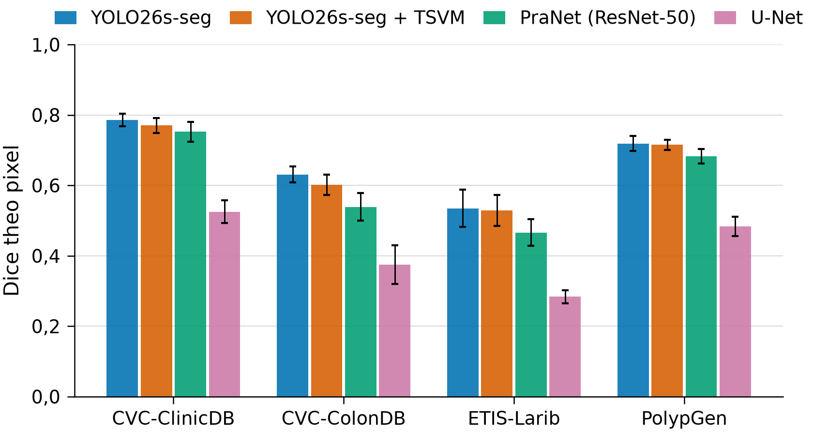
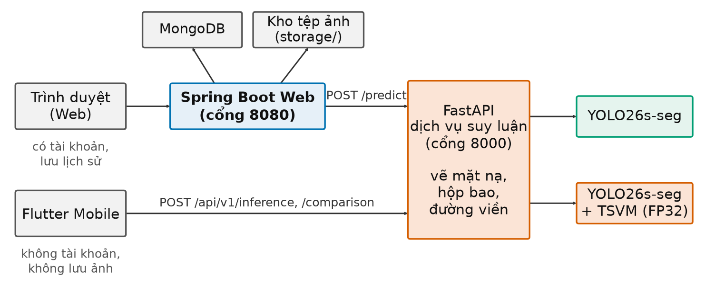

# CHƯƠNG 4. THỰC NGHIỆM VÀ KẾT QUẢ

> **Ghi chú soạn thảo (xóa khi nộp):** bản mẫu cho dàn ý 70 trang (03/11/2026). Gộp ba chương của bản rút gọn: Ch.4 Dữ liệu (biên tập từ `TienXuLy_yolo26.docx` của nhóm, bỏ cả 8 công thức, viết thành lời), Ch.5 Cài đặt và ứng dụng (giữ môi trường, thiết lập và ứng dụng; bỏ mã lệnh, tên tệp, bảng kiểm thử) và Ch.6 Thực nghiệm (giữ mọi số chính; bỏ các hình o01, x03, h04, bảng độ nhạy epoch và bảng ổn định thành lời). Mọi con số lấy nguyên từ bản rút gọn, truy được về `00_tai_lieu_tong_quan/bang/*.csv` và `08_du_lieu_thuc_te/bang/20seed/*.csv`. Số tài liệu tiếp theo Ch.3 (đến [28]); [29]–[39] lấy từ danh sách 57 mục, số cũ ghi ở cuối chương. Còn 3 ô **[CHỤP HÌNH]** chờ nhóm chụp.

Chương này trình bày toàn bộ phần thực nghiệm: dữ liệu và cách tiền xử lý, môi trường và cách đánh giá, kết quả so sánh mô hình gốc với mô hình đề xuất (gọi tắt là TSVM), so sánh với PraNet và U-Net, chi phí tính toán, thí nghiệm tách thành phần, kết quả trên dữ liệu khác nguồn, cuối cùng là ứng dụng minh họa PolypVision.

## 4.1. Dữ liệu và tiền xử lý

Quy trình dữ liệu gồm hai giai đoạn. Giai đoạn chuẩn bị chỉ chạy một lần trước khi huấn luyện, gồm chọn ảnh, chia tập và chuyển mặt nạ thành nhãn đa giác. Giai đoạn nạp dữ liệu lặp lại mỗi khi ảnh được đưa vào mô hình, gồm đổi kích thước, tăng cường và chuẩn hóa. Hai mô hình YOLO dùng chung toàn bộ quy trình này, nên dữ liệu không tạo ra khác biệt giữa chúng.

### 4.1.1. Nguồn dữ liệu và bộ BG20

Kvasir-SEG [10] là bộ dữ liệu công khai gồm 1.000 ảnh nội soi đường tiêu hóa có polyp. Mặt nạ của mỗi ảnh được khoanh dưới sự giám sát của bác sĩ và được bác sĩ chuyên khoa tiêu hóa kiểm tra lại; điểm ảnh trắng là polyp, điểm ảnh đen là nền. Ảnh có kích thước không đồng đều, polyp có vùng rất nhỏ, có vùng chiếm gần hết ảnh. Ảnh và mặt nạ đều nén JPEG nên quanh biên mặt nạ có các điểm xám nhiễu, cần xử lý trước khi dùng.

Để mô hình học cả trường hợp ảnh không có polyp, nhóm bổ sung ảnh nền từ bộ Kvasir phiên bản 2 [29], gồm 8 lớp ảnh, mỗi lớp 1.000 ảnh. Nhóm dùng lớp normal-cecum, tức ảnh manh tràng bình thường, kích thước 720 × 576 điểm ảnh. Nếu chỉ học ảnh có polyp, mô hình dễ khoanh nhầm các nếp niêm mạc hay vùng phản quang; ảnh nền giúp giảm sai sót khi gặp ảnh không có tổn thương.

Ảnh polyp được tải từ Kaggle [30] kèm sẵn cách chia 880 ảnh huấn luyện và 120 ảnh kiểm định do nhóm tác giả cung cấp, nhờ đó kết quả có thể so sánh với các nghiên cứu khác. Với ảnh nền, chương trình sắp xếp 1.000 ảnh theo tên rồi chọn ngẫu nhiên với seed 42, nên cách chia tái lập được chính xác. Tên BG20 thể hiện số ảnh nền bằng 20% số ảnh polyp; tính trên toàn bộ 1.200 ảnh, ảnh nền chiếm 16,67% (Bảng 4.1).

*Bảng 4.1. Phân bố ảnh và nhãn trong bộ dữ liệu BG20*

| Thành phần | Huấn luyện | Kiểm định | Tổng |
|---|---:|---:|---:|
| Ảnh có polyp | 880 | 120 | 1.000 |
| Ảnh nền normal-cecum | 160 | 40 | 200 |
| Tổng số ảnh | 1.040 | 160 | 1.200 |
| Số vùng polyp được gán nhãn | 936 | 127 | 1.063 |

*Nguồn: nhóm đếm trực tiếp trên bộ dữ liệu BG20.*

Một ảnh có thể chứa nhiều vùng polyp tách rời, mỗi vùng có một nhãn riêng. Bộ dữ liệu được tổ chức theo định dạng của Ultralytics [23], mỗi ảnh có một tệp nhãn cùng tên; lớp polyp mang chỉ số 0. Với ảnh nền, tệp nhãn để trống: ảnh nền không phải một lớp thứ hai, chỉ là ảnh không chứa đối tượng cần tìm.

### 4.1.2. Chuyển mặt nạ thành nhãn đa giác

YOLO26-seg không đọc nhãn dạng ảnh mà đọc tệp văn bản, mỗi dòng gồm chỉ số lớp và tọa độ các đỉnh của một đa giác bao quanh polyp. Vì vậy nhóm chuyển mỗi mặt nạ thành nhãn đa giác qua năm bước bằng thư viện OpenCV; ảnh nội soi giữ nguyên.

1. **Nhị phân hóa.** Mặt nạ được tách thành nền và polyp bằng một ngưỡng chọn tự động theo phương pháp Otsu [31], tức ngưỡng làm hai nhóm sáng và tối khác nhau nhiều nhất. Trên 1.000 mặt nạ, ngưỡng chỉ nằm trong khoảng 5 đến 8, cho thấy mặt nạ gốc gần như đã có hai mức và bước này chủ yếu loại các điểm xám do nén ảnh.
2. **Làm liền vùng.** Phép đóng hình thái học [19] với phần tử cấu trúc 3 × 3 làm vùng trắng phình ra một điểm ảnh để lấp khe và lỗ nhỏ, rồi co lại một điểm ảnh để biên trở về gần vị trí cũ.
3. **Tìm đường bao và loại nhiễu.** Thuật toán dò biên của Suzuki và Abe [32] tìm đường bao ngoài cùng của mỗi vùng trắng; vùng nhỏ hơn 20 điểm ảnh vuông bị loại vì thường là đốm nhiễu. Trên 1.000 mặt nạ, chương trình tìm được 1.206 đường bao, loại 143 và còn đúng 1.063 vùng polyp.
4. **Đơn giản hóa đường bao.** Mỗi đường bao còn trung bình khoảng 333 điểm, quá nhiều cho tệp nhãn. Thuật toán Douglas–Peucker [33] bỏ những điểm gần như thẳng hàng với hai bên, chỉ giữ chỗ gấp khúc lệch quá một sai số bằng 0,2% chu vi đường bao (polyp chu vi 1.000 điểm ảnh thì sai số là 2 điểm ảnh). Số điểm trung bình mỗi đa giác giảm từ 333,2 xuống 24,6, tức giảm 92,6%.
5. **Chuẩn hóa tọa độ và ghi tệp.** Tọa độ mỗi đỉnh được chia cho chiều rộng và chiều cao của ảnh để đưa về khoảng 0 đến 1, làm tròn 6 chữ số thập phân. Nhờ vậy nhãn không phụ thuộc kích thước ảnh: ảnh phóng to hay thu nhỏ thì đa giác vẫn khớp đúng vị trí polyp.

### 4.1.3. Đổi kích thước, tăng cường và chuẩn hóa

Mô hình nhận ảnh có cạnh dài 640 điểm ảnh. Kéo giãn ảnh sẽ làm polyp bị méo, nên ảnh được thu phóng giữ nguyên tỉ lệ để cạnh dài bằng 640. Ở nhánh kiểm định, phần thiếu của cạnh ngắn được đệm màu xám, chia đều cho hai phía (kỹ thuật LetterBox), và tọa độ đa giác được dịch theo nên nhãn luôn khớp với ảnh mới. Ở nhánh huấn luyện, khung 640 × 640 được tạo bởi phép ghép ảnh Mosaic và phép biến đổi affine.

Tập huấn luyện chỉ có 1.040 ảnh, khá ít với một mô hình học sâu, nên mô hình dễ học thuộc từng ảnh. Tăng cường dữ liệu tạo một biến thể ngẫu nhiên mỗi lần ảnh được nạp và chỉ áp dụng cho tập huấn luyện; phép hình học làm dịch chuyển điểm ảnh nên đa giác nhãn được biến đổi theo, còn phép đổi màu giữ nguyên nhãn (Bảng 4.2, Hình 4.1).

*Bảng 4.2. Các phép tăng cường dữ liệu*

| Phép biến đổi | Giá trị | Ý nghĩa |
|---|:---:|---|
| Mosaic [34] | 1,0 | Luôn ghép bốn ảnh quanh một tâm ngẫu nhiên, tắt trong 10 epoch cuối |
| Dịch chuyển | 0,1 | Lệch tối đa 10% khung |
| Thu phóng | 0,5 | Hệ số từ 0,5 đến 1,5 |
| Sắc độ, độ bão hòa, độ sáng | 0,015; 0,7; 0,4 | Mô phỏng điều kiện chiếu sáng khác nhau |
| Lật ngang | 0,5 | Xác suất 50% |
| Làm mờ, lọc trung vị, chuyển xám, CLAHE | 0,01 | Xác suất 1% mỗi phép |
| Lật dọc, xoay, cắt xiên, trộn ảnh | 0 | Không sử dụng |

{width=11cm}

*Hình 4.1. Ảnh huấn luyện trước và sau các phép tăng cường dữ liệu; đường bao luôn khớp polyp vì nhãn được biến đổi cùng ảnh*

Trước khi vào mạng, giá trị điểm ảnh được chia cho 255 để đưa về khoảng 0 đến 1, ảnh được ghép thành lô 8 ảnh, và đa giác được tô đầy để tạo lại mặt nạ huấn luyện kích thước 160 × 160. Chương trình chuyển đổi tự dừng nếu số ảnh và số tệp nhãn lệch nhau. Một lượt kiểm tra độc lập cho thấy mỗi ảnh có đúng một tệp nhãn, cả 1.063 dòng nhãn đều hợp lệ và hai tập không có ảnh trùng tên hay trùng nội dung. Kiểm tra này vẫn có giới hạn: không có thông tin bệnh nhân nên chưa loại trừ được ảnh của cùng một người ở cả hai tập, và không có tập kiểm thử độc lập nên kết quả được đánh giá trên tập kiểm định. Hình 4.2 tổng hợp toàn bộ quy trình.

{width=12cm}

*Hình 4.2. Quy trình xây dựng bộ dữ liệu BG20 và tiền xử lý dữ liệu; phần trên chạy một lần, phần dưới lặp lại mỗi lần nạp ảnh*

## 4.2. Môi trường, cài đặt và thiết lập thực nghiệm

### 4.2.1. Môi trường và ngôn ngữ lập trình

Theo đề cương, huấn luyện chạy trên nền tảng điện toán đám mây Kaggle có GPU. Mỗi tài khoản Kaggle có hạn mức GPU khoảng 30 giờ mỗi tuần, trong khi một lượt mô hình đề xuất mất khoảng 4,7 giờ, nên các lượt được chia cho nhiều tài khoản chạy song song. Kết quả được tải về máy cá nhân để tính lại số liệu, vẽ hình và đo tốc độ (Bảng 4.3).

Về ngôn ngữ, đề tài dùng Python cho huấn luyện mô hình và dịch vụ suy luận, Java cho Website như đề cương quy định, và bổ sung Dart (Flutter) cho ứng dụng di động. Đề cương có nêu cả PyTorch và TensorFlow; đề tài chỉ dùng PyTorch, vì Ultralytics YOLO26 [23] và các bản cài đặt Mamba, VMamba đều viết trên PyTorch, nhờ đó khối C2TSVMamba ghép thẳng vào mô hình gốc mà không phải chuyển đổi giữa hai thư viện. Các thư viện khác gồm NumPy, pandas, OpenCV, SciPy và Matplotlib cho xử lý dữ liệu, thống kê và vẽ hình; FastAPI cho dịch vụ suy luận; Spring Boot, Thymeleaf, Bootstrap và MongoDB cho Website; Git để quản lý mã nguồn.

*Bảng 4.3. Môi trường huấn luyện và đánh giá*

| Thành phần | Giá trị |
|---|---|
| Huấn luyện | Kaggle Notebook, GPU NVIDIA Tesla T4 15 GB, Python 3.12, PyTorch 2.10.0 **[CẦN KIỂM TRA]** |
| Thư viện mô hình | Ultralytics 8.4.127, bản sao có thêm khối C2TSVMamba và bản vá lưu FP32 |
| Thời gian một lượt (100 epoch) | Mô hình gốc khoảng 2,3 giờ, mô hình đề xuất khoảng 4,7 giờ |
| Máy đánh giá | CPU AMD Ryzen 7 250, GPU NVIDIA GeForce RTX 5050 Laptop, Windows 11 |
| Ứng dụng | FastAPI (dịch vụ suy luận), Java Spring Boot và MongoDB (Web), Flutter (di động) |

### 4.2.2. Cài đặt hai mô hình

**Mô hình gốc YOLO26s-seg** dùng nguyên bản Ultralytics 8.4.127, khởi tạo từ trọng số YOLO26s-seg đã tiền huấn luyện trên COCO; lớp đầu ra được đổi từ 80 lớp sang một lớp duy nhất là polyp. Lệnh huấn luyện chính như sau:

```python
model = YOLO("yolo26s-seg.pt")
model.train(data="data_bg20.yaml", epochs=100, imgsz=640, batch=8,
            optimizer="AdamW", lr0=0.001, amp=False, deterministic=True, seed=SEED)
```

**Mô hình đề xuất** cần khối C2TSVMamba, vốn không có trong Ultralytics, nên nhóm tạo một bản sao của Ultralytics 8.4.127 với ba thay đổi. Thứ nhất, thêm một mô-đun mới cài đặt SS2D, nhánh hình dạng, cổng và khối C2TSVMamba như Chương 3, rồi đăng ký khối này để trình đọc cấu hình dựng được mô hình. Thứ hai, thêm một tệp cấu hình sao từ cấu hình gốc của YOLO26-seg, chỉ đổi dòng tầng 10 từ C2PSA sang C2TSVMamba. Thứ ba, sửa mã lưu trọng số để giữ FP32 (mục 3.5) và kèm bộ kiểm thử tự động cho khối mới. Mô hình đề xuất được dựng từ tệp cấu hình ở cỡ small rồi nạp cùng trọng số COCO, dùng đúng các tham số huấn luyện như mô hình gốc. Thí nghiệm tách thành phần dùng cùng bản sao này, chỉ đổi chế độ của khối ở tầng 10 (Bảng 3.3).

**Cấu hình huấn luyện chung.** Hai mô hình dùng chung mọi thiết lập: ảnh 640 điểm ảnh, 100 epoch, lô 8 ảnh, bộ tối ưu AdamW [28] với tốc độ học 0,001 và suy giảm trọng số 0,0005, khởi động 5 epoch, cùng các phép tăng cường ở Bảng 4.2, tính toán hoàn toàn bằng FP32. Chế độ tất định được bật và mọi nguồn ngẫu nhiên được đặt theo seed, nên cùng seed thì cùng thứ tự dữ liệu và cùng khởi tạo. Mỗi mô hình được huấn luyện 20 lượt với seed 0–19; hai lượt cùng seed của hai mô hình tạo thành một **cặp**.

**Quy trình trên Kaggle và lưu trữ kết quả thực nghiệm.** Đề tài dùng ba notebook: notebook mô hình gốc, notebook mô hình đề xuất (thêm bước nạp bản sao Ultralytics) và notebook tách thành phần (thêm ô chọn chế độ, seed và ô kiểm tra số tham số tầng 10 trước khi huấn luyện, sai thì dừng ngay để không tốn giờ GPU). Mỗi lượt lưu riêng một thư mục theo tên mô hình và seed, gồm tệp cấu hình đầy đủ, nhật ký chỉ số và hàm mất mát từng epoch, và trọng số tốt nhất; các thư mục được xếp theo từng mô hình và từng chế độ tách thành phần. Từ các tệp này, các script của nhóm tính lại mọi số liệu ra bảng CSV, suy luận lại để tính chỉ số theo điểm ảnh và vẽ hình, nên mọi con số trong chương truy được về tệp gốc.

> **[CHỤP HÌNH 4.3] Notebook Kaggle đang chạy.** Notebook tách thành phần trên Kaggle, khung bên phải mở mục *Input* (thấy hai bộ dữ liệu: dữ liệu BG20 và bản sao Ultralytics FP32) và *Settings* (Accelerator là GPU). Cần thấy đầu ra của ô kiểm tra mô hình có dòng "Tham số tầng 10 = …" và vài dòng nhật ký huấn luyện có cột epoch, loss, mAP. Che tên tài khoản nếu cần.

### 4.2.3. Thiết lập đánh giá

**Mô hình đối chiếu.** PraNet [6] với xương sống ResNet-50 và U-Net [35] cũng được huấn luyện 20 seed trên BG20, nhưng ở ảnh 352 × 352 và không tăng cường dữ liệu. Hai mô hình này chỉ dùng để đặt kết quả vào bối cảnh, không phải đối tượng so sánh chính.

**Độ đo và kiểm định.** Chỉ số chính là **mask mAP50–95** (mục 2.7.3), được chọn trước khi xem kết quả; các chỉ số khác là chỉ số phụ. Với mỗi lượt, đề tài lấy epoch có mask mAP50–95 lớn nhất và mọi chỉ số khác ở cùng epoch. Hiệu số ghép cặp được kiểm định bằng kiểm định t ghép cặp kèm khoảng tin cậy 95% và kiểm định Wilcoxon [21], kèm cỡ hiệu ứng $d_z$ [22] và số seed TSVM tốt hơn, ở mức ý nghĩa 0,05. Đề tài không hiệu chỉnh đa kiểm định nên chỉ kết luận chắc chắn trên chỉ số chính. Để so sánh độ dao động giữa các seed, đề tài dùng kiểm định Levene dạng trung vị [36]; kiểm định này bỏ qua ghép cặp nên chỉ mang tính thăm dò.

**Đánh giá theo điểm ảnh.** PraNet và U-Net không cho ra từng đối tượng kèm độ tin cậy, nên để so sánh bốn mô hình, đề tài chạy lại suy luận và tính Dice, IoU, Precision, Recall theo điểm ảnh trên từng ảnh trong 120 ảnh có polyp (ảnh bị bỏ sót hoàn toàn có Dice bằng 0), lấy trung bình mỗi seed rồi qua 20 seed. Với 40 ảnh nền, đề tài đếm tỉ lệ ảnh có ít nhất một điểm ảnh bị dự đoán là polyp, gọi là tỉ lệ báo nhầm. Mọi giá trị ghi dưới dạng trung bình ± độ lệch chuẩn qua 20 seed.

## 4.3. So sánh mô hình gốc và mô hình đề xuất trên 20 seed

### 4.3.1. Kết quả tổng hợp

*Bảng 4.4. Chỉ số mặt nạ của hai mô hình (20 seed, epoch có mask mAP50–95 lớn nhất)*

| Chỉ số | YOLO26s-seg | TSVM | Δ (TSVM − gốc) | CI 95% của Δ | p (t) | p (Wilcoxon) | Seed TSVM tốt hơn |
|---|---:|---:|---:|---:|---:|---:|---:|
| **Mask mAP50–95** | 0,7189 ± 0,0118 | 0,7232 ± 0,0072 | **+0,0043** | [−0,0002; 0,0088] | 0,061 | 0,070 | 13/20 |
| Mask mAP50 | 0,9069 ± 0,0125 | 0,9083 ± 0,0086 | +0,0014 | [−0,0053; 0,0080] | 0,668 | 0,812 | 10/20 |
| Mask Precision | 0,9041 ± 0,0287 | 0,9145 ± 0,0233 | +0,0104 | [−0,0086; 0,0293] | 0,266 | 0,498 | 11/20 |
| Mask Recall | 0,8594 ± 0,0241 | 0,8590 ± 0,0179 | −0,0004 | [−0,0126; 0,0119] | 0,948 | 0,926 | 9/20 |
| Mask F1 | 0,8806 ± 0,0142 | 0,8856 ± 0,0129 | +0,0049 | | 0,259 | 0,388 | 12/20 |
| Box mAP50–95 | 0,7228 ± 0,0159 | 0,7273 ± 0,0134 | +0,0045 | [−0,0031; 0,0121] | 0,227 | 0,105 | 13/20 |

*Nguồn: đề tài tính từ 40 tệp nhật ký huấn luyện (`bang/02_ket_qua_tung_seed.csv`, `bang/04_thong_ke_ghep_cap.csv`). Mask F1 tính từ Precision và Recall của cùng epoch.*

Trên chỉ số chính, TSVM đạt 0,7232, cao hơn mô hình gốc 0,0043 (khoảng 0,6% tương đối) và cao hơn ở 13/20 seed. Tuy vậy, khoảng tin cậy 95% của hiệu số vẫn chứa 0, kiểm định t cho $p = 0{,}061$, Wilcoxon cho $p = 0{,}070$, cỡ hiệu ứng $d_z = 0{,}44$ ở mức nhỏ đến vừa. **Ở mức ý nghĩa 0,05, chưa đủ bằng chứng để khẳng định TSVM tốt hơn mô hình gốc**; kết quả chỉ cho thấy xu hướng tăng nhỏ. Ngược lại, $p > 0{,}05$ cũng không chứng minh hai mô hình tương đương: hiệu số thật có thể từ gần 0 đến khoảng +0,009.

Các chỉ số phụ đi cùng chiều nhưng yếu hơn và không chỉ số nào có ý nghĩa thống kê: Precision tăng khoảng 1 điểm phần trăm, Recall gần như không đổi nên F1 chỉ tăng 0,0049, mAP50 gần bằng nhau. Điều này gợi ý phần chênh lệch nhỏ nằm ở các ngưỡng IoU cao, tức mức khớp biên mặt nạ, chứ không ở khả năng tìm ra polyp.



*Hình 4.4. Mask mAP50–95 của từng seed; mỗi đường nối hai lượt cùng seed của hai mô hình*

Hiệu số dao động khá rộng, từ −0,0121 (seed 0) đến +0,0272 (seed 3). Lượt tốt nhất của mô hình gốc (0,7366, seed 0) còn cao hơn lượt tốt nhất của TSVM (0,7339, seed 8); các hiệu số dương lớn nhất rơi vào những seed mà mô hình gốc thấp, như seed 3 (0,6941 so với 0,7213).

### 4.3.2. Độ ổn định, cách chọn epoch và quá trình hội tụ

Qua 20 seed, mask mAP50–95 của mô hình gốc dao động từ 0,6941 đến 0,7366 (độ lệch chuẩn 0,0118), của TSVM từ 0,7065 đến 0,7339 (độ lệch chuẩn 0,0072). Độ lệch chuẩn của TSVM nhỏ hơn khoảng 39%, kiểm định Levene cho $p = 0{,}026$. Vì kiểm định này bỏ qua ghép cặp và không phải chỉ số chính, đề tài chỉ coi đây là dấu hiệu thăm dò rằng TSVM ít phụ thuộc vào seed hơn. Dấu hiệu này chỉ đúng ở epoch tốt nhất: ở epoch 100, độ lệch chuẩn hai mô hình gần bằng nhau (0,0132 và 0,0130), và trên dữ liệu ngoài (mục 4.7) nó không còn.

Kết luận cũng không phụ thuộc cách chọn epoch. Nếu lấy epoch của trọng số tốt nhất do Ultralytics chọn, hiệu số là +0,0048 ($p = 0{,}062$); nếu lấy epoch cuối cùng, hiệu số thu hẹp còn +0,0025 ($p = 0{,}456$). Về quá trình hội tụ, trong khoảng 10 epoch đầu TSVM tăng chậm hơn, phù hợp với việc hơn một triệu tham số mới được khởi tạo ngẫu nhiên và hệ số $\gamma$ ban đầu rất nhỏ (mục 3.5); từ epoch 82 đến 100, trung bình của TSVM luôn cao hơn.

### 4.3.3. Phát hiện theo đối tượng

Ở mức đối tượng, hai mô hình tìm được gần như cùng số polyp: trung bình 110,55 so với 110,65 trên 127 vùng (khoảng 87%), bỏ sót 16,45 so với 16,35 vùng. TSVM dự đoán thừa ít hơn trung bình 0,7 vùng (16,45 so với 15,75), không có ý nghĩa thống kê (Wilcoxon $p = 0{,}671$). Ô âm tính đúng không xác định được ở mức đối tượng, nên đề tài không tính độ đặc hiệu từ ma trận nhầm lẫn; tỉ lệ báo nhầm trên ảnh nền được đo riêng ở mục 4.4.

## 4.4. So sánh theo điểm ảnh với PraNet, U-Net và chỉ số topology

*Bảng 4.5. Chỉ số theo điểm ảnh của bốn mô hình trên tập kiểm định (20 seed)*

| Mô hình | Dice | IoU | Precision | Recall | Ảnh nền báo nhầm (%) |
|---|---:|---:|---:|---:|---:|
| YOLO26s-seg | 0,8486 ± 0,0171 | 0,7927 ± 0,0170 | 0,8585 ± 0,0170 | 0,8703 ± 0,0193 | 1,2 ± 1,9 |
| TSVM | 0,8540 ± 0,0129 | **0,7998 ± 0,0129** | 0,8632 ± 0,0173 | 0,8730 ± 0,0112 | 1,5 ± 2,1 |
| PraNet | **0,8541 ± 0,0068** | 0,7785 ± 0,0063 | **0,8687 ± 0,0117** | **0,8881 ± 0,0145** | **0,8 ± 1,2** |
| U-Net | 0,7097 ± 0,0221 | 0,6069 ± 0,0221 | 0,7964 ± 0,0213 | 0,7167 ± 0,0327 | 20,4 ± 6,4 |

*Nguồn: `bang/11_pixel_tung_seed.csv`, `bang/12_pixel_thong_ke.csv`. Số in đậm là giá trị tốt nhất của mỗi cột. Ở mức điểm ảnh, F1 chính là Dice (mục 2.7.2) nên không ghi riêng.*



*Hình 4.5. Dice, IoU, Precision và Recall theo điểm ảnh của bốn mô hình; thanh lỗi là ±1 độ lệch chuẩn qua 20 seed*

**So với mô hình gốc**, TSVM vẫn có xu hướng tăng nhẹ theo điểm ảnh (Dice +0,0054, $p = 0{,}260$; IoU +0,0071, $p = 0{,}130$; cao hơn ở 13–14/20 seed), không có ý nghĩa thống kê, khớp với kết luận theo mAP.

**So với PraNet**, Dice trung bình gần như bằng nhau, nhưng mỗi mô hình mạnh ở một mặt. TSVM có IoU cao hơn ở 19/20 seed ($p < 0{,}001$), tức mặt nạ khớp nhãn sát hơn khi đã khoanh được polyp. PraNet có Recall cao hơn ($p = 0{,}002$) và ổn định hơn nhiều giữa các seed (độ lệch chuẩn Dice 0,0068 so với 0,0129). Dice trung bình của YOLO bị kéo xuống bởi các ảnh bỏ sót hoàn toàn: ở ngưỡng tin cậy 0,25, YOLO không dự đoán điểm ảnh nào trên trung bình khoảng 6,5/120 ảnh có polyp mỗi seed, còn PraNet chỉ 0,95 ảnh.

**So với U-Net**, ba mô hình còn lại hơn rất xa (Dice của TSVM cao hơn 0,1443, 20/20 seed); U-Net còn báo nhầm khoảng 20% ảnh nền, trong khi YOLO và PraNet chỉ khoảng 1–1,5%. Ảnh nền của tập kiểm định đều lấy từ lớp manh tràng bình thường, khá đồng nhất, nên con số này chưa đại diện cho niêm mạc bình thường nói chung.



*Hình 4.6. Ví dụ dự đoán của bốn mô hình (seed 0); ba ảnh được chọn tự động: ảnh cả bốn mô hình đều tốt, ảnh TSVM hơn mô hình gốc nhiều nhất và ảnh khó nhất*

Hình 4.6 chỉ có tính minh họa. Cần lưu ý phép so sánh có giới hạn: YOLO dùng ảnh 640 điểm ảnh, có tăng cường và khởi tạo COCO, còn PraNet, U-Net dùng ảnh 352 điểm ảnh, không tăng cường, và ngưỡng chưa được tối ưu riêng. Kết quả phản ánh các cấu hình cụ thể này, không so trực tiếp với số trong bài báo gốc của PraNet.

**Chỉ số topology.** mAP và Dice gần như không phạt các lỗi hình dạng tổng thể như mặt nạ vỡ nhiều mảnh hay có lỗ nhỏ. Đề tài đếm trực tiếp số mảnh và số lỗ của mặt nạ (bỏ qua mảnh và lỗ dưới 20 điểm ảnh); một ảnh được coi là **đúng topology** khi số mảnh và số lỗ của dự đoán khớp với nhãn. Tỉ lệ ảnh đúng topology là 0,797 ± 0,027 với mô hình gốc, 0,808 ± 0,026 với TSVM, 0,914 ± 0,021 với PraNet và 0,260 ± 0,045 với U-Net. TSVM nhích hơn mô hình gốc ở mọi chỉ số topology nhưng không chỉ số nào có ý nghĩa thống kê (ảnh đúng topology $p = 0{,}139$). **Đề tài không khẳng định khối đề xuất cải thiện topology của mặt nạ.** PraNet tốt nhất rõ rệt, hơn TSVM ở cả 20/20 seed ($p < 0{,}001$); một giải thích hợp lý, chưa kiểm chứng, là PraNet lấy ngưỡng một bản đồ xác suất trơn, còn YOLO ghép mặt nạ từ các mặt nạ mẫu 160 × 160 rồi phóng lên (mục 2.4.2), dễ tạo lỗ nhỏ và mép răng cưa.

## 4.5. Chi phí tính toán

*Bảng 4.6. Số tham số, số phép tính và độ trễ suy luận (trọng số seed 0, lô 1 ảnh, ảnh 640 × 640, FP32)*

| | YOLO26s-seg | TSVM | Chênh lệch |
|---|---:|---:|---:|
| Tham số toàn mô hình | 11.434.463 | 12.254.688 | +7,2% |
| GFLOPs | 34,29 | 34,82 | +1,5% |
| Tệp trọng số | 22,27 MiB (FP16) | 47,37 MiB (FP32) | |
| Độ trễ CPU AMD Ryzen 7 250 (ms, trung bình 100 lần) | 269,56 ± 18,71 | 577,36 ± 24,40 | 2,14 lần |
| Độ trễ GPU RTX 5050 Laptop (ms, trung vị 1.000 lần) | 26,33 | 39,86 | 1,51 lần |

*Nguồn: `bang/08_kien_truc_dung_lai.csv`, `bang/16_flops_do_tre_gpu.csv`, `bang/07_checkpoint_best_pt.csv`, `04_phan_tich_20seed/efficiency_benchmark/tables/efficiency_summary.csv`. Độ trễ chỉ tính lan truyền xuôi.*

Số phép tính chỉ tăng khoảng 1,5% nhưng độ trễ tăng khoảng 1,5 lần trên GPU và 2,1 lần trên CPU: GFLOPs không phản ánh đúng tốc độ của khối Mamba viết bằng PyTorch thuần. Bộ đếm phép tính chỉ tính tích chập và nhân ma trận, không tính các phép theo từng phần tử trong phép quét, nên GFLOPs của TSVM là cận dưới. Nguyên nhân chính của độ trễ là phép quét song song (mục 3.4): 9 vòng nối tiếp, mỗi vòng tạo tensor trung gian và nhiều phép theo từng phần tử, bị giới hạn bởi băng thông bộ nhớ; Mamba gốc tránh được điều này nhờ mã CUDA riêng [18]. Trên GPU, các lần đo được kiểm soát nhiệt độ và tỉ lệ giữa hai mô hình ổn định qua các vòng (1,44 đến 1,63 lần), nên tỉ lệ đáng tin hơn số mili giây tuyệt đối. Như vậy, **TSVM tốn thêm khoảng 50–110% thời gian suy luận để đổi lấy mức tăng mAP50–95 khoảng 0,004 chưa có ý nghĩa thống kê**.

## 4.6. Thí nghiệm tách thành phần

Để biết thành phần nào của khối TSVMamba đóng góp, đề tài huấn luyện thêm ba biến thể ở Bảng 3.3: chỉ giữ SS2D, chỉ giữ nhánh hình dạng, và giữ hai nhánh nhưng bỏ cổng. Mọi thiết lập khác giữ nguyên; do giới hạn giờ GPU, mỗi biến thể chạy 5 seed (0–4), cùng seed với các lượt chính để ghép cặp.

*Bảng 4.7. Kết quả thí nghiệm tách thành phần (mask mAP50–95, seed 0–4)*

| Cấu hình | Mask mAP50–95 | Δ so với bản đầy đủ | p (t) | Seed cao hơn bản đầy đủ | Giờ mỗi lượt |
|---|---:|---:|---:|---:|---:|
| TSVM đầy đủ | **0,7238 ± 0,0032** | – | – | – | 4,61 |
| Bỏ cổng | 0,7201 ± 0,0045 | −0,0036 | 0,085 | 1/5 | 4,62 |
| Chỉ SS2D | 0,7170 ± 0,0128 | −0,0068 | 0,218 | 1/5 | 4,59 |
| Chỉ nhánh hình dạng | 0,7128 ± 0,0097 | −0,0110 | 0,101 | 1/5 | 2,41 |
| YOLO26s-seg (C2PSA) | 0,7177 ± 0,0160 | −0,0061 | 0,444 | 2/5 | 2,32 |

*Nguồn: `bang/17_ablation_tung_seed.csv`, `bang/17b_ablation_tong_hop.csv`. Hai dòng TSVM đầy đủ và YOLO26s-seg là seed 0–4 của các lượt chính.*



*Hình 4.7. Mask mAP50–95 từng seed (0–4) của năm cấu hình; đường xám nối cùng một seed, vạch đen là trung bình ± độ lệch chuẩn*

Cả ba biến thể đều có trung bình thấp hơn bản đầy đủ và mỗi biến thể chỉ cao hơn bản đầy đủ ở 1/5 seed. Bỏ cổng làm giảm ít nhất (−0,0036) và vẫn dao động nhỏ; chỉ giữ SS2D giảm 0,0068, gần bằng mô hình gốc; chỉ giữ nhánh hình dạng giảm nhiều nhất (−0,0110), thấp hơn cả mô hình gốc. Kết quả cho thấy một **xu hướng** rằng hai nhánh bổ sung cho nhau, nhưng không biến thể nào khác bản đầy đủ có ý nghĩa thống kê ($p$ từ 0,085 đến 0,218; với 5 cặp, Wilcoxon hai phía không thể cho $p$ nhỏ hơn 0,0625). Các biến thể còn chênh nhau tới khoảng 740 nghìn tham số tầng 10, nên chưa tách được phần do cấu trúc với phần do thêm tham số. Thời gian huấn luyện thì tách được rõ: cấu hình chỉ có nhánh hình dạng mất khoảng 2,4 giờ mỗi lượt, gần bằng mô hình gốc, còn cấu hình chỉ có SS2D mất khoảng 4,6 giờ, bằng bản đầy đủ; gần như toàn bộ thời gian tăng thêm nằm ở SS2D.

## 4.7. Kết quả trên dữ liệu khác nguồn

Để đánh giá khả năng tổng quát hóa, đề tài lấy nguyên trọng số đã huấn luyện trên BG20, chạy trên bốn bộ dữ liệu công khai không tham gia huấn luyện: CVC-ClinicDB [37] (612 ảnh), CVC-ColonDB [38] (380 ảnh), ETIS-Larib [39] (196 ảnh, nhiều polyp nhỏ) và phần ảnh đơn của PolypGen [3] (1.537 ảnh từ 6 trung tâm, trong đó 125 ảnh không có polyp dùng để đo báo nhầm). Cách đánh giá giống mục 4.2, với bốn mô hình và 20 seed. Kiểm tra bằng mã băm cho thấy không có ảnh nào của PolypGen trùng với Kvasir-SEG.

*Bảng 4.8. Dice theo điểm ảnh trên bốn bộ dữ liệu ngoài (20 seed)*

| Bộ dữ liệu | YOLO26s-seg | TSVM | PraNet | U-Net | TSVM − gốc | p (t) | Seed TSVM cao hơn |
|---|---:|---:|---:|---:|---:|---:|---:|
| CVC-ClinicDB | **0,786** | 0,770 | 0,752 | 0,525 | −0,016 | 0,006 | 5/20 |
| CVC-ColonDB | **0,631** | 0,601 | 0,539 | 0,375 | −0,030 | < 0,001 | 3/20 |
| ETIS-Larib | **0,535** | 0,529 | 0,466 | 0,284 | −0,005 | 0,766 | 7/20 |
| PolypGen (gộp) | **0,719** | 0,715 | 0,683 | 0,484 | −0,004 | 0,551 | 7/20 |

*Nguồn: `08_du_lieu_thuc_te/bang/20seed/01_ngoai_tung_seed.csv`, `02_ngoai_thong_ke.csv`.*



*Hình 4.8. Dice theo điểm ảnh của bốn mô hình trên bốn bộ dữ liệu ngoài; thanh lỗi là ±1 độ lệch chuẩn qua 20 seed*

Ngoài đánh giá định lượng, nhóm triển khai thử hai mô hình trên ảnh của các bộ dữ liệu ngoài bằng chức năng so sánh của ứng dụng PolypVision (mục 4.8), như Hình 4.9. Kết quả trên ứng dụng chỉ có tính minh họa; kết luận về khả năng tổng quát hóa dựa trên số liệu ở Bảng 4.8.

> **[CHỤP HÌNH 4.9] So sánh hai mô hình trên ảnh ngoài** (một hình hai phần: (a) một ảnh CVC-ClinicDB, (b) một ảnh ETIS-Larib). Dùng trang *So sánh* của Website; mỗi bộ chọn một ảnh đại diện cho xu hướng chung ở trên, không chọn trường hợp hiếm. Cần thấy ảnh chồng mặt nạ và độ tin cậy của hai mô hình; chú thích ghi tên bộ dữ liệu và tên tệp ảnh.

Có bốn điểm rút ra. Thứ nhất, mọi mô hình đều giảm mạnh khi gặp dữ liệu khác nguồn: Dice của TSVM giảm từ 0,854 trên tập kiểm định xuống 0,53–0,77, và ETIS-Larib khó nhất vì nhiều polyp nhỏ. Thứ hai, TSVM không tổng quát hóa tốt hơn mô hình gốc: trên CVC-ClinicDB và CVC-ColonDB, TSVM **thấp hơn có ý nghĩa thống kê** (Dice −0,016 và −0,030), còn trên ETIS-Larib và PolypGen hai mô hình không khác biệt có ý nghĩa. Thứ ba, hai mô hình YOLO tốt hơn PraNet và U-Net trên cả bốn bộ, dù trên tập kiểm định Dice của TSVM và PraNet ngang nhau; một phần có thể do YOLO được huấn luyện với tăng cường dữ liệu. Thứ tư, độ dao động giữa các seed của TSVM không còn nhỏ hơn mô hình gốc.

Trên PolypGen, chất lượng khác nhau rất nhiều giữa các trung tâm (Dice của TSVM từ 0,47 đến 0,86), cho thấy thiết bị và cách thu ảnh ảnh hưởng mạnh hơn nhiều so với lựa chọn giữa hai mô hình YOLO. Trên 125 ảnh không có polyp của PolypGen, tỉ lệ báo nhầm là 13,3% với mô hình gốc, 10,8% với TSVM, 22,6% với PraNet và 69,3% với U-Net. TSVM báo nhầm ít hơn mô hình gốc 2,5 điểm phần trăm ($p = 0{,}011$), nhưng đây là chỉ số phụ nên chỉ là dấu hiệu tích cực cần kiểm chứng thêm. Tỉ lệ này cao hơn nhiều so với khoảng 1% trên 40 ảnh nền của tập kiểm định, cho thấy ảnh nền của BG20 chưa đủ đa dạng.

## 4.8. Ứng dụng PolypVision

### 4.8.1. Yêu cầu và kiến trúc

Theo đề cương, ứng dụng cần cho phép tải ảnh nội soi, phân đoạn polyp, hiển thị mặt nạ, đường biên và độ tin cậy, lưu trữ kết quả dự đoán và so sánh mô hình gốc với mô hình đề xuất. Nhóm bổ sung quản lý tài khoản, phân quyền, lịch sử, trang quản trị và ứng dụng di động (Bảng 4.9).

*Bảng 4.9. Đối chiếu yêu cầu đề cương với chức năng đã cài đặt*

| Yêu cầu | Web | Di động | Ghi chú |
|---|:---:|:---:|---|
| Tải ảnh nội soi | Có | Có | JPG, JPEG, PNG, tối đa 10 MB |
| Hiển thị mặt nạ và đường biên | Có | Có | Mặt nạ chồng lên ảnh gốc, đường viền vàng theo đa giác của từng polyp |
| Hiển thị độ tin cậy | Có | Có | Độ tin cậy cao nhất trong các đối tượng |
| Lưu trữ kết quả | Có | Không | Di động cố ý không lưu ảnh để bảo vệ quyền riêng tư |
| So sánh hai mô hình | Có | Có | Chạy lần lượt hai mô hình trên cùng ảnh |

Hệ thống gồm ba thành phần (Hình 4.10). Dịch vụ suy luận viết bằng FastAPI giữ cả hai mô hình và được dùng chung cho hai nhánh: nhánh Web đi từ trình duyệt qua máy chủ Spring Boot, nơi quản lý tài khoản, lịch sử và lưu dữ liệu trong MongoDB; nhánh di động viết bằng Flutter gọi thẳng dịch vụ suy luận, không có tài khoản và không lưu lịch sử. Tách riêng dịch vụ suy luận giúp chỉ nạp mô hình một lần, phần Java không phụ thuộc PyTorch, và có thể chuyển dịch vụ sang máy có GPU mà không đổi giao diện.



*Hình 4.10. Kiến trúc hệ thống PolypVision; Website và ứng dụng di động là hai client độc lập của cùng dịch vụ suy luận, chỉ nhánh Web có cơ sở dữ liệu và kho ảnh*

Dịch vụ suy luận nạp hai trọng số của seed 0. Riêng seed này, mô hình đề xuất có mask mAP50–95 thấp hơn mô hình gốc (0,7245 so với 0,7366), nên các ví dụ so sánh trên ứng dụng chỉ có tính minh họa, không dùng để kết luận mô hình nào tốt hơn. Ngưỡng tin cậy mặc định là 0,25, kích thước ảnh 640. Dịch vụ kiểm tra ảnh đầu vào trước khi suy luận và không lưu ảnh sau khi xử lý; thời gian xử lý hiển thị trên ứng dụng gồm cả tiền xử lý và hậu xử lý, không phải phép đo hiệu năng khoa học.

### 4.8.2. Giao diện và chức năng

Website có đăng ký, đăng nhập và phân quyền người dùng, quản trị; phân tích một ảnh bằng một trong hai mô hình (Hình 4.11); so sánh hai mô hình trên cùng ảnh (Hình 4.12); lịch sử phân tích có tìm kiếm, lọc và phân trang; tải ảnh kết quả, xóa dữ liệu; trang quản trị và thống kê. Mật khẩu được băm trước khi lưu, người dùng thường chỉ xem và xóa được dữ liệu của mình. Ứng dụng di động phục vụ trình diễn nhanh: hiển thị trạng thái dịch vụ và hai mô hình, suy luận một mô hình hoặc so sánh hai mô hình, xem ảnh toàn màn hình (Hình 4.14).

> **[CHỤP HÌNH 4.11] Kết quả phân tích một ảnh trên Website.** Đăng nhập bằng tài khoản thử, vào trang *Phân tích*, chọn một ảnh tập kiểm định có polyp rõ (gợi ý: một ảnh ở Hình 4.6) và mô hình đề xuất. Cần thấy cùng lúc: ảnh gốc và ảnh có mặt nạ chồng lên với đường viền vàng, độ tin cậy dạng phần trăm, số polyp, tên mô hình và dòng cảnh báo y khoa.

> **[CHỤP HÌNH 4.12] Kết quả so sánh hai mô hình.** Trang *So sánh*, dùng cùng ảnh ở Hình 4.11. Cần thấy hai cột kết quả cạnh nhau, mỗi cột có ảnh chồng mặt nạ, độ tin cậy và số mặt nạ. Chú thích chỉ mô tả, không kết luận mô hình nào tốt hơn từ một ảnh.

**Tổ chức lưu trữ kết quả.** Chỉ nhánh Web lưu kết quả dự đoán. Cơ sở dữ liệu MongoDB có hai tập: tập tài khoản người dùng (mật khẩu được băm) và tập lịch sử phân tích, mỗi bản ghi lưu người dùng, mô hình đã dùng, độ tin cậy, đường dẫn ảnh gốc, đường dẫn ảnh kết quả và thời điểm tạo. Ảnh gốc và ảnh kết quả được lưu thành tệp trong hai thư mục riêng trên máy chủ, cơ sở dữ liệu chỉ giữ đường dẫn. Một lần so sánh tạo hai bản ghi có cùng mã nhóm so sánh, nhờ đó phân tích đơn lẻ và so sánh dùng chung một cấu trúc (Hình 4.13).

> **[CHỤP HÌNH 4.13] Dữ liệu lưu trữ** (một hình hai phần): (a) MongoDB Compass mở tập lịch sử phân tích, xem bản ghi của lần phân tích ở Hình 4.11, thấy các trường mô hình, độ tin cậy, đường dẫn ảnh, thời điểm; (b) hai thư mục ảnh gốc và ảnh kết quả có tệp tương ứng. Không chụp tập tài khoản người dùng.

> **[CHỤP HÌNH 4.14] Ứng dụng di động** (một hình ba phần: màn hình chính, kết quả suy luận, so sánh hai mô hình), dùng cùng ảnh ở Hình 4.11.

Mỗi thành phần có bộ kiểm thử tự động riêng, và nhóm đã kiểm thử thủ công ứng dụng di động trên điện thoại Android thật. Ứng dụng còn các hạn chế: chưa xử lý video trực tiếp từ máy nội soi, ứng dụng di động chưa có tài khoản và chưa chạy ngoại tuyến, chưa có HTTPS và giới hạn tần suất gọi dịch vụ. Ứng dụng không phải thiết bị y tế; độ tin cậy hiển thị là điểm của mô hình, không phải xác suất mắc bệnh.

## 4.9. Thảo luận và kết chương

Trên tập kiểm định, TSVM có mask mAP50–95 cao hơn mô hình gốc 0,0043 và cao hơn ở 13/20 seed, nhưng chưa có ý nghĩa thống kê ($p = 0{,}061$); đánh giá theo điểm ảnh và topology cho cùng kết luận. Độ dao động giữa các seed nhỏ hơn khoảng 39% nhưng chỉ ở epoch tốt nhất và chỉ là thăm dò. So với PraNet, TSVM có Dice ngang, IoU cao hơn nhưng topology kém rõ rệt. Trên 5 seed, bỏ bất kỳ thành phần nào của khối đề xuất cũng làm trung bình giảm, nhưng không chênh lệch nào có ý nghĩa. Trên dữ liệu khác nguồn, TSVM không tốt hơn và còn thấp hơn có ý nghĩa ở hai trong bốn bộ. Đổi lại, độ trễ tăng khoảng 1,5 lần trên GPU, 2,1 lần trên CPU và thời gian huấn luyện tăng khoảng gấp đôi, gần như hoàn toàn do nhánh SS2D.

Mức cải thiện nhỏ có thể do ba nguyên nhân, đều là giải thích hợp lý nhưng chưa kiểm chứng riêng. Một là phạm vi thay đổi hẹp: chỉ tầng 10 ở mức 20 × 20 thay đổi, C2PSA vốn đã có chú ý toàn cục, và ở 400 vị trí lợi thế chi phí của SSM gần như không phát huy. Hai là khởi tạo bất lợi: khoảng một triệu tham số mới học từ đầu trên chỉ 1.040 ảnh, trong khi C2PSA đã được tiền huấn luyện trên COCO; điều này cũng có thể giải thích kết quả trên dữ liệu ngoài. Ba là chỉ số gần bão hòa: mAP50 của cả hai mô hình đã khoảng 0,91, dư địa chủ yếu nằm ở mức khớp biên.

Thực nghiệm còn các giới hạn: không có tập kiểm thử độc lập (dữ liệu ngoài bù một phần), chỉ một bộ dữ liệu huấn luyện, PraNet và U-Net có thiết lập khác, nhiều phép so sánh không hiệu chỉnh, độ trễ đo trên một máy, và thí nghiệm tách thành phần chỉ có 5 seed. Với cách tích hợp và dữ liệu hiện có, khối C2TSVMamba chưa mang lại cải thiện đủ rõ để bù cho chi phí suy luận tăng thêm.

**Lựa chọn mô hình.** Theo kế hoạch ở tuần 9 của đề cương, nhóm so sánh và chọn mô hình cho từng mục đích. Nếu cần triển khai thực tế, YOLO26s-seg gốc là lựa chọn hợp lý hơn: chất lượng gần như ngang mô hình đề xuất, tổng quát hóa tốt hơn trên hai bộ dữ liệu ngoài, nhanh hơn khoảng 1,5–2,1 lần và tệp trọng số nhỏ hơn. Mô hình đề xuất phù hợp hơn với mục đích nghiên cứu tiếp, khi cần độ dao động giữa các lần huấn luyện thấp và khi phép quét được tối ưu bằng mã CUDA. Ứng dụng PolypVision giữ cả hai mô hình để người dùng so sánh trực tiếp.

Ứng dụng PolypVision đáp ứng các yêu cầu của đề cương về tải ảnh, hiển thị mặt nạ, đường biên, độ tin cậy, lưu trữ và so sánh hai mô hình.

## Tài liệu tham khảo dùng trong Chương 4 (tạm, gộp vào danh sách chung ở bước cuối)

> Dùng lại: [3], [6], [10], [18], [19], [21], [22], [23], [28]. Mục mới tiếp theo Ch.3, lấy nguyên từ danh sách 57 mục (số cũ trong ngoặc).

[29] K. Pogorelov *et al.*, "KVASIR: A multi-class image dataset for computer aided gastrointestinal disease detection," in *Proc. 8th ACM Multimedia Syst. Conf. (MMSys)*, Taipei, Taiwan, 2017, pp. 164–169, doi: 10.1145/3083187.3083212. *(cũ [8])*

[30] D. Jha, "Kvasir-SEG data (polyp segmentation & detection)," Kaggle. [Online]. Available: https://www.kaggle.com/datasets/debeshjha1/kvasirseg (accessed Oct. 9, 2026). *(cũ [53])*

[31] N. Otsu, "A threshold selection method from gray-level histograms," *IEEE Trans. Syst., Man, Cybern.*, vol. 9, no. 1, pp. 62–66, 1979, doi: 10.1109/TSMC.1979.4310076. *(cũ [54])*

[32] S. Suzuki and K. Abe, "Topological structural analysis of digitized binary images by border following," *Comput. Vis., Graph., Image Process.*, vol. 30, no. 1, pp. 32–46, 1985, doi: 10.1016/0734-189X(85)90016-7. *(cũ [55])*

[33] D. H. Douglas and T. K. Peucker, "Algorithms for the reduction of the number of points required to represent a digitized line or its caricature," *Cartographica*, vol. 10, no. 2, pp. 112–122, 1973, doi: 10.3138/FM57-6770-U75U-7727. *(cũ [56])*

[34] A. Bochkovskiy, C.-Y. Wang, and H.-Y. M. Liao, "YOLOv4: Optimal speed and accuracy of object detection," 2020, *arXiv:2004.10934*. *(cũ [39])*

[35] O. Ronneberger, P. Fischer, and T. Brox, "U-Net: Convolutional networks for biomedical image segmentation," in *Medical Image Computing and Computer-Assisted Intervention – MICCAI 2015* (Lecture Notes in Computer Science, vol. 9351). Cham, Switzerland: Springer, 2015, pp. 234–241, doi: 10.1007/978-3-319-24574-4_28. *(cũ [10])*

[36] M. B. Brown and A. B. Forsythe, "Robust tests for the equality of variances," *J. Amer. Statist. Assoc.*, vol. 69, no. 346, pp. 364–367, 1974, doi: 10.1080/01621459.1974.10482955. *(cũ [57])*

[37] J. Bernal, F. J. Sánchez, G. Fernández-Esparrach, D. Gil, C. Rodríguez, and F. Vilariño, "WM-DOVA maps for accurate polyp highlighting in colonoscopy: Validation vs. saliency maps from physicians," *Comput. Med. Imaging Graph.*, vol. 43, pp. 99–111, Jul. 2015, doi: 10.1016/j.compmedimag.2015.02.007. *(cũ [13])*

[38] N. Tajbakhsh, S. R. Gurudu, and J. Liang, "Automated polyp detection in colonoscopy videos using shape and context information," *IEEE Trans. Med. Imag.*, vol. 35, no. 2, pp. 630–644, Feb. 2016, doi: 10.1109/TMI.2015.2487997. *(cũ [14])*

[39] J. Silva, A. Histace, O. Romain, X. Dray, and B. Granado, "Toward embedded detection of polyps in WCE images for early diagnosis of colorectal cancer," *Int. J. Comput. Assist. Radiol. Surg.*, vol. 9, no. 2, pp. 283–293, 2014, doi: 10.1007/s11548-013-0926-3. *(cũ [15])*
