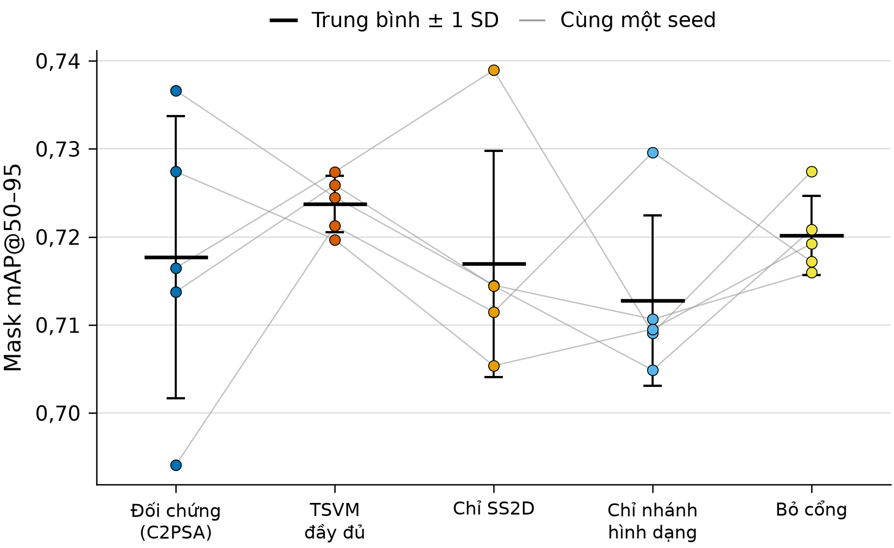

# CHƯƠNG 6. THỰC NGHIỆM VÀ ĐÁNH GIÁ

> **Ghi chú cho người biên tập (xóa khi ghép Word):**
> - Bản rút gọn, nén từ `md_bao_cao/07_CHUONG_6_THUC_NGHIEM_DANH_GIA.md` (tag git `ban_day_du_147`). Giữ số mục 6.1–6.9 và mọi bảng số chính; 11 hình bổ sung, bảng mAP theo epoch, bảng tỉ lệ bỏ sót trọn ảnh và bảng PolypGen theo trung tâm chuyển xuống Phụ lục H. Bảng mô hình (6.1 cũ) và bảng bộ dữ liệu ngoài (6.13 cũ) viết thành lời.
> - Mọi con số lấy từ `00_tai_lieu_tong_quan/bang/*.csv` và `08_du_lieu_thuc_te/bang/20seed/*.csv`, nguồn ghi dưới từng bảng.

Chương này trả lời câu hỏi: khi thay khối C2PSA ở tầng 10 bằng C2TSVMamba (gọi tắt là **TSVM**), chất lượng phân đoạn thay đổi thế nào và chi phí tính toán tăng bao nhiêu.

## 6.1. Thiết lập thực nghiệm

**Mô hình.** Đề tài đánh giá bốn mô hình, mỗi mô hình 20 lượt huấn luyện (seed 0–19): YOLO26s-seg (mô hình gốc, đối chứng), TSVM (mô hình đề xuất, chỉ khác tầng 10, lưu trọng số FP32), PraNet với xương sống ResNet-50 [9] và U-Net [10]. Hai mô hình YOLO dùng chung mọi thiết lập (BG20, ảnh 640 pixel, 100 epoch, lô 8, AdamW, khởi tạo COCO, cùng tăng cường dữ liệu); lượt của hai mô hình có cùng seed tạo thành một **cặp**, nhờ đó phần dao động do seed được trừ bớt khi so sánh [31]. Một lượt mất trung bình khoảng 2,3 giờ với mô hình gốc và 4,7 giờ với TSVM. PraNet và U-Net được huấn luyện ở 352 × 352 pixel, không tăng cường dữ liệu, chỉ để đặt kết quả vào bối cảnh.

**Tập đánh giá.** Mục 6.2–6.6 tính trên **tập kiểm định của BG20** (120 ảnh có polyp với 127 vùng polyp, 40 ảnh nền). Không có tập kiểm thử riêng nên kết quả tuyệt đối có thể hơi lạc quan, nhưng hai mô hình chịu cùng thiên lệch. Mục 6.7 bổ sung bốn bộ dữ liệu không tham gia huấn luyện.

**Chỉ số chính** là **mask mAP50–95** (mục 2.7.3), chọn trước khi xem kết quả vì nó phạt cả khoanh thiếu lẫn biên lệch; các chỉ số khác là chỉ số phụ, mang tính thăm dò. Với mỗi lượt, đề tài lấy **epoch có mask mAP50–95 lớn nhất** và mọi chỉ số khác ở cùng epoch; mục 6.2.3 kiểm tra lại với hai quy tắc khác.

**Kiểm định.** Với hiệu ghép cặp $d_i = x_i^{\text{TSVM}} - x_i^{\text{gốc}}$, đề tài dùng kiểm định t ghép cặp [48] kèm CI 95% (mục 2.8.2), kiểm định Wilcoxon dấu–hạng [49] (mục 2.8.3), cỡ hiệu ứng $d_z$ [51] và số seed TSVM tốt hơn; mức ý nghĩa $\alpha = 0{,}05$. Đề tài không hiệu chỉnh đa kiểm định, nên chỉ kết luận chắc chắn trên chỉ số chính [50]. Để so sánh độ dao động giữa các seed, đề tài dùng kiểm định Levene dạng trung vị (Brown–Forsythe) [57]; kiểm định này coi hai nhóm là độc lập nên chỉ mang tính thăm dò. Các phép tính dùng SciPy.

**Đánh giá theo pixel.** PraNet và U-Net không cho ra từng đối tượng kèm điểm tin cậy, nên để so sánh bốn mô hình, đề tài chạy lại suy luận và tính Dice, IoU, Precision, Recall **theo pixel** (mục 2.7.2): nhãn là mặt nạ vẽ lại từ nhãn đa giác ở độ phân giải gốc; YOLO dùng ảnh 640 pixel, ngưỡng tin cậy 0,25, ngưỡng IoU 0,7, gộp mọi mặt nạ của ảnh; PraNet, U-Net dùng ảnh 352 × 352, ngưỡng 0,5. Chỉ số tính trên **từng ảnh** của 120 ảnh có polyp (ảnh bị bỏ sót hoàn toàn có Dice bằng 0), lấy trung bình mỗi seed rồi qua 20 seed; Dice gộp toàn bộ pixel được ghi kèm. Với 40 ảnh nền, đề tài đếm tỉ lệ ảnh có ít nhất một pixel bị dự đoán là polyp (tỉ lệ **báo nhầm**). Mọi giá trị ghi dưới dạng **trung bình ± độ lệch chuẩn qua 20 seed**.

## 6.2. So sánh mô hình gốc và mô hình đề xuất trên 20 seed

### 6.2.1. Kết quả tổng hợp

*Bảng 6.1. Chỉ số mặt nạ của hai mô hình (20 seed, epoch có mask mAP50–95 lớn nhất)*

| Chỉ số | YOLO26s-seg | TSVM | Δ (TSVM − gốc) | CI 95% của Δ | p (t) | p (Wilcoxon) | Seed TSVM tốt hơn |
|---|---:|---:|---:|---:|---:|---:|---:|
| **Mask mAP50–95** | 0,7189 ± 0,0118 | 0,7232 ± 0,0072 | **+0,0043** | [−0,0002; 0,0088] | 0,061 | 0,070 | 13/20 |
| Mask mAP50 | 0,9069 ± 0,0125 | 0,9083 ± 0,0086 | +0,0014 | [−0,0053; 0,0080] | 0,668 | 0,812 | 10/20 |
| Mask Precision | 0,9041 ± 0,0287 | 0,9145 ± 0,0233 | +0,0104 | [−0,0086; 0,0293] | 0,266 | 0,498 | 11/20 |
| Mask Recall | 0,8594 ± 0,0241 | 0,8590 ± 0,0179 | −0,0004 | [−0,0126; 0,0119] | 0,948 | 0,926 | 9/20 |
| Mask F1 | 0,8806 ± 0,0142 | 0,8856 ± 0,0129 | +0,0049 | | 0,259 | 0,388 | 12/20 |
| Box mAP50–95 | 0,7228 ± 0,0159 | 0,7273 ± 0,0134 | +0,0045 | [−0,0031; 0,0121] | 0,227 | 0,105 | 13/20 |
| Box mAP50 | 0,9006 ± 0,0116 | 0,9014 ± 0,0083 | +0,0008 | [−0,0053; 0,0069] | 0,778 | 1,000 | 11/20 |

*Nguồn: đề tài tính từ 40 tệp `results.csv` (`bang/02_ket_qua_tung_seed.csv`, `bang/04_thong_ke_ghep_cap.csv`). Mask F1 tính từ Precision và Recall của cùng epoch theo công thức $F_1 = 2PR/(P+R)$. Hình cột các chỉ số ở Phụ lục H.*

Trên chỉ số chính, TSVM đạt 0,7232, cao hơn mô hình gốc 0,0043 (khoảng 0,6% tương đối) và cao hơn ở 13/20 seed. Tuy vậy, CI 95% của hiệu số vẫn chứa 0, kiểm định t cho $p = 0{,}061$, Wilcoxon cho $p = 0{,}070$, cỡ hiệu ứng $d_z = 0{,}44$ ở mức nhỏ đến vừa theo quy ước của Cohen (được Lakens [51] trình bày lại). **Ở mức ý nghĩa 0,05, chưa đủ bằng chứng để khẳng định TSVM tốt hơn mô hình gốc**; kết quả chỉ cho thấy xu hướng tăng nhỏ. Ngược lại, $p > 0{,}05$ cũng không chứng minh hai mô hình tương đương: hiệu số thật có thể từ gần 0 đến khoảng +0,009.

Các chỉ số phụ đi cùng chiều nhưng yếu hơn và không chỉ số nào có ý nghĩa thống kê: Precision tăng khoảng 1 điểm phần trăm, Recall gần như không đổi, mAP50 gần bằng nhau (+0,0014). Điều này gợi ý phần chênh lệch nhỏ nằm ở các ngưỡng IoU cao, tức mức khớp biên mặt nạ, chứ không ở khả năng tìm ra polyp.

*Hình 6.1. Mask mAP50–95 của từng seed. Mỗi đường nối hai lượt cùng seed của hai mô hình.*

Hiệu số dao động khá rộng, từ −0,0121 (seed 0) đến +0,0272 (seed 3). Lượt tốt nhất của mô hình gốc (0,7366, seed 0) còn cao hơn lượt tốt nhất của TSVM (0,7339, seed 8); các hiệu số dương lớn nhất rơi vào những seed mà mô hình gốc thấp, như seed 3 (0,6941 so với 0,7213) và seed 10 (0,7045 so với 0,7198).

### 6.2.2. Độ ổn định giữa các seed

*Bảng 6.2. Mức dao động của mask mAP50–95 qua 20 seed*

| | YOLO26s-seg | TSVM |
|---|---:|---:|
| Độ lệch chuẩn | 0,0118 | 0,0072 |
| Nhỏ nhất | 0,6941 | 0,7065 |
| Lớn nhất | 0,7366 | 0,7339 |
| Khoảng (lớn nhất − nhỏ nhất) | 0,0425 | 0,0274 |

*Nguồn: `bang/02_ket_qua_tung_seed.csv`.*

Độ lệch chuẩn của TSVM nhỏ hơn khoảng 39%, kiểm định Levene dạng trung vị cho $p = 0{,}026$, kết quả duy nhất trên tập kiểm định có $p < 0{,}05$. Vì kiểm định này bỏ qua ghép cặp và không phải chỉ số chính, đề tài chỉ coi đây là dấu hiệu thăm dò: **TSVM ít phụ thuộc vào seed hơn**. Dấu hiệu này chỉ đúng ở epoch tốt nhất: ở epoch 100, độ lệch chuẩn hai mô hình gần bằng nhau (0,0132 và 0,0130); trong 100 epoch có 34 epoch mà độ lệch chuẩn của TSVM lớn hơn; và trên dữ liệu ngoài (mục 6.7) nó không còn.

### 6.2.3. Độ nhạy theo quy tắc chọn epoch

*Bảng 6.3. Mask mAP50–95 theo ba quy tắc chọn epoch*

| Quy tắc | YOLO26s-seg | TSVM | Δ | p (t) | p (Wilcoxon) | Seed TSVM tốt hơn |
|---|---:|---:|---:|---:|---:|---:|
| Mask mAP50–95 lớn nhất (chỉ số chính) | 0,7189 ± 0,0118 | 0,7232 ± 0,0072 | +0,0043 | 0,061 | 0,070 | 13/20 |
| Epoch của `best.pt` (chỉ số tổng hợp hộp và mặt nạ) | 0,7174 ± 0,0129 | 0,7222 ± 0,0075 | +0,0048 | 0,062 | 0,076 | 14/20 |
| Epoch 100 (cuối huấn luyện) | 0,7093 ± 0,0132 | 0,7119 ± 0,0130 | +0,0025 | 0,456 | 0,349 | 12/20 |

*Nguồn: `bang/04b_do_nhay_quy_tac_epoch.csv`.*

Hai quy tắc dựa trên epoch tốt nhất cho kết luận gần như nhau; lấy epoch cuối thì khoảng cách thu hẹp còn +0,0025 và không còn dấu hiệu ổn định hơn. Kết luận "xu hướng tăng nhỏ, chưa có ý nghĩa thống kê" không phụ thuộc cách chọn epoch.

### 6.2.4. Quá trình hội tụ

Theo đường mAP trung bình 20 seed (Phụ lục H): trong khoảng 10 epoch đầu TSVM tăng chậm hơn, phù hợp với cách khởi tạo ở mục 3.5.1 (hơn một triệu tham số mới khởi tạo ngẫu nhiên, $\gamma = 0{,}001$ làm khối mới gần như "tắt" lúc đầu); từ epoch 50 đến 81 hai đường đan xen; từ epoch 82 đến 100 trung bình của TSVM luôn cao hơn. Trung vị epoch tốt nhất là 88 với mô hình gốc và 92 với TSVM. Hàm mất mát phân đoạn trên tập kiểm định của mô hình gốc thấp nhất ở epoch 59 (1,2294) rồi tăng lên 1,2893 ở epoch 100, của TSVM thấp nhất ở epoch 90 (1,2236): mô hình gốc có dấu hiệu quá khớp sớm hơn trên hàm mất mát, dù mAP vẫn tăng tới cuối. Đây là quan sát mô tả, chưa kiểm định.

### 6.2.5. Ma trận nhầm lẫn theo đối tượng

*Bảng 6.4. Số vùng polyp phát hiện đúng, bỏ sót và dự đoán thừa (trên 127 vùng polyp)*

| | YOLO26s-seg | TSVM | Δ | p (Wilcoxon) |
|---|---:|---:|---:|---:|
| Phát hiện đúng (TP) | 110,55 ± 2,95 | 110,65 ± 1,87 | +0,10 | 1,000 |
| Bỏ sót (FN) | 16,45 ± 2,95 | 16,35 ± 1,87 | −0,10 | 1,000 |
| Dự đoán thừa (FP) | 16,45 ± 3,43 | 15,75 ± 3,02 | −0,70 | 0,671 |

*Nguồn: `bang/06_ma_tran_nham_lan_tung_seed.csv`, đã đối chiếu với 40 ảnh `confusion_matrix.png`.*

*Hình 6.2. Ma trận nhầm lẫn trung bình 20 seed. Ô nền–nền để trống vì không xác định được ở mức đối tượng.*

Hai mô hình tìm được gần như cùng số polyp, khoảng 110,6/127 vùng (87%); TSVM dự đoán thừa ít hơn trung bình 0,7 vùng, không có ý nghĩa thống kê. Ô TN không xác định được ở mức đối tượng, nên đề tài không tính độ đặc hiệu từ bảng này; tỉ lệ báo nhầm trên ảnh nền được đo riêng ở mục 6.3.

## 6.3. Đánh giá theo pixel và so sánh với PraNet, U-Net

*Bảng 6.5. Chỉ số theo pixel của bốn mô hình trên tập kiểm định (20 seed)*

| Mô hình | Dice | IoU | Precision | Recall | Dice gộp pixel | Ảnh nền báo nhầm (%) |
|---|---:|---:|---:|---:|---:|---:|
| YOLO26s-seg | 0,8486 ± 0,0171 | 0,7927 ± 0,0170 | 0,8585 ± 0,0170 | 0,8703 ± 0,0193 | 0,8659 ± 0,0313 | 1,2 ± 1,9 |
| TSVM | 0,8540 ± 0,0129 | **0,7998 ± 0,0129** | 0,8632 ± 0,0173 | 0,8730 ± 0,0112 | **0,8785 ± 0,0243** | 1,5 ± 2,1 |
| PraNet | **0,8541 ± 0,0068** | 0,7785 ± 0,0063 | **0,8687 ± 0,0117** | **0,8881 ± 0,0145** | 0,8715 ± 0,0060 | **0,8 ± 1,2** |
| U-Net | 0,7097 ± 0,0221 | 0,6069 ± 0,0221 | 0,7964 ± 0,0213 | 0,7167 ± 0,0327 | 0,7412 ± 0,0185 | 20,4 ± 6,4 |

*Nguồn: `bang/11_pixel_tung_seed.csv`, `bang/12_pixel_thong_ke.csv`. Số in đậm là giá trị tốt nhất của mỗi cột.*

*Bảng 6.6. So sánh ghép cặp TSVM với từng mô hình theo pixel (cùng seed)*

| So với | Chỉ số | Δ (TSVM − mô hình kia) | p (t) | p (Wilcoxon) | Seed TSVM cao hơn |
|---|---|---:|---:|---:|---:|
| YOLO26s-seg | Dice | +0,0054 | 0,260 | 0,246 | 13/20 |
| | IoU | +0,0071 | 0,130 | 0,114 | 14/20 |
| | Ảnh nền báo nhầm | +0,25 điểm % | 0,694 | 0,793 | |
| PraNet | Dice | −0,0001 | 0,982 | 0,927 | 12/20 |
| | IoU | +0,0213 | < 0,001 | < 0,001 | 19/20 |
| | Recall | −0,0151 | 0,002 | 0,001 | 5/20 |
| U-Net | Dice | +0,1443 | < 0,001 | < 0,001 | 20/20 |
| | Ảnh nền báo nhầm | −18,9 điểm % | < 0,001 | < 0,001 | |

*Nguồn: `bang/12_pixel_thong_ke.csv`.*

*Hình 6.3. Dice, IoU, Precision và Recall theo pixel của bốn mô hình. Thanh lỗi là ±1 độ lệch chuẩn qua 20 seed.*

**So với mô hình gốc**, TSVM vẫn có xu hướng tăng nhẹ theo pixel (Dice +0,005, IoU +0,007, cao hơn ở 13–14/20 seed) nhưng không có ý nghĩa thống kê, khớp với kết luận theo mAP.

**So với PraNet**, Dice trung bình gần như bằng nhau, nhưng hai mô hình mạnh ở hai mặt: TSVM có **IoU cao hơn** ở 19/20 seed ($p < 0{,}001$), tức mặt nạ khớp nhãn sát hơn khi đã khoanh được polyp; PraNet có **Recall cao hơn** ($p = 0{,}002$) và **ổn định hơn nhiều** giữa các seed (độ lệch chuẩn Dice 0,0068 so với 0,0129). Dice trung bình của YOLO bị kéo xuống bởi các ảnh **bỏ sót hoàn toàn**: ở ngưỡng tin cậy 0,25, YOLO không dự đoán pixel nào trên trung bình khoảng 6,5/120 ảnh có polyp mỗi seed (mô hình gốc 6,45, TSVM 6,65), còn PraNet chỉ 0,95 ảnh. Khi gộp pixel cả 120 ảnh, Dice của TSVM là 0,8785, cao hơn PraNet (0,8715).

**So với U-Net**, ba mô hình còn lại hơn rất xa; U-Net còn báo nhầm khoảng 20% ảnh nền, trong khi YOLO và PraNet chỉ khoảng 1–1,5% (dưới một ảnh mỗi seed). Ảnh nền của tập kiểm định đều lấy từ lớp manh tràng bình thường, khá đồng nhất, nên con số này chưa đại diện cho niêm mạc bình thường nói chung.

*Hình 6.4. Ví dụ dự đoán của bốn mô hình (seed 0). Ba ảnh được chọn tự động: ảnh cả bốn mô hình đều tốt, ảnh TSVM hơn mô hình gốc nhiều nhất và ảnh khó nhất.*

Hình 6.4 chỉ có tính minh họa; ảnh được chọn theo tiêu chí trong chú thích, không ngẫu nhiên. **Giới hạn của phép so sánh:** YOLO dùng ảnh 640 pixel, có tăng cường và khởi tạo COCO, còn PraNet, U-Net dùng ảnh 352 pixel, không tăng cường; PraNet dùng ResNet-50 thay cho Res2Net-50 của bản gốc; ngưỡng chưa tối ưu riêng. Kết quả phản ánh các cấu hình cụ thể này, không so trực tiếp với số trong bài báo gốc của PraNet.

## 6.4. Chỉ số topology của mặt nạ

mAP và Dice gần như không phạt các lỗi hình dạng tổng thể như mặt nạ vỡ nhiều mảnh hay có lỗ nhỏ. Đề tài đo trực tiếp hai số Betti đầu tiên của mặt nạ: $b_0$ là **số mảnh** (thành phần liên thông 8 hướng) và $b_1$ là **số lỗ** (vùng nền liên thông 4 hướng nằm hẳn bên trong vùng polyp); mảnh và lỗ dưới 20 pixel không được đếm, trùng ngưỡng loại nhiễu ở Chương 4. Trên 120 ảnh có polyp, nhãn có 113 ảnh một mảnh, 7 ảnh hai mảnh, không ảnh nào có lỗ. Một ảnh **đúng topology** khi cả $b_0$ và $b_1$ của dự đoán bằng của nhãn.

*Bảng 6.7. Chỉ số topology của bốn mô hình (ngưỡng 20 pixel, 20 seed)*

| Chỉ số | YOLO26s-seg | TSVM | PraNet | U-Net |
|---|---:|---:|---:|---:|
| Ảnh đúng topology ↑ | 0,797 ± 0,027 | 0,808 ± 0,026 | **0,914 ± 0,021** | 0,260 ± 0,045 |
| Lỗi $b_0$ trung bình ↓ | 0,198 ± 0,045 | 0,191 ± 0,032 | **0,086 ± 0,025** | 2,745 ± 0,641 |
| Lỗi $b_1$ trung bình ↓ | 0,105 ± 0,039 | 0,094 ± 0,027 | **0,004 ± 0,006** | 1,215 ± 0,419 |
| Ảnh thừa mảnh ↓ | 0,082 ± 0,027 | 0,082 ± 0,018 | **0,057 ± 0,021** | 0,638 ± 0,046 |
| Ảnh có lỗ ↓ | 0,073 ± 0,020 | 0,063 ± 0,014 | **0,004 ± 0,005** | 0,432 ± 0,069 |
| Ảnh thiếu mảnh ↓ | 0,071 ± 0,023 | 0,066 ± 0,016 | **0,027 ± 0,008** | 0,028 ± 0,016 |

*Nguồn: `bang/14_topology_tung_seed.csv`, `bang/15_topology_thong_ke.csv`. ↑ là càng cao càng tốt, ↓ là càng thấp càng tốt. Lỗi $b_0$, $b_1$ là trung bình của |dự đoán − nhãn| trên 120 ảnh có polyp.*

*Hình 6.5. Tỉ lệ ảnh có polyp được dự đoán đúng topology (số mảnh và số lỗ khớp nhãn).*

So với mô hình gốc, mọi chỉ số topology của TSVM đều nhích theo chiều có lợi (ảnh đúng topology +1,1 điểm phần trăm, ảnh có lỗ −1 điểm phần trăm) nhưng không chỉ số nào có ý nghĩa thống kê (ảnh đúng topology $p = 0{,}139$, ảnh có lỗ $p = 0{,}099$); khi đếm cả mảnh dưới 20 pixel, kết luận không đổi (0,758 so với 0,770; $p = 0{,}086$). **Đề tài không khẳng định khối đề xuất cải thiện topology của mặt nạ.** PraNet có topology tốt nhất rõ rệt: 91% ảnh đúng so với 81% của TSVM, TSVM kém hơn ở cả 20/20 seed ($p < 0{,}001$). Một giải thích hợp lý, chưa kiểm chứng, là PraNet lấy ngưỡng một bản đồ xác suất trơn, còn YOLO ghép mặt nạ từ các mặt nạ mẫu 160 × 160 rồi phóng lên (mục 2.3.3), dễ tạo lỗ nhỏ và mép răng cưa. Ở hai mô hình YOLO, lỗi chia khá đều giữa thừa mảnh, có lỗ và thiếu mảnh, mỗi kiểu khoảng 6–8% số ảnh.

## 6.5. Chi phí tính toán

*Bảng 6.8. Số tham số và số phép tính của hai mô hình*

| | YOLO26s-seg | TSVM | Chênh lệch |
|---|---:|---:|---:|
| Tham số toàn mô hình | 11.434.463 | 12.254.688 | +820.225 (+7,2%) |
| Tham số tầng 10 | 990.976 (C2PSA) | 1.811.201 (C2TSVMamba) | +82,8% |
| GFLOPs (`FlopCounterMode` của PyTorch) | 34,29 | 34,82 | +1,5% |
| GFLOPs (cách đếm của Ultralytics) | 37,32 | 37,86 | +1,4% |
| Tệp `best.pt` | 22,27 MiB (FP16) | 47,37 MiB (FP32) | |

*Nguồn: `bang/08_kien_truc_dung_lai.csv`, `bang/16_flops_do_tre_gpu.csv`, `bang/07_checkpoint_best_pt.csv`. FLOPs đo trên một ảnh 640 × 640 sau khi gộp tích chập với chuẩn hóa lô.*

`FlopCounterMode` chỉ đếm tích chập và nhân ma trận, không đếm các phép theo từng phần tử trong phép quét SS2D, nên GFLOPs của TSVM là **cận dưới**. Tệp `best.pt` của TSVM lớn gấp khoảng hai lần chủ yếu vì lưu FP32 (mục 3.5.3).

*Bảng 6.9. Độ trễ suy luận của hai mô hình (checkpoint seed 0, lô 1 ảnh, ảnh 640 × 640, FP32)*

| Phần cứng | Cách đo | YOLO26s-seg (ms) | TSVM (ms) | Tỉ lệ |
|---|---|---:|---:|---:|
| CPU AMD Ryzen 7 250, 4 luồng | Chỉ lan truyền xuôi, trung bình 100 lần | 269,56 ± 18,71 | 577,36 ± 24,40 | 2,14 lần |
| | Cả quy trình dự đoán (tiền xử lý, lan truyền xuôi, hậu xử lý), 20 ảnh | 286,56 ± 20,09 | 567,86 ± 24,45 | 1,98 lần |
| GPU RTX 5050 Laptop | Chỉ lan truyền xuôi, trung vị 1.000 lần | 26,33 | 39,86 | 1,51 lần |
| | Trung bình ± độ lệch chuẩn | 26,99 ± 3,20 | 41,42 ± 6,82 | 1,53 lần |
| | Nhỏ nhất | 20,79 | 29,80 | 1,43 lần |

*Nguồn: CPU: `04_phan_tich_20seed/efficiency_benchmark/tables/efficiency_summary.csv`; GPU: `bang/16_flops_do_tre_gpu.csv`, `bang/16b_do_tre_gpu_tung_lan.csv` (2.000 lần đo), `bang/16c_do_tre_gpu_nhiet_do.csv`. Môi trường CPU: PyTorch 2.6.0. Môi trường GPU: PyTorch 2.13.0, CUDA 13.0.*

Trên GPU, mỗi mô hình được đo 5 vòng, mỗi vòng 200 lần sau 50 lần khởi động, xen kẽ hai mô hình và đảo thứ tự mỗi vòng; trước mỗi khối đo, chương trình chờ GPU nguội dưới 55 °C. GPU ở 41–51 °C và chạy ở xung nhịp tối đa trong cả lần đo; tỉ lệ độ trễ giữa hai mô hình ổn định qua các vòng, từ 1,44 đến 1,63 lần. Một lần đo trước đó không kiểm soát nhiệt cho độ trễ tuyệt đối nhỏ hơn khoảng 1,5–2 lần (giá trị nhỏ nhất: mô hình gốc 11,8 ms, TSVM 20,4 ms) nhưng tỉ lệ tương tự, khoảng 1,7 lần; vì vậy **tỉ lệ khoảng 1,5–1,7 lần là kết quả đáng tin hơn** số mili giây tuyệt đối.

**Nhận xét.** Số phép tính chỉ tăng khoảng 1,5% nhưng độ trễ tăng khoảng 1,5 lần trên GPU và 2,1 lần trên CPU: GFLOPs không phản ánh đúng tốc độ của khối Mamba viết bằng PyTorch thuần. Nguyên nhân chính là phép quét song song (mục 3.4): 9 vòng nối tiếp, mỗi vòng tạo tensor trung gian và nhiều phép theo từng phần tử, bị giới hạn bởi băng thông bộ nhớ và số lần gọi kernel; Mamba gốc tránh được nhờ kernel CUDA riêng [23]. Như vậy TSVM **tốn thêm khoảng 50–110% thời gian suy luận để đổi lấy mức tăng mAP50–95 khoảng 0,004 chưa có ý nghĩa thống kê**. Ở khoảng 40 ms trên GPU, mô hình vẫn xử lý được khoảng 25 ảnh mỗi giây khi chỉ tính lan truyền xuôi, nhưng đây là đo trên một máy, một checkpoint.

## 6.6. Thí nghiệm tách thành phần

Để biết thành phần nào của khối TSVMamba đóng góp, đề tài huấn luyện thêm ba biến thể (Bảng 3.4): `vmamba_only` (chỉ giữ SS2D), `shape_only` (chỉ giữ nhánh hình dạng), `shape_vmamba_no_guidance` (giữ hai nhánh, bỏ cổng, hai nhánh chỉ được nối rồi trộn bằng tích chập 1 × 1). Mọi thiết lập khác giữ nguyên; do giới hạn giờ GPU, mỗi biến thể chạy **5 seed (seed 0–4)**, cùng seed với các lượt chính để ghép cặp. Tệp `args.yaml` của 15 lượt đều trùng tham số huấn luyện với lượt TSVM chính cùng seed, chỉ khác tệp cấu hình mô hình (`bang/18_ablation_cau_hinh_args.csv`).

*Bảng 6.10. Kết quả thí nghiệm tách thành phần (mask mAP50–95, seed 0–4)*

| Cấu hình | SS2D | Nhánh hình dạng | Cổng | Tham số tầng 10 | Mask mAP50–95 | Δ so với gốc | Δ so với đầy đủ | Số seed cao hơn bản đầy đủ |
|---|:---:|:---:|:---:|---:|---:|---:|---:|---:|
| YOLO26s-seg (C2PSA) | | | | 990.976 | 0,7177 ± 0,0160 | – | −0,0061 | 2/5 |
| TSVM đầy đủ | ✓ | ✓ | ✓ | 1.811.201 | **0,7238 ± 0,0032** | +0,0061 | – | – |
| `vmamba_only` | ✓ | | | 1.071.873 | 0,7170 ± 0,0128 | −0,0007 | −0,0068 | 1/5 |
| `shape_only` | | ✓ | | 1.331.969 | 0,7128 ± 0,0097 | −0,0049 | −0,0110 | 1/5 |
| `shape_vmamba_no_guidance` | ✓ | ✓ | | 1.745.409 | 0,7201 ± 0,0045 | +0,0025 | −0,0036 | 1/5 |

*Nguồn: `00_tai_lieu_tong_quan/bang/17_ablation_tung_seed.csv` và `17b_ablation_tong_hop.csv`, sinh bằng `scripts/tinh_ablation.py`. Hai dòng đầu là seed 0–4 của các lượt chính, khớp với `bang/02_ket_qua_tung_seed.csv`. Số tham số tầng 10 đếm trực tiếp từ `best.pt` của từng lượt, trùng với Bảng 3.4. Giá trị là trung bình ± độ lệch chuẩn qua 5 seed.*

*Hình 6.6. Mask mAP50–95 từng seed (0–4) của năm cấu hình. Đường xám nối kết quả của cùng một seed; vạch ngang đậm là trung bình, thanh dọc là ±1 độ lệch chuẩn qua 5 seed.*

Cả ba biến thể đều có trung bình thấp hơn bản đầy đủ, mỗi biến thể chỉ cao hơn bản đầy đủ ở 1/5 seed:
1. **Bỏ nhánh hình dạng (`vmamba_only`):** giảm 0,0068, gần bằng mô hình gốc (−0,0007), độ lệch chuẩn 0,0128 gấp khoảng bốn lần bản đầy đủ. Seed 1 đạt 0,7390, cao nhất trong 25 lượt, nhưng bốn seed còn lại đều thấp hơn bản đầy đủ. Chỉ thay attention bằng SS2D chưa cho thấy lợi ích.
2. **Bỏ SS2D (`shape_only`):** trung bình thấp nhất, kém bản đầy đủ 0,0110 và kém cả mô hình gốc 0,0049. Nhánh hình dạng dùng riêng không thay được khối ngữ cảnh toàn cục.
3. **Bỏ cổng:** giảm ít nhất (−0,0036), độ lệch chuẩn vẫn nhỏ (0,0045), đứng thứ hai. Phần lớn khác biệt đến từ việc dùng cùng lúc hai nhánh; cổng góp thêm một phần nhỏ, cùng chiều ở 4/5 seed.

Kết quả cho thấy một **xu hướng**: hai nhánh bổ sung cho nhau, bản đầy đủ vừa có trung bình cao nhất vừa dao động ít nhất. Tuy nhiên không biến thể nào khác bản đầy đủ có ý nghĩa thống kê (t ghép cặp $p = 0{,}218$, $0{,}101$ và $0{,}085$; với 5 cặp, Wilcoxon hai phía không thể cho $p$ nhỏ hơn 0,0625). Với lực kiểm định thấp, phần này chỉ dùng để mô tả xu hướng; khoảng cách giữa các cấu hình còn nhỏ hơn độ lệch chuẩn giữa các seed ở mục 6.2 (khoảng 0,007–0,012), và các biến thể chênh nhau tới khoảng 740 nghìn tham số tầng 10 nên chưa tách được phần do cấu trúc với phần do thêm tham số. Thời gian huấn luyện cũng tách được: `shape_only` mất khoảng 2,4 giờ mỗi lượt, gần bằng mô hình gốc (2,3 giờ), còn `vmamba_only` khoảng 4,6 giờ, bằng bản đầy đủ; gần như toàn bộ thời gian tăng thêm nằm ở SS2D.

## 6.7. Kết quả trên dữ liệu thực tế

Để đánh giá khả năng tổng quát hóa, đề tài lấy nguyên checkpoint đã huấn luyện trên BG20, chạy trên bốn bộ dữ liệu **khác nguồn** không huấn luyện lại: CVC-ClinicDB [13] (612 ảnh, 384 × 288), CVC-ColonDB [14] (380 ảnh, 574 × 500; bản phổ biến trong các benchmark từ PraNet [9], bài gốc mô tả 300 ảnh), ETIS-Larib [15] (196 ảnh, 1.225 × 966, nhiều polyp nhỏ) và phần ảnh đơn của PolypGen [12] (1.537 ảnh từ 6 trung tâm C1–C6, tới 1.920 × 1.080; 1.412 ảnh có polyp, 125 ảnh mặt nạ rỗng dùng để đo báo nhầm). Giao thức giống mục 6.1, với bốn mô hình và 20 seed. Kiểm tra trùng ảnh giữa PolypGen và Kvasir-SEG bằng MD5, mã băm cảm nhận (pHash, dHash) và tương quan ảnh xám thu nhỏ không thấy cặp nào trùng. Đây là ảnh công khai, không phải dữ liệu lâm sàng do nhóm thu tại bệnh viện.

*Bảng 6.11. Dice và IoU theo pixel trên bốn bộ dữ liệu ngoài (20 seed)*

| Bộ dữ liệu | Chỉ số | YOLO26s-seg | TSVM | PraNet | U-Net | TSVM − gốc | p (t) | p (Wilcoxon) | Seed TSVM cao hơn |
|---|---|---:|---:|---:|---:|---:|---:|---:|---:|
| CVC-ClinicDB | Dice | **0,786** | 0,770 | 0,752 | 0,525 | −0,016 | 0,006 | 0,006 | 5/20 |
| | IoU | **0,725** | 0,712 | 0,676 | 0,425 | −0,013 | 0,010 | 0,015 | 6/20 |
| CVC-ColonDB | Dice | **0,631** | 0,601 | 0,539 | 0,375 | −0,030 | < 0,001 | < 0,001 | 3/20 |
| | IoU | **0,574** | 0,549 | 0,474 | 0,304 | −0,025 | 0,001 | < 0,001 | 3/20 |
| ETIS-Larib | Dice | **0,535** | 0,529 | 0,466 | 0,284 | −0,005 | 0,766 | 0,498 | 7/20 |
| | IoU | **0,493** | 0,490 | 0,416 | 0,225 | −0,003 | 0,851 | 0,571 | 8/20 |
| PolypGen (gộp) | Dice | **0,719** | 0,715 | 0,683 | 0,484 | −0,004 | 0,551 | 0,246 | 7/20 |
| | IoU | **0,665** | 0,663 | 0,616 | 0,402 | −0,003 | 0,605 | 0,312 | 7/20 |

*Nguồn: `08_du_lieu_thuc_te/bang/20seed/01_ngoai_tung_seed.csv`, `02_ngoai_thong_ke.csv`. Tỉ lệ ảnh bị bỏ sót hoàn toàn và Dice theo từng trung tâm PolypGen ở Phụ lục H.*

*Hình 6.7. Dice theo pixel của bốn mô hình trên bốn bộ dữ liệu ngoài. Thanh lỗi là ±1 độ lệch chuẩn qua 20 seed.*

Bốn điểm rút ra:
1. **Mọi mô hình đều giảm mạnh khi gặp dữ liệu khác nguồn.** Dice của TSVM giảm từ 0,854 trên tập kiểm định xuống 0,53–0,77; tỉ lệ ảnh bị bỏ sót hoàn toàn tăng từ khoảng 5% lên 11–39%. ETIS-Larib khó nhất vì nhiều polyp nhỏ.
2. **TSVM không tổng quát hóa tốt hơn mô hình gốc.** Trên CVC-ClinicDB và CVC-ColonDB, TSVM **thấp hơn có ý nghĩa thống kê** (Dice −0,016 và −0,030, cả hai kiểm định $p < 0{,}01$) và bỏ sót trọn ảnh nhiều hơn (+2,1 và +3,8 điểm phần trăm); trên ETIS-Larib và PolypGen, hai mô hình không khác biệt có ý nghĩa.
3. **Hai mô hình YOLO tốt hơn PraNet và U-Net trên dữ liệu ngoài.** TSVM cao hơn PraNet ở cả bốn bộ ($p < 0{,}05$), dù trên tập kiểm định Dice ngang nhau; một phần có thể do YOLO được huấn luyện với tăng cường dữ liệu.
4. **Độ ổn định không còn:** độ lệch chuẩn giữa các seed của TSVM không nhỏ hơn mô hình gốc, thậm chí lớn hơn ở CVC-ClinicDB và CVC-ColonDB.

Trên PolypGen, chất lượng khác nhau rất nhiều giữa các trung tâm (Dice của TSVM từ 0,47 ở C5 đến 0,86 ở C3), cho thấy thiết bị và cách thu ảnh ảnh hưởng mạnh hơn nhiều so với lựa chọn giữa hai mô hình YOLO. Chỉ ở C6 (83 ảnh) TSVM thấp hơn mô hình gốc với cả hai kiểm định, cần thận trọng vì có nhiều phép so sánh.

*Hình 6.8. Tỉ lệ ảnh không có polyp của PolypGen (125 ảnh) bị báo nhầm.*

Trên 125 ảnh không có polyp của PolypGen, tỉ lệ báo nhầm là 13,3% với mô hình gốc, 10,8% với TSVM, 22,6% với PraNet và 69,3% với U-Net. TSVM báo nhầm ít hơn mô hình gốc 2,5 điểm phần trăm ($p = 0{,}011$; Wilcoxon $p = 0{,}018$), chủ yếu ở C2 và C4; đây là chỉ số phụ nên chỉ là dấu hiệu tích cực cần kiểm chứng thêm. Tỉ lệ này cao hơn nhiều so với khoảng 1% trên 40 ảnh nền của tập kiểm định, cho thấy ảnh nền của BG20 chưa đủ đa dạng.

## 6.8. Thảo luận

**Trả lời câu hỏi nghiên cứu.** Trên tập kiểm định, TSVM có mask mAP50–95 cao hơn 0,0043, cao hơn ở 13/20 seed, nhưng chưa có ý nghĩa thống kê ($p = 0{,}061$); đánh giá theo pixel và topology cho cùng kết luận, còn trên dữ liệu ngoài TSVM không tốt hơn và thấp hơn có ý nghĩa ở hai trong bốn bộ. Độ lệch chuẩn giữa các seed nhỏ hơn khoảng 39% (Levene $p = 0{,}026$, thăm dò) nhưng chỉ ở epoch tốt nhất. Trên 5 seed, bỏ bất kỳ thành phần nào cũng làm trung bình thấp hơn bản đầy đủ, bỏ cổng giảm ít nhất (−0,0036), chỉ giữ nhánh hình dạng giảm nhiều nhất (−0,0110), không chênh lệch nào có ý nghĩa thống kê. Tham số tăng 7,2%, GFLOPs tăng 1,5%, nhưng độ trễ tăng khoảng 1,5 lần trên GPU, 2,1 lần trên CPU và thời gian huấn luyện khoảng 2 lần, gần như hoàn toàn do nhánh SS2D.

**Vì sao mức cải thiện nhỏ** (các giải thích hợp lý nhưng chưa kiểm chứng riêng):
- **Phạm vi thay đổi hẹp:** chỉ tầng 10 ở mức 20 × 20 thay đổi, C2PSA vốn đã có chú ý toàn cục, và ở 400 vị trí lợi thế chi phí tuyến tính của SSM gần như không phát huy.
- **Khởi tạo bất lợi:** khoảng một triệu tham số mới khởi tạo ngẫu nhiên, trong khi C2PSA được tiền huấn luyện trên COCO, và chỉ có 1.040 ảnh huấn luyện; điều này cũng có thể giải thích kết quả trên dữ liệu ngoài, vì khối mới chỉ học từ ảnh Kvasir.
- **Chỉ số gần bão hòa:** mAP50 của cả hai mô hình đã khoảng 0,91, dư địa chủ yếu ở mức khớp biên.

**Giới hạn của thực nghiệm:** không có tập kiểm thử độc lập (dữ liệu ngoài bù một phần); chỉ một bộ dữ liệu huấn luyện; PraNet, U-Net có thiết lập khác; nhiều phép so sánh không hiệu chỉnh, nên các kết quả $p < 0{,}05$ ở chỉ số phụ chỉ là gợi ý; độ trễ đo trên một máy, một checkpoint; tách thành phần chỉ có 5 seed; topology chỉ đo trên tập kiểm định với nhãn đa giác vốn không có lỗ.

## 6.9. Kết chương

Qua 20 cặp lượt huấn luyện, mask mAP50–95 tăng 0,0043 (0,7189 lên 0,7232), cao hơn ở 13/20 seed nhưng **chưa có ý nghĩa thống kê**; độ dao động giữa các seed nhỏ hơn ở epoch tốt nhất (thăm dò). TSVM có Dice ngang PraNet, IoU cao hơn PraNet nhưng topology kém PraNet rõ rệt; độ trễ tăng khoảng 1,5–2,1 lần dù số phép tính gần như không đổi; trên dữ liệu ngoài TSVM không tốt hơn mô hình gốc. Với cách tích hợp và dữ liệu hiện có, khối C2TSVMamba chưa mang lại cải thiện đủ rõ để bù cho chi phí suy luận tăng thêm.
