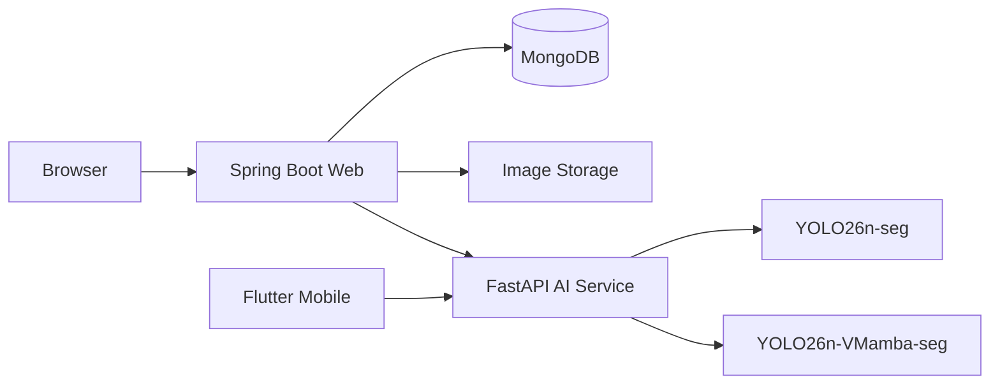

# PolypVision

> **Đề tài:** “Nghiên cứu phương pháp tích hợp VMamba vào mô hình YOLO26-seg trong phân đoạn polyp từ ảnh nội soi đại trực tràng.”

PolypVision là hệ thống phục vụ nghiên cứu phân đoạn polyp trên ảnh nội soi đại trực tràng. Dự án cho phép chạy và so sánh mô hình baseline `YOLO26n-seg` với mô hình nghiên cứu `YOLO26n-VMamba-seg`, đồng thời cung cấp hai client độc lập: website Spring Boot và ứng dụng Flutter Mobile. FastAPI là dịch vụ AI inference dùng chung.

> **Cảnh báo:** PolypVision không phải thiết bị y tế và không cung cấp chẩn đoán lâm sàng.

## 1. Nhóm thực hiện

| MSSV | Họ và tên |
|---|---|
| 2001230490 | Lê Đức Lương |
| 2001230312 | Phùng Tuấn Huy |
| 2001230830 | Trần Mạnh Toàn |

- Giảng viên hướng dẫn: **TS. Phùng Thế Bảo** — [baopt@huit.edu.vn](mailto:baopt@huit.edu.vn)
- Đơn vị: Trường Đại học Công Thương TP. Hồ Chí Minh, Khoa Công nghệ Thông tin

## 2. Kiến trúc hệ thống



- Nhánh Web: `Browser → Spring Boot → FastAPI → AI Models`. Spring Boot quản lý tài khoản, session, CSRF, lịch sử, admin, MongoDB và file ảnh.
- Nhánh Mobile: `Flutter → FastAPI → AI Models`. Mobile Direct AI không phụ thuộc Spring Boot, không có tài khoản và không có lịch sử cloud/local.
- Spring Boot và Flutter là hai client độc lập của cùng FastAPI inference service.
- MongoDB chỉ thuộc nhánh Web.

<!-- SCREENSHOT: System architecture -->
<!-- Đề xuất: docs/images/system-architecture.png -->
<!--  -->

## 3. Kiến trúc AI

### Baseline

`YOLO26n-seg` là mô hình baseline cho bài toán instance segmentation.

### Mô hình nghiên cứu

`YOLO26n-VMamba-seg` tích hợp một `VMambaBlock` vào feature maps của YOLO. Source hiện tại xác nhận block này:

- dùng cơ chế **VSS/SS2D-inspired four-direction selective scan**;
- nằm sau `C2PSA` cuối của backbone trong checkpoint nghiên cứu;
- giữ segmentation head của YOLO để tạo mask/overlay.

Tên `VMambaBlock` trong dự án mô tả khối tích hợp phục vụ thí nghiệm. README không xem đây là bản cài đặt đầy đủ của Vision Mamba, không gọi là SegMamba và không khẳng định kiến trúc giống hệt một paper bên ngoài.

Hai model key/checkpoint mặc định trong registry:

| Model key | Vai trò | Checkpoint mặc định |
|---|---|---|
| `YOLO26n-seg` | Baseline | `yolo26n-seg-best.pt` |
| `YOLO26n-VMamba-seg` | Research model | `yolo26n-vmamba-seg-best.pt` |

Checkpoint là artifact nghiên cứu cục bộ và không được commit vào Git.

## 4. Công nghệ

| Thành phần | Công nghệ được dùng trong source |
|---|---|
| Web | Java 17, Spring Boot 4.1, Spring MVC, Thymeleaf, Spring Security, Spring Data MongoDB, Actuator, Maven Wrapper, Bootstrap 5, JavaScript |
| AI service | Python, FastAPI, Uvicorn, Ultralytics, PyTorch, TorchVision, Pillow, OpenCV, NumPy |
| Mobile | Flutter, Dart, Riverpod, Dio, go_router, image_picker, shared_preferences |
| Database/storage Web | MongoDB, local file storage |

## 5. Cấu trúc repository

```text
polypweb-root/
├── README.md
├── polypweb/                 # Spring Boot Web
│   ├── src/
│   ├── ai-service/           # FastAPI dùng chung cho Web và Mobile
│   │   ├── custom_ultralytics/
│   │   ├── tests/
│   │   ├── main.py
│   │   └── mobile_routes.py
│   ├── storage/              # dữ liệu runtime, không commit
│   ├── pom.xml
│   └── README.md
└── app_polyp/                # Flutter Mobile Direct AI
    ├── android/
    ├── assets/
    ├── lib/
    ├── test/
    ├── pubspec.yaml
    └── README.md
```

Các thư mục `.venv`, `build`, `target`, dữ liệu `storage`, checkpoint, keystore và file secret không được trình bày như source cần commit.

## 6. Tính năng Web

- Đăng ký, đăng nhập, đăng xuất; vai trò `USER` và `ADMIN`.
- Dashboard theo tài khoản và dashboard quản trị.
- Phân tích một ảnh bằng Baseline hoặc VMamba.
- So sánh tuần tự hai mô hình trên cùng ảnh.
- Lưu ảnh gốc, overlay và metadata; xem lại kết quả sau restart.
- Lịch sử phân tích và lịch sử so sánh với tìm kiếm/lọc/phân trang.
- Hồ sơ, đổi mật khẩu, quản lý tài khoản và vai trò.
- Tải ảnh, xuất metadata, xóa dữ liệu theo ownership.
- Spring Security, session, CSRF, BCrypt và các security header.
- MongoDB, health/Actuator và các trang pháp lý.

Tài liệu vận hành chi tiết: [Web/Spring Boot README](polypweb/README.md).

<!-- SCREENSHOT: Web home -->
<!-- Đề xuất: docs/images/web-home.png -->
<!--  -->
<!-- SCREENSHOT: Web login -->
<!-- Đề xuất: docs/images/web-login.png -->
<!--  -->
<!-- SCREENSHOT: Web dashboard -->
<!-- Đề xuất: docs/images/web-dashboard.png -->
<!--  -->
<!-- SCREENSHOT: Web diagnosis -->
<!-- Đề xuất: docs/images/web-diagnosis.png -->
<!--  -->
<!-- SCREENSHOT: Web comparison -->
<!-- Đề xuất: docs/images/web-comparison.png -->
<!--  -->
<!-- SCREENSHOT: Web history -->
<!-- Đề xuất: docs/images/web-history.png -->
<!--  -->

## 7. Tính năng Mobile Direct AI

- Home AI hiển thị health và model readiness.
- Single inference với Baseline hoặc VMamba.
- Model comparison trên cùng một ảnh.
- Chọn/kiểm tra ảnh JPG, JPEG, PNG tối đa 10 MB.
- Upload progress, processing, cancel, retry và error state an toàn.
- Hiển thị metadata, ảnh gốc, overlay; fullscreen zoom/pan.
- Giao diện responsive phone/tablet, portrait/landscape.
- Chế độ light/dark/system và các trang pháp lý.

Runtime Mobile hiện tại không có login/account, MongoDB, cloud sync hoặc local history. Code Spring-backed cũ chỉ được giữ trong `LegacyPolypVisionApp` cho rollback/regression và không được entrypoint production khởi tạo.

Tài liệu chi tiết: [Flutter Mobile README](app_polyp/README.md).

<!-- SCREENSHOT: Mobile Home AI -->
<!-- Đề xuất: docs/images/mobile-home.png -->
<!--  -->
<!-- SCREENSHOT: Mobile single inference -->
<!-- Đề xuất: docs/images/mobile-single-inference.png -->
<!--  -->
<!-- SCREENSHOT: Mobile Baseline result -->
<!-- Đề xuất: docs/images/mobile-result-baseline.png -->
<!--  -->
<!-- SCREENSHOT: Mobile VMamba result -->
<!-- Đề xuất: docs/images/mobile-result-vmamba.png -->
<!--  -->
<!-- SCREENSHOT: Mobile comparison -->
<!-- Đề xuất: docs/images/mobile-comparison.png -->
<!--  -->
<!-- SCREENSHOT: Mobile fullscreen -->
<!-- Đề xuất: docs/images/mobile-fullscreen.png -->
<!--  -->
<!-- SCREENSHOT: Mobile dark mode -->
<!-- Đề xuất: docs/images/mobile-dark-mode.png -->
<!--  -->

## 8. FastAPI dùng chung

Tài liệu đầy đủ: [FastAPI AI Service README](polypweb/ai-service/README.md).

### Contract legacy cho Spring Boot

| Method | Endpoint | Mục đích |
|---|---|---|
| `GET` | `/health` | Health service, device và registry model |
| `POST` | `/predict` | Multipart `image` + `modelType`; trả metadata và JPEG overlay Base64 |

### Contract Mobile Direct AI

| Method | Endpoint | Mục đích |
|---|---|---|
| `GET` | `/api/v1/health` | Health tổng hợp cho mobile |
| `GET` | `/api/v1/models` | Danh sách hai model và readiness |
| `POST` | `/api/v1/inference` | Multipart `image` + `modelKey`; inference một model |
| `POST` | `/api/v1/comparison` | Multipart `image`; chạy Baseline và VMamba |

Mobile API trả `requestId`; lỗi dùng JSON envelope gồm `status`, `code`, `message` và `fieldErrors`. Overlay được trả trong JSON dưới dạng Base64 JPEG. FastAPI không lưu lịch sử hoặc file ảnh lâu dài.

<!-- SCREENSHOT: FastAPI health/models -->
<!-- Đề xuất: docs/images/fastapi-health-models.png -->
<!--  -->

## 9. Yêu cầu môi trường

- Java 17.
- MongoDB cho nhánh Web.
- Python virtual environment và dependency trong `polypweb/ai-service/requirements.txt`.
- Flutter/Dart SDK tương thích `app_polyp/pubspec.yaml`.
- Hai checkpoint đúng tên hoặc biến môi trường trỏ tới checkpoint hợp lệ.
- Android SDK/emulator hoặc thiết bị Android thật nếu chạy Mobile.
- GPU là tùy chọn; CPU vẫn chạy nhưng có thể chậm hơn.

## 10. Cách chạy

### 10.1 FastAPI

```powershell
cd ".\polypweb\ai-service"
.\.venv\Scripts\python.exe -m pip install -r requirements.txt
.\.venv\Scripts\python.exe -m uvicorn main:app --host 0.0.0.0 --port 8000
```

Dùng `127.0.0.1` thay cho `0.0.0.0` nếu chỉ Web hoặc client trên cùng máy cần truy cập. Thiết bị thật qua LAN cần `0.0.0.0`, firewall phù hợp và mạng nghiên cứu tin cậy.

### 10.2 Web

Khởi động theo thứ tự MongoDB → FastAPI → Spring Boot:

```powershell
cd ".\polypweb"
$env:SPRING_PROFILES_ACTIVE="dev"
.\mvnw.cmd spring-boot:run
```

Mở `http://localhost:8080`.

### 10.3 Mobile trên Android Emulator

```powershell
cd ".\app_polyp"
flutter pub get
flutter run --dart-define=AI_BASE_URL=http://10.0.2.2:8000
```

`10.0.2.2` là địa chỉ đặc biệt để Android Emulator gọi host; không dùng địa chỉ này cho điện thoại thật.

### 10.4 Mobile trên thiết bị Android thật

```powershell
cd ".\app_polyp"
flutter devices
flutter run -d <DEVICE_ID_FROM_FLUTTER_DEVICES> `
  --dart-define=AI_BASE_URL=http://<IP-LAN>:8000
```

- PC và điện thoại phải cùng mạng.
- `<IP-LAN>` là IP của máy chạy FastAPI, không hardcode vào source.
- FastAPI cần bind `0.0.0.0`; firewall cần cho phép TCP 8000 trong phạm vi cần thiết.
- HTTP LAN chỉ dành cho debug. Release bắt buộc endpoint HTTPS.

## 11. Biến môi trường

### FastAPI

| Biến | Mặc định | Vai trò |
|---|---|---|
| `AI_BASELINE_MODEL_PATH` | `models/yolo26n-seg-best.pt` | Checkpoint Baseline |
| `AI_MODEL_PATH` | checkpoint Baseline mặc định | Fallback tương thích cho Baseline |
| `AI_VMAMBA_MODEL_PATH` | `models/yolo26n-vmamba-seg-best.pt` | Checkpoint VMamba |
| `AI_DEVICE` | `auto` | Chọn `cpu`, `cuda:0` hoặc tự động |
| `AI_CONFIDENCE_THRESHOLD` | `0.25` | Confidence threshold |
| `AI_IMAGE_SIZE` | `640` | Kích thước inference |
| `AI_MAX_CONCURRENT_INFERENCE` | `1` | Số mobile inference/comparison đồng thời |
| `AI_INFERENCE_QUEUE_TIMEOUT_SECONDS` | `5.0` | Thời gian chờ semaphore |
| `AI_INFERENCE_TIMEOUT_SECONDS` | `120.0` | Ngưỡng timeout worker mobile |

### Spring Boot

| Biến | Mục đích |
|---|---|
| `SPRING_PROFILES_ACTIVE` | Chọn `dev` hoặc `prod` |
| `POLYPVISION_MONGODB_URI` | MongoDB URI |
| `POLYPVISION_AI_BASE_URL` | Base URL FastAPI |
| `POLYPVISION_STORAGE_ROOT` | Storage bền vững |
| `POLYPVISION_AI_CONNECT_TIMEOUT` | Connect timeout |
| `POLYPVISION_AI_READ_TIMEOUT` | Inference read timeout |
| `POLYPVISION_AI_HEALTH_TIMEOUT` | Health timeout |
| `POLYPVISION_ADMIN_EMAIL` | Seed admin tùy chọn |
| `POLYPVISION_ADMIN_PASSWORD` | Seed admin tùy chọn; không commit |
| `POLYPVISION_ADMIN_NAME` | Seed admin tùy chọn |

Profile `prod` yêu cầu `POLYPVISION_MONGODB_URI` và `POLYPVISION_AI_BASE_URL`; không có localhost fallback.

### Flutter

| Biến compile-time | Vai trò |
|---|---|
| `AI_BASE_URL` | Base URL FastAPI cho Direct AI runtime |

Debug mặc định dùng `http://10.0.2.2:8000`; release yêu cầu HTTPS và từ chối host phát triển/private/loopback.

## 12. Kiểm thử

### Flutter

```powershell
cd ".\app_polyp"
flutter pub get
dart format lib test
flutter analyze
flutter test
```

### FastAPI

```powershell
cd ".\polypweb\ai-service"
.\.venv\Scripts\python.exe -m pip install -r requirements-dev.txt
.\.venv\Scripts\python.exe -m pytest -q
```

### Spring Boot

```powershell
cd ".\polypweb"
.\mvnw.cmd test
.\mvnw.cmd clean package
```

Tại thời điểm README M8 được cập nhật và xác minh, kết quả được ghi nhận là:

- Flutter: **498/498 PASS**.
- FastAPI: **50/50 PASS**.
- Spring Boot: **261/261 PASS**.
- Kiểm thử thủ công Android thật: hoàn tất cho health, model readiness, Baseline, VMamba, comparison, fullscreen zoom/pan, retry/error, rotate, dark mode và back navigation.

Đây là ảnh chụp trạng thái kiểm thử tại thời điểm tài liệu được cập nhật, không phải số lượng bất biến của dự án. Hãy chạy lại các lệnh trên sau mỗi thay đổi source/dependency.

<!-- SCREENSHOT: Test results -->
<!-- Đề xuất: docs/images/test-results.png -->
<!--  -->

## 13. Build Flutter Android

Debug APK:

```powershell
cd ".\app_polyp"
flutter build apk --debug `
  --dart-define=AI_BASE_URL=http://10.0.2.2:8000
```

Artifact: `app_polyp/build/app/outputs/flutter-apk/app-debug.apk`.

Release cần keystore/signing cục bộ và endpoint HTTPS hợp lệ:

```powershell
flutter build apk --release `
  --dart-define=AI_BASE_URL=https://<VALID_PUBLIC_AI_HOST>
```

Không commit keystore, `android/key.properties`, password hoặc signing secret. Gradle chủ động chặn release nếu thiếu signing config.

## 14. Quyền riêng tư và cảnh báo y khoa

- Web lưu tài khoản, metadata và ảnh trong MongoDB/local storage theo chức năng history.
- Mobile Direct AI không tạo account, không persist ảnh/Base64/history và không tích hợp analytics; ảnh chỉ được gửi tới `AI_BASE_URL` đã cấu hình.
- FastAPI xử lý ảnh trong request và không quản lý kho ảnh/lịch sử lâu dài.
- Production/release phải dùng HTTPS và bổ sung lớp bảo vệ API phù hợp trước khi public.

> “Kết quả chỉ phục vụ nghiên cứu và hỗ trợ tham khảo, không thay thế chẩn đoán hoặc quyết định chuyên môn của bác sĩ.”

Không mô tả PolypVision là medical device và không dùng kết quả một ảnh để đưa ra quyết định điều trị.

## 15. Giới hạn hiện tại

- Mobile không có account/login, local history, cloud history hoặc cloud sync.
- Mobile cần kết nối tới FastAPI; chưa có offline inference.
- Flutter release signing chưa được cấu hình trong repository; secret phải được cung cấp cục bộ.
- Chưa có production HTTPS deployment mặc định hoặc API protection/rate limiting hoàn chỉnh.
- Web dùng local file storage; chưa có object storage mặc định.
- Timeout mobile không thể hard-cancel an toàn một worker/GPU inference đang chạy trong thread.
- Quan sát thời gian xử lý trên Web/Mobile phụ thuộc CPU/GPU/mạng và không phải benchmark khoa học.
- Hệ thống không phải công cụ chẩn đoán y tế.

## 16. Hướng phát triển

- Mobile Account & Cloud Sync.
- Local History tùy chọn cho Mobile.
- Production HTTPS deployment và API protection.
- Object storage/backup đồng bộ cho Web.
- Process isolation hoặc job worker nếu cần hard cancellation inference.
- Nghiên cứu ablation, benchmark và đánh giá nhiều tập dữ liệu có kiểm soát.

## 17. Tài liệu theo module

- [Web/Spring Boot](polypweb/README.md)
- [FastAPI AI Service](polypweb/ai-service/README.md)
- [Flutter Mobile Direct AI](app_polyp/README.md)
